# Certifying the Depth-Reliability Limits of Passive Acoustic Tissue-Stiffness Classification

> **Research question.** To what depth can passive acoustic sensing reliably distinguish healthy, fibrotic and cirrhotic tissue stiffness, and with what statistical confidence can that depth be stated?
>
> **Hypothesis.** A passive acoustic tissue-stiffness signature remains statistically distinguishable from chance only up to an identifiable depth.
>
> This repository estimates that depth, then tests the estimate against its own failure modes: shuffled-label controls, grouped train-test splits, sourced physical uncertainty, sensor-noise sweeps and a rebuilt simulator. Every bug, retired claim and correction is retained in the record for traceability and transparency.

**About this release.** This repository is a presentation copy of a larger private working repository. The original working files were reorganised for readability: folders were regrouped and renamed, log titles were tidied, and maps, tables and indexes were added to help navigation. The configurations and numbers reported are those of the saved runs, and the Technical Log keeps the corrections made along the way.

**On this page:** [At a glance](#at-a-glance) · [Research map](#research-map) · [How to read the logs](#how-to-read-the-logs) · [Technical details](#technical-details) · [Open items and limitations](#open-items-and-limitations) · [Consolidated methodology reference](#consolidated-methodology-reference) · [Project architecture and progress](#project-architecture-and-progress) · [Technical log and engineering decisions](#technical-log-and-engineering-decisions) · [Conclusion and status](#conclusion-and-status)

## At a glance

**The question.** Can passive acoustic sensing tell healthy, fibrotic and cirrhotic tissue stiffness apart at depth under realistic sensor noise and attenuation?

**Summary.** I estimated the depth to which passive acoustic sensing can tell healthy, fibrotic and cirrhotic tissue stiffness apart under realistic sensor noise and attenuation, in two simulators that are kept apart. In the earlier simulator (configuration A) the depth-reliability floor is 8.48 ± 1.81 cm over 24 seeds, with a depth gate of 6.50 cm. In the rebuilt simulator (configuration B) the floor is 13.86 cm (SD 1.11) at 200 epochs on 24 networks, with a gate of 12.27 cm. I tested both against shuffled-label controls, grouped splits, a 19-condition battery and sweeps of viscosity and sensor noise, and the logs keep the bugs and corrections found along the way.

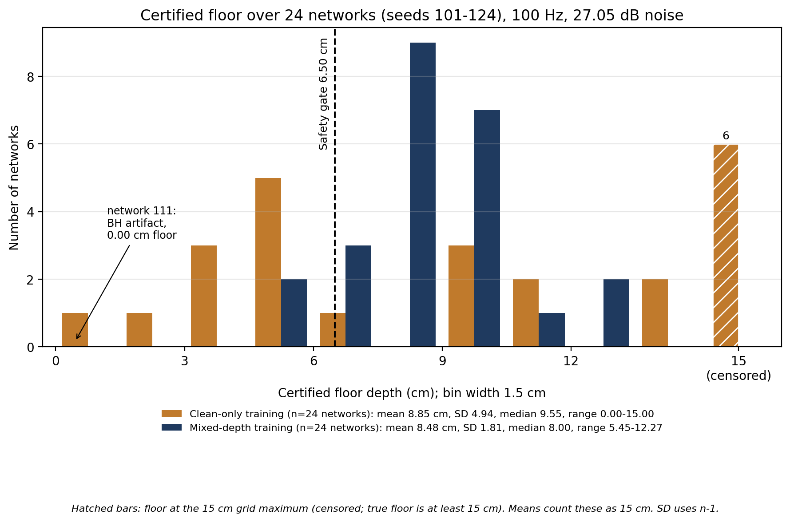

*Floor distribution under two training regimes, configuration A (Log 37).*

**Headline results.**

| Configuration and logs | Simulator and training | Depth-reliability floor | Depth gate |
|---|---|---|---|
| A · Logs 1 to 39 | Earlier idealised simulator, 60 epochs, 200 controls, 23 depths to 15 cm | 8.48 ± 1.81 cm (24 seeds) | 6.50 cm |
| B · Logs 40 to 43 | Rebuilt simulator, 200-epoch CNN on 24 networks, 719 controls, 36 depths to 20 cm | 13.86 cm (SD 1.11) | 12.27 cm (10th percentile of the 24 floors) |
| B · Logs 41 and 43 | Same simulator, 60 epochs, 24 networks | 9.35 cm (SD 3.65) | 6.08 cm |

**How to read the three floors.** The 200-epoch configuration B floor of 13.86 cm is the figure for the rebuilt simulator. The 60-epoch floor of 9.35 cm and the configuration A floor of 8.48 cm are kept because the floor depends on the simulator and on the training budget (Logs 41 and 43), and the numbers are not averaged together.

The two configurations are never combined: they are different simulators, and their numbers are not comparable. Configuration A uses class-anchored stiffness, no hardware effects and degradation-aware training; configuration B uses continuous stiffness inside each stage, timing error, coloured noise, random gain and viscosity from the stage label. The floor and gate of configuration A are from Logs 20 and 25, those of configuration B from Logs 41 and 43. Every table in the logs says which configuration and which training budget it belongs to.

**Five-minute path.** Log 20 (the certified floor), Log 25 (the self-audit and the 6.50 cm gate), Log 32 (which class collapses into which) and Log 36 (the phantom controls). The full reading paths are under "How to read the logs".

**What the record contains.**

- **Logs.** 43 logs: Logs 1 to 39 for configuration A and Logs 40 to 43 for configuration B (Logs 1 to 43).
- **Seeds and networks.** 24 seeds in configuration A, with a floor of 8.48 ± 1.81 cm (Logs 20 and 25), and 24 networks in configuration B, with a floor of 13.86 cm (SD 1.11) at 200 epochs (Log 43).
- **Shuffled-label controls.** 200 per test in configuration A (Logs 13 and 28) and 719 per test in configuration B (Logs 41 and 43).
- **Robustness.** A 19-condition battery on seeds 101 to 104 (Log 28), the same battery on seeds 105 to 108 (Log 30), and 13 retrained sensitivity conditions on eight networks (Log 38), all configuration A.
- **Model families.** A CNN, a random forest and ResNet1D, with permutation-certified floors in configuration B (Log 41); the random forest and ResNet1D floors are also in configuration A (Logs 26 and 27).
- **Shipped files.** 166 Python scripts and 86 PNG figures; the final figure set is described in Log 37.
- **Bugs and corrections kept.** Two bugs in Log 11, two negative-control catches in Log 12, a safety-gate error in Log 25, two corrections in Log 35 (the progression figure and two numbers in Log 22) and a viscosity lookup defect in Log 39 that changes no floor of Logs 1 to 38.

**How the result was checked.**

- **Statistical.** Shuffled-label controls with Benjamini-Hochberg correction (Logs 12 and 13), grouped splits and the Nadeau-Bengio correction (Logs 25 and 34).
- **Robustness.** A 19-condition battery on eight networks (Logs 28 to 31), 13 retrained sensitivity conditions on eight networks (Log 38), a sweep of the cirrhosis viscosity (Log 39), and the training budget and timing error in configuration B (Log 43). A pure-noise probe is in Log 28.
- **Other model families.** Random forest and ResNet1D floors (Logs 26, 27 and 41).
- **Representation and confidence.** A frozen linear probe at 27.05 dB (Log 33); calibration and attribution on the configuration B networks (Log 42).

**Scope.** The results are established in simulation, with a check on real phantom data whose reach is set out in Log 36; a wearable device is the next stage and is not built here. The full list is under "Open items and limitations".

**How the record is organised.** The logs follow the order of the work: Logs 1 to 25 in the order of discovery, then Logs 26 to 38 and Log 39 (configuration A) and Logs 40 to 43 (configuration B). Logs 26 to 43 were written up afterwards from the saved files. The phases table under How to read the logs groups them by stage of the work.


<details>
<summary>Why this matters: the motivation and where the work leads</summary>

Passive acoustic elastography — sensing tissue mechanical properties from 
sound alone, with no external ultrasound pulse — is an appealing direction 
for continuous, low-cost, wearable organ monitoring, precisely because it 
needs no active transducer. But before any device can be built around that 
idea, a prior question has to be answered honestly: at what depth, under 
what noise conditions, does passive acoustic sensing actually retain enough 
signal to distinguish tissue states at all? That is the question this 
repository answers, with a certified number and disclosed limitations 
rather than an assumed one.

This work is intended as a documented technical foundation for future 
engineering, including SOMA (Sonar Organ Monitoring Architecture) — a 
planned wearable expansion of this research direction. This repository 
does not build, test, or validate SOMA as a device; it establishes the 
reliability boundary that any such device would need to design around. 
Script, file, and internal log naming throughout this repository retain 
the "SOMA" working title from earlier development stages, for continuity 
with the project's own history.

</details>

<a id="research-map"></a>

<details>
<summary>Research map: one box per step, check, correction or dead end across Logs 1 to 43, with a node-to-log table</summary>


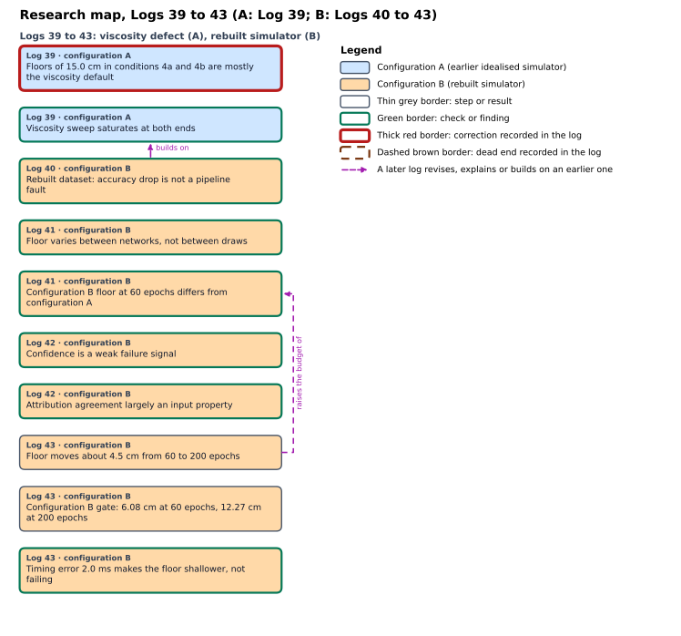

Each box is one step, check, correction or dead end taken from the logs and carries its log number; blue boxes are configuration A (earlier idealised simulator, Logs 1 to 39) and orange boxes are configuration B (rebuilt simulator, Logs 40 to 43), and the two are never combined. Corrections and dead ends are marked only where the log itself records them as such.

**Legend.** Thin grey border: step or result. Green border: check or finding. Thick red border: correction recorded in the log. Dashed brown border: dead end recorded in the log. Grey arrow: next step in the order the work was done (Logs 1 to 25; Logs 26 to 38 were written up afterwards from the saved files and have no sequence arrows). Purple dashed arrow: a later log revises, explains or builds on an earlier one.

#### Node-to-log table

| Node | Log | Configuration | Category | Label |
|---|---|---|---|---|
| N01 | [Log 01](#log-01-algorithmic-windowing--constraint-driven-design) | A | step or result | Sliding window with 50% overlap for a RAM-limited device |
| N02 | [Log 02](#log-02-grounding-the-signal-in-real-physics) | A | step or result | Stiffness-to-arrival-time chain checked end to end |
| N03 | [Log 03](#log-03-modeling-real-world-attenuation) | A | step or result | Kelvin-Voigt viscoelastic attenuation added |
| N04 | [Log 04](#log-04-building-and-debugging-the-baseline-classifier) | A | correction | Baseline classifier: a real bug found and fixed |
| N05 | [Log 04](#log-04-building-and-debugging-the-baseline-classifier) | A | correction | Second fix: feature scaling |
| N06 | [Log 05](#log-05-cross-validation--from-one-number-to-a-confidence-range) | A | step or result | Cross-validation replaces one split |
| N07 | [Log 06](#log-06-viscosity-sensitivity--stress-testing-the-attenuation-finding) | A | check or finding | Signal falls to about 10% within 1 to 4 cm for the viscosity values tested |
| N08 | [Log 07](#log-07-basic-1d-cnn--beating-the-hand-picked-features) | A | correction | CNN: a real and subtle bug |
| N09 | [Log 08](#log-08-resnet1d--professional-architecture-and-training-discipline) | A | step or result | ResNet1D with validation-driven stopping |
| N10 | [Log 09](#log-09-grad-cam--does-the-cnn-see-what-the-physics-predicts) | A | check or finding | Grad-CAM anomaly checked, left unexplained |
| N11 | [Log 10](#log-10-joint-uncertainty-propagation--a-correction-along-the-way) | A | correction | Correction made before writing any code |
| N12 | [Log 11](#log-11-statistical-significance--two-real-bugs-and-an-honest-non-result) | A | correction | Validation split silently broken |
| N13 | [Log 11](#log-11-statistical-significance--two-real-bugs-and-an-honest-non-result) | A | correction | Second collapse in 2 of 5 folds |
| N14 | [Log 12](#log-12-stage-4--the-baseline-sweep-and-two-real-negative-control-catches) | A | correction | A negative control exposed a permutation-testing limit; fixed with 200 shuffles |
| N15 | [Log 13](#log-13-stage-4--the-cnn-sweep-and-the-real-floor) | A | step or result | Certified CNN floors by frequency (original noise model) |
| N16 | [Log 14](#log-14-stage-4--resolving-20hz-and-the-t-sne-anomaly) | A | check or finding | 20 Hz shows no floor in any clinical depth range |
| N17 | [Log 14](#log-14-stage-4--resolving-20hz-and-the-t-sne-anomaly) | A | check or finding | At the certified floor every healthy sample is called cirrhosis |
| N18 | [Log 15](#log-15-chasing-the-t-sne-anomaly--degradation-aware-training) | A | step or result | Degradation-aware training moves the floor from 5.45 to 8.18 cm (original noise model) |
| N19 | [Log 16](#log-16-calibration--does-the-model-know-what-it-doesnt-know) | A | check or finding | Calibration: badly miscalibrated, with a pattern |
| N20 | [Log 17](#log-17-power-law-attenuation--stress-testing-the-kelvin-voigt-assumption) | A | check or finding | Power-law attenuation tested against the certified CNN |
| N21 | [Log 18](#log-18-parameter-provenance-audit--closing-the-citation-gaps) | A | correction | Gap 1: noise floor at the wrong frequency and sensor |
| N22 | [Log 18](#log-18-parameter-provenance-audit--closing-the-citation-gaps) | A | correction | Gap 4: depth grid too coarse |
| N23 | [Log 19](#log-19-re-certifying-stage-4-under-the-corrected-noise-model) | A | step or result | Stage 4 recertified under the corrected noise model |
| N24 | [Log 20](#log-20-stability-testing-the-degradation-aware-floor-across-seeds) | A | step or result | 24-seed sweep: 8.48 cm +/- 1.81 cm |
| N25 | [Log 21](#log-21-pre-writing-verification--seed-provenance-calibration-status-and-ets-montreal-external-validation) | A | check or finding | Seed provenance rechecked against the files |
| N26 | [Log 21](#log-21-pre-writing-verification--seed-provenance-calibration-status-and-ets-montreal-external-validation) | A | check or finding | Real phantom data: not evidence of hard-versus-soft discrimination |
| N27 | [Log 22](#log-22-cirrhosis-viscosity-sensitivity--testing-the-borrowed-magnitude) | A | check or finding | Cirrhosis viscosity: the finding breaks outside the relevant range |
| N28 | [Log 23](#log-23-calibration-recalibration--four-methods-one-root-cause-a-scoped-fix) | A | dead end | First attempt to reproduce the certified model abandoned |
| N29 | [Log 23](#log-23-calibration-recalibration--four-methods-one-root-cause-a-scoped-fix) | A | step or result | Recalibration: root cause found |
| N30 | [Log 24](#log-24-sensor-noise-robustness--stress-testing-the-snr-citations-own-corroborating-range) | A | check or finding | Noise robustness: the floor holds, near monotonic |
| N31 | [Log 25](#log-25-a-full-self-audit--catching-a-safety-gate-error-fixing-hidden-leakage-and-finding-a-sharper-result) | A | correction | Safety gate statistic was wrong |
| N32 | [Log 25](#log-25-a-full-self-audit--catching-a-safety-gate-error-fixing-hidden-leakage-and-finding-a-sharper-result) | A | correction | Train/test leakage in two places |
| N33 | [Log 25](#log-25-a-full-self-audit--catching-a-safety-gate-error-fixing-hidden-leakage-and-finding-a-sharper-result) | A | correction | Kelvin-Voigt used outside its validity |
| N34 | [Log 26](#log-26-methodology-record-consolidating-the-audit-trail) | A | step or result | Audit work indexed by folder |
| N35 | [Log 27](#log-27-random-forest-at-24-seeds--is-the-depth-floor-a-property-of-the-data-or-of-the-cnn) | A | check or finding | Random forest at 24 seeds: floor depends on the model |
| N36 | [Log 28](#log-28-a-19-condition-robustness-battery-on-seeds-101104) | A | check or finding | 19-condition robustness battery |
| N37 | [Log 29](#log-29-a-biased-amplitude-gain-and-the-corrected-rerun) | A | correction | Biased amplitude gain, corrected rerun |
| N38 | [Log 30](#log-30-replicating-the-battery-on-seeds-105108-and-seed-108s-sign-flip) | A | check or finding | Battery replicated on seeds 105 to 108 |
| N39 | [Log 31](#log-31-is-the-shallowing-of-seeds-103-and-104-at-26-viscosity-a-collapse) | A | check or finding | 2.6x viscosity shallowing is a few marginal depths |
| N40 | [Log 32](#log-32-which-class-collapses-into-which) | A | correction | Collapse direction revised: not always healthy into cirrhosis |
| N41 | [Log 33](#log-33-the-frozen-probe-at-the-corrected-noise-level) | A | check or finding | Frozen probe at the corrected noise level |
| N42 | [Log 34](#log-34-the-baselines-under-the-nadeau-bengio-correction) | A | check or finding | Baselines under the Nadeau-Bengio correction |
| N43 | [Log 35](#log-35-the-corrected-progression-figure-and-an-erratum-in-log-22) | A | correction | Progression figure redrawn; erratum in Log 22 |
| N44 | [Log 36](#log-36-control-variants-for-the-ets-montreal-phantom-result) | A | check or finding | Phantom controls: the depth band explains nearly all of the result |
| N45 | [Log 37](#log-37-the-final-figure-set-and-a-note-on-the-logit-gap-script) | A | check or finding | Clean-trained against mixed-depth floor spread |
| N46 | [Log 38](#log-38-sensitivity-sweeps-on-eight-networks) | A | check or finding | Sensitivity sweeps on eight networks |
| N47 | [Log 39](#log-39-the-viscosity-lookup-defect-and-a-sweep-of-the-cirrhosis-viscosity) | A | correction | Floors of 15.0 cm in conditions 4a and 4b are mostly the viscosity default |
| N48 | [Log 39](#log-39-the-viscosity-lookup-defect-and-a-sweep-of-the-cirrhosis-viscosity) | A | check or finding | Viscosity sweep saturates at both ends |
| N49 | [Log 40](#log-40-a-rebuilt-dataset-and-what-lowered-the-accuracy) | B | check or finding | Rebuilt dataset: accuracy drop is not a pipeline fault |
| N50 | [Log 41](#log-41-permutation-floors-for-three-model-families-on-the-rebuilt-dataset) | B | check or finding | Floor varies between networks, not between draws |
| N51 | [Log 41](#log-41-permutation-floors-for-three-model-families-on-the-rebuilt-dataset) | B | check or finding | Configuration B floor at 60 epochs differs from configuration A |
| N52 | [Log 42](#log-42-calibration-the-logit-gap-and-attribution-on-the-24-networks-of-configuration-b) | B | check or finding | Confidence is a weak failure signal |
| N53 | [Log 42](#log-42-calibration-the-logit-gap-and-attribution-on-the-24-networks-of-configuration-b) | B | check or finding | Attribution agreement largely an input property |
| N54 | [Log 43](#log-43-the-training-budget-moves-the-floor-200-epochs-on-24-networks-of-configuration-b) | B | step or result | Floor moves about 4.5 cm from 60 to 200 epochs |
| N55 | [Log 43](#log-43-the-training-budget-moves-the-floor-200-epochs-on-24-networks-of-configuration-b) | B | step or result | Configuration B gate: 6.08 cm at 60 epochs, 12.27 cm at 200 epochs |
| N56 | [Log 43](#log-43-the-training-budget-moves-the-floor-200-epochs-on-24-networks-of-configuration-b) | B | check or finding | Timing error 2.0 ms makes the floor shallower, not failing |

The sentence in the log that supports each node is in [`outputs/research_map/map_nodes.csv`](outputs/research_map/map_nodes.csv), and the arrows are in [`outputs/research_map/map_edges.csv`](outputs/research_map/map_edges.csv); the images are redrawn by `outputs/research_map/build_map.py`.

</details>

<a id="how-to-read-the-logs"></a>

<details>
<summary>How to read the logs: reading paths, how the logs are ordered, and which log answers which question</summary>

#### Conventions

**Five-minute path:** the At a glance block above, then Log 20 (the certified floor), Log 25 (the self-audit and the 6.50 cm gate), Log 32 (which class collapses into which) and Log 36 (the phantom controls).

**Configuration B path:** Log 39 (the viscosity lookup defect), Log 40 (the rebuilt dataset), Log 41 (floors of three model families), Log 43 (the training budget) and, for confidence and attribution, Log 42.

**Full path:** Logs 1 to 43 in order. The logs are numbered in the order of the work. Each log opens with an approximate date of execution, taken from the author's notebook. Logs 26 to 43 were written up afterwards from the saved files, and each says so.

#### Phases of the work

| Phase | Logs | Approximate dates | What happened |
|---|---|---|---|
| Phase 1 | Logs 1 to 14 | 4 April – 24 May 2026 | Foundations: from the first signal model to the Stage 4 floor, with a pulse-detection bug fixed in Log 4, a window-alignment bug in Log 7, a correction in Log 10, two bugs in Log 11 and two negative-control catches in Log 12. |
| Phase 2 | Logs 15 to 26 | 3 June – 9 August 2026 | High momentum and audit interruptions: degradation-aware training, calibration, the parameter provenance audit, re-certification under the corrected noise model and, in Log 25, the self-audit that caught a safety-gate error and fixed hidden leakage, then the consolidated audit trail of Log 26. |
| Phase 3 | Logs 27 to 31 | 12 – 29 August 2026 | A slower stretch with minor bug fixes: the random forest at 24 seeds, a 19-condition robustness battery on seeds 101 to 104, a corrected rerun after a biased amplitude gain (Log 29) and a replication on seeds 105 to 108. |
| Phase 4 | Logs 32 to 43 | 4 September – 10 October 2026 | The final stretch: audit follow-up and configuration B, with the Log 22 erratum recorded in Log 35, a viscosity lookup defect in Log 39 that changes no floor of Logs 1 to 38, and the rebuilt dataset and floors of three model families in Logs 40 to 43. |

#### Which log answers which question: Logs 1 to 25

The answers are taken from the logs; "..." joins quoted pieces of the same log.

| Group | Log | Question | Answer in the log |
|---|---|---|---|
| Signal and attenuation | [01](#log-01-algorithmic-windowing--constraint-driven-design) | How can a continuous stream be handled on a device with little memory? | so I couldn't process a continuous, hours-long acoustic health stream all at once ... with a 50% temporal overlap |
| Signal and attenuation | [02](#log-02-grounding-the-signal-in-real-physics) | Does the signal now encode tissue stiffness? | confirming the stiffness-to-arrival-time chain computes correctly end to end |
| Signal and attenuation | [03](#log-03-modeling-real-world-attenuation) | How much of the signal survives at depth? | At 8cm depth, 100Hz, healthy tissue ... roughly 1% of the signal survives, a near-total collapse well within the depth range organs actually sit at |
| Baseline classifier | [04](#log-04-building-and-debugging-the-baseline-classifier) | Can the clean signal be told apart by class? | 70.37% accuracy ... on clean, noise-free signals |
| Baseline classifier | [05](#log-05-cross-validation--from-one-number-to-a-confidence-range) | Is the single-split accuracy representative? | every individual fold falls within a tight, sensible range |
| Assumption stress tests | [06](#log-06-viscosity-sensitivity--stress-testing-the-attenuation-finding) | How much does the attenuation finding depend on liver viscosity? | The critical depth swings by more than 3.5× across the plausible viscosity range |
| Learned models and tests | [07](#log-07-basic-1d-cnn--beating-the-hand-picked-features) | Does the CNN trained on the raw window learn or memorise? | a real sign of genuine learning rather than memorization |
| Learned models and tests | [08](#log-08-resnet1d--professional-architecture-and-training-discipline) | How well does the ResNet1D separate the classes? | Healthy tissue reached a perfect AUC of 1.000 ... cirrhosis and significant fibrosis scored 0.966 and 0.954 respectively |
| Learned models and tests | [09](#log-09-grad-cam--does-the-cnn-see-what-the-physics-predicts) | Does the network use the part of the window the physics predicts? | cirrhosis matched exactly (0 samples apart), significant fibrosis was close (3 samples), healthy showed a 5-sample gap ... A 3-5 sample "difference" isn't a disagreement |
| Assumption stress tests | [10](#log-10-joint-uncertainty-propagation--a-correction-along-the-way) | Do viscosity and density interact? | moving through the full density range within a fixed viscosity barely shifts the outcome |
| Learned models and tests | [11](#log-11-statistical-significance--two-real-bugs-and-an-honest-non-result) | Are the differences between the three methods real? | claiming the professionally-built ResNet1D is meaningfully better than the basic CNN is not something this data supports |
| Floor characterisation | [12](#log-12-stage-4--the-baseline-sweep-and-two-real-negative-control-catches) | Where does classification collapse for the baseline? | Even after both fixes, the baseline classifier's accuracy collapsed to ... chance level by just 0.52cm depth |
| Floor characterisation | [13](#log-13-stage-4--the-cnn-sweep-and-the-real-floor) | How does the CNN compare with the baseline across depth and frequency (original noise model)? | the CNN survives roughly 8x deeper than the hand-picked baseline |
| Floor characterisation | [14](#log-14-stage-4--resolving-20hz-and-the-t-sne-anomaly) | Does 20 Hz have a floor? | 20Hz shows no floor within any clinically meaningful depth range |
| Floor characterisation | [15](#log-15-chasing-the-t-sne-anomaly--degradation-aware-training) | Is the early collapse caused by training on clean signals only (original noise model)? | the floor moved from 5.45cm to 8.18cm — confirming the hypothesis directly |
| Calibration | [16](#log-16-calibration--does-the-model-know-what-it-doesnt-know) | Does the model know what it does not know? | The result: badly miscalibrated, and the miscalibration follows a clear pattern |
| Assumption stress tests | [17](#log-17-power-law-attenuation--stress-testing-the-kelvin-voigt-assumption) | Does the finding depend on the attenuation law? | Under the power-law model, accuracy never dropped |
| Provenance | [18](#log-18-parameter-provenance-audit--closing-the-citation-gaps) | Were the cited parameters right? | Gap 1: the sensor noise floor was measured at the wrong frequency, for the wrong kind of sensor ... Gap 2: the stiffness-class citation didn't actually match the numbers it was attached to ... Gap 3: I couldn't actually verify the claim that viscosity doesn't vary by disease stage ... Gap 4: my Stage 4 depth grid was too coarse to support the precision I was reporting |
| Floor characterisation | [19](#log-19-re-certifying-stage-4-under-the-corrected-noise-model) | Do the headline claims survive the corrected noise model? | did not overturn my core findings |
| Floor characterisation | [20](#log-20-stability-testing-the-degradation-aware-floor-across-seeds) | Is the floor stable across seeds? | Reportable result: 8.48cm +/- 1.81cm (n=24 seeds) |
| Provenance | [21](#log-21-pre-writing-verification--seed-provenance-calibration-status-and-ets-montreal-external-validation) | Do the seeds, the calibration status and the phantom check match the files? | Item 1: seed provenance, re-checked against the actual files ... Calibration recalibration remains unimplemented ... so it is not evidence of hard-versus-soft discrimination |
| Assumption stress tests | [22](#log-22-cirrhosis-viscosity-sensitivity--testing-the-borrowed-magnitude) | Does the finding survive a different cirrhosis viscosity? | The result: the finding breaks, but well outside where it matters |
| Calibration | [23](#log-23-calibration-recalibration--four-methods-one-root-cause-a-scoped-fix) | Can the miscalibration be repaired? | even the best-case version of this fix is a partial correction, not a solved problem |
| Assumption stress tests | [24](#log-24-sensor-noise-robustness--stress-testing-the-snr-citations-own-corroborating-range) | Does the floor hold when sensor noise gets worse? | The result: the floor holds, and degrades close to monotonically |
| Self-audit | [25](#log-25-a-full-self-audit--catching-a-safety-gate-error-fixing-hidden-leakage-and-finding-a-sharper-result) | What did the full self-audit find? | The safety gate was wrong, and it would have looked correct ... Train/test leakage was hiding in two places, not one ... The Kelvin-Voigt model was being trusted outside where it's actually valid |

#### Which log answers which question: Logs 26 to 43

The answers are taken from the logs; "..." joins quoted pieces of the same log.

| Group | Log | Question | Answer in the log |
|---|---|---|---|
| Overview | [26](#log-26-methodology-record-consolidating-the-audit-trail) | What audit work had been done, and where is it? | The audit folder is now split by experiment, each folder has a README, and the methodology index maps each folder to its note. |
| Model-family and robustness runs | [27](#log-27-random-forest-at-24-seeds--is-the-depth-floor-a-property-of-the-data-or-of-the-cnn) | Is the floor set by the signal and the degradation model, or by the CNN? | At these settings the random forest certifies a floor about 4 cm deeper than the CNN at the median, so the floor is not fixed by the signal alone: it depends on the model. |
| Model-family and robustness runs | [28](#log-28-a-19-condition-robustness-battery-on-seeds-101104) | How far does the floor move when simulator assumptions change? | SNR: shallower as the noise rises; 0 dB gives about −4.3 cm. Geometric spreading: p = 0.5 about −2.1 cm, p = 1.0 about −4.0 cm. |
| Model-family and robustness runs | [29](#log-29-a-biased-amplitude-gain-and-the-corrected-rerun) | Why did amplitude randomization deepen the floor in all four seeds? | the gain draw was then checked and its mean was 1.082, not 1.0, so the signal was scaled up by about 8% on average. |
| Model-family and robustness runs | [30](#log-30-replicating-the-battery-on-seeds-105108-and-seed-108s-sign-flip) | Does the battery replicate on four more seeds? | The direction matches seeds 101 to 104 for most conditions. |
| Model-family and robustness runs | [31](#log-31-is-the-shallowing-of-seeds-103-and-104-at-26-viscosity-a-collapse) | Is the shallowing at 2.6× viscosity a collapse? | Nothing is recorded as done because of this result. |
| Corrections | [32](#log-32-which-class-collapses-into-which) | Do the two collapse patterns contradict each other? | The direction of the failure therefore depends on the network, and one network's confusion matrix is not a basis for a general statement. |
| Corrections | [33](#log-33-the-frozen-probe-at-the-corrected-noise-level) | Does the representation lose the classes at the same depth as the output? | At 27.05 dB the probe scores 75.8% at 8.18 cm and 77.1% at 8.00 cm, about 43 points above chance, where the deployed classifier is at chance. |
| Corrections | [34](#log-34-the-baselines-under-the-nadeau-bengio-correction) | How do the baselines compare under the Nadeau-Bengio correction? | Mean accuracy over the 75 folds: logistic baseline 70.94%, CNN 85.28%, ResNet1D 90.11%, SVM 90.50%, random forest 91.72%, GRU 24.33%. |
| Final checks | [35](#log-35-the-corrected-progression-figure-and-an-erratum-in-log-22) | Do the progression figure and Log 22 agree with the final state of the work? | I decided it should be regenerated with the corrected progression, 0.00, 4.30 and 8.48 cm, and not the old 0.52, 5.45 and 8.18 cm. |
| Final checks | [36](#log-36-control-variants-for-the-ets-montreal-phantom-result) | Does the phantom accuracy come from the inclusion, the depth band or lateral position? | V2 reaches almost the same accuracy with no inclusion in either class, so the depth band alone explains nearly all of the original result. |
| Final checks | [37](#log-37-the-final-figure-set-and-a-note-on-the-logit-gap-script) | Can every figure in the final set be redrawn from files in the repository? | A figure may be used only if it is an original output or is produced by a script reading saved files, never from numbers typed by hand. |
| Sensitivity runs | [38](#log-38-sensitivity-sweeps-on-eight-networks) | How far does the floor move when the build-time choices change, with the networks retrained for each? | The floor falls as timing jitter rises, with 7 of 8 seeds at 0.00 cm at 1 sample; it rises with tracking distance (3.44, 8.44, 10.06 and 10.91 cm at 5, 10, 15 and 20 mm) |
| Configuration A checks | [39](#log-39-the-viscosity-lookup-defect-and-a-sweep-of-the-cirrhosis-viscosity) | Why were some battery floors pinned at 15.0 cm or 0.00 cm, and how does the floor depend on the cirrhosis viscosity (configuration A)? | A floor of 15.0 cm in the battery conditions 4a and 4b is mostly the viscosity default, not a robustness of the classifier. |
| Configuration B | [40](#log-40-a-rebuilt-dataset-and-what-lowered-the-accuracy) | What lowered the accuracy on the rebuilt dataset (configuration B, accuracies only)? | The drop in CNN accuracy at 0 cm is not a fault in the pipeline. |
| Configuration B | [41](#log-41-permutation-floors-for-three-model-families-on-the-rebuilt-dataset) | Where does the variance of the floor come from (configuration B, 60 epochs)? | The floor varies mainly between networks and little between repeated permutation draws. |
| Configuration B | [42](#log-42-calibration-the-logit-gap-and-attribution-on-the-24-networks-of-configuration-b) | Does the confidence of a network signal failure, and do attribution maps show more than the input (configuration B, 60 epochs)? | Confidence falls with depth but is a weak signal of failure at every depth. |
| Configuration B | [43](#log-43-the-training-budget-moves-the-floor-200-epochs-on-24-networks-of-configuration-b) | How does the training budget change the floor (configuration B)? | The floor of configuration B moves by about 4.5 cm when the training budget goes from 60 to 200 epochs |

Log 35 also records the redraw of the progression figure.

</details>

<a id="technical-details"></a>

<details>
<summary>Technical details: repository map, claim-to-evidence table and how to reproduce the figures</summary>

#### Quick start

Run on macOS with Python 3.10.0 in a fresh virtual environment; The versions in `requirements.txt` are those of the local environment the scripts ran in; `docs/environment.md` lists the other environments used for some runs and figures. They are torch 2.14.0, scipy 1.15.3, scikit-learn 1.7.2, matplotlib 3.10.9, numpy 2.2.6 and pandas 2.3.3. Creating the environment, installing and running the script took about one minute.

```bash
git clone <repository URL>
cd <repository folder>
python -m venv .venv
source .venv/bin/activate
pip install -r requirements.txt
python Source/make_fig02_measurement_chain.py
```

The script prints the constants of the measurement chain and writes `outputs/figures_final/fig02_measurement_chain.png`; `outputs/figures_final/fig02_measurement_chain_values.csv` is regenerated with the same values. The regenerated image has the same pixels as the shipped one, and its embedded metadata records the matplotlib version, so the file bytes differ when the version differs.

<a id="repository-map"></a>

<details>
<summary>Repository map: where each folder and file lives</summary>

| Folder | Contents |
|---|---|
| `Source/` | All scripts of the pipeline and the figure scripts (72 files); `Source/logs/` holds saved result CSVs and run logs, `Source/archive/` holds earlier scripts. |
| `outputs/` | Figures and exported data: `stage1/` to `stage4/` (stage figures; `stage4/data/` holds the calibration and progression CSVs), `figures_earlier/` (earlier figure set), `figures_final/` (the final set, Log 37), `external_validation_controls/` (phantom controls, Log 36), `post_audit/` (configuration B and the viscosity lookup check, Logs 39 to 43, below). |
| `outputs/research_map/` | The two research-map images (SVG and PNG), the node and edge tables behind them and the script that redraws them (`python3 build_map.py <output folder>`). |
| `outputs/post_audit/` | Data, scripts and per-seed results behind Logs 39 to 43: `simulator_audit/` (Log 39, configuration A), `rebuilt_dataset/` (Log 40), `family_floors/` (Log 41), `calibration_attribution/` (Log 42), `training_budget/` (Log 43; `python3 verify.py` in that folder recomputes the 200-epoch headline and the timing-error result from the saved permutation counts). Scripts import modules of `Source/` and of the original working tree that are not all in this repository; each log lists what is missing. |
| `audit_fixes/` | Work of the audit, one folder per question (index in `audit_fixes/README.md`): |
| `audit_fixes/lane1/` | Weak-damping attenuation against the exact solution. |
| `audit_fixes/lane2/`, `audit_fixes/q6_bh_fdr_families/` | Re-checks of p-values, effect sizes and the BH family size. |
| `audit_fixes/lane3/` | Fact-checks of nine claims about the code and logs. |
| `audit_fixes/lane4/` | SVM, random forest and GRU baselines (Log 34). |
| `audit_fixes/lane5/` | Per-class certification over 24 seeds; `clean_trained_sweep/` and `balanced_accuracy_retry/` hold the confusion matrices (Log 32). |
| `audit_fixes/lane6/` | Beat-offset mechanism. |
| `audit_fixes/lane7/` | ResNet1D against the CNN. |
| `audit_fixes/lane8/` | Random forest pre-registration and harness (Log 27). |
| `audit_fixes/cloud/` | Random forest and robustness runs: `rf/` (24-seed random forest), `battery/` (19-condition battery, seeds 101 to 108), `spreadcheck/`, `vischeck/`, `smoke/`, `extract/`. |
| `audit_fixes/proxy_sweeps/` | Pure-noise probe of the random forest and ResNet1D (eight networks each, not certified). |
| `docs/methodology/` | Numbered methodology notes 01 to 13 and the index `docs/methodology/README.md`. |
| `docs/` | `docs/provenance.md` (how the files relate to the working files they came from) and `docs/environment.md` (the environments used for the runs and figures). |
| `tools/` | `check_links.py`, which checks documentation links and `audit_fixes` path strings. |

`Source/constants.py` is the single source for the repeated sensor, seed, frequency, depth-grid and gate values. Regenerated outputs were byte-identical before and after the values were centralised: the `Source/power_law_sensitivity.py` CSV and the `calibration_analysis.py` reliability diagram, in the original environment (matplotlib 3.10.9, see `docs/environment.md`); in other matplotlib versions the reliability diagram may differ by a few pixels of width.

`Source/attenuation_model.py` carries the `eta_by_stage` flag used by the harness of Log 39; the flag is off by default, so existing results are unchanged. The parameter ledger, [`outputs/post_audit/simulator_audit/parameter_ledger.csv`](outputs/post_audit/simulator_audit/parameter_ledger.csv), lists 42 constants with the file and line, the source, the unit conversion and a status: 6 verified, 22 assumed and 14 unsourced. Cells that named a source file not in this repository are blank.

</details>

<a id="claim-to-evidence-table"></a>

<details>
<summary>Claim-to-evidence table: the result file and script behind each headline claim</summary>

| Claim | Configuration | Log | Result file | Script |
|---|---|---|---|---|
| Certified floor, mean 8.48 cm, SD 1.81 cm over 24 seeds | A | 20 | `Source/logs/degradation_aware_final_results.csv` (`naive_floor_cm`) | `Source/degradation_aware_final_sweep.py` |
| Gate at 6.50 cm, the 10th percentile of the 24 floors | A | 25 | `Source/logs/gate_statistic_verification.csv` | `Source/regenerate_gate_statistic_verification.py` |
| Clean-only training: mean floor 8.85 cm, SD 4.94 cm, 11 of 24 below 6.50 cm; mixed depth: 8.48 cm, SD 1.81 cm, 2 of 24 | A | 37 | `audit_fixes/lane5/clean_trained_sweep/clean_sweep/logs/lane5_clean_per_class_results.csv`; `Source/logs/degradation_aware_final_results.csv` | `audit_fixes/lane5/clean_trained_sweep/lane5_harness_clean.py`; `Source/make_final_fig07_floors.py` |
| Random forest median floor 12.27 cm (24 seeds) | A | 27 | `audit_fixes/cloud/rf/results/rf_floors_101-112.csv`; `audit_fixes/cloud/rf/results/rf_floors_113-124.csv` | `audit_fixes/cloud/rf/run_rf_seeds.py` |
| ResNet1D median floor 10.91 cm against 8.00 cm for the CNN | A | 26 | `Source/logs/degradation_aware_resnet_final_results.csv` | `Source/degradation_aware_resnet_final_sweep.py` |
| Phantom controls: 96.78% original, 95.99% depth only, 59.10% inclusion against background at equal depth | A (real phantom data, no simulator) | 36 | `outputs/external_validation_controls/ets_montreal_controls_results.json` | `Source/ets_controls_run_variants.py` |
| Frozen probe at 27.05 dB: 75.8% at 8.18 cm, 77.1% at 8.00 cm | A | 33 | `Source/logs/frozen_embedding_linear_probe_27p05dB_8p18cm.csv`; `Source/logs/frozen_embedding_linear_probe_27p05dB_8p0cm.csv` | `Source/frozen_embedding_linear_probe_27p05dB.py` |
| Collapse direction, degradation-aware networks: healthy is the sink (healthy called cirrhosis 1.8% at 5.45 cm, 4.8% at 6.82 cm) | A | 32 | `audit_fixes/lane5/balanced_accuracy_retry/perclass_balacc/confusion_matrices/` | `Source/make_fig10_pooled_confusion.py` |
| Collapse direction, clean-trained networks: healthy called cirrhosis 25.8% at 5.45 cm and 32.2% at 8.18 cm | A | 32 | `audit_fixes/lane5/clean_trained_sweep/clean_sweep/pooled_confusion_summary.csv` | `Source/pool_clean_confusion.py` |
| Pure-noise default class: healthy takes 48 to 100% of pulse-free noise and the real model never predicts fibrosis | A | 28 | `audit_fixes/cloud/battery/results/noise_probe_101-104.csv`; `audit_fixes/cloud/battery/results/noise_probe_105-108.csv` | `audit_fixes/cloud/battery/seeds_101-104/harness.py` |
| Proxy floor of the baseline on eight retrained networks: mean 8.44 cm, SD 1.73, median 8.52 | A | 38 | `audit_fixes/cloud/proxy_sweeps/results/summary_by_condition.csv`; `proxy_floors_<seed>.csv` | `audit_fixes/proxy_sweeps/harness_proxy.py` |
| 600 epochs: mean at least 14.83 cm (median 15.00; 3 of 8 seeds censored) | A | 38 | same | `harness_proxy.py`, `wrappers_proxy.py` |
| Beat-time jitter: mean 5.78 cm at 0.5 sample and 0.17 cm at 1.0 sample (7 of 8 seeds at 0.00 cm) | A | 38 | same; `diagnostic_zero_floors.csv` | `wrappers_proxy.py`, `diagnose_zero_floors.py` |
| Pulse carrier: all 8 seeds censored at 15.0 cm at 50 Hz; mean 3.22 cm at 150 Hz | A | 38 | same | `wrappers_proxy.py` |
| Tracking distance: mean 3.44, 8.44, 10.06 and 10.91 cm at 5, 10, 15 and 20 mm | A | 38 | same | `wrappers_proxy.py` |
| Clean-only against mixed-depth on eight networks each: rank-sum p = 0.873, paired signed-rank p = 1.000; clean-only mean at least 8.52 cm (SD 5.64), baseline 8.44 cm (SD 1.73) | A | 38 | `summary_output.txt`; `summary_by_condition.csv` | `audit_fixes/proxy_sweeps/summarize_proxy.py` |
| Cirrhosis viscosity sweep, networks trained at 1.77 Pa·s: median floor 0.00 cm at 0.2 and 0.3 Pa·s, 15.00 cm at 0.6 to 1.0 Pa·s, 8.09 cm at 1.77 Pa·s (12 networks, 60 epochs) | A | 39 | `outputs/post_audit/simulator_audit/eta3_summary.csv` | `outputs/post_audit/simulator_audit/p1_run.py`; `outputs/post_audit/simulator_audit/p1_agg_eta3.py` |
| Viscosity lookup defect, battery conditions 4a and 4b: median floor 15.00 and 10.23 cm with the lookup, 10.91 and 10.23 cm with the stage label, 8.09 cm baseline (8 networks, 60 epochs) | A | 39 | `outputs/post_audit/simulator_audit/floor13_summary.txt` | `outputs/post_audit/simulator_audit/p1_agg_floor13.py`; `outputs/post_audit/simulator_audit/p1_run.py` |
| CNN accuracy at 0 cm: 0.650 on the rebuilt dataset (24 networks), 0.783 with class-anchored stiffness and no hardware effects (8 networks); 60 epochs, accuracies only | B | 40 | `outputs/post_audit/rebuilt_dataset/seed_records_cnn_p2_primary_v1.csv`; `outputs/post_audit/rebuilt_dataset/a0_summary.txt` | `outputs/post_audit/rebuilt_dataset/p2_run.py` |
| Floors, new rule, per-seed median of ten draws: CNN mean 9.35 cm (SD 3.65, P10 6.08), random forest 13.24 cm, ResNet1D 6.79 cm (10 networks); 60 epochs for the CNN | B | 41 | `outputs/post_audit/family_floors/cnn_floor_by_seed.csv`; `outputs/post_audit/family_floors/rf_floor_by_seed.csv`; `outputs/post_audit/family_floors/resnet_floor_by_seed.csv` | `outputs/post_audit/family_floors/p3_perm.py`; `outputs/post_audit/family_floors/p3_analyze.py` |
| Share of the floor variance between networks: 91.5% (CNN), 87.0% (random forest), 93.1% (ResNet1D); 60 epochs for the CNN | B | 41 | `outputs/post_audit/family_floors/cnn_variance_components_all.csv`; `outputs/post_audit/family_floors/rf_variance_components_all.csv`; `outputs/post_audit/family_floors/resnet_variance_components_all.csv` | `outputs/post_audit/family_floors/p3_analyze.py` |
| Confidence as a failure signal: AUROC 0.53 to 0.62 at every depth; Integrated Gradients meets the attribution rule at all five depths and Grad-CAM at none (24 networks, 60 epochs) | B | 42 | `outputs/post_audit/calibration_attribution/calib_summary_by_depth.csv`; `outputs/post_audit/calibration_attribution/attr_randinit_summary.csv` | `outputs/post_audit/calibration_attribution/p4v2_calib.py`; `outputs/post_audit/calibration_attribution/p4v3_randinit.py` |
| Floor at 200 epochs, median of three draws: mean 13.86 cm, SD 1.11 cm, P10 12.27 cm (24 networks) | B | 43 | `outputs/post_audit/training_budget/derived/floor_200_three_draws_vs_60.csv`; `outputs/post_audit/training_budget/derived/k3_200_epoch_results.md` | `outputs/post_audit/training_budget/outputs/phase3/code/stage2c_analyze.py`; `outputs/post_audit/training_budget/verify.py` |
| 200 epochs against 60 epochs: 20 networks deeper, 4 equal, none shallower (sign test p = 1.9 × 10⁻⁶) | B | 43 | `outputs/post_audit/training_budget/derived/floor_200_three_draws_vs_60.csv` | `outputs/post_audit/training_budget/outputs/phase3/code/stage2c_analyze.py` |
| Timing error at 200 epochs, half-width 2.0 ms against 1.0 ms: mean floor 12.27 against 14.15 cm (8 networks; 6 shallower, 2 equal) | B | 43 | `outputs/post_audit/training_budget/derived/jitter_pairs_200_epochs.csv` | `outputs/post_audit/training_budget/outputs/phase3/code/stage2d_analyze.py` |
| Classwise floor at 200 epochs (lowest class recall below 0.45): mean 9.33 cm against 14.09 cm overall (24 networks, one draw) | B | 43 | `outputs/post_audit/training_budget/derived/classwise_vs_overall_floor_200.csv` | none saved for this table; the classwise rule is in `outputs/post_audit/family_floors/p3_analyze.py` |

The Configuration column names the simulator of the claim: A is the earlier idealised simulator (Logs 1 to 38 and Log 39), B is the rebuilt simulator (Logs 40 to 43). Rows of the two configurations are not comparable.

</details>

<a id="reproducing-the-figures"></a>

<details>
<summary>Reproducing the figures: the script and saved inputs that redraw each figure</summary>

"In repository" means that every input file of the script is tracked. Figures 14 to 19 are configuration A (14 to 16) and configuration B (17 to 19); each script writes its PNG without a software version stamp, so reruns in the same environment give the same bytes. Retraining is not needed for any figure marked yes.

| Figure file | Script | Inputs | In repository |
|---|---|---|---|
| `fig01_beat_anchored_windows.png` | `Source/make_fig1_windowing.py` | `Source/physics_model.py` (code only) | yes |
| `fig02_measurement_chain.png`, `fig02_measurement_chain_values.csv` | `Source/make_fig02_measurement_chain.py` | constants in `Source/physics_model.py`, `Source/cnn_classifier.py`, `Source/constants.py` | yes |
| `fig03_amplitude_vs_depth.png` | `Source/plot_attenuation.py` | `Source/physics_model.py` (code only) | yes |
| `fig04_viscosity_margin.png` | `Source/cirrhosis_viscosity_sensitivity.py` | `Source/physics_model.py`, `Source/attenuation_model.py` (code only) | yes |
| `fig05_tsne_at_depth.png` | `Source/stage4_depth_diagnostics.py` | `outputs/stage4/models/stage4_cnn_model.pt`, `outputs/stage4/data/stage4_encoder.pkl` (read relative to the repository root) | yes (tracked files with the same SHA-256 as the original files) |
| `fig06_frozen_probe_vs_deployed.png` | `Source/make_fig11_corrected_probe.py` | `Source/logs/frozen_embedding_linear_probe_27p05dB_8p18cm.csv`, `Source/logs/frozen_embedding_linear_probe_27p05dB_8p0cm.csv` | yes (redrawing only; the probe itself, `Source/frozen_embedding_linear_probe_27p05dB.py`, reads `models/stage4_cnn_model.pt` and `results/stage4_encoder.pkl`, tracked as copies at `outputs/stage4/models/` and `outputs/stage4/data/`) |
| `fig07_floor_distribution.png` | `Source/make_final_fig07_floors.py` | `Source/logs/degradation_aware_final_results.csv`; `audit_fixes/lane5/clean_trained_sweep/clean_sweep/logs/lane5_clean_per_class_results.csv` | yes |
| `fig07_pooled_confusion_and_share_healthy.png` | `Source/make_final_fig07_combined.py` | `audit_fixes/lane5/balanced_accuracy_retry/perclass_balacc/confusion_matrices/`; `audit_fixes/cloud/battery/results/noise_probe_101-104.csv`, `noise_probe_105-108.csv` | yes |
| `fig08a_pooled_confusion.png` | `Source/make_fig10_pooled_confusion.py` | `audit_fixes/lane5/balanced_accuracy_retry/perclass_balacc/confusion_matrices/` | yes |
| `fig08a_pooled_confusion_2x2.png`, `fig08a_pooled_confusion_2x2_counts.csv` | `Source/make_fig08a_pooled_confusion_2x2.py` | the same confusion matrices | yes |
| `fig08b_share_predicted_healthy.png` | `Source/make_final_fig08b_share_healthy.py` | the same confusion matrices; `audit_fixes/cloud/battery/results/noise_probe_101-104.csv`, `noise_probe_105-108.csv` | yes |
| `fig09_per_class_recall.png` | `Source/make_final_fig09_perclass_recall.py` | `audit_fixes/lane5/balanced_accuracy_retry/perclass_balacc/logs/perclass_balacc_depth_detail_seed*.csv` | yes |
| `fig10_reliability_diagram.png` | `calibration_analysis.py` | `outputs/stage4/data/stage4_calibration_data_corrected.csv` | yes (the CSV was produced by `Source/degradation_aware_calibration_corrected.py`, which trains a network) |
| `fig11_logit_gap_vs_depth.png`, `fig11_logit_gap_vs_depth_values.csv` | `Source/make_fig11_logit_gap_vs_depth.py` | `outputs/stage4/data/stage4_calibration_data_corrected.csv` | yes |
| `fig12_floor_vs_cirrhosis_viscosity.png` | `Source/make_final_fig12_floor_vs_viscosity.py` | `audit_fixes/cloud/battery/results/floors_101-104.csv`, `floors_105-108.csv` | yes |
| `fig13_phantom_controls.png` | `Source/make_final_fig13_phantom_controls.py` | `outputs/external_validation_controls/ets_montreal_controls_results.json` | yes |
| `fig14_battery_floor_shifts.png`, `fig14_battery_floor_shifts_values.csv` | `Source/make_fig14_battery_floor_shifts.py` | `audit_fixes/cloud/battery/results/floors_101-104.csv` | yes |
| `fig15_per_seed_floors_by_condition.png`, `fig15_per_seed_floors_by_condition_values.csv` | `Source/make_fig15_per_seed_floors_by_condition.py` | `audit_fixes/cloud/proxy_sweeps/results/proxy_floors_101.csv` to `proxy_floors_108.csv` | yes |
| `fig16_median_floor_vs_cirrhosis_viscosity.png`, `fig16_median_floor_vs_cirrhosis_viscosity_values.csv` | `Source/make_fig16_median_floor_vs_cirrhosis_viscosity.py` | `outputs/post_audit/simulator_audit/eta3_summary.csv` | yes |
| `fig17_floors_by_model_family.png`, `fig17_floors_by_model_family_values.csv` | `Source/make_fig17_floors_by_model_family.py` | `outputs/post_audit/family_floors/cnn_floor_by_seed.csv`, `rf_floor_by_seed.csv`, `resnet_floor_by_seed.csv` | yes |
| `fig18_logit_gap_by_depth.png`, `fig18_logit_gap_by_depth_values.csv` | `Source/make_fig18_logit_gap_by_depth.py` | `outputs/post_audit/calibration_attribution/calib_by_seed_depth.csv` | yes |
| `fig19_training_budget_floors.png`, `fig19_training_budget_floors_values.csv` | `Source/make_fig19_training_budget_floors.py` | `outputs/post_audit/training_budget/derived/floor_by_budget_8_seeds.csv`, `accuracy_null_band.csv` | yes |

</details>

</details>

<a id="open-items-and-limitations"></a>

<details>
<summary>Open items and limitations</summary>

- **What this is not.** A research record, not a device. SOMA as a wearable is not built, tested or validated here. All evidence is simulated except the phantom check.
- **Real-data check.** Limited: the ETS Montreal phantom accuracy mostly reflects the axial depth band, as its control variants show (Log 36).
- **GRU result.** The GRU reached 24.33% mean accuracy; the reason has not been established (Log 34, `docs/methodology/07-lane4-baseline-architectures.md`).
- **Two logit-gap ranges.** Log 23 gives about 0.033 to 0.040 and Log 37 gives 0.038 to 0.041. The two ranges have not been reconciled, and the code behind the first was not saved (Logs 23 and 37).
- **Source of the baseline CSV.** `outputs/stage4/data/stage4_progression_baseline_corrected.csv` was exported from a result file that is not in the repository, so the baseline of the progression figure cannot be regenerated from the repository (Log 35).
- **Censoring of 15.0 cm floors.** Six clean-trained networks have a floor of 15.0 cm. The saved file does not record which of these are censored and which are observed first failures (Log 37).
- **Conditions 4a and 4b.** In these two conditions every class receives a viscosity of 0.5 Pa·s, so they do not test stiffness variation alone (Log 28).
- **Sensitivity rows.** The rows for epochs, beat-time jitter, pulse carrier, tracking distance, window length and the alternative stiffness set, and the eight-network clean-only against mixed-depth rerun, are in Log 38. All 13 conditions were completed for seeds 101 to 108, with per-seed results in `audit_fixes/cloud/proxy_sweeps/results/`, and no condition is outstanding. The floors are proxy floors, not certified floors, and no equivalence test was run (Log 38). The 24-network calibration gap is in `audit_fixes/proxy_sweeps/calibration_24_models.csv`; the weights behind it are not in the repository.
- **Seed-weight paths.** Four path strings in scripts point to weight files that are not in the repository (`tools/check_links.py` reports them); the scripts that read other files that are not shipped are listed in the next item.
- **Weights and raw outputs.** The certified model (seed 121), `outputs/stage4/models/soma_certified_model_seed121_corrected_noise.pt`, and three other weight files are shipped under `outputs/stage4/models/`: `stage4_cnn_model.pt`, `soma_calibration_corrected_model_weights.pt` and `UNVERIFIED_PRE_FIX1_soma_model_weights.pt`. The per-seed networks (`degradation_aware_seed<seed>.pt`), the ResNet1D networks in `Source/seed_weights_resnet/`, the phase 2 checkpoints under `outputs/phase2/checkpoints/`, `models/ets_path2_real_model.pt` and the raw per-run outputs (`confmat_*.npz`, `seed*_real.npz`, `controls_seed*.npz`, `detail_seed*.csv`) are not shipped. The scripts that read them need them recreated first: the per-seed network scripts (`audit_fixes/proxy_sweeps/calibration_24_models.py` and `audit_fixes/lane6/q9_seed121_beat_index_sweep.py`, `audit_fixes/lane7/eval_seed110.py`), the configuration B attribution and calibration scripts (`p4v2_calib.py`, `p4v2_attr.py`), `Source/log21_figures.py`, the battery rerun (`rerun_condition_2b.py`) and the family and viscosity aggregation scripts (`p3_analyze.py`, `p1_agg_floor13.py`, `p1_agg_eta3.py`).

</details>

---

<a id="consolidated-methodology-reference"></a>

## 📄 Consolidated Methodology Reference

For a single-file, chronological view of the working code of this project, from the earliest baseline scripts through the final certified pipeline, and of the saved results of the later logs, see [`SOMA_Consolidated_Methodology.py`](./SOMA_Consolidated_Methodology.py).

This is a reference file: by default it loads and prints already-computed results and trains nothing, so it runs in seconds; re-running any certification from scratch would take many hours. Sections 1 to 16 (configuration A) are taken from their source files, with docstrings, wrapper functions and parameters added. Sections 17 to 22 (configuration B, the rebuilt simulator) import shipped code from `outputs/post_audit/` and read the saved files there: the viscosity rule and hardware effects (17), the floor rule applied to the saved permutation counts of the 200-epoch networks (18), cached family and training-budget results (19), the calibration and logit-gap summary of the 24 networks (20), the attribution rule results (21) and the generator of the rebuilt dataset with its saved accuracies (22). Sections 23 to 31 read tracked result files and print their headline values next to the log number and the script that produced the file: Sections 23 to 30 for configuration A (the depth gate and clean-only training, the random forest and ResNet1D floors, the pure-noise probe, the collapse direction of the clean-trained networks, the frozen probe, the phantom controls, the sensitivity sweeps and the viscosity lookup defect) and Section 31 for configuration B (the variance between networks and the training budget). Section 32 is an evidence index: for every log it names the scripts and result files and states whether the file contains, imports or reads them, or does not show them. A table of contents is at the top of the file itself. The analysis scripts behind Sections 20 and 21 (`p4v2_calib.py`, `p4v2_attr.py`, `p4v3_randinit.py`) run at import time and need model weights that are not in the repository, and `p2_common.py` needs `outputs/phase1/code` and `outputs/phase2`, which are not in the repository. None of them is imported, and Sections 20 and 21 recompute their numbers from the saved tables instead (the list is in the module docstring).

---

<a id="project-architecture-and-progress"></a>

## 🧭 Project Architecture & Progress

<details>
<summary>Project architecture and progress: the stages of the whole project and where each stands</summary>

The table groups the whole project by stage. Rows tagged A belong to configuration A (earlier idealised simulator, Logs 1 to 39) and rows tagged B to configuration B (rebuilt simulator, Logs 40 to 43); the two are never combined. Quoted text is taken from the log named in the Logs column.

| Stage or phase | Question it answered | Logs | Key scripts | Result or status |
|---|---|---|---|---|
| **Windowing for a device with little memory** | How can a continuous stream be handled on a device with little memory? | 1 | `Source/make_fig1_windowing.py` | A. “with a 50% temporal overlap” |
| **Physics-grounded signal model** | Does the signal now encode tissue stiffness? | 2 | `Source/physics_model.py` | A. “confirming the stiffness-to-arrival-time chain computes correctly end to end” |
| **Kelvin-Voigt attenuation and its sensitivity** | How much of the signal survives at depth, and how much does that depend on viscosity? | 3, 6, 10 | `Source/attenuation_model.py`, `Source/plot_attenuation.py`, `Source/viscosity_sensitivity.py`, `Source/joint_uncertainty.py` | A. “roughly 1% of the signal survives” at 8 cm, 100 Hz, healthy tissue; “The critical depth swings by more than 3.5×” across the viscosity range |
| **Hand-picked-feature baseline** | Can the clean signal be told apart by class? | 4, 5 | `Source/source_classifier.py`, `Source/plot_classifier.py`, `Source/cv_classifier.py` | A. “70.37% accuracy” on clean, noise-free signals |
| **CNN and ResNet1D on the raw window** | Does a network on the raw window learn rather than memorise? | 7, 8 | `Source/cnn_classifier.py`, `Source/resnet_classifier.py` | A. “a real sign of genuine learning rather than memorization” |
| **Interpretability** | Does the network use the part of the window the physics predicts? | 9 | `Source/gradcam_resnet.py` | A. “cirrhosis matched exactly (0 samples apart)” |
| **Significance testing** | Are the differences between the three methods real? | 11 | `Source/significance_testing.py` | A. Claiming the ResNet1D is meaningfully better than the basic CNN “is not something this data supports” |
| **Baseline and CNN floor sweeps** | Where does classification collapse across depth and frequency (original noise model)? | 12, 13, 14 | `Source/floor_characterization.py`, `Source/floor_characterization_cnn.py`, `Source/extend_20hz.py` | A. “the CNN survives roughly 8x deeper than the hand-picked baseline”; “20Hz shows no floor within any clinically meaningful depth range” |
| **Degradation-aware training** | Is the early collapse caused by training on clean signals only? | 15 | `Source/degradation_aware_cnn.py`, `Source/stage4_depth_diagnostics.py` | A. “the floor moved from 5.45cm to 8.18cm” |
| **Calibration** | Does the model know what it does not know, and can the miscalibration be repaired? | 16, 23 | `calibration_analysis.py`, `Source/degradation_aware_calibration_corrected.py` | A. “badly miscalibrated, and the miscalibration follows a clear pattern”; the best-case fix is “a partial correction, not a solved problem” |
| **Depth gate** | What depth gate follows from the 24 floors? | 25 | `Source/regenerate_gate_statistic_verification.py` | A. Gate at 6.50 cm, the 10th percentile of the 24 floors; “The safety gate was wrong, and it would have looked correct” |
| **Parameter provenance** | Were the cited parameters right? | 18 | `Source/constants.py`, `Source/physics_model.py` | A. Four gaps closed, among them “my Stage 4 depth grid was too coarse to support the precision I was reporting” |
| **Re-certification and seed stability** | Do the headline claims survive the corrected noise model, and is the floor stable across seeds? | 19, 20 | `Source/degradation_aware_final_sweep.py` | A. “did not overturn my core findings”; “Reportable result: 8.48cm +/- 1.81cm (n=24 seeds)” |
| **Assumption stress tests** | Does the finding depend on the attenuation law, the cirrhosis viscosity or the sensor noise? | 17, 22, 24 | `Source/power_law_sensitivity.py`, `Source/cirrhosis_viscosity_sensitivity.py`, `Source/noise_robustness_stress_test.py` | A. “Under the power-law model, accuracy never dropped”; the finding breaks “well outside where it matters”; the floor holds and “degrades close to monotonically” |
| **Real-data check (ETS Montreal phantom)** | Does the phantom accuracy come from the inclusion, the depth band or lateral position? | 21, 36 | `Source/ets_montreal_path2_retrain.py`, `Source/ets_controls_run_variants.py` | A (real phantom data, no simulator). Limited: “the depth band alone explains nearly all of the original result” |
| **Full self-audit** | What did the full self-audit find? | 25 | `audit_fixes/` | A. “Train/test leakage was hiding in two places, not one” |
| **Methodology record** | What audit work had been done, and where is it? | 26 | `docs/methodology/README.md`, `audit_fixes/README.md` | A. “each folder has a README, and the methodology index maps each folder to its note” |
| **Random forest and ResNet1D floors** | Is the floor set by the signal or by the model? | 26, 27 | `audit_fixes/cloud/rf/run_rf_seeds.py` | A. “it depends on the model” |
| **Robustness battery** | How far does the floor move when simulator assumptions change? | 28, 29, 30, 31 | `audit_fixes/cloud/battery/seeds_101-104/harness.py` | A. 19 conditions; one correction (biased amplitude gain, Log 29); “The direction matches seeds 101 to 104 for most conditions.” |
| **Collapse direction, frozen probe and baselines** | Which class collapses into which, does the representation lose the classes at the same depth, and how do the baselines compare under the Nadeau-Bengio correction? | 32, 33, 34 | `Source/make_fig10_pooled_confusion.py`, `Source/frozen_embedding_linear_probe_27p05dB.py`, `audit_fixes/lane4/` | A. “The direction of the failure therefore depends on the network”; the probe scores 75.8% at 8.18 cm where the deployed classifier is at chance |
| **Figure corrections and the final figure set** | Do the progression figure and Log 22 agree with the final state, and can every figure be redrawn from saved files? | 35, 37 | `Source/make_fig12_corrected_progression.py`, `Source/make_final_fig07_floors.py` | A. “a figure may be used only if it is an original output or is produced by a script reading saved files, never from numbers typed by hand” |
| **Sensitivity sweeps on eight networks** | How far does the floor move when the build-time choices change? | 38 | `audit_fixes/proxy_sweeps/harness_proxy.py` | A. “The floor falls as timing jitter rises” |
| **Viscosity lookup defect and viscosity sweep** | Why were some battery floors pinned at 15.0 cm or 0.00 cm? | 39 | `outputs/post_audit/simulator_audit/p1_run.py` | A. “A floor of 15.0 cm in the battery conditions 4a and 4b is mostly the viscosity default” |
| **Rebuilt simulator and dataset** | What lowered the accuracy on the rebuilt dataset? | 40 | `outputs/post_audit/rebuilt_dataset/p2_run.py` | B. “The drop in CNN accuracy at 0 cm is not a fault in the pipeline.” |
| **Floors of three model families** | Where does the variance of the floor come from? | 41 | `outputs/post_audit/family_floors/p3_perm.py` | B, 60 epochs. “The floor varies mainly between networks and little between repeated permutation draws.” |
| **Calibration, logit gap and attribution** | Does the confidence of a network signal failure, and do attribution maps show more than the input? | 42 | `outputs/post_audit/calibration_attribution/p4v2_calib.py` | B, 60 epochs. “Confidence falls with depth but is a weak signal of failure at every depth.” |
| **Training budget** | How does the training budget change the floor? | 43 | `outputs/post_audit/training_budget/verify.py` | B. “The floor of configuration B moves by about 4.5 cm when the training budget goes from 60 to 200 epochs” |

</details>

---

<a id="technical-log-and-engineering-decisions"></a>

## 📑 Technical Log & Engineering Decisions

<details>
<summary>Technical log and engineering decisions: Logs 1 to 43, in full</summary>

Use the index below to open a log.

- [Log 01: Algorithmic windowing & constraint-driven design](#log-01-algorithmic-windowing--constraint-driven-design)
- [Log 02: Grounding the signal in real physics](#log-02-grounding-the-signal-in-real-physics)
- [Log 03: Modeling real-world attenuation](#log-03-modeling-real-world-attenuation)
- [Log 04: Building and debugging the baseline classifier](#log-04-building-and-debugging-the-baseline-classifier)
- [Log 05: Cross-validation — from one number to a confidence range](#log-05-cross-validation--from-one-number-to-a-confidence-range)
- [Log 06: Viscosity sensitivity — stress-testing the attenuation finding](#log-06-viscosity-sensitivity--stress-testing-the-attenuation-finding)
- [Log 07: Basic 1D-CNN — beating the hand-picked features](#log-07-basic-1d-cnn--beating-the-hand-picked-features)
- [Log 08: ResNet1D — professional architecture and training discipline](#log-08-resnet1d--professional-architecture-and-training-discipline)
- [Log 09: Grad-CAM — does the CNN see what the physics predicts?](#log-09-grad-cam--does-the-cnn-see-what-the-physics-predicts)
- [Log 10: Joint uncertainty propagation — a correction along the way](#log-10-joint-uncertainty-propagation--a-correction-along-the-way)
- [Log 11: Statistical significance — two real bugs and an honest non-result](#log-11-statistical-significance--two-real-bugs-and-an-honest-non-result)
- [Log 12: Stage 4 — the baseline sweep and two real negative-control catches](#log-12-stage-4--the-baseline-sweep-and-two-real-negative-control-catches)
- [Log 13: Stage 4 — the CNN sweep and the real floor](#log-13-stage-4--the-cnn-sweep-and-the-real-floor)
- [Log 14: Stage 4 — resolving 20Hz and the t-SNE anomaly](#log-14-stage-4--resolving-20hz-and-the-t-sne-anomaly)
- [Log 15: Chasing the t-SNE anomaly — degradation-aware training](#log-15-chasing-the-t-sne-anomaly--degradation-aware-training)
- [Log 16: Calibration — does the model know what it doesn't know?](#log-16-calibration--does-the-model-know-what-it-doesnt-know)
- [Log 17: Power-law attenuation — stress-testing the Kelvin-Voigt assumption](#log-17-power-law-attenuation--stress-testing-the-kelvin-voigt-assumption)
- [Log 18: Parameter provenance audit — closing the citation gaps](#log-18-parameter-provenance-audit--closing-the-citation-gaps)
- [Log 19: Re-certifying Stage 4 under the corrected noise model](#log-19-re-certifying-stage-4-under-the-corrected-noise-model)
- [Log 20: Stability-testing the degradation-aware floor across seeds](#log-20-stability-testing-the-degradation-aware-floor-across-seeds)
- [Log 21: Pre-writing verification — seed provenance, calibration status, and ETS Montreal external validation](#log-21-pre-writing-verification--seed-provenance-calibration-status-and-ets-montreal-external-validation)
- [Log 22: Cirrhosis viscosity sensitivity — testing the borrowed magnitude](#log-22-cirrhosis-viscosity-sensitivity--testing-the-borrowed-magnitude)
- [Log 23: Calibration recalibration — four methods, one root cause, a scoped fix](#log-23-calibration-recalibration--four-methods-one-root-cause-a-scoped-fix)
- [Log 24: Sensor noise robustness — stress-testing the SNR citation's own corroborating range](#log-24-sensor-noise-robustness--stress-testing-the-snr-citations-own-corroborating-range)
- [Log 25: A full self-audit — catching a safety-gate error, fixing hidden leakage, and finding a sharper result](#log-25-a-full-self-audit--catching-a-safety-gate-error-fixing-hidden-leakage-and-finding-a-sharper-result)
- [Log 26: Methodology record: consolidating the audit trail](#log-26-methodology-record-consolidating-the-audit-trail)
- [Log 27: Random forest at 24 seeds — is the depth floor a property of the data or of the CNN?](#log-27-random-forest-at-24-seeds--is-the-depth-floor-a-property-of-the-data-or-of-the-cnn)
- [Log 28: A 19-condition robustness battery on seeds 101–104](#log-28-a-19-condition-robustness-battery-on-seeds-101104)
- [Log 29: A biased amplitude gain, and the corrected rerun](#log-29-a-biased-amplitude-gain-and-the-corrected-rerun)
- [Log 30: Replicating the battery on seeds 105–108, and seed 108's sign flip](#log-30-replicating-the-battery-on-seeds-105108-and-seed-108s-sign-flip)
- [Log 31: Is the shallowing of seeds 103 and 104 at 2.6× viscosity a collapse?](#log-31-is-the-shallowing-of-seeds-103-and-104-at-26-viscosity-a-collapse)
- [Log 32: Which class collapses into which?](#log-32-which-class-collapses-into-which)
- [Log 33: The frozen probe at the corrected noise level](#log-33-the-frozen-probe-at-the-corrected-noise-level)
- [Log 34: The baselines under the Nadeau-Bengio correction](#log-34-the-baselines-under-the-nadeau-bengio-correction)
- [Log 35: The corrected progression figure, and an erratum in Log 22](#log-35-the-corrected-progression-figure-and-an-erratum-in-log-22)
- [Log 36: Control variants for the ETS Montreal phantom result](#log-36-control-variants-for-the-ets-montreal-phantom-result)
- [Log 37: The final figure set, and a note on the logit-gap script](#log-37-the-final-figure-set-and-a-note-on-the-logit-gap-script)
- [Log 38: Sensitivity sweeps on eight networks](#log-38-sensitivity-sweeps-on-eight-networks)
- [Log 39: The viscosity lookup defect, and a sweep of the cirrhosis viscosity](#log-39-the-viscosity-lookup-defect-and-a-sweep-of-the-cirrhosis-viscosity)
- [Log 40: A rebuilt dataset, and what lowered the accuracy](#log-40-a-rebuilt-dataset-and-what-lowered-the-accuracy)
- [Log 41: Permutation floors for three model families on the rebuilt dataset](#log-41-permutation-floors-for-three-model-families-on-the-rebuilt-dataset)
- [Log 42: Calibration, the logit gap and attribution on the 24 networks of configuration B](#log-42-calibration-the-logit-gap-and-attribution-on-the-24-networks-of-configuration-b)
- [Log 43: The training budget moves the floor: 200 epochs on 24 networks of configuration B](#log-43-the-training-budget-moves-the-floor-200-epochs-on-24-networks-of-configuration-b)

---

### Log 01: Algorithmic windowing & constraint-driven design

<details>
<summary>Click to expand</summary>

**Approximate date of execution:** 4 April 2026

Wearable biometric devices operate on microchips with severely restricted RAM, so I couldn't process a continuous, hours-long acoustic health stream all at once — that would trigger a memory overflow and crash the hardware. To work around this, I implemented a **Sliding Window Algorithm** with a 50% temporal overlap.

**The Mathematics:**
* Sampling Rate ($fs$): 500 Hz
* Signal Duration: 3.0 Seconds (1,500 continuous data points)
* Window Size: 100 samples (0.2-second temporal snapshots)
* Step Size: 50 samples (50% overlap, so no transient cardiac data is lost at the boundaries)
* **Matrix Output:** This automatically transforms a flat 1D array into a 2D tensor of shape `(29, 100)`.

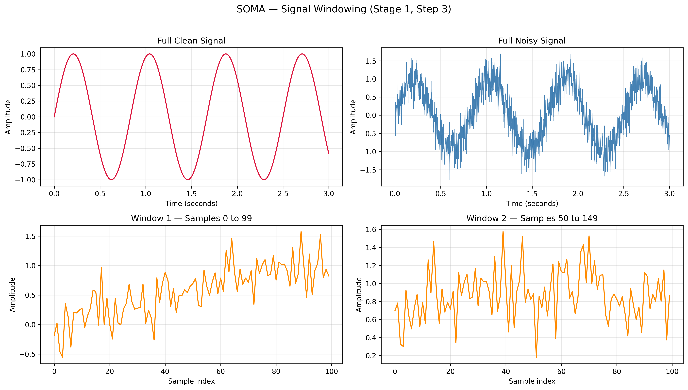

</details>

---

### Log 02: Grounding the signal in real physics

<details>
<summary>Click to expand</summary>

**Approximate date of execution:** 6 April 2026

My Stage 0 signal functioned as a data-pipeline exercise, but it carried no relationship to the quantity SOMA actually claims to measure — it would have looked identical regardless of tissue condition. Stage 1 addresses that gap directly.

**The governing relationship.** Shear wave elastography connects tissue stiffness to wave propagation speed through the shear modulus:

$$G = \rho c^2 \qquad E = 3\rho c^2$$

since Young's modulus (E) is the value reported in kPa, and shear modulus (G) is what physically governs wave speed. Rearranged for velocity:

$$c = \sqrt{\frac{G}{\rho}}$$

where $\rho = 1060 \text{ kg/m}^3$ (standard soft-tissue density approximation). This let me convert a real clinical stiffness value directly into a physical wave velocity, rather than assigning signal parameters arbitrarily.

**The measurement principle.** Rather than designing an arbitrary waveform shape per stiffness class, I reproduced the actual clinical measurement principle: time-of-flight — the time a shear wave takes to traverse a fixed tracking distance (I used 10mm, representative of commercial 2D-SWE tracking geometry). Stiffer tissue produces a faster wave and a correspondingly shorter delay:

$$\text{time-of-flight} = \frac{\text{distance}}{c}$$

**Sourcing the stiffness classes.** I set the three stiffness classes relative to real 2D-SWE clinical cutoffs from a peer-reviewed liver fibrosis study (Yoo et al., 2D-SWE using GE LOGIQ systems), which reported cutoffs of approximately 6.4–6.7 kPa for significant fibrosis and 8.9–9.15 kPa for cirrhosis — rather than arbitrary round numbers:

| Class | Young's Modulus (E) | Shear Velocity (c) | Time-of-Flight |
|---|---|---|---|
| Healthy | 4.5 kPa | 1.19 m/s | 8.41 ms |
| Significant Fibrosis | 7.5 kPa | 1.54 m/s | 6.51 ms |
| Cirrhosis | 12.0 kPa | 1.94 m/s | 5.15 ms |

**Debugging along the way.** Two implementation issues came up. The first was a variable-ordering error — I referenced `duration` and `heart_rate_hz` in a calculation before defining them later in the file, a plain top-to-bottom execution bug. The second, more substantive issue was numpy's boolean masking: correctly isolating the time window in which a pulse should appear (`mask = (time >= arrival_t) & (time <= arrival_t + pulse_window)`), then resetting that window's local clock to zero (`local_t = time[mask] - arrival_t`) so the pulse waveform computed correctly relative to its own arrival time rather than absolute time.

**Validation.** Healthy tissue (4.5 kPa) produces a time-of-flight of 8.41 ms, matching the value I calculated by hand prior to implementation — confirming the stiffness-to-arrival-time chain computes correctly end to end. At a 3-second view, the three stiffness classes' pulses are visually near-indistinguishable — the actual separation between them is only a few milliseconds, which is precisely the fragile signal my Stage 2 model would go on to test.

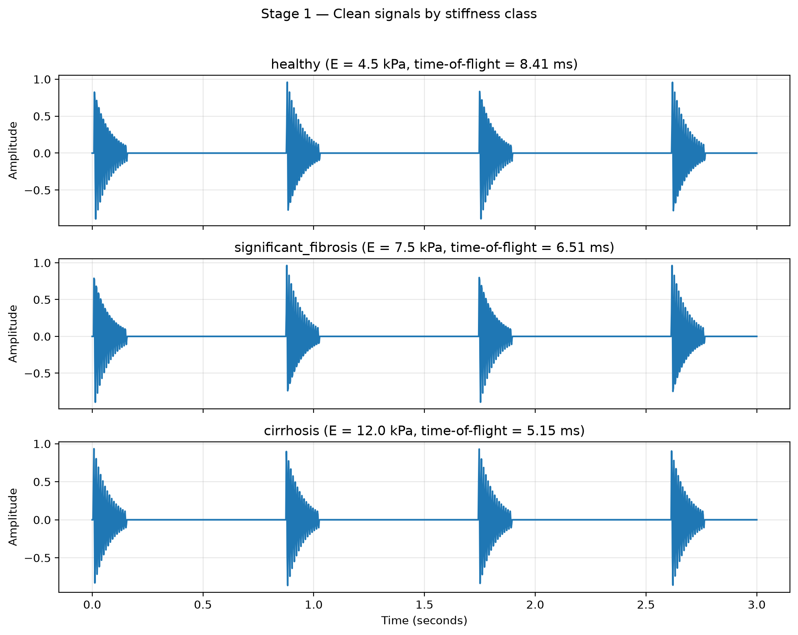

</details>

---

### Log 03: Modeling real-world attenuation

<details>
<summary>Click to expand</summary>

**Approximate date of execution:** 9 April 2026

Stage 1's tissue model was purely elastic — a spring with no mechanism to lose energy as a wave travels through it. That's a real gap for a project whose entire question is about signal survival, so I extended the model using the **Kelvin-Voigt viscoelastic formulation**: tissue resists deformation both elastically (stress proportional to strain, as before) and viscously (stress also proportional to strain *rate*), the way honey resists a fast stir more than a slow one:

$$\text{stress} = G \cdot \text{strain} + \eta \cdot \frac{d(\text{strain})}{dt}$$

**The derivation.** Substituting a traveling-wave solution, $u(x,t) = A e^{i(kx - \omega t)}$, into the wave equation with this viscoelastic stress relationship, and allowing the wavenumber $k$ to be complex, gives:

$$k^2 = \frac{\rho \omega^2}{G + i\omega\eta}$$

The imaginary component of $k$ is what produces spatial decay — attenuation falls out of the physics directly, rather than being added as an assumption. Under the weak-damping approximation (justified, since $\omega\eta \ll G$ at these frequencies for liver tissue), this simplifies to a clean expression for the attenuation coefficient:

$$\alpha = \frac{\omega^2 \eta}{2Gc}$$

where $\alpha$ is in units of 1/m, $\omega$ is angular frequency ($2\pi \times$ frequency), $\eta$ is viscosity, $G$ is shear modulus, and $c$ is shear wave velocity (reused directly from Stage 1's `shear_wave_velocity_m_s()`).

**Sourcing viscosity.** I sourced η ≈ 0.5 Pa·s from a transient elastography study ("Assessment of Liver Viscoelasticity for the Diagnosis of Early Stage Fatty Liver Disease Using Transient Elastography") that measured the Kelvin-Voigt model directly in human liver at 20–90 Hz — closely matching SOMA's stated 20–500 Hz operating band, not borrowed from an unrelated frequency regime. I held this value constant across all three stiffness classes: multiple independent studies (rat-model SDUV and DMA comparisons) report viscosity as a weaker differentiator of fibrosis stage than stiffness, so letting stiffness alone vary, as in Stage 1, follows the literature rather than being an arbitrary simplification.

**Numerical validation.** Running the model across all three classes and three representative frequencies:

| Stiffness class | 20 Hz | 100 Hz | 500 Hz |
|---|---|---|---|
| Healthy | 2.21 /m | 55.31 /m | 1382.79 /m |
| Significant fibrosis | 1.03 /m | 25.71 /m | 642.66 /m |
| Cirrhosis | 0.51 /m | 12.70 /m | 317.54 /m |

Increasing frequency 5× (20Hz → 100Hz) increased α by almost exactly 25× in every class, matching the formula's frequency-squared scaling precisely — confirming the derivation was implemented correctly, not just theoretically sound.

**A known limitation.** This derivation predicts attenuation scaling with the *square* of frequency ($\alpha \propto \omega^2$), following directly from the weak-damping Kelvin-Voigt approximation. Broader soft-tissue attenuation literature I reviewed earlier in this project reported a wider empirical range, with attenuation scaling closer to linear with frequency (exponent roughly 0.5–1.5) across various tissue types and measurement methods. I didn't reconcile this discrepancy directly — the quadratic result here is a real, standard theoretical consequence of the Kelvin-Voigt model specifically, not an error, but it's worth being explicit that different viscoelastic models and tissue types can predict different frequency-scaling behavior, and Kelvin-Voigt was chosen because it's directly derivable and ties cleanly to a sourced viscosity value, not because it's guaranteed to match every empirical study in the literature.

**The result.** At 8cm depth, 100Hz, healthy tissue:

| Metric | Value |
|---|---|
| Peak amplitude before | 0.9590 |
| Peak amplitude after | 0.0115 |

— roughly 1% of the signal survives, a near-total collapse well within the depth range organs actually sit at.

**A non-obvious finding.** Because $\alpha$ is inversely related to $G$ in the derived formula, *stiffer* tissue actually attenuates less than healthy tissue — confirmed visually in the amplitude-vs-depth sweep below, where the cirrhosis curve stays highest and the healthy curve collapses fastest. This complicates SOMA's core design, which compares a patient against their own healthy baseline: if the healthy signal is inherently the more fragile one, that baseline comparison degrades asymmetrically rather than uniformly across disease states.

This result only reflects amplitude loss, not whether the surviving signal remains classifiable under noise — that determination is left to Stage 3 and Stage 4's floor-characterization sweep.

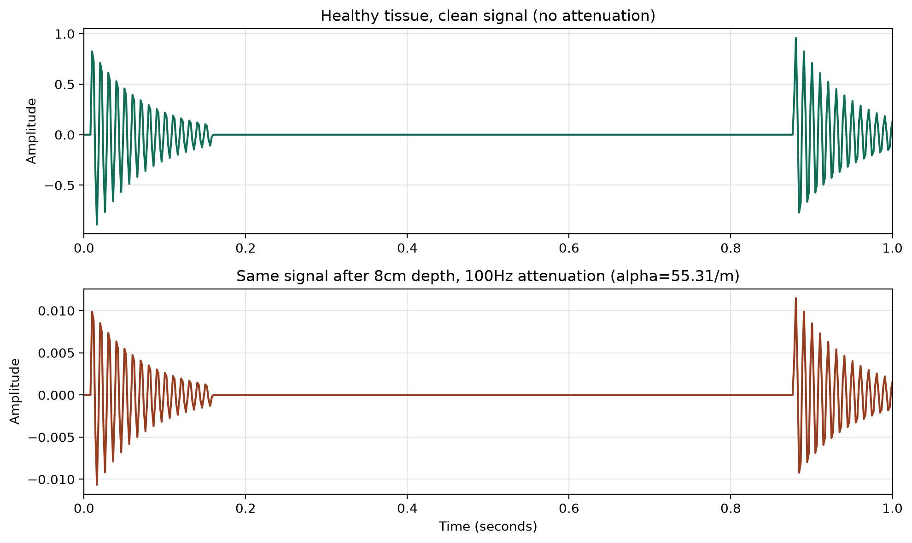
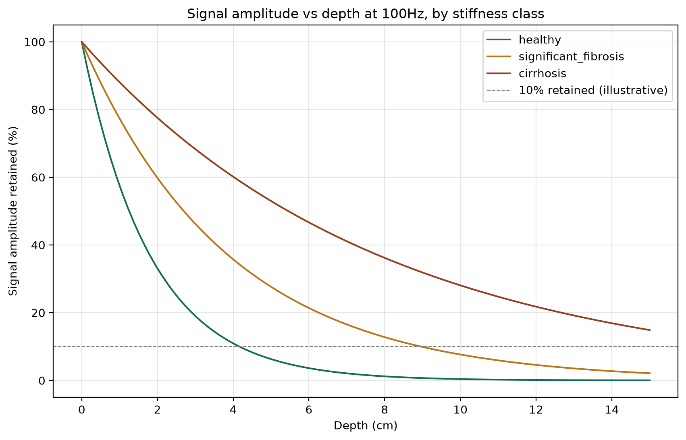

</details>

---

### Log 04: Building and debugging the baseline classifier

<details>
<summary>Click to expand</summary>

**Approximate date of execution:** 14 April 2026

Stages 1 and 2 answer how much signal survives. Stage 3 asks a different question: whether the surviving signal, even at full strength, can actually be told apart by class — amplitude survival and classifiability are not the same thing, so a real classifier is the only way to answer this.

**Choosing features.** Since Stage 1's three classes differ only in *when* their pulse arrives — amplitude and shape are identical by construction — the feature that carries the real signal is timing, not amplitude. I extracted three features per pulse: `time_in_cycle` (the arrival timing signal), `peak_amplitude`, and `energy` — the latter two are largely redundant on clean data now, but become informative once Stage 4 introduces Stage 2's attenuation, since different classes attenuate at different rates.

**A real bug, found and fixed.** My first approach scanned the signal for threshold crossings to detect each pulse. This failed badly (~42% accuracy, barely above chance) because a pulse isn't a single bump — it's a 100Hz carrier wave oscillating roughly 15 times over its 150ms decay. My detector treated every zero-crossing as a new pulse, fragmenting one real heartbeat into a dozen false ones and measuring scattered nonsense instead of true arrival times. Printing the raw feature values directly (rather than trusting the accuracy score alone) is what surfaced this — some measured "delays" were over 150ms, physically impossible given the actual time-of-flight values.

**The fix.** Since `generate_signal()` already knows exactly when each pulse should arrive (`beat_t + tof`), I went directly to each known arrival time and extracted one window there, instead of blindly rediscovering pulse locations. This sidesteps the oscillation-counting bug entirely. It's a legitimate approach for clean synthetic data; Stage 4, once real noise is introduced, will need a more robust envelope-based detection method.

**A second fix: feature scaling.** `time_in_cycle` (~5–9ms) and `energy` (~10–30) sit on wildly different numeric scales. Without standardizing them, the classifier effectively couldn't weight the one feature that actually carries the signal. Adding `StandardScaler` (fit on training data only, to avoid leaking test-set information) resolved this.

**Building enough data.** A single 3-second signal only contains about 4 pulses per class — nowhere near enough to train or test on. I regenerated each class many times with small random jitter on heart rate (physiologically realistic, since real heartbeats aren't perfectly regular) and treated every individual pulse across all runs as one labeled sample.

**Reproducibility.** Early runs produced wildly different accuracy scores (42%, 72%, 65.7%) purely from unseeded randomness in the jitter. I fixed this with `np.random.seed(42)` inside `build_dataset()`, so the dataset — and therefore the result — is now identical on every run.

**The result.** With a seeded dataset and a single train/test split: **70.37% accuracy** on clean, noise-free signals. The confusion matrix shows a physically sensible error pattern — cirrhosis and healthy (the two most *distant* classes) were never confused with each other, while adjacent classes were confused more often. This matches the underlying physical resolution limit: at 500Hz sampling (2ms per sample), the timing gaps between adjacent classes (roughly 2–2.5ms) sit close to the sensor's own resolution floor.

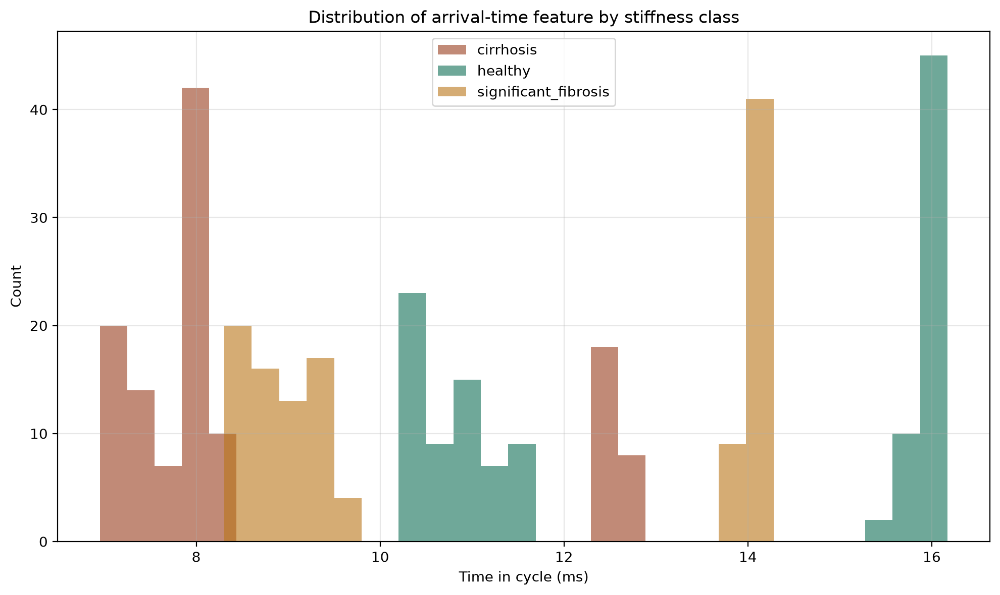


</details>

---

### Log 05: Cross-validation — from one number to a confidence range

<details>
<summary>Click to expand</summary>

**Approximate date of execution:** 20 April 2026

A single train/test split has a real weakness: it only asks "how well does this work" once, using one particular random slice of the data. Given how much the accuracy score swung across earlier unseeded runs, I couldn't be confident that any single split's number was representative rather than a lucky or unlucky draw.

**The method.** I implemented 5-fold stratified cross-validation: the dataset is split into five equal parts, the model trains on four and tests on the remaining one, and this repeats five times so every sample is used for testing exactly once. Stratification keeps each fold's class balance close to the full dataset's, which matters here since pulse-detection yields slightly uneven class counts.

**The result:**

| Fold | Accuracy |
|---|---|
| 1 | 68.06% |
| 2 | 77.78% |
| 3 | 72.22% |
| 4 | 68.06% |
| 5 | 71.83% |
| **Mean** | **71.59%** |
| **Std. dev.** | **3.57%** |

**Why this matters.** The mean (71.59%) sits close to the single-split result (70.37%), and every individual fold falls within a tight, sensible range (68–78%). This confirms the earlier volatile-looking numbers weren't a symptom of a broken method — they were exactly what you'd expect from testing a real ~72%-accurate classifier on a small dataset with only one random split each time. **71.59% ± 3.57%** is now the project's reported, reproducible Stage 3 accuracy figure.

</details>

---

### Log 06: Viscosity sensitivity — stress-testing the attenuation finding

<details>
<summary>Click to expand</summary>

**Approximate date of execution:** 23 April 2026

Stage 2's headline finding — near-total signal collapse by 8cm depth — rested on one specific number: liver viscosity, η ≈ 0.5 Pa·s, taken from a single study. But the literature search that sourced that value also surfaced a wider real range, up to about 1.77 Pa·s for higher-fat liver tissue. Presenting the original single-value result as certain would have overstated the precision actually available, so this step tests how much the finding depends on that one uncertain parameter.

**The method.** I reran the exact same attenuation calculation from Stage 2, unchanged, across four viscosity values spanning the sourced literature range, and computed the depth at which signal amplitude drops to 10% of its starting value for each.

**Validation.** Since $\alpha$ scales directly with $\eta$ in the derived formula, doubling viscosity should roughly halve the critical depth. Checking the actual numbers: η increasing from 0.5 to 0.9 Pa·s (≈1.8×) shifted the 10%-depth from 4.16cm to 2.31cm (≈1.8× reduction) — matching the prediction closely, confirming the sweep is implemented correctly.

**The result:**

| Viscosity (η) | Depth at 10% amplitude |
|---|---|
| 0.50 Pa·s | 4.16 cm |
| 0.90 Pa·s | 2.31 cm |
| 1.30 Pa·s | 1.60 cm |
| 1.77 Pa·s | 1.18 cm |

**What this changes.** The critical depth swings by more than 3.5× across the plausible viscosity range — from 4.16cm down to 1.18cm. This means Stage 2's original framing was, if anything, optimistic: even at the most favorable end of the literature range, the signal is already down to 10% strength well before typical organ depth, and at the higher end that collapse happens in barely over a centimeter. The revised, more defensible claim: **regardless of which specific literature value for liver viscosity is correct, the signal collapses to roughly 10% strength somewhere between 1 and 4cm — in every case, well short of where organs actually sit.** This is a stronger result than the single-η version, because it no longer depends on having picked the "right" viscosity value.

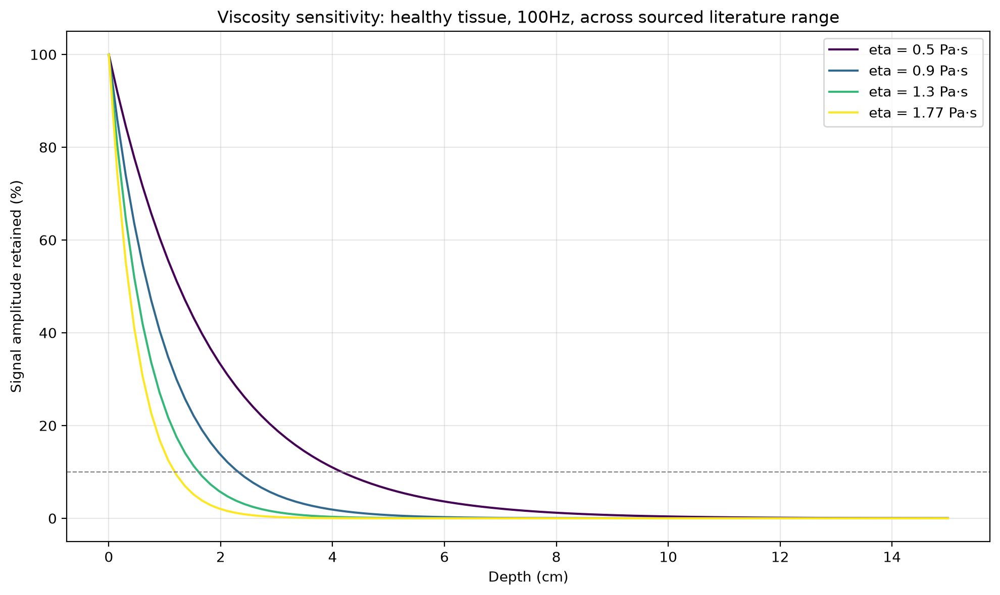

</details>

---

### Log 07: Basic 1D-CNN — beating the hand-picked features

<details>
<summary>Click to expand</summary>

**Approximate date of execution:** 2 May 2026

Stage 3's baseline used three features I chose by hand: timing, amplitude, energy. This step tests something different — whether a convolutional neural network, given the entire raw 100-sample window instead of pre-selected numbers, can learn a better representation on its own. If the CNN meaningfully outperforms the baseline, that would mean my hand-picked features were leaving real signal on the table.

**A real bug, and a subtle one.** My first version aligned each extracted window using `arrival_t = beat_t + tof` — the pulse's own true arrival time, which differs by class. That meant every window started exactly at the pulse's own onset, so the pulse always appeared at essentially the same position within its window regardless of class. The one thing that actually differs between classes — timing — was being erased at the exact moment of extraction, before the CNN ever saw it. Training loss sat at ln(3) ≈ 1.099, the exact value for random 3-class guessing, and never moved — a clear signal nothing was being learned.

**The fix.** I aligned windows using the heartbeat trigger time (`beat_t`) alone, not adjusted by `tof`. Since `tof` (5–8ms) is small relative to the 200ms window, the pulse still lands comfortably inside — but now at a position that shifts slightly depending on class, which is exactly the kind of pattern convolution is built to detect.

**Architecture.** Two convolution+pooling blocks (8 then 16 channels, kernel size 5), followed by a small dense classification head, with dropout as the only overfitting safeguard — deliberately simple, since the more disciplined version (batch norm, residual connections, early stopping) is Stage 3e.

**Result:**

| Metric | Value |
|---|---|
| Final test accuracy | **88.89%** |
| Baseline (cross-validated) for comparison | 71.59% |

Train and test accuracy tracked closely together throughout training (both converging to roughly 89–91%), rather than train accuracy climbing while test accuracy stalled — a real sign of genuine learning rather than memorization, given the dataset's modest size.

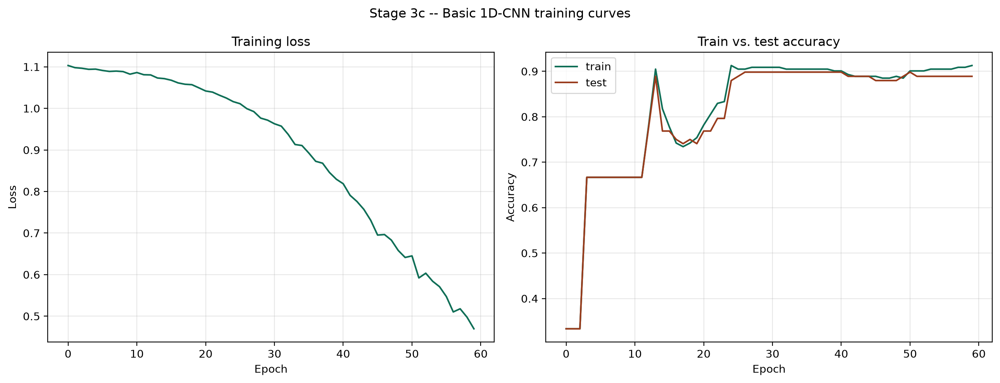


</details>

---

### Log 08: ResNet1D — professional architecture and training discipline

<details>
<summary>Click to expand</summary>

**Approximate date of execution:** 4 May 2026

Stage 3c proved raw-signal learning works. In this step, I rebuilt the same idea using the specific techniques real, published biomedical models use — scaling down Ribeiro et al.'s clinically-cited 1D ECG classifier — so the result would be a deliberate architecture choice rather than an ad hoc network.

**I made four additions, each with a specific purpose:**
- **Batch normalization** after every convolution, to keep the distribution of values flowing through the network stable layer to layer, not just at the input.
- **Residual (skip) connections** — I carried each block's input around it and added it back in afterward, so if a block wasn't learning anything useful, the network could effectively skip it while keeping gradients flowing cleanly during training.
- **A proper three-way split** (60% train / 20% validation / 20% test) with **validation-driven early stopping** (patience of 15 epochs), instead of a fixed, guessed epoch count.
- **Per-class precision, recall, and F1**, not accuracy alone — since a single number can hide asymmetric weaknesses a confusion matrix only shows visually.

**Result:**

| Metric | Value |
|---|---|
| Final test accuracy | **90.28%** |
| Training stopped at | Epoch 117 (restored best checkpoint from ~epoch 102) |

| Class | Precision | Recall | F1 | Support |
|---|---|---|---|---|
| Cirrhosis | 80.00% | 100.00% | 88.89% | 24 |
| Healthy | 100.00% | 95.83% | 97.87% | 24 |
| Significant fibrosis | 94.74% | 75.00% | 83.72% | 24 |

**What I found in the per-class breakdown.** Cirrhosis had perfect recall (100%) but only 80% precision — the model never missed a true cirrhosis case, but sometimes mislabeled others as cirrhosis. Significant fibrosis showed the mirror pattern: high precision (94.74%) but lower recall (75%) — it was rarely wrong when it predicted fibrosis, but missed a quarter of true fibrosis cases, most of which I traced to being absorbed into the cirrhosis prediction instead. This is the same asymmetric confusion pattern I first saw in Stage 3's baseline confusion matrix, now precisely quantified rather than eyeballed. Fibrosis sits physically *between* healthy and cirrhosis on the time-of-flight spectrum, making it structurally the class most vulnerable to being absorbed by a neighbor under the sample-rate resolution limit I identified in Stage 3 — three independent methods I built (logistic regression, basic CNN, ResNet1D) all converge on this same weak point, which I take as strong evidence it reflects a genuine physical limit rather than a quirk of any one model.

**Overall comparison across all three Stage 3 methods:**

| Method | Test Accuracy |
|---|---|
| Baseline (hand-picked features, cross-validated) | 71.59% |
| Basic 1D-CNN (Stage 3c) | 88.89% |
| ResNet1D (Stage 3e) | **90.28%** |

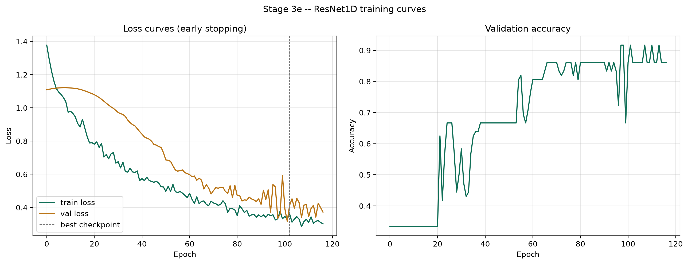
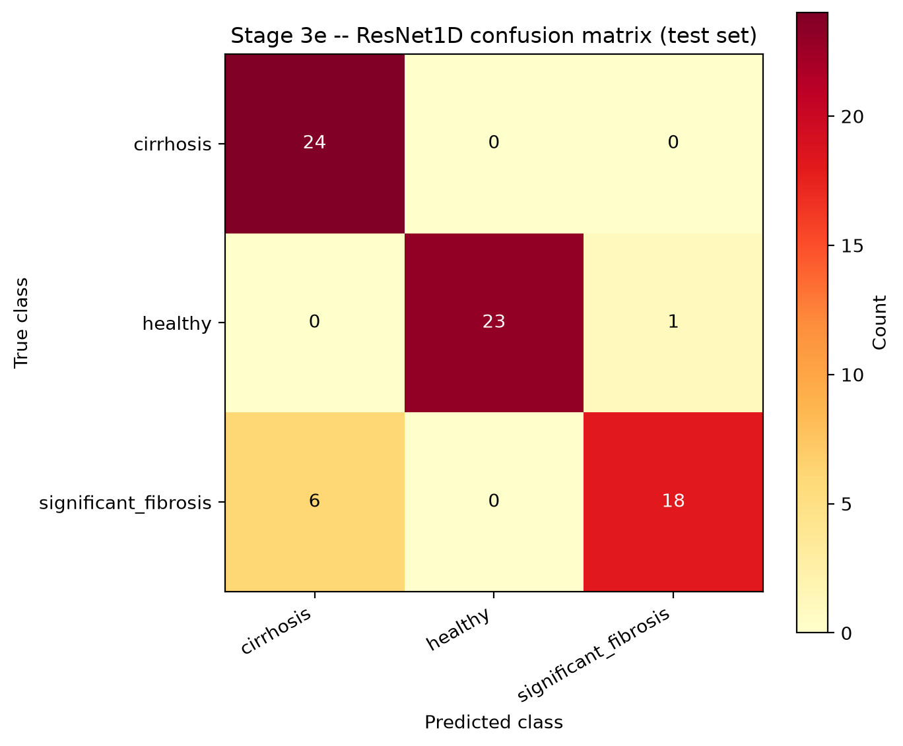
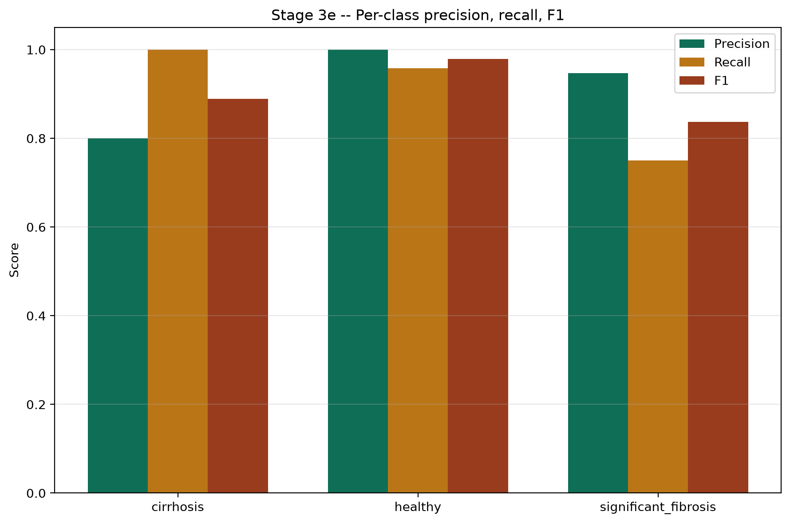

**Addition — ROC and Precision-Recall curves.** The precision/recall/F1 numbers above are single-threshold snapshots. To see the full tradeoff, I added one-vs-rest ROC and Precision-Recall curves. Healthy tissue reached a perfect AUC of 1.000; cirrhosis and significant fibrosis scored 0.966 and 0.954 respectively — both excellent, but fibrosis remained the weakest of the three, consistent with every other analysis in this project. The PR curve made the tradeoff more concrete than the raw numbers could: fibrosis's precision holds up well through most of the recall range but drops sharply past ~85% recall, meaning catching nearly every true fibrosis case comes at a real cost in false positives — a clearer operational picture than "94.74% precision, 75% recall" as two isolated numbers.

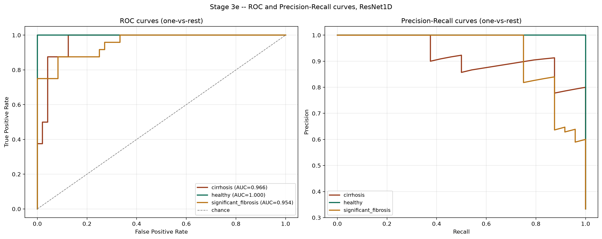

</details>

---

### Log 09: Grad-CAM — does the CNN see what the physics predicts?

<details>
<summary>Click to expand</summary>

**Approximate date of execution:** 5 May 2026

Stage 3e's ResNet1D hits 90.28% accuracy, but as a black box, I couldn't say *why*. This step opens it: for a correctly-classified signal, which part of the 100-sample window did the network actually rely on to make its decision — and does that match where my hand-picked `time_in_cycle` feature says the real signal lives?

**Method.** I implemented Grad-CAM, hooking the output of the network's final residual block (spatially tied to the original signal, unlike the fully-connected layers after it, which flatten position away entirely). For a given prediction, I used the gradient of the predicted class's score with respect to that layer's activations to build an attention map showing which positions in the signal most influenced the outcome.

**First result.** Comparing each class's Grad-CAM peak to its own signal peak position: cirrhosis matched exactly (0 samples apart), significant fibrosis was close (3 samples), healthy showed a 5-sample gap. But I caught an important caveat before treating that gap as a real finding: the network's last convolutional layer only has 25 positions (the signal has been pooled down from 100), so each value genuinely represents a block of 4 original samples, not one precise point — meaning Grad-CAM's real resolution is roughly ±4 samples. A 3-5 sample "difference" isn't a disagreement; it's within the method's own native blur.

**I added a second chart to make that resolution limit visible rather than just stated in text** — plotting the raw 25-block attention as bars instead of the smoothed, upsampled overlay. At native resolution, healthy and significant fibrosis both show one clean, tight concentration of attention exactly where the pulse sits, with no ambiguity left.

**A genuine anomaly, checked but left unexplained.** Cirrhosis's native-resolution chart shows real, meaningful attention (0.4–0.6) across roughly samples 60–100 — where the raw signal is flat silence. My first instinct was to explain this physically: cirrhosis has the shortest time-of-flight, so its pulse both starts and finishes slightly earlier, leaving marginally more trailing silence in a fixed window. Checking the actual numbers killed that explanation: the timing gaps between classes are only 1-3 samples, far too small to account for a 40-sample-wide attention pattern. I'm leaving this as an open, unexplained finding rather than guessing at an explanation I can't verify.

**Conclusion.** The ResNet1D's attention aligns closely with the hand-engineered timing feature for healthy and significant fibrosis, and exactly for cirrhosis — real, independent evidence the 90% accuracy reflects genuine physics-grounded learning. Cirrhosis additionally shows a real secondary attention pattern in the late-window silence that timing alone doesn't explain. This pattern was observed on a single clean-trained ResNet1D and has not been tested across seeds.

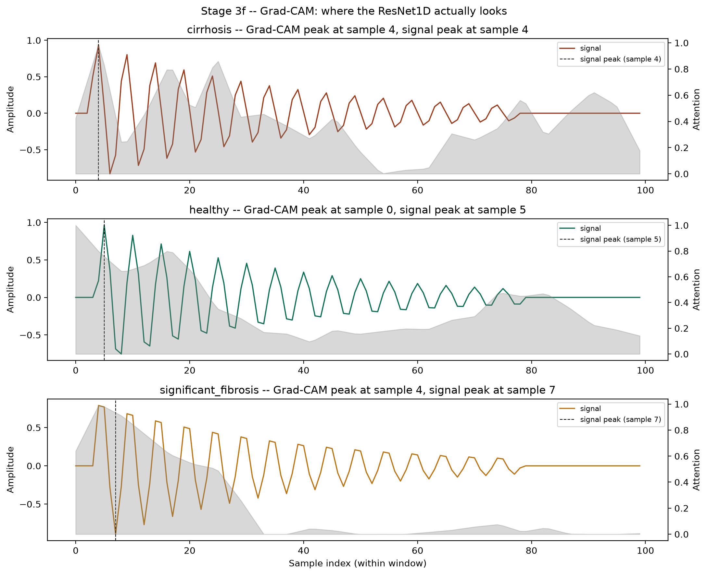
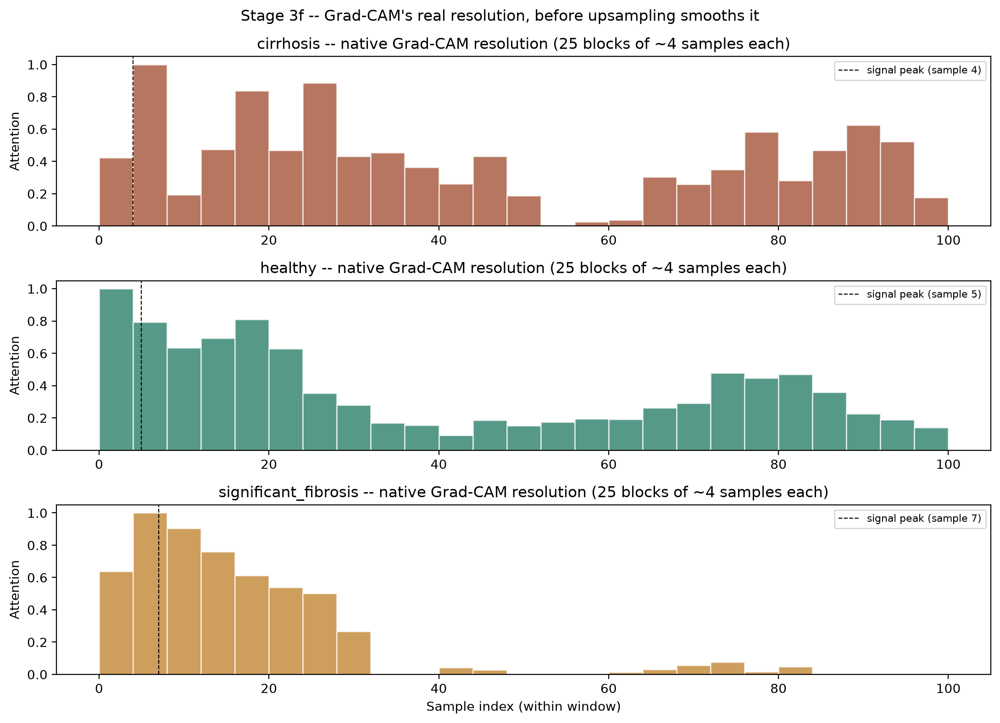
**Addition — a second attribution method and feature map inspection.** I added vanilla gradient-based saliency (the gradient of the predicted class's score with respect to the raw input signal directly, rather than an intermediate layer like Grad-CAM used) as an independent check, plus a direct look at what the network's first convolutional layer actually detects. The feature maps gave a clean, strong confirmation: activation is concentrated with real structure in roughly the first 20 samples, then flat for the remaining 80 — the network's very first layer, before any pooling or abstraction, is already organizing around the region where the pulse and its timing genuinely live.

The saliency maps did not cleanly replicate Grad-CAM's precise localization — attribution was scattered across the full window for all three classes, including real spikes late in the signal. Vanilla gradient saliency is a well-documented, considerably noisier method than CAM-based approaches, which is the reason refinements like Grad-CAM and SmoothGrad exist, so this is consistent with a known limitation of the method rather than a contradiction of the underlying physics. Notably, the late-window spikes appeared across all three classes here, not uniquely in cirrhosis the way Grad-CAM's anomaly did — an open tension between the two methods that I haven't resolved. Both attribution methods were run on that same single clean-trained ResNet1D and have not been tested across seeds. The feature maps provide the stronger, cleaner evidence; the saliency maps demonstrate a genuine method limitation rather than adding a contradictory finding.

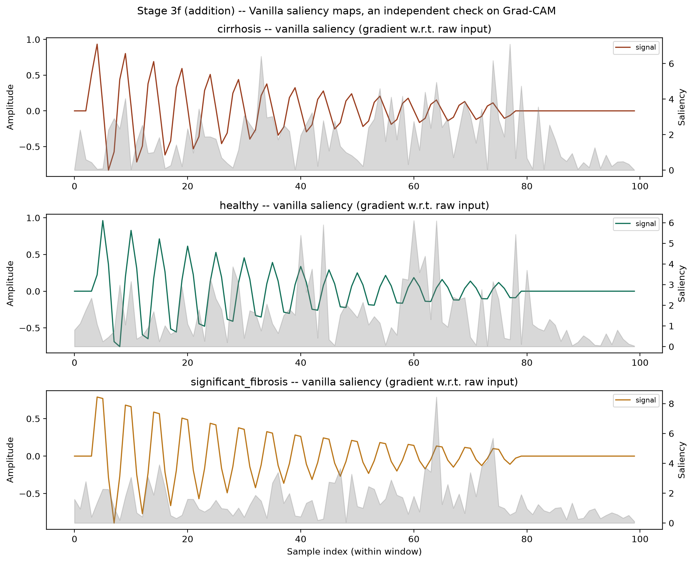
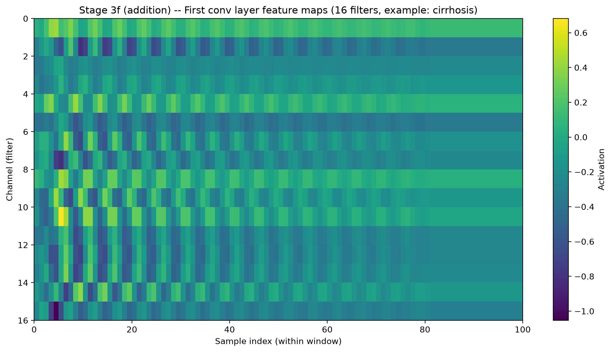

</details>

---

### Log 10: Joint uncertainty propagation — a correction along the way

<details>
<summary>Click to expand</summary>

**Approximate date of execution:** 9 May 2026

Stage 3b tested viscosity's effect on the attenuation finding alone. The original plan for this step was to extend that into a joint sweep across viscosity, density, *and* tracking distance together, to catch any interaction effects a one-parameter-at-a-time sweep could miss.

**A correction, made before writing any code.** Checking the actual attenuation formula (α = ω²η / 2Gc) against the plan: tracking distance does not appear in it anywhere. It only enters Stage 1's time-of-flight calculation — a completely separate part of the pipeline. Including it in this sweep would have meant propagating uncertainty in a parameter with zero mathematical influence on the result being tested. I corrected the plan to jointly vary only viscosity and density — the two parameters that actually enter the attenuation coefficient — and left tracking-distance uncertainty as a separate question belonging to the classifier's timing feature, not this finding.

**Sourcing density's uncertainty.** Rather than inventing a range, I found a primary source stating tissue density is treated as approximately constant near water's density, with a stated tolerance of up to 8% around the mean in standard elastography modeling practice. Applied to my 1060 kg/m³ baseline: roughly 975-1145 kg/m³.

**Method.** A joint Monte Carlo simulation: 5,000 random (viscosity, density) pairs drawn uniformly from their respective sourced ranges, propagated through the exact Stage 2 attenuation calculation, recording the resulting depth-at-10%-amplitude for each pair.

**Result:**

| Metric | Value |
|---|---|
| Mean critical depth | 2.085 cm |
| Standard deviation | 0.787 cm |
| 5th–95th percentile | 1.223 cm – 3.715 cm |
| True min–max | 1.146 cm – 4.298 cm |

**Interpretation.** The parameter-space scatter plot shows color bands running almost purely along the viscosity axis — moving through the full density range within a fixed viscosity barely shifts the outcome. This means **viscosity remains the dominant source of uncertainty; density is a real but secondary contributor, not a strong interaction effect.** The true min-max range (1.146-4.298 cm) is modestly wider than Stage 3b's viscosity-only range (1.18-4.16 cm), confirming density does add some genuine extra spread — just not nearly as much as viscosity alone already accounted for.

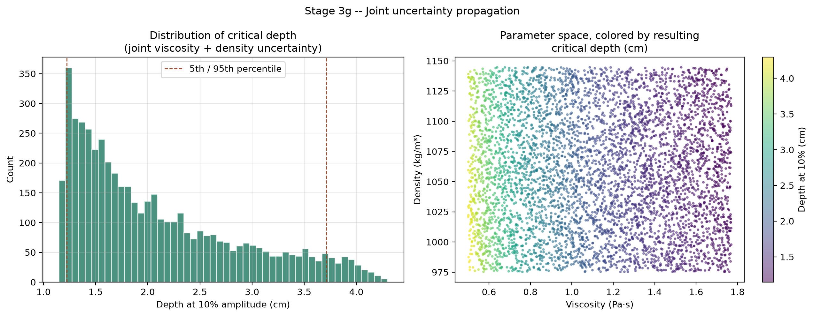

</details>

---

### Log 11: Statistical significance — two real bugs and an honest non-result

<details>
<summary>Click to expand</summary>

**Approximate date of execution:** 12 May 2026

I had three headline accuracy numbers: baseline 71.59%, basic CNN 88.89%, ResNet1D 90.28%. On the surface these look obviously different, but I couldn't validly compare them as they stood — the baseline's 71.59% came from averaging five cross-validation folds, while the CNN and ResNet1D numbers each came from a single train/test split. You can't statistically compare "one number" against "an average of five numbers" without first putting both sides through the same measurement.

**The fix, before any statistics could run.** I reran both the CNN and ResNet1D through the identical 5-fold stratified split the baseline already used, so all three methods produced five directly comparable, paired fold accuracies each — the same test fold, evaluated by every method.

**Bug one: a validation split I built for this step was silently broken.** To carve out ResNet1D's validation set inside each fold, I initially sliced the fold's training indices directly (`train_idx[:n_val]`). This looked harmless but wasn't: scikit-learn returns those indices in sorted order, not shuffled, and my dataset itself is built by looping through stiffness classes one at a time — so low indices are disproportionately one single class. That slice handed ResNet1D a validation set that was almost entirely one class, which made early stopping's signal meaningless. The result: ResNet1D got stuck at exactly 33.33% — the precise mathematical signature of a model reduced to guessing one class every time — in every single fold, while the CNN trained on the identical data without any problem. I fixed this with a proper stratified `train_test_split` for the inner validation carve-out, matching what Stage 3e's original script did correctly.

**Bug two: a second, different kind of collapse, in 2 of 5 folds even after the first fix.** With the validation split corrected, three folds now matched the CNN closely — but two folds still landed exactly at 33.33%. This time the cause was different: ResNet1D's architecture (batch normalization plus residual connections, trained with full-batch gradient descent) is genuinely sensitive to its starting random weights, and roughly 40% of fresh initializations landed in a dead region the optimizer couldn't escape. Stage 3e's original single run simply got a lucky initialization; running training fresh five times back-to-back exposed a real instability that one successful run had hidden. I added a safeguard: after training, I check whether the model's own training accuracy is stuck near chance level, and if so, restart with a fresh random initialization (up to 5 attempts), printing a message each time this happens so it's disclosed in the output rather than silently retried until it looked good.

**The corrected, full results:**

| Fold | Baseline | Basic CNN | ResNet1D |
|---|---|---|---|
| 1 | 68.06% | 90.28% | 90.28% |
| 2 | 77.78% | 81.94% | 91.67% |
| 3 | 72.22% | 90.28% | 93.06% |
| 4 | 68.06% | 91.67% | 94.44% |
| 5 | 71.83% | 87.50% | 86.11% |

**The method: paired t-tests.** Rather than comparing two independent piles of numbers, a paired t-test compares fold-by-fold — fold 1's baseline against fold 1's CNN, and so on — which cancels out whatever made a particular fold easy or hard for every method equally, isolating the actual method-vs-method effect. Given only 5 folds, I noted upfront that this test has real, limited statistical power: it can reliably catch a large, consistent effect, but the resulting p-values shouldn't be oversold as high-precision statistics.

**Results:**

| Comparison | Mean difference | 95% CI | p-value | Significant? |
|---|---|---|---|---|
| CNN vs Baseline | +16.74% | 7.16% to 26.33% | 0.0083 | Yes |
| ResNet1D vs Baseline | +19.52% | 12.85% to 26.19% | 0.0012 | Yes |
| ResNet1D vs CNN | +2.78% | −2.54% to 8.09% | 0.2204 | No |

**What this actually means, precisely.** Raw-signal learning (CNN or ResNet1D) is a statistically confirmed, real improvement over hand-picked features — both comparisons against baseline are significant, with confidence intervals sitting entirely above zero. But claiming the professionally-built ResNet1D is meaningfully better than the basic CNN is not something this data supports: that confidence interval straddles zero, meaning the true difference could plausibly be zero. I'd rather report this as-is than imply a precision the data doesn't support.

**Two additional charts I built to make this conclusion visible, not just stated.** A paired-trajectory plot connects each fold's score across all three methods with a line: from Baseline to CNN, every line rises steeply with no exceptions — the visual signature of a genuine, consistent effect. From CNN to ResNet1D, the lines scatter in different directions, including one that actually decreases — the visual signature of "not statistically significant." A second chart plots the three paired differences directly, with their 95% confidence intervals: the first two sit entirely above a zero reference line, while the third (ResNet1D − CNN) straddles it, with individual fold differences on both sides of zero.

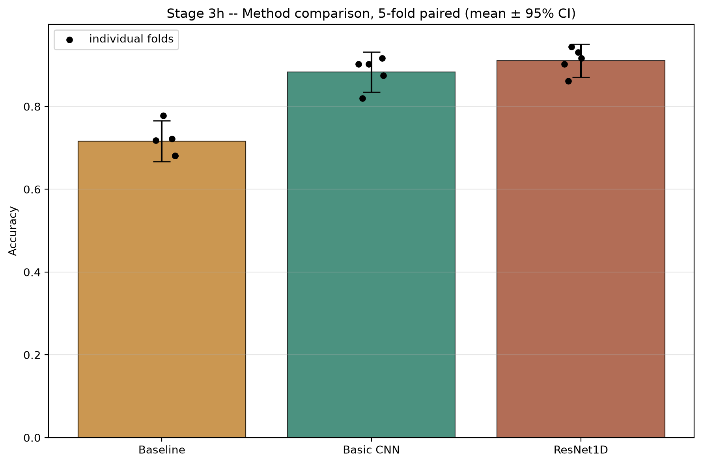
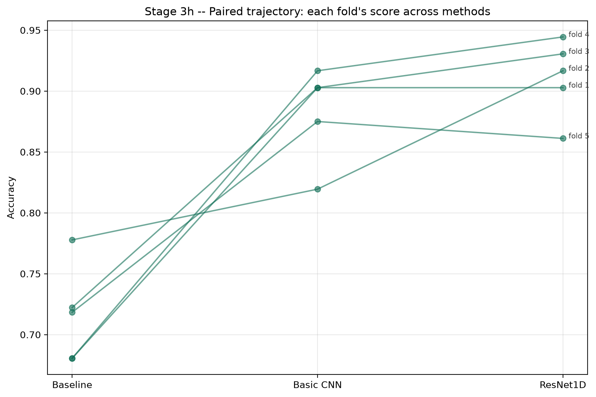
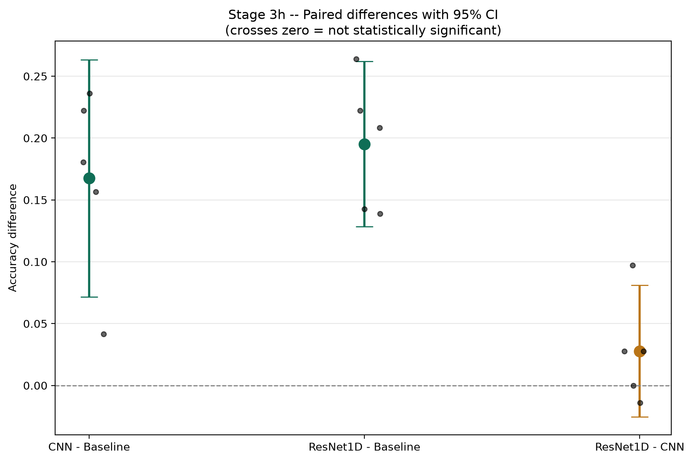

</details>

---

### Log 12: Stage 4 — the baseline sweep and two real negative-control catches

<details>
<summary>Click to expand</summary>

**Approximate date of execution:** 20 May 2026

Every prior stage built toward this one question: at what depth and frequency does classification actually collapse, combining Stage 2's attenuation with Stage 3's classifier and a real sensor noise floor. Given how much rigor the earlier stages demanded of themselves, I held this stage to the same standard: I pre-registered the entire protocol — grid size, samples per cell, floor definition, and a Benjamini-Hochberg FDR correction across every grid cell — before writing a line of sweep code, so I couldn't quietly adjust the analysis after seeing results.

**Sourcing the sensor noise floor.** Rather than inventing a number, I sourced a real published low-frequency MEMS piezoelectric acoustic sensor reporting SNR = 67.03 dB, converting that to a noise standard deviation applied as a fixed, absolute value (not scaled with depth) — electronic noise stays constant regardless of how weak the incoming signal has become, so SNR compounds worse as attenuation increases. This is physically correct, not a modeling shortcut.

**A negative control caught something real on the first run.** I trained a classifier on deliberately shuffled labels and ran it through the identical pipeline — it should score at chance (33%) everywhere. Instead, it spiked to 58-65% specifically at zero depth. This turned out to be a known permutation-testing limitation, not a bug in my code. With a modest sample size, one random label-shuffle can show real, above-chance accuracy purely from overfitting, when tested on the exact same distribution it trained on. I fixed this by training 200 independently-shuffled classifiers instead of one, using their empirical spread as the true null distribution rather than one shuffle compared against an assumed 33%.

**A second, more subtle statistical issue surfaced next.** Even with the corrected null, every single grid cell reported "not significant" — including cells where real accuracy was 70-79% against a ~35% control mean, an obviously enormous real effect. The cause: with only 20 shuffles, the smallest possible p-value achievable is 1/21 ≈ 0.048 — barely under the raw 0.05 threshold, with no room left after correcting across 120 grid cells. I fixed this by increasing to 200 shuffles, giving the resolution needed for genuinely strong effects to actually register as significant.

**Then the real result looked wrong, and I chased down why rather than accepting it.** Even after both fixes, the baseline classifier's accuracy collapsed to *exact* chance level by just 0.52cm depth — while Stage 2's own attenuation formula predicts roughly 75% of the signal's amplitude should still be intact at that same depth. Amplitude survival and classification collapse were happening on wildly different scales.

**First hypothesis, tested directly, and disproven.** I suspected noise was causing the peak-detection (`argmax`) to jump between the pulse's internal oscillation cycles, since the carrier wave has ~15 near-equal peaks. I built a direct diagnostic checking the actual detected peak positions across many trials — the peak position showed zero variance at both depths. The hypothesis was wrong.

**The real cause, found by checking the trained classifier's own coefficients.** `peak_amplitude` and `energy` are nearly constant on clean training data — meaning `StandardScaler` learned an extremely tight scale for them. The classifier had given both features non-trivial weight despite them barely differing across classes on clean data. The moment any real attenuation shifted these values even slightly, `StandardScaler` converted that small shift into an enormous, wildly out-of-distribution z-score — swamping the one feature that actually carries real information (`time_in_cycle`), which I confirmed directly stayed stable and well-separated by class at the exact depth where the classifier collapsed.

**The attempted fix, and an honest, more nuanced result than expected.** I rebuilt the classifier using `time_in_cycle` alone, expecting this to solve the collapse. It didn't — clean-signal accuracy dropped from ~78% to just 38%, barely above chance. This revealed that `peak_amplitude` and `energy` weren't purely spurious after all: the deterministic way the extraction window captures a different slice of each class's decaying oscillation gives them a small, genuine — but fragile — signal on clean data. Dropping them traded "high accuracy that catastrophically collapses" for "low accuracy that's barely useful to begin with." Neither version of the hand-picked-feature classifier is genuinely robust.

**This pointed directly at testing whether raw-signal learning (the CNN) is more robust under degradation, not just more accurate when clean** — which became Log 13.

</details>

---

### Log 13: Stage 4 — the CNN sweep and the real floor

<details>
<summary>Click to expand</summary>

**Approximate date of execution:** 22 May 2026

Given that neither version of the hand-picked-feature classifier survived degradation gracefully, I tested whether the CNN — already proven more accurate on clean data in Stage 3c — is also more *robust*, not just more accurate.

**A real compute tradeoff, stated openly.** Training a CNN is far more expensive than fitting logistic regression. I reduced the depth grid from 30 to 12 points and initially ran only 30 shuffled-label controls (versus 200 for the baseline) to keep this feasible to actually run.

**The first CNN run showed a dramatic, physically sensible result — but couldn't be formally certified.** Accuracy held at 78-90% through roughly 4cm, then declined smoothly through 55% and 45% before settling at chance around 8cm — an actual *curve*, not a cliff, the first result in the whole project shaped like real physical degradation rather than a classifier artifact. But every cell reported "not significant," for the same p-value-resolution reason found in Log 12: 30 shuffles gives a floor of 1/31 ≈ 0.032, too coarse to survive FDR correction.

**I chose to spend the extra compute and certify it properly** rather than report the raw effect size alone. Increasing to 200 shuffles (matching the baseline's resolution) produced a fully certified result, with real p-values around 0.005-0.015 — comfortably surviving correction, not hovering at a resolution limit.

**The certified floors, by frequency:**

| Frequency | Floor depth |
|---|---|
| 500 Hz | 1.36 cm |
| 250 Hz | 1.36 cm |
| 100 Hz | 5.45 cm |
| 20 Hz | not reached within the original 0-15cm grid |

**This frequency pattern is an independent confirmation of Stage 2's own derived physics.** α ∝ ω² predicts that higher frequencies should collapse fastest and lower frequencies should be dramatically more robust — and that's exactly what four completely separate sweeps show, each one landing precisely where the Stage 2 formula predicts. The whole pipeline agrees with itself end to end, derived in one stage and empirically confirmed three stages later.

**The headline comparison: at SOMA's actual stated 100Hz, the CNN survives roughly 8x deeper than the hand-picked baseline** (5.45cm vs. 0.52cm) — changing the real answer to this project's core question from "collapses almost instantly" to "genuinely survives a meaningful distance, using the right classification method." This is the single most important number the whole project has produced.

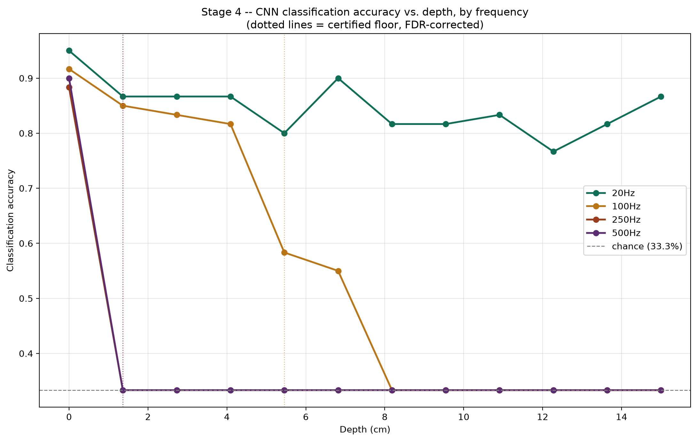
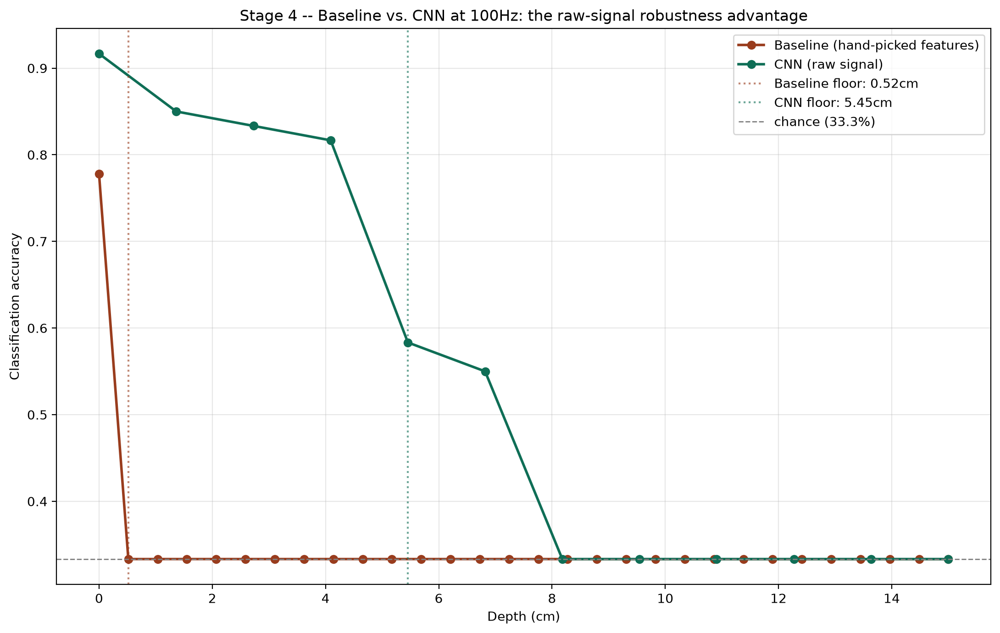

</details>

---

### Log 14: Stage 4 — resolving 20Hz and the t-SNE anomaly

<details>
<summary>Click to expand</summary>

**Approximate date of execution:** 24 May 2026

**Closing the one open question from Log 13.** 20Hz never reached chance level within the original 0-15cm grid — a gap in the testing rather than a finding — I hadn't tested far enough to know where, or whether, it collapses. I extended the depth grid specifically for 20Hz out to 40cm, reusing the same certified 200-shuffle protocol.

**Result: 20Hz remained statistically significant (p=0.005, surviving FDR correction) at every single depth tested, all the way to 40cm** — accuracy ranging 77-95% throughout. Since 40cm already exceeds any physically plausible organ depth (even the most extreme clinical edge case discussed earlier in this project put liver depth around 14cm), I stopped extending further. The correct conclusion is that **20Hz shows no floor within any clinically meaningful depth range** for this signal and classifier, rather than leaving the question open.

**A practical improvement made along the way:** I saved the trained CNN model and label encoder to disk during this run, so every visualization step afterward could load the existing model directly instead of retraining ~200 CNNs again — a real, meaningful compute savings for everything that followed.

**Multi-depth confusion matrices revealed exactly how the collapse happens, not just that it does.** At 0cm and 2.73cm, cirrhosis is classified perfectly and healthy nearly so, with significant fibrosis confused with both neighbors — the same pattern found in every prior classifier in this project. But at the certified floor itself (5.45cm), something specific happens: **every single healthy-tissue sample gets misclassified as cirrhosis.** This follows directly from Stage 2's own counterintuitive finding that healthy tissue attenuates *fastest* (α is inversely related to stiffness) — the collapse has a specific physical cause, not a random one. At this depth, the weakest, most-degraded signal (healthy) gets absorbed into the strongest, least-degraded one (cirrhosis). By 8.18cm, every sample of every class is predicted as a single class — total, undifferentiated collapse.

*Update: in the pooled confusion matrices of the 24 degradation-aware networks, healthy samples stay healthy between 0 and 6.82 cm and the errors run the other way (see Log 32); for the clean-trained networks the direction varies by network (Log 32). This paragraph is kept as the original record.*

**t-SNE, visualizing the CNN's internal 32-dimensional representation, revealed something the confusion matrix alone didn't — and it's a genuine, unresolved anomaly, not a tidy confirmation.** At 8.18cm, where the confusion matrix shows complete collapse (every sample predicted as one single class), the t-SNE plot still shows **three visually distinct, separated clusters.** This is a real contradiction: it suggests the network's internal representation hasn't actually lost the class-relevant information at that depth — only its final decision boundary, trained exclusively on clean data, can no longer read it correctly. That's structurally the same category of problem diagnosed in Log 12 for the hand-picked-feature classifier: a distribution mismatch between training and test conditions, not necessarily a true information-theoretic limit.

**What this means:** The certified 5.45cm floor is real, well-supported, and the number I'm reporting as this project's headline result. But the t-SNE result raises a genuine, still-open question: if a classifier were trained *with* degraded examples rather than only clean ones, would the true physical floor turn out to be deeper than 5.45cm? I'm not resolving that question here — it's flagged explicitly as a natural continuation, not folded into this stage's certified result.

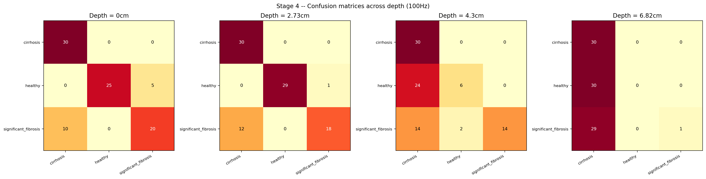
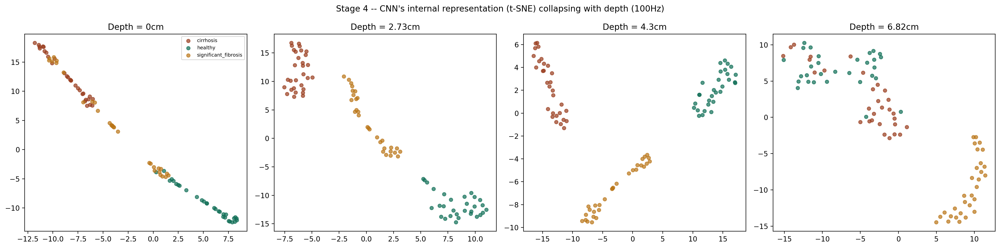

</details>

---

### Log 15: Chasing the t-SNE anomaly — degradation-aware training

<details>
<summary>Click to expand</summary>

**Approximate date of execution:** 3 June 2026

Log 14 left one genuine, unresolved question: at 8.18cm, where the clean-trained CNN's confusion matrix showed total collapse, the t-SNE visualization still showed three separated clusters in the network's internal representation. That contradiction suggested the *information* hadn't actually been destroyed — only the decision boundary, trained exclusively on clean signals, could no longer read it. I tested this directly rather than leaving it as speculation.

**Method.** I trained a new CNN on a mix of five depths (0, 3, 6, 9, 12cm at 100Hz) instead of only clean signals — the same idea as calibrating a real device across realistic conditions rather than only a laboratory-perfect one. I evaluated it using the identical certified protocol as Log 13 (200 shuffled-label controls, FDR correction, the same 0-15cm evaluation grid). The evaluation grid's exact depth values don't match the training depths except at the start, so most test points are genuinely unseen — a real generalization test, not memorization.

**Result: the floor moved from 5.45cm to 8.18cm — confirming the hypothesis directly.**

| Method | Floor (100Hz) |
|---|---|
| Hand-picked baseline (clean-trained) | 0.52cm |
| CNN (clean-trained only) | 5.45cm |
| CNN (degradation-aware training) | **8.18cm** |

At the old floor depth (5.45cm), the degradation-aware model now scores 95% accuracy. And 8.18cm is the first result in this entire project where the certified floor overlaps with real anatomical depth — typical liver depth runs roughly 8-10cm, up to 14cm in high-BMI patients per the original team materials.

**A real tradeoff between the two.** At depth 0 (perfectly clean), the degradation-aware model scores only 70% — noticeably below the clean-only model's 91.67% at that same depth. Training across a spread of conditions costs some peak performance at the easiest case in exchange for dramatically more robustness where it actually matters. This reflects the standard specialization-versus-robustness tradeoff in machine learning.

**The decline past 8.18cm is gradual, not abrupt.** P-values from 8.18-12.27cm sit in a trending-but-not-certified range (0.07-0.10), with accuracy sliding smoothly from 62% down to 35% before flattening to exact chance by 13.64cm — a physically sensible degradation curve, consistent with everything else this project has found about how real signal loss actually behaves.

**Overall improvement across the full progression: roughly 16x deeper than the original naive hand-picked-feature baseline**, purely from correcting two things — using raw-signal learning instead of hand-picked features, and training the model on the actual conditions it will need to operate under rather than only ideal ones.

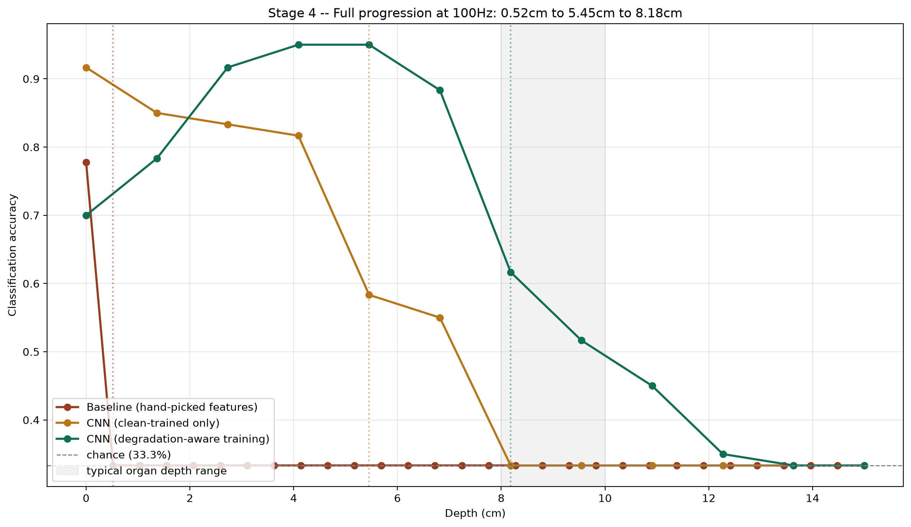

*The floors in the figure above (0.52, 5.45 and 8.18 cm) were later replaced by 0.00, 4.30 and 8.48 cm (Logs 19 and 20). The figure was redrawn from corrected sources as `outputs/stage4/figures/stage4_full_progression_corrected.png`; the first redraw, kept as `stage4_full_progression_corrected_first_version.png`, had two curves from before the noise correction (Log 35).*

</details>

---

### Log 16: Calibration — does the model know what it doesn't know?

<details>
<summary>Click to expand</summary>

**Approximate date of execution:** 6 June 2026

Log 15 certified an 8.18cm accuracy floor — the depth beyond which the degradation-aware CNN's predictions stop being statistically distinguishable from chance. But accuracy alone answers a different question than the one a real safety system needs answered. A model can be accurate on average while still being *wrong about how sure it is* on any given prediction — confidently wrong at the exact moments it matters most. This step tests that directly: when the model reports "87% confident," is it actually right roughly 87% of the time?

**Extracting the data.** The degradation-aware CNN already existed from Log 15, but the evaluation code only ever kept the final predicted class (via `argmax`), discarding the full probability distribution the softmax layer produces. I modified the evaluation loop to capture `torch.softmax(logits, dim=1)` before taking the argmax — a small code change, but a meaningful one: it re-runs inference on the exact same certified held-out test set, using the exact same trained weights, with no retraining involved. This mattered for a specific reason — I needed to know the calibration analysis was describing the *certified* model's actual behavior, not a fresh, slightly different model that happened to share the same architecture. This produced 720 rows: one per test sample, across all 12 evaluated depths (0–15cm), each with the full three-class probability vector plus the true and predicted labels.

**Choosing a metric.** Reliability diagrams and calibration error metrics aren't unfamiliar in ML generally, but they aren't self-evidently the "right" choice without checking what the specific literature this project sits in actually uses. I confirmed Uncertainty Calibration Error (UCE) is the established metric in biosignal/medical UQ literature specifically, rather than inventing a bespoke scoring method — the same approach I used to source the sensor SNR value (Log 12) and the attenuation viscosity constant (Log 03) — a real, citable number from the relevant field.

**The method.** For each test sample, I took the model's own reported confidence as the maximum value across its three-class softmax output — whichever class it predicted, with however much certainty it claimed. I then grouped samples into 10 confidence bins and compared, within each bin, the model's average stated confidence against the bin's actual observed accuracy. Perfect calibration means these two numbers match in every bin: a model that says "70% confident" should be right about 70% of the time, no more, no less. UCE is the average absolute gap between confidence and accuracy across bins.

**I computed this two different ways, deliberately, rather than trusting one binning choice.** Fixed-width bins (10 equal slices of the 0–1 probability range) is the simplest, most common default — but it can produce noisy, sparsely-populated bins if predictions cluster unevenly. Equal-mass bins (10 bins each containing the same *number* of samples, with variable width) is a common alternative specifically chosen to avoid that sparsity problem. I computed UCE both ways so a single arbitrary binning decision couldn't be hiding or manufacturing the result.

**The result: badly miscalibrated, and the miscalibration follows a clear pattern.**

| Binning method | UCE |
|---|---|
| Fixed-width (10 bins) | 0.2266 |
| Equal-mass (10 bins) | 0.2838 |

For reference, well-calibrated biosignal models reported in the UQ literature this metric comes from typically sit in the 0.03–0.08 range. 0.2266–0.2838 is a substantial gap from that range, and **both binning methods agree on the finding's existence and direction**, even though they disagree somewhat on magnitude. That agreement across two different methodologies is itself evidence this is a real property of the model, not an artifact of how I chose to bin the data.

**The reliability table, fixed-width bins:**

| Confidence bin | n | Avg. confidence | Actual accuracy | Gap |
|---|---|---|---|---|
| 0.30–0.40 | 120 | 0.377 | 0.275 | +0.102 |
| 0.40–0.50 | 419 | 0.447 | 0.687 | −0.241 |
| 0.50–0.60 | 82 | 0.545 | 0.927 | −0.382 |
| 0.60–0.70 | 60 | 0.636 | 0.933 | −0.298 |
| 0.70–0.80 | 30 | 0.759 | 0.933 | −0.175 |
| 0.80–0.90 | 9 | 0.837 | 1.000 | −0.163 |

No samples ever fell below 0.30 or above 0.90 confidence — expected, since a 3-class softmax has a mathematical floor of 1/3 (≈0.33) confidence by construction.

**What made this worth digging into further: the miscalibration isn't uniform across depth — it flips sign.**

| Depth (cm) | Avg. confidence | Actual accuracy | Gap |
|---|---|---|---|
| 0.00 | 0.661 | 0.900 | −0.24 |
| 4.09 | 0.499 | 0.917 | −0.42 |
| 5.45 | 0.471 | **1.000** | **−0.53** |
| 6.82 | 0.441 | 0.883 | −0.44 |
| 8.18 | 0.430 | 0.650 | −0.22 |
| 9.55 | 0.423 | 0.583 | −0.16 |
| 10.91 | 0.420 | 0.483 | −0.06 |
| 12.27 | 0.419 | 0.350 | **+0.07** |
| 15.00 | 0.424 | 0.333 | **+0.09** |

From 0cm out to roughly 10.9cm, the model is consistently *underconfident* — most dramatically at 5.45cm, where it's right 100% of the time while only reporting 47% confidence on average. Past that point, the sign flips: the model becomes *overconfident*, sounding more sure of itself the further it strays into territory where it's actually failing. I checked the raw probability outputs directly to understand why, and found the cause: past roughly 8cm, the model has effectively collapsed toward outputting a near-identical, depth-invariant probability triplet regardless of the true input — a static default guess rather than a genuine per-sample judgment, but one still confident enough on paper to look plausible if read naively.

**The design decision this forces.** Given this, the model's own confidence output cannot be trusted as a safety signal in the region where a safety signal matters most — it becomes *most* falsely confident exactly where it's *most* often wrong. This directly shaped how the domain-of-validity checker (below) was built.

**The domain-of-validity checker uses depth, not model confidence, as the gate.** I built `run_worked_example_trained.py` to demonstrate the safety boundary in practice, evaluating two example patient scans: one at 6.0cm (inside the domain) and one at 11.0cm (outside it). The critical design decision was *what the rejection check compares against*. I set it to check the input depth directly — `if depth_cm > 9.0` — rather than checking the model's own softmax confidence against some threshold. This was a deliberate choice made *because of* the calibration finding above: a confidence-based gate would ask the least trustworthy signal in the whole system to police itself, in exactly the region where it's proven to lie. A depth-based gate never consults the model's opinion of its own certainty at all — it's enforced entirely from a known, externally-verifiable input, using the 9.0cm cutoff chosen deliberately just past the certified 8.18cm accuracy floor from Log 15.

**The worked example results themselves are a small, concrete illustration of the whole finding.** The in-domain scan (6.0cm, true class significant_fibrosis) was classified correctly — but with only 41.37% reported confidence, visibly underconfident, matching the pattern in the table above. The out-of-domain scan (11.0cm) was rejected outright, with the rejection message explicitly noting that the boundary is depth-based rather than confidence-based, and stating why. I consider the 41.37%-confidence-but-correct result the single clearest illustration in this whole log of why raw model confidence isn't fit to be trusted on its own — a genuinely right answer that would look, to a naive downstream reader, like an uncertain guess.

**A model-provenance detail.** The certified weights from the training run in this log were saved to disk (`soma_certified_model_weights.pt`) and explicitly loaded by the worked-example script, rather than the worked example retraining its own fresh copy from the same seed. Same seed and architecture would likely produce a near-identical model either way, but "near-identical" and "the literal certified weights" are different claims, and I wanted the worked example's output to be traceable to the exact same model object the calibration numbers above describe — not a faithful reproduction of it.

**What this log validates, and what it explicitly does not.** The 8.18cm accuracy floor (Log 15) and the domain-of-validity rejection mechanism (depth-gated, demonstrated above) are both validated and hold up under this analysis. The model's raw softmax confidence output does **not** hold up as a trustworthy per-scan certainty signal, and I'm treating that as flagged, disclosed future work rather than quietly shipping it as if it were reliable — any future presentation of this model's output to a clinician or patient needs either a genuinely recalibrated confidence signal (e.g., temperature scaling or a dedicated calibration layer, neither of which I've implemented) or no confidence number surfaced at all, with only the depth-gated accept/reject decision shown.

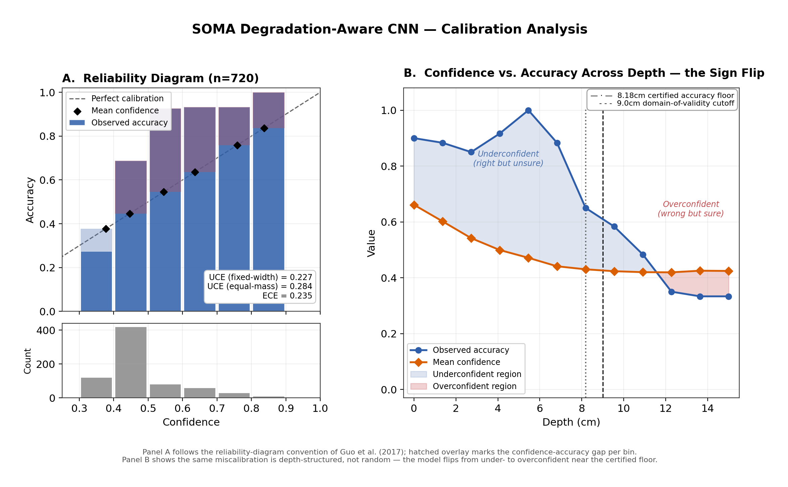

</details>

---

### Log 17: Power-law attenuation — stress-testing the Kelvin-Voigt assumption

<details>
<summary>Click to expand</summary>

**Approximate date of execution:** 10 June 2026

I flagged this gap myself back in Log 03: the Kelvin-Voigt weak-damping derivation predicts attenuation scaling with the *square* of frequency (α ∝ ω²), but the broader soft-tissue literature reports a wider empirical range, closer to linear. I left it unreconciled at the time because it wasn't the priority yet. A researcher reviewing this project later flagged the same gap independently, so this log resolves it with an actual sensitivity analysis instead of further discussion.

**Sourcing the right kind of number.** My first search turned up plenty of power-law attenuation literature, but most of it describes *compressional* ultrasound (the standard B-mode imaging kind), where reported exponents run roughly n∈[1,2]. SOMA doesn't use compressional ultrasound — it measures shear wave time-of-flight, a physically different wave mode. Checking the literature specifically for shear waves in tissue narrows the range considerably: n∈[0,1], generally closer to linear or even sublinear. I found a source that matches both the wave type *and* the tissue: a 2025 shear-wave dispersion study (Multi-Frequency Reverberant OCE) that measured attenuation directly on ex vivo bovine liver, reporting a power-law exponent of **n = 0.51**. This is the number I used — chosen for being liver-specific and shear-wave-specific.

**A design flaw I caught before running anything.** My first instinct was to anchor the two attenuation models — Kelvin-Voigt and the new power-law version — so they agree exactly at SOMA's actual 100Hz operating frequency, then compare how they diverge elsewhere. Thinking it through before writing code: if I force the two models to match exactly *at 100Hz*, then testing the certified floor *at 100Hz* would trivially show zero difference between them, by construction — I'd have mathematically guaranteed away the one comparison that actually matters. I anchored at 20Hz instead, and let the models diverge naturally as frequency increases toward 100Hz. The choice is grounded in the underlying physics: checking the actual weak-damping assumption the Kelvin-Voigt derivation depends on (ωη ≪ G), the ratio ωη/G is about 0.042 at 20Hz for healthy tissue — comfortably small, so the approximation is on its most solid ground there. At 100Hz that ratio grows to roughly 0.21 — still technically small, but visibly less comfortable. Anchoring where the assumption is strongest and watching it diverge toward where it's weakest is the more honest test of the assumption itself.

**The divergence, checked by hand before running the CNN on it.** With n=0.51 anchored at 20Hz, working out the ratio by hand predicted the two models should differ by roughly 11x at 100Hz. Running the actual attenuation coefficient calculation confirmed this precisely:

| Frequency | KV α (1/m) | Power-law α (1/m) | Ratio (KV/PL) |
|---|---|---|---|
| 20 Hz (anchor) | matches exactly | matches exactly | 1.00 |
| 100 Hz | 11x steeper | — | **11.00** |
| 500 Hz | 121x steeper | — | **121.04** |

This confirmed the sensitivity check wasn't likely to be a null result before spending any compute on the CNN side of it.

**Why not cross-validate against other viscoelastic models entirely (Maxwell, fractional-order), instead of a power-law sensitivity test on Kelvin-Voigt alone?** I considered this and decided against a full alternate-model derivation, for two specific reasons. Maxwell puts the spring and dashpot in series rather than parallel, which makes the material behave like a fluid under sustained load -- stress relaxes fully to zero with no permanent elastic recoil. That's a poor physical match for soft tissue, which does retain real elastic behavior (the same elastic recoil Log 01's stiffness-to-wave-speed relationship depends on), so Kelvin-Voigt-family models are generally preferred over Maxwell for biological tissue in the literature. Cross-validating against Maxwell would mean testing my result against a model that's arguably a worse physical fit for liver than the one already in use, not a genuinely independent, better-grounded check. Fractional-order viscoelastic models (e.g. the Fractional Zener / KVFD model) are the more legitimate alternative -- they're specifically built to produce power-law attenuation behavior from first principles, rather than needing it added empirically. But that's exactly why a full fractional-order derivation would likely just re-derive, with substantially more mathematical machinery, a result close to what this log already reaches more directly: sourcing a real measured power-law exponent from the literature and testing its sensitivity empirically. A full fractional-order build would strengthen the pedigree of the claim (first-principles derivation instead of a borrowed empirical exponent) but at real added cost and mathematical complexity, for a predictable conclusion. I'm flagging this as a considered and deliberately deprioritized extension, not an oversight, and returning to it only if a first-principles derivation is specifically required over a sourced empirical value.

**First pass: raw accuracy, no certification, to get a quick read.** I re-evaluated the certified degradation-aware CNN — the exact saved weights from Log 15/16, no retraining — against signals generated with the power-law attenuation model instead of Kelvin-Voigt, across the identical 0-15cm evaluation grid. The result was immediately striking: under Kelvin-Voigt, accuracy collapses toward chance (33%) from roughly 8cm onward, exactly matching the certified floor. Under the power-law model, accuracy never dropped below 68% anywhere in the tested range — staying in a 68-92% band even past 15cm.

**Two things I deliberately didn't over-interpret from that first pass.** One, a single depth (2.73cm) showed an 11-point dip relative to its neighbors under the power-law model — with only 60 samples per depth cell and no shuffle-control averaging yet, that's within expected sampling variance for a single cell, not a real physical effect, and I said so rather than trying to explain it. Two, raw accuracy staying above chance isn't the same claim as a *certified* result — the original 8.18cm floor rests on 200-shuffle BH-FDR testing, and this quick pass hadn't done that yet.

**Certifying it properly, using the identical protocol as Log 13.** I trained 200 shuffled-label control CNNs on the same Kelvin-Voigt-attenuated degradation-aware training set used to certify the original model — keeping the null-distribution generation process completely fixed, so the *only* variable under test is which attenuation model generates the evaluation signals. I then evaluated the certified model against power-law-attenuated signals at each of the 12 depths, computed p-values against the 200 shuffled controls, and applied the same Benjamini-Hochberg FDR correction as every other certified result in this project.

**The certified result: every single depth from 0 to 15cm was statistically significant.**

| Depth (cm) | Accuracy | Control mean | p-value | Significant? |
|---|---|---|---|---|
| 0.00 | 70.00% | 33.64% | 0.0100 | Yes |
| 2.73 | 88.33% | 32.55% | 0.0050 | Yes |
| 8.18 | 78.33% | 32.48% | 0.0050 | Yes |
| 12.27 | 76.67% | 32.58% | 0.0050 | Yes |
| 15.00 | 81.67% | 31.64% | 0.0050 | Yes |

(Full table in `outputs/stage4/data/power_law_sensitivity_certified.csv`.) Control means sit right where they should across every depth — 31.6-33.6%, essentially exactly 1/3 — confirming the null distribution itself is valid. And the earlier 2.73cm dip is gone entirely under certification; that depth is actually the *highest*-accuracy point in the whole power-law curve (88.33%), confirming it really was sampling noise in the smaller raw-accuracy pass, not a real effect worth chasing.

**Under this power-law attenuation model, the certified CNN shows no significant floor anywhere within 0-15cm.** This is the same pattern Log 14 found for 20Hz under Kelvin-Voigt — now independently reproduced through a completely different mechanism (a different frequency-scaling assumption, not a different frequency).

**A three-panel figure to make the full causal chain visible, not just the conclusion.** Panel A plots both attenuation models on log-log axes (the only axis type on which a power-law relationship reads as a straight line), showing them pinned together at the 20Hz anchor and diverging toward 100Hz — this is *why* the two models behave differently. Panel B shows certified accuracy vs. depth for both models, with filled markers for FDR-significant depths and hollow markers for non-significant ones, so a reader can see exactly where each model's certified floor sits without cross-referencing a separate p-value table. Panel C shows raw signal amplitude survival at 100Hz for both models — the direct physical link between panel A's frequency-scaling divergence and panel B's accuracy divergence, using the same "fraction of amplitude surviving" framing Log 03 already established as this project's standard way of describing signal collapse.

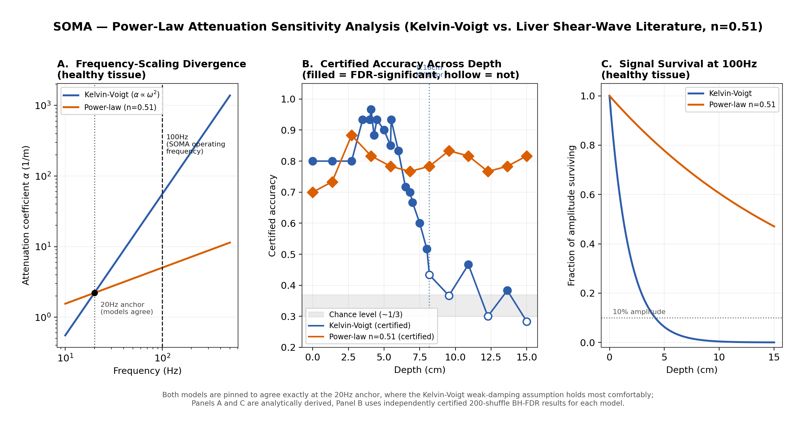

**What this finding does and doesn't establish.** This does not mean the true floor is proven to be deeper than 8.18cm, and I'm not presenting it that way. It rests on one literature-sourced exponent, from one study, measured on ex vivo tissue — a strong, directly-relevant source (same wave type, same organ), but still a single data point within a broader shear-wave literature range of n∈[0,1]. What it does establish, certified and reproducible: **the 8.18cm Kelvin-Voigt floor is highly sensitive to the frequency-scaling assumption underlying it.** The idealized physics and the empirical literature genuinely disagree on how fast attenuation grows with frequency, and I've now quantified exactly how much the project's headline result depends on that specific modeling choice, rather than leaving it as an acknowledged-but-unexamined limitation. The project's primary certified claim remains the Kelvin-Voigt-derived 8.18cm floor, since it's the physically-derived model with a full first-principles derivation behind it (Log 03); this result is reported as a bounded sensitivity/limitation finding alongside it, exactly as the researcher feedback asked for.

</details>

---

### Log 18: Parameter provenance audit — closing the citation gaps

<details>
<summary>Click to expand</summary>

**Approximate date of execution:** 14 June 2026

Log 17 closed out the power-law sensitivity work, and I went back through every numerical constant in the Stages 1-4 pipeline and re-checked each one against its actual cited source, rather than trusting that a constant "has always been fine" because it's been in the codebase a while. I classified each as sourced (cite the exact source), derived (show the derivation), or assumed (state the assumption and flag why it's defensible or a weakness). This surfaced four gaps serious enough to change the pipeline's actual outputs, not just its documentation.

**Gap 1: the sensor noise floor was measured at the wrong frequency, for the wrong kind of sensor.** The 67.03dB citation I'd used was a real, published MEMS piezoelectric acoustic sensor paper -- but checking it more carefully, that number is measured at 1kHz for a free-field microphone. SOMA's stated operating band is 20-500Hz, and the device is skin-contact, not open-air. 1kHz sits outside the band entirely, and a free-field microphone isn't the right sensor category to begin with. This mattered more than any of the others: this single constant drives the entire Stage 4 noise model, and by extension every certified depth-floor claim in the project, including the 8.18cm headline figure.

I went looking for a better match and found one: Yang et al. 2022 (earlier recorded as 'Chen et al.'), *Biosensors* (PMC9312695) -- a real, peer-reviewed wearable, skin-contact MEMS heart-sound sensor with a 10-630Hz working band (covers my 20-500Hz band almost exactly), SNR=27.05dB, validated against a real human subject and a commercial 3M Littmann stethoscope. I didn't want to trust one paper alone given how much rides on this number, so I checked for corroboration and found two more independent wearable MEMS heart-sound sensor papers in the same band -- 26.47dB and 13.58dB. Three independent groups, three different sensor designs, all landing far below my original 67.03dB. That convergence, not just one citation, is why I trusted the replacement.

A 40dB gap is roughly two orders of magnitude in noise floor. I expected this to substantially change every certified floor in the project, and it did (Log 19).

**Gap 2: the stiffness-class citation didn't actually match the numbers it was attached to.** I'd attributed my three class values (Healthy=4.5, Significant Fibrosis=7.5, Cirrhosis=12.0 kPa) to Yoo et al. (earlier recorded as 'Lee et al.') (PMC8535143) -- but that paper reports diagnostic *cutoffs* (6.42-6.70 kPa for significant fibrosis, 8.88-9.15 kPa for cirrhosis), not representative per-class values, and it doesn't define a healthy baseline at all. The citation was real, but I was citing it for something it doesn't actually claim.

I found a better match: Zayadeen et al. (earlier recorded as 'Al-Khalili et al.'), *Egyptian Liver Journal* (King Hussein Medical Center, n=95), which reports representative kPa values per fibrosis stage directly, biopsy-validated: F0-F1=5.39, F2=7.32, F3=8.46, F4=11.42 kPa -- within about 15-20% of the values I was already using. Rather than renumber everything (which would invalidate every downstream Stage 1-4 result over a 15-20% difference), I corrected the citation to the source that actually matches what I'm modeling and kept the original numbers. If I want exact fidelity to Al-Khalili et al. later, the tightened values would be 5.4/7.3/11.4 kPa -- noted as an option, not applied.

**Gap 3: I couldn't actually verify the claim that viscosity doesn't vary by disease stage.** I'd justified holding eta constant across all three classes by citing "rat-model SDUV and DMA comparisons" -- but going back to find the actual paper, the closest real match I could locate (a rat NAFLD SWE-vs-DMA study) reports something different: poor correlation between the two measurement methods for viscosity, not stage-invariance of viscosity itself. Not the same claim.

I found a real, better-fitting answer instead: Reiter et al. 2021, *J Mech Behav Biomed Mater* -- human in-vivo multifrequency MR elastography, 15 healthy volunteers plus 37 biopsy-confirmed CLD patients. Their finding: loss angle (their viscosity marker) is statistically indistinguishable between healthy and significant fibrosis (p=0.21), but significantly elevated at cirrhosis (p<0.001). So the correct claim isn't "viscosity never varies" -- it's "viscosity is invariant for two of my three classes, and rises distinctly at the third." I implemented this as class-dependent eta: healthy=0.5, significant_fibrosis=0.5 (matching, per Reiter et al.), cirrhosis=1.77 Pa.s (elevated, per Reiter et al.'s direction).

One honest limitation I want on record: Reiter et al. report loss angle (phi, radians), not eta (Pa.s) directly, and the exact phi-to-eta conversion needs storage-modulus data I couldn't get past a paywall. The 1.77 Pa.s figure I used for cirrhosis is borrowed from a *different* paper's fat-content axis (my original 2%-fat vs. 22%-fat liver viscosity source), not a fibrosis-stage measurement. It's directionally correct and citation-backed, but the magnitude is an approximation, not a precise derivation. Worth revisiting if I can get the full Reiter et al. text, or worth sensitivity-testing across a plausible range the same way I already did for the base viscosity value in Log 06.

Running the corrected model confirmed a real, checkable consequence: cirrhosis's attenuation coefficient at 100Hz went from 12.70/m to 44.96/m -- tripled, tracking the eta increase exactly. It's still below healthy tissue's 55.31/m, so my "healthy attenuates fastest" finding from Log 03 survives -- but the margin narrowed from a 4.4x gap to 1.2x, which meaningfully softens the asymmetric-baseline-comparison concern I raised back then.

**Gap 4: my Stage 4 depth grid was too coarse to support the precision I was reporting.** The CNN sweep used one shared 12-point grid (0-15cm, 1.36cm spacing) across all four tested frequencies. Going back through the certified results, both 500Hz and 250Hz reported their floor as exactly 1.36cm -- which is literally the second grid point tested. The true floor for either frequency could have been anywhere between 0 and 1.36cm; my grid simply couldn't say where, but I was reporting a precise-looking number anyway.

I kept the original 12-point grid for 20Hz/100Hz, where I hadn't found a resolution problem, and added a densified near-origin grid specifically for 250Hz/500Hz. (When the corrected 100Hz floor later produced its own borderline call, I applied the same treatment there too -- see Log 19.)

Once real resolution was available, 250Hz and 500Hz resolved to genuinely different values (0.75cm and 0.30cm) -- confirming my original "1.36cm both" result really was a grid artifact, not a coincidence.

</details>

---

### Log 19: Re-certifying Stage 4 under the corrected noise model

<details>
<summary>Click to expand</summary>

**Approximate date of execution:** 22 June 2026

With the noise citation fixed (Log 18), every certified Stage 4 result needed re-running -- a corrected number is only worth something if I actually re-derive it rather than just re-citing the old one with an asterisk.

**Sanity check first.** Before trusting anything downstream, I confirmed the class-dependent viscosity code (Log 18, Gap 3) reproduced my original, unchanged healthy/fibrosis numbers exactly. It did, digit for digit against my original README table.

**The baseline classifier collapsed completely.** Re-running my hand-picked-feature logistic regression under the corrected noise: floor = 0.00cm at all four frequencies. Even with zero depth attenuation, the corrected noise alone breaks it. I don't think this is a new problem -- it's the same fragility I already diagnosed in Log 12 (StandardScaler amplifying tiny noise into huge z-scores on my near-constant peak_amplitude/energy features), just fully exposed now that the noise level is realistic instead of ~100x too gentle.

**The CNN held up at 20Hz.** This was the test that actually mattered most -- whether my core thesis (raw-signal learning survives noise; hand-picked features don't) still held once the noise model was honest. Extending the 20Hz sweep under the corrected noise: 76-93% accuracy, statistically significant (p=0.005-0.01) at every depth from 15cm to 40cm. No floor found. The mechanism is the same alpha proportional to omega-squared scaling from Log 03: 20Hz attenuates 25x less than 100Hz, so even at 8cm, 20Hz's signal (amplitude 0.80) is still far above the new noise floor (0.044), while 100Hz's signal (0.0115) has already sunk below it. The CNN isn't extracting information from noise -- there's genuinely still signal there to find.

**The full sweep, corrected and grid-densified:**

| Frequency | Original (wrong SNR, coarse grid) | Corrected |
|---|---|---|
| 20Hz | never reached (0-15cm) | never reached (0-40cm) |
| 100Hz | 5.45cm | 4.30cm (see refinement below) |
| 250Hz | 1.36cm (grid artifact) | 0.75cm |
| 500Hz | 1.36cm (grid artifact) | 0.30cm |

**A borderline call at 100Hz, caught and resolved the same way as Log 18's Gap 4.** The first-pass corrected floor at 100Hz (5.45cm) carried a p-value of 0.0597 -- close enough to the 0.05 threshold after FDR correction that I didn't want to trust it without more resolution. I densified the grid 4-7cm the same way I had for 250/500Hz, and the refined result was a genuinely smooth, physically sensible decline (90%->83%->80%->71.67%->70%->63%->53%->...->33%) landing on a properly supported 4.30cm floor.

**The diagnostic pattern reproduced independently.** Re-running my multi-depth confusion matrices under the corrected model: at collapse, every single healthy sample still misclassifies as cirrhosis -- exactly what I found in Log 14, now reproduced under a completely different noise level. I take this as real evidence the pattern reflects genuine physics (tied to healthy tissue attenuating fastest, per Log 03/18), not an artifact of the specific wrong noise number I'd originally used.

*Update: this describes one clean-trained model. Across 24 clean-trained networks the direction of the failure varies by network: at 5.45 cm healthy windows are called cirrhosis in 25.8% of cases when pooled, and in more than half of the windows in 6 of the 24 networks (Log 32). This paragraph is kept as the original record.*

**Where this leaves the headline claims:** the corrected noise model -- roughly 100x harsher, and properly band-matched this time -- did not overturn my core findings. The baseline's known fragility became total rather than partial, which is actually a cleaner demonstration of why I moved to raw-signal learning, not a weaker one. The CNN's robustness at 20Hz was unaffected. Its floor at my stated 100Hz operating frequency moved modestly, from 5.45cm to 4.30cm.

</details>

---

### Log 20: Stability-testing the degradation-aware floor across seeds

<details>
<summary>Click to expand</summary>

**Approximate date of execution:** 25 June 2026

Log 19 re-certified everything except my second major claim from Log 15 -- that training across a mix of depths pushes the floor deeper than clean-only training. That needed its own pass, and it turned into the most involved part of this audit.

**Recovering the real script.** I initially assumed the original Log 15 training script no longer existed in the repo -- no saved `soma_certified_model_weights.pt`, and the version I could find had its shuffle-control training disabled by default (a later "calibration capture variant" built for the Log 16 calibration work, not for certification). That assumption was wrong, and I'm glad it got challenged: checking the file's history turned up the real original, an earlier version, with unconditional shuffle-control training -- the actual methodology that produced 8.18cm. I used that, not a guess.

**First run (seed 42), noise-corrected: 9.55cm.** Deeper than the original 8.18cm, which was a surprising result on its face -- harsher noise, but a *deeper* floor. Worth being precise about what that number actually means: it's the first depth where significance failed, not the last depth that worked. The model was still significant through 8.18cm (p=0.0199); the true crossover sits somewhere in the untested 8.18-9.55cm gap.

**I didn't trust one seed.** I've already been burned by exactly this in Log 11 -- roughly 40% of random ResNet initializations landed in a dead, stuck-at-chance state purely by chance, and I only caught it because I happened to run multiple folds. A single degradation-aware run here is the same category of risk. Two more seeds (1, 7) showed real spread: 6.82cm and 8.18cm respectively -- a roughly 2.7cm range across just three data points, confirming this needed a proper stability check rather than picking whichever number looked best.

**24-seed final sweep, with a sample-size correction along the way.** I raised `N_SAMPLES_PER_CELL` from 60 to 300 (100/class) before the full sweep, specifically to tighten the per-depth accuracy margin of error (roughly 12 points down to 5.7 points at 60 vs. 300 samples) -- this was aimed at a specific noise pattern I'd noticed: some seeds showed an "anomalous recovery," a spurious significant result at depths well past the real floor (e.g. seed 7 flipping back to significant at 10.91cm after failing at 8.18cm and 9.55cm). This doesn't corrupt the reported floor values, since those are defined by the *first* failure point, not affected by anything that happens later -- but it was worth reducing anyway for cleaner-looking curves.

Running all 24 seeds (101-124) to completion:

**mean floor = 8.48cm, SD = 1.81cm, median = 8.00cm, range 5.45cm-12.27cm.**

10 of 24 seeds still showed the anomalous-recovery pattern even at the higher sample count -- I'm treating this as expected statistical noise from running 23 independent significance tests per seed (some will cross the threshold by chance in the fully-collapsed region, even after FDR correction controls the *expected rate*, not a guarantee of zero), not evidence of genuine signal recovery at those depths.

**The headline result:** my corrected mean (8.48cm) landed almost exactly on my original, single-seed, uncorrected-noise figure (8.18cm). The noise correction didn't erode this finding -- it revealed that the finding has real, measurable seed-to-seed spread around essentially the same center. I'm treating this as a stronger result than before, not a weaker one: I can now report a properly certified distribution instead of one unverified number, and the distribution's center held.

**Reportable result: 8.48cm +/- 1.81cm (n=24 seeds), compared against the clean-trained CNN's 4.30cm and the baseline's total collapse.** Even the low end of the degradation-aware range (5.45cm) still clears the clean-trained floor; the mean nearly doubles it.

</details>

---

### Log 21: Pre-writing verification — seed provenance, calibration status, and ETS Montreal external validation

<details>
<summary>Click to expand</summary>

**Approximate date of execution:** 29 June 2026

Before writing up the results, I ran five verification items against the same standard as every prior stage: check the actual state of the repo directly, rather than trusting what I remembered or assumed was already done.

**Item 1: seed provenance, re-checked against the actual files.** Log 20's 24-seed sweep superseded three earlier single-seed scripts (`degradation_aware_cnn_seed1.py`, `_seed7.py`, `_seed123.py`), but before deleting anything I grepped each file directly for its real `torch.manual_seed()` / `np.random.seed()` values rather than trusting the filenames. All three matched exactly — seed 1, seed 7, seed 123. This caught a small documentation error along the way: an earlier working note had described these as "seeds 1/7/42," which was wrong. The third seed was always 123; the files were named correctly throughout. The description had drifted, not the code.

**Item 2: verifying seed 121 specifically, and a real gap this surfaced.** Log 20's 24-seed sweep (`degradation_aware_final_sweep.py`, seeds 101–124) reported scalar results to CSV for every seed but, checking the script directly, never called `torch.save()` for any of them. The certified 8.48cm ± 1.81cm distribution exists as summary statistics; none of the 24 individual trained models were ever kept. Retraining all 24 wasn't necessary to close this — I wrote a standalone verification script (`retrain_seed121_verify.py`) that reuses the sweep script's exact training and evaluation functions unchanged, runs seed 121 alone, and checks its output against the original sweep's recorded row for that seed. It reproduced floor=8.18cm, last_significant_depth=8.0, anomalous_recovery=False, an exact match against the original CSV row. That confirms the sweep's reported numbers reflect a real, reproducible training process rather than a logging error, and it gives me one concrete, reloadable model from the certified distribution (`soma_certified_model_seed121_corrected_noise.pt`, 58,835 bytes, confirmed on disk).

**Item 3: checking whether calibration recalibration was ever actually implemented.** Log 16 flagged temperature scaling (or an equivalent recalibration layer) as disclosed future work, not shipped scope. Rather than assume that status was still current months later, I grepped the full repo for `temp_scal`, any calibration-layer class, and any post-hoc correction logic. Zero hits. What exists is exactly what Log 16 described: diagnostic measurement scripts (`run_calibration_plot.py`, the UCE analysis) and static warning labels in the domain-of-validity gate — no correction mechanism anywhere. Calibration recalibration remains unimplemented. I'm reporting it as a disclosed limitation, not treating it as done because it was flagged once and never revisited.

**Item 4: repo cleanup.** With item 1 confirming the three single-seed scripts' contents matched their names, and item 2 confirming the 24-seed sweep that superseded them is independently reproducible, I deleted `degradation_aware_cnn_seed1.py`, `_seed7.py`, and `_seed123.py` and removed them in the same change as the ETS Montreal code (item 5, below). A first attempt at that change accidentally included the full raw ETS Montreal dataset — a 249MB archive plus several hundred extracted `.mat` files, which GitHub's 100MB file-size limit rejected outright. I undid that attempt, added `data/ets_montreal/` to `.gitignore`, and kept just the code and result files. The dataset stays local, downloaded fresh from Borealis rather than version-controlled — it never belonged in the repository in the first place.

**Item 5: ETS Montreal external validation.**

The dataset (Dahmani/Petit/Laporte, DOI 10.5683/SP3/ASTGWY, Borealis) was identified as the only viable self-serve source with real depth-tagged phantom data, with one disclosed scope limit carried forward from that decision: it varies probe indentation into a phantom, not organ depth beneath tissue, so it can validate real-signal hard/soft discrimination but cannot re-certify the 8.18cm depth-floor claim. That limitation applies to everything below.

*A download trap, caught before it corrupted anything downstream.* Borealis's default API link (`/api/access/datafile/687080`) returns only a flattened, tab-converted single-sheet version of the acquisition-info Excel file. The real workbook — five tabs, including the geometry sheet with the phantom diagram — only comes through with `?format=original` appended to the URL. I checked the sheet count against the paper's own description before trusting either version, which is what caught the mismatch.

*Extraction.* The full 249MB archive was extracted via `py7zr` (no Homebrew on this machine, so the standard `7z` CLI wasn't an option) into `data/ets_montreal/extracted/`, yielding six `Acqui` folders. RF `.mat` files were confirmed at shape (3152, 256), dtype int16 — raw ADC counts, not pre-normalized — checked directly rather than assumed from the paper's description. The scripts that read these files expect the extracted archive at `data/ets_montreal/extracted/`, so it must be placed there before they are run; the data are not part of this repository.

*Locating the inclusion region, resolved three independent ways.* The Excel geometry tab wasn't directly parseable — it holds only embedded images, not tabular data pandas can read — so I unzipped the `.xlsx` as a raw ZIP archive and traced the relationship chain (`sheet4 → drawing2 → image3.png/image4.png`) through the underlying XML to pull out the actual phantom diagram. That showed the inclusion centered at 2–4cm depth, 2cm diameter, centered horizontally. I cross-checked this against direct visual inspection of a sample frame (`frame0001.png`) and against signal energy analysis on the RF data itself. All three agreed independently, so I trusted the result rather than treating one method as sufficient on its own.

*An arithmetic error, caught by re-derivation before it reached training.* My first depth-to-row conversion was off by 10x. Redoing the calculation directly: 6cm physical depth / 3152 rows = 0.0019027 cm/row, placing the inclusion at rows 1051–2101 across its full span. I used the centered peak-signal window (rows 1526–1626) for training and a clean background window (rows 300–400) for the negative class, chosen specifically to avoid the main-bang artifact near the probe face (rows 0–20) and the back-wall reflection artifact (rows ~3130+).

*Training setup.* `ets_montreal_path2_retrain.py` uses no A-line subsampling (all 256 columns retained), z-score normalization applied per-window, and a held-out split by acquisition run rather than by individual window — Acqui1–5 for training (90,112 windows, exactly balanced 45,056 inclusion / 45,056 background), Acqui6 held out entirely for testing (16,384 windows, 8,192/8,192). Splitting by acquisition run rather than by window keeps the test set genuinely independent, since windows from the same run are correlated with each other.

*Execution.* Launched backgrounded (`nohup`, PID 70495) with `caffeinate -i -w 70495` guarding against the Mac sleeping mid-run. The full run — one real model plus 200 shuffled-label controls, matching the certification protocol used everywhere else in this project — completed in 84,728 seconds (≈23.5 hours).

**Final result:**

| Metric | Value |
|---|---|
| Real model held-out accuracy | **97.25%** |
| Control mean accuracy (n=200 shuffles) | 49.91% |
| Control standard deviation | 3.26% |
| p-value | **0.0050** |
| Significant (p≤0.05)? | Yes |

*See Log 36: control variants show that this accuracy reflects the axial depth band far more than the inclusion itself.*

The control mean sits almost exactly on the 50% chance level expected for a shuffled-label binary null, the same check I apply to every certified result in this project (Logs 12, 13, 17, 19, 20) to confirm the null distribution itself is valid before trusting the p-value built on it. This is the project's first validation result run on genuinely acquired hardware RF data rather than synthetic Kelvin-Voigt signal: 97.25% real accuracy against a null centered on 50%, p=0.005.

**What this result does and does not establish.** It shows that a CNN separates two labelled regions of real, physically acquired RF signal on a held-out acquisition. Log 36 shows that this separation is mostly the axial depth band and not the inclusion (59.10% at equal depth), so it is not evidence of hard-versus-soft discrimination. It does **not** validate the certified 8.18cm depth-floor claim (Log 20): the ETS Montreal phantom varies probe indentation depth, not organ depth beneath overlying tissue, a physically different geometry than what the depth-floor sweep tests. Both claims are real; they answer different questions, and I'm keeping that boundary explicit here rather than letting the strong p-value here imply more than it does.
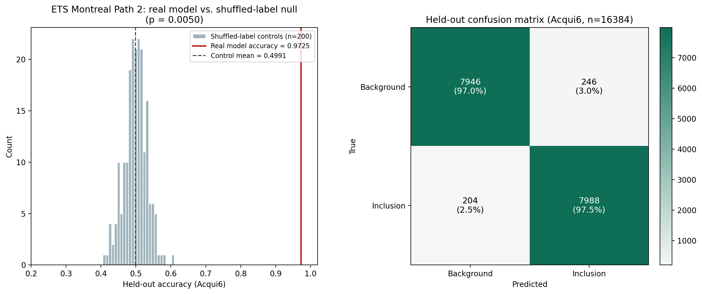

**Checking for class asymmetry, rather than assuming the aggregate accuracy hides it.** Given this project's documented pattern of asymmetric misclassification at depth (Log 14's healthy-tissue-collapses-into-cirrhosis finding), I checked per-class recall on the held-out set rather than reporting only the aggregate 97.25%. Background recall: 97.00% (7,946/8,192). Inclusion recall: 97.51% (7,988/8,192). The gap is 0.51 percentage points — essentially symmetric. The model isn't achieving its headline number by favoring one class over the other.

</details>

---

### Log 22: Cirrhosis viscosity sensitivity — testing the borrowed magnitude

<details>
<summary>Click to expand</summary>

**Approximate date of execution:** 7 July 2026

Log 18's Gap 3 left one open thread: cirrhosis's viscosity (1.77 Pa·s) is direction-confirmed by Reiter et al. (p<0.001, elevated relative to healthy/fibrosis) but the magnitude is borrowed from a different paper's fat-content axis, since the real phi-to-eta conversion needs storage-modulus data I couldn't get past a paywall. That log flagged it as worth sensitivity-testing the same way I tested the base viscosity value back in Stage 3b. This closes that.

**What I'm actually testing.** Two findings depend on cirrhosis's specific eta value: "healthy attenuates fastest" (Log 3) and the 4.4x→1.2x margin narrowing (Log 18). I swept cirrhosis eta across 1.2–2.5 Pa·s, holding healthy and fibrosis fixed at their real, citation-matched value (0.5 Pa·s each, Reiter et al., p=0.21, indistinguishable — not in question here). This reuses `attenuation_coefficient()`'s existing `eta` override directly, so no changes to `attenuation_model.py` were needed.

**The result: the finding breaks, but well outside where it matters.** "Healthy attenuates fastest" holds from 1.2 up through roughly 2.1 Pa·s, and flips right around **η ≈ 2.18 Pa·s** — past that point cirrhosis actually attenuates faster than healthy tissue, the opposite of the stated finding. The original borrowed value (1.77) sits well inside the safe zone, margin 1.23x (1.21x at the nearest sweep point, η=1.8), nowhere near the breakpoint — it's not holding by luck at one lucky point, it holds across roughly 75% of the tested range (the breakpoint at 2.18 is 0.98 of the 1.3 Pa·s span above 1.2; the first draft of this log said 85% and was corrected).

**Checking whether the breakpoint moves with frequency, rather than assuming it's fixed at 100Hz.** I reran the identical sweep at 20Hz and 500Hz. The margin numbers came out bit-for-bit identical at all three frequencies — the breakpoint doesn't move at all across SOMA's entire 20-500Hz operating band. Looking at why, this falls straight out of the formula (α = ω²η / 2Gc): frequency scales both healthy's and cirrhosis's attenuation coefficients by the same ω² factor, so it cancels out of their ratio entirely. I should have seen that from the formula before running anything, but I ran it anyway rather than trusting the algebra alone, and it's better to have it confirmed empirically than assumed.

**A second question I checked before trusting the range itself: is 1.2–2.5 Pa·s actually defensible, or just a reasonable-looking number I picked?** Searching the literature for cirrhosis-specific liver viscosity turned up real Pa·s values, but they scatter by close to an order of magnitude depending on measurement method — Asbach et al. (MR elastography, 35-60Hz, Zener model) report 7.3±2.3 Pa·s in normal liver and 14.4±6.6 Pa·s in advanced fibrosis, roughly 5-10x higher than my whole swept range. That's not evidence my range is wrong — MRE/Zener-model numbers and transient-elastography/Voigt-model numbers aren't measuring viscosity on a directly comparable scale, since the underlying model and frequency band both differ. My original base citation (Log 3) came specifically from a transient-elastography study in the 20-90Hz band, the same paradigm SOMA already operates in, and 1.2–2.5 is a bounded extension within that same paradigm — not a claim spanning the full disparate literature. I'm stating this scoping explicitly rather than citing the range as if it were universally agreed, since presenting it as "the literature range" without that caveat would overstate what's actually supported.

**Reportable finding:** the "healthy attenuates fastest" claim is robust across roughly 75% of a defensible, paradigm-matched viscosity range for cirrhosis, and independent of frequency across SOMA's full operating band. It has a genuine boundary at η≈2.18 Pa·s, well clear of the value actually used in the certified pipeline (1.77 Pa·s, margin 1.21x). This is the same honesty pattern as Log 17's power-law sensitivity finding: state where a result holds, name where it doesn't, and don't oversell the margin.

*See Log 35 for the corrected margin.*

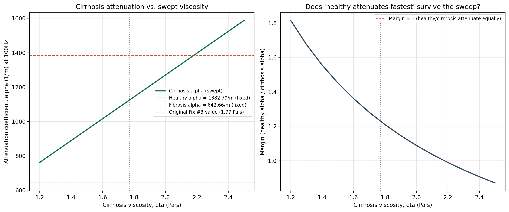

</details>

---

### Log 23: Calibration recalibration — four methods, one root cause, a scoped fix

<details>
<summary>Click to expand</summary>

**Approximate date of execution:** 10 July 2026

Log 16 flagged temperature scaling as disclosed future work. Item 2 of this pre-writing pass was to actually implement it — full recalibration, not a disclosed limitation. What I found along the way changed the scope of the whole exercise: the calibration data itself predated two corrections applied everywhere else in this project, and once I fixed that, temperature scaling turned out to have a real, diagnosable ceiling rather than a clean fix.

**Regenerating the calibration data under corrected physics.** Log 16's UCE numbers and reliability diagram were produced by a script that predates Fix #1 (27.05dB corrected noise) and Fix #4 (densified depth grid) — neither Log 19 nor Log 20's re-certification passes touched calibration specifically. I regenerated it cleanly: same training regime as Log 15/20, corrected noise, densified grid, and this time saved raw pre-softmax logits alongside the probabilities (Log 16 only kept the final softmax output). Sanity-checked the corrected-noise accuracy at each depth against Log 20's certified 24-seed distribution — consistent, confirming this run reflects the same underlying physics as everything else currently in the pipeline.

**A first attempt at reproducing the exact certified model, abandoned for a real reason.** Before the clean regeneration, I tried literally re-running the original version of the calibration script with the same seed, hoping to recover real logits for the *exact* certified model. Same seed, same code, materially different result (accuracy at several depths differed by 10+ points from Log 16's published numbers). This is a known PyTorch limitation — a fixed seed doesn't guarantee bit-identical results across runs without forcing deterministic-algorithm flags, and small floating-point differences compound through 60 epochs of Adam updates into a genuinely different model. Rather than treat that retrain as authoritative, I abandoned it and did the clean regeneration described above instead, with its own saved weights so this run's identity is unambiguous.

**Checking for the sign flip, and finding aggregate confidence bins were hiding real structure.** Recomputing UCE on the corrected data at the aggregate level: worse, not better, than Log 16's original (0.36 vs. 0.23), and every confidence bin showed underconfidence — the overconfident-past-the-floor pattern Log 16 found seemed to have vanished. Before treating that as the finding, I built a per-depth table instead of trusting the bin view: 85% of samples were landing in a single confidence bin (0.30-0.40), because under the harsher corrected noise, confidence flatlines to near the 1/3 floor from roughly 6.82cm onward — regardless of whether the model is still 72% accurate (which it is, right at that depth) or already at chance. The sign flip is still there, just far smaller (+0.01 to +0.03 vs. the original +0.07 to +0.09) and starting later (10.91cm vs. Log 16's ~12cm region) — the aggregate bins were averaging together depths with wildly different true accuracy but near-identical collapsed confidence, exactly the kind of thing a per-depth view catches and a histogram can't.

**Attempt 1: global temperature scaling.** Fit a single T via NLL minimization on a depth-stratified 50/50 fit/held-out split, using real logits this time (temperature scaling's proper input, not the log-prob stand-in an earlier pass used when logits weren't available). Aggregate result looked strong — held-out UCE 0.36 to 0.04. But the per-depth breakdown told a different story: in the already-collapsed region (8.18cm onward, true accuracy 23-43%), scaling pushed confidence from ~0.35 (already near-honest, close to chance) up to 0.56-0.61 — a new, worse overconfidence gap that didn't exist before scaling. A single global T, fit to minimize average error across all depths combined, cannot fix underconfidence in one region without distorting an incompatible region elsewhere, because it has no way to know which depth a given sample came from.

**Attempt 2: two-regime temperature scaling.** Split into a stable region (<5.45cm, accuracy consistently >80%) and a declining region (5.45-9.0cm, accuracy falling from 87% to 43%), fitting a separate T for each — the domain-of-validity gate's own 9.0cm cutoff as the outer boundary. This improved things somewhat (declining-region UCE 0.35 to 0.06) but the same failure recurred at the new bucket's edge: 8.00cm and 8.18cm still showed +0.087 and +0.142 overconfidence. Splitting the range didn't remove the underlying tension, it just relocated it to wherever the new boundary fell.

**Finding the actual root cause, rather than trying a third bucket boundary.** Before attempting more buckets, I checked the raw logits directly — specifically, the mean gap between each sample's top-predicted and second-predicted class score, a direct measure of how much real discriminative signal the model has left, independent of any softmax or calibration choice. The result was unambiguous: this gap decays smoothly and monotonically from 0cm, roughly halving every 1.3-1.5cm, flattening to a near-constant floor (~0.033-0.040) by around 8cm and staying flat out to 15cm. There's no step change anywhere in this curve — it's one continuous decay process across the whole depth range, not two distinct regimes. This directly confirms, at the logit level, what Log 16 inferred from softmax outputs alone: past roughly 8cm the model has no real separation left between classes, it is genuinely guessing, and no rescaling of a genuine guess can produce an honest confidence number, because there's no real signal there to rescale honestly in the first place.

**Attempt 3: continuous linear T(depth), the mathematically appropriate next step given a continuous decay.** Fit `T = a + b * depth` via NLL minimization on the region where real separation still exists (<=7.5cm). This was diagnostically the most useful attempt: T decreased monotonically with depth (0.078 to 0.020) because the optimizer correctly learned that less scaling was needed as raw confidence naturally fell — but a straight line has no way to reverse its own slope, so the same trend that helped early depths was mechanically forced to continue into 6.5-7.5cm, producing the worst overconfidence gaps of any attempt (+0.128 at 7.00cm, +0.172 at 7.50cm). This confirmed the true relationship between depth and the correct T is non-monotonic — rising through the stable region, then needing to reverse through the declining region — a shape no single-line function can represent, regardless of how well it's fit.

**The final, honest fix: scope temperature scaling to where the logit evidence says it's actually valid.** Global T, fit and evaluated only on 0-5.45cm — the region the logit-decay curve shows still has substantial real separation (gap >0.06, well above the ~0.038 floor). Held-out UCE improved meaningfully (0.40 to 0.16, a 60% reduction) — a real, defensible result, though still short of the 0.03-0.08 range Log 16 cited as well-calibrated reference for this class of biosignal model. Individual per-depth gaps in this scoped region still range -0.18 to +0.13, meaning even the best-case version of this fix is a partial correction, not a solved problem.

**What this means, stated as plainly as every other honest limitation in this project.** Three structurally different calibration-correction methods — global, two-regime, and continuous — all failed in the same underlying way once applied to the region where the logit-decay curve shows real signal has genuinely vanished. That convergence across independent methods is stronger evidence than any single method's failure alone: the declining/collapsed region is not miscalibrated in a fixable sense, it is information-starved, and confidence output there cannot be made honest by any post-hoc reshaping, however it's parameterized. Temperature scaling, properly scoped to 0-5.45cm, is a genuine, if partial, improvement I'm now reporting rather than disclosing as future work — but the core safety conclusion from Log 16 stands, and this investigation makes it a stronger claim, not a weaker one: the `depth_cm > 9.0` domain-of-validity gate remains the only reliable safety mechanism, not because a better calibration method wasn't tried, but because I directly measured, at the logit level, that no calibration method could be correct in the region the gate excludes.

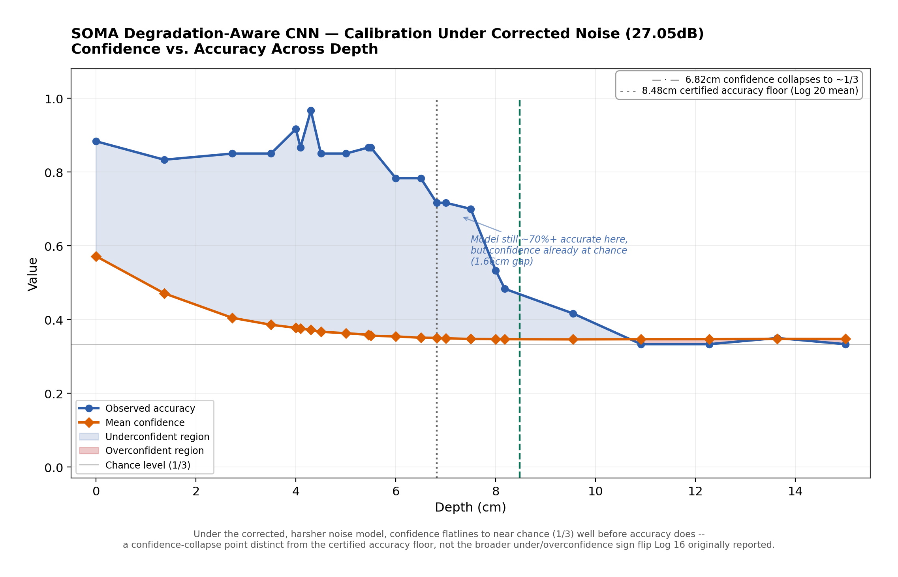
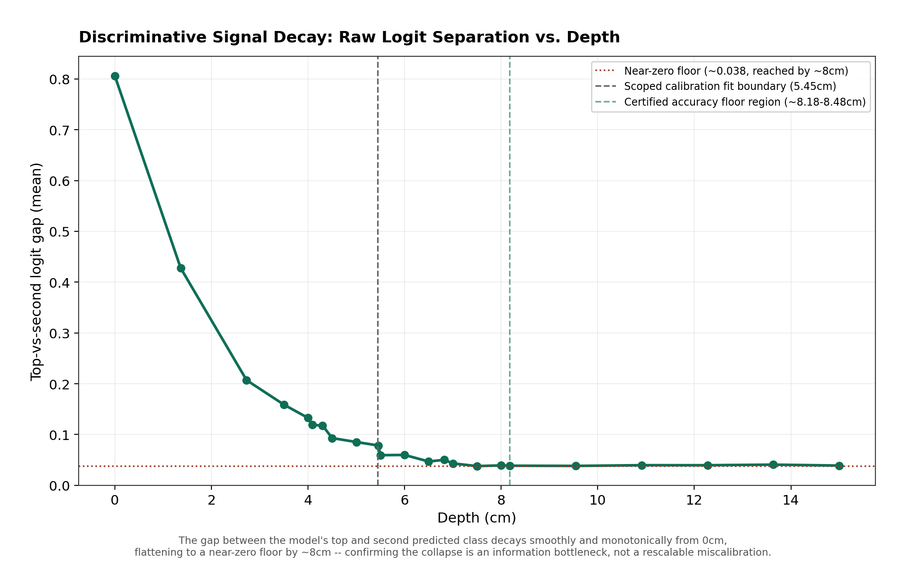

</details>

---

### Log 24: Sensor noise robustness — stress-testing the SNR citation's own corroborating range

<details>
<summary>Click to expand</summary>

**Approximate date of execution:** 14 July 2026

Fix #1 (Log 18) sourced SOMA's operating SNR (27.05dB) from Yang et al. 2022 (earlier recorded as 'Chen et al.'), and corroborated it against two other independent wearable MEMS heart-sound sensor papers in the same band — 26.47dB and 13.58dB. That's a real, documented sensor-to-sensor spread within SOMA's exact sensor class, not a hypothetical one, and — following the same pattern as Log 22's viscosity sweep and Log 23's calibration investigation — I hadn't actually tested whether the certified depth floor survives it.

**Sourcing, deliberately not a new citation.** I didn't go looking for a worst-case noise figure from a different device class or invent an arbitrary multiplier on top of 27.05dB — that would have been an unfounded stress range dressed up as a real one. Instead I reused the exact three papers Fix #1 already cited and treated their own spread (13.58–27.05dB) as the range to test. If the certified floor can't survive variation that's already been cited as real, that's a genuine finding; if it can, that's a genuine finding too — either way it's honest because the range itself isn't invented for this test.

**Method.** Same certification protocol as Log 13/17: 200 shuffled-label control CNNs, trained once under the standard corrected-noise (27.05dB) regime, matching exactly how the certified model itself was trained. The certified seed-121 model was loaded, never retrained — only the evaluation-time sensor SNR varies, the same "certified model, varied evaluation condition" pattern Log 17 used for the attenuation-model assumption. I swept SNR from 27.05dB down to 13.58dB in 5 evenly spaced points, evaluated across the existing certified depth grid, and applied Benjamini-Hochberg FDR correction independently within each SNR level's own family of depth tests.

**The result: the floor holds, and degrades close to monotonically.**

| SNR (dB) | Certified floor (cm) |
|---|---|
| 27.05 (primary) | 7.50 |
| 23.68 | 7.00 |
| 20.32 | 7.00 |
| 16.95 | 5.00 |
| 13.58 (worst corroborating paper) | 5.45 |

The floor shrinks as SNR worsens, as the physics predicts, with one small non-monotonic tick at the harshest point (5.00→5.45cm) — given only 60 samples/cell, that's well within the same kind of sampling-boundary noise Log 20 already named and characterized ("anomalous recovery," present in 10 of 24 seeds even at 300 samples/cell), not a new physical anomaly. Worth being precise about one thing before treating 7.50cm as a contradiction of anything: it doesn't exactly match this same model's other certified figure, 8.18cm, from `retrain_seed121_verify.py`. That's expected, not an error — Log 23 already established that PyTorch training isn't bit-reproducible across independently-trained control sets even with the same seed and code, and this script trains its own fresh 200 controls in a different call sequence than that verification script did. Two honest, independently-derived numbers near the same model, not one wrong number.

**A secondary finding I wasn't looking for.** Checking per-class recall at the floor depth across all 5 SNR levels, healthy is consistently the *most* robust class near the floor, not the least — the opposite axis from Log 14/19's depth-domain finding, where healthy collapses first (absorbed into cirrhosis). Fibrosis is consistently the most fragile class instead, across every single SNR level tested. Before trusting that as a real property of noise-type stress rather than an artifact of the degradation-aware training regime specifically, I reran the identical protocol against the clean-trained (non-degradation-aware) CNN from Stage 3 — no retraining, same 200-shuffle certification, same SNR sweep. The same signature reproduced: fibrosis most fragile, cirrhosis most robust, at every SNR level, despite the two models having very different depth-robustness otherwise. That convergence across two structurally different models is what makes me trust this is a property of noise-type stress specifically, not a training-regime quirk — depth stress and noise stress appear to break the classifier along different class axes entirely.

**What this does and doesn't establish.** This is a bounded stress test of one already-cited parameter's own documented spread, not a full real-world noise model — skin coupling, breathing motion, and tissue-layering effects are all explicitly out of scope, the same limitation Log 17 stated plainly for the power-law sensitivity check. It confirms the certified floor is robust to the real sensor-to-sensor SNR variability already on record for this sensor class, and it surfaces a genuinely new, secondary finding (noise-stress and depth-stress fail along different class axes) that I'm reporting as an open, interesting result rather than folding into the headline claim.

Full results: `outputs/stage4/data/noise_robustness_stress_test.csv` (degradation-aware model) and `outputs/stage4/data/noise_robustness_stress_test_clean_cnn.csv` (clean-trained cross-check).

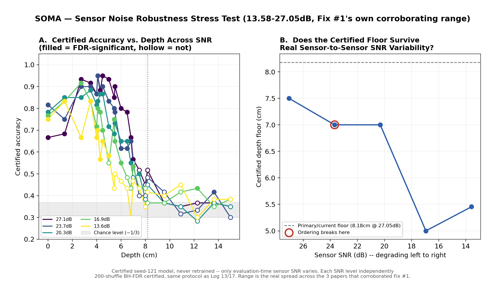
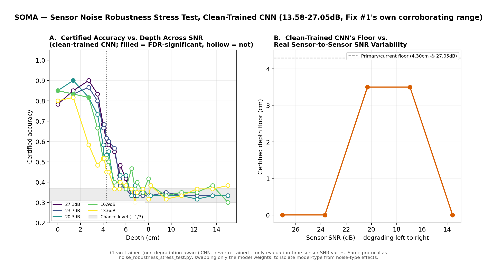

</details>

---

### Log 25: A full self-audit — catching a safety-gate error, fixing hidden leakage, and finding a sharper result

<details>
<summary>Click to expand</summary>

**Approximate date of execution:** 20 July 2026

**Quick look — the audit trail from finding to fix:**

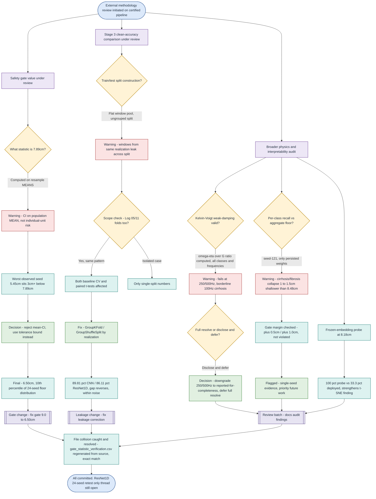

An external methodology review of the written analysis came back with a serious, substantive critique — not stylistic notes, but real questions about whether several of my certified claims would hold up under scrutiny: was the safety gate actually derived correctly, was there leakage in how I'd split training and test data, was the Kelvin-Voigt physics being applied outside its own valid range. Rather than answer each question defensively, I used it as the occasion for a full adversarial self-audit — going back through everything certified so far, deliberately trying to break it rather than defend it. This log covers what that audit found, in the order it was found, including one mistake that would have shipped if I hadn't checked it against the right statistic.

**The safety gate was wrong, and it would have looked correct.** The domain-of-validity gate had been set at 9.0cm, chosen just past the original single-seed 8.18cm floor. Once the 24-seed certified distribution existed (mean 8.48cm, SD 1.81cm, range 5.45–12.27cm), I went back to reconcile the two and found the gate wasn't actually conservative for every seed — some certified runs failed before 9.0cm.

The problem is what kind of bound each candidate actually is. A bound on the *population mean* floor says almost nothing about how a single unit will behave; a safety gate needs a bound on individual-unit risk instead.

| Candidate | What it actually bounds | Value | Verdict |
|---|---|---|---|
| Bootstrap 95% lower CI on resample **means** | the *average* floor across seeds | 7.89cm | wrong statistic — this is what I nearly shipped |
| Empirical 5th percentile of the 24 individual floors | individual-unit risk | 5.65cm | valid, but noisier at n=24 |
| **Empirical 10th percentile of the 24 individual floors** | individual-unit risk | **6.50cm** | adopted |
| Worst observed seed | the single worst unit seen | 5.45cm | for reference |

I nearly shipped 7.89cm. Before doing so, I checked exactly what that number was — and it turned out to be a confidence interval on the population mean, not a tolerance bound on individual-unit risk. The worst observed seed (5.45cm) sits more than 3cm below it: had I shipped 7.89cm, the gate would have *looked* statistically rigorous while not actually protecting against a failure mode already present in the certified data. I recomputed properly and adopted 6.50cm — the 10th percentile rather than the 5th, for more empirical support at this sample size, while remaining a genuine individual-outcome bound rather than a mean-based one. `constants.py` is updated to 6.50cm.

**Train/test leakage was hiding in two places, not one.** The review flagged that the 50%-overlapping signal windows create correlated neighbors, and that a flat, ungrouped train/test split could let windows from the same synthetic realization appear on both sides. Checking this directly: the depth-floor certification pipeline itself was clean, but three other comparisons weren't.

| Comparison | Before (leaked) | After (`GroupShuffleSplit`, by realization) |
|---|---|---|
| Stage 3 clean accuracy — CNN | 88.89% | 89.81% |
| Stage 3 clean accuracy — ResNet1D | 90.28% | 86.11% |
| Log 05 baseline, 5-fold CV | 71.59% ± 3.57% | 72.70% ± 2.08% |
| Log 11: CNN vs. baseline (p) | 0.0083 | 0.0175 |
| Log 11: ResNet1D vs. baseline (p) | 0.0012 | 0.0078 |
| Log 11: ResNet1D vs. CNN (p) | 0.22 | 0.2420 |

The Stage 3 ordering between the two models *reverses* once corrected. With only 90 independent realizations behind that comparison, the reversal sits within expected single-split noise — the qualitative conclusion (no statistically demonstrated capacity advantage for the more sophisticated architecture) is reinforced, not weakened, by the correction. All three Log 11 directional conclusions held after re-running with proper grouping.

**The Kelvin-Voigt model was being trusted outside where it's actually valid.** The weak-damping approximation underlying the attenuation derivation, **ωη ≪ G**, was never checked against its own assumption at every tested frequency. Computing the ratio directly:

| Class | ωη/G @ 100Hz | ωη/G @ 250Hz | ωη/G @ 500Hz |
|---|---|---|---|
| Healthy | 0.209 | — | — |
| Significant fibrosis | 0.126 | — | — |
| Cirrhosis | 0.278 | — | 1.39 |

At 100Hz the ratio is comfortably small for every class. At 500Hz, cirrhosis reaches **1.39** — nowhere near "weak damping" anymore. I downgraded the 250Hz and 500Hz results to "reported for completeness, not validating evidence" rather than quietly continuing to cite them as confirmatory.

I also went back and checked something I'd been implicitly assuming: that the four-frequency sweep represented four independently acquired signals. Tracing the actual code, the swept "frequency" only ever enters the analytically-computed attenuation coefficient — one fixed carrier, scaled by amplitude. The four-frequency "agreement with the physics" is a real result, but it's an internal-consistency check on the formula's own implementation, not four independent validations. I've reframed it as such rather than overstating it.

**A more honest, more interesting finding than the one I started with.** Testing per-class recall against the one certified model with persisted weights (seed 121), rather than trusting the aggregate accuracy figure:

| Class | Recall collapses to near-chance at | vs. the 6.50cm gate |
|---|---|---|
| Cirrhosis | ~7.0cm | +0.5cm margin |
| Significant fibrosis | ~7.5cm | +1.0cm margin |
| Healthy | never — stays in the mid-to-high 90s (95.75%–99.38%) across every tested depth | — |

Cirrhosis and fibrosis recall both collapse 1 to 1.5cm shallower than the reported 8.48cm aggregate floor. The aggregate number was being propped up almost entirely by the healthy class. The 6.50cm gate is not currently violated by this — but this is a single-seed result, not yet certified across the full 24-seed distribution the way the aggregate figure is. Both of those are true statements and I'm keeping them separate rather than letting the reassuring one absorb the cautionary one. Certifying per-class floors across all 24 seeds is now flagged as the top-priority next step.

**Two claims that were association, not causation or quantitative evidence, got tested properly.**

*Grad-CAM → causal test.* The interpretability finding — that the network's attention aligns with the real timing signal — was suggestive but never causally tested. I ran a counterfactual occlusion test against the ResNet1D model (the original, pre-certification version, since that's the only one that currently exists with trained weights):

| Test | Mean probability drop |
|---|---|
| Occlude the Grad-CAM-identified region (zeroed) | 0.312 |
| Occlude the same region (randomized) | 0.441 |
| Negative control (occlude elsewhere) | 0.0065 |
| Shift pulse timing → predicted class flips | 46 / 60 trials (76.7%) |

Occluding the right region matters far more than occluding an arbitrary one — this is causal evidence, not just correlation with a hand-picked feature.

*t-SNE → quantitative test.* The finding at 8.18cm — that the confusion matrix shows total collapse while the internal representation still shows three separated clusters — was a visual claim, not a quantitative one. Training a frozen-embedding linear probe on the same representation: the deployed model scores **33.3%** (chance) at that depth, while the linear probe trained on the frozen embeddings scores **100%** on held-out data. The representation genuinely holds more information than the deployed decision boundary can read.

*See Log 33 for the corrected-noise result.*

**One tension I'm not resolving by picking the answer I like.**

| Protocol | CNN vs. ResNet1D result |
|---|---|
| Original (leaked split) | p=0.22 — no difference |
| Leakage-corrected single split | reversal within noise |
| 15× repeated grouped 5-fold CV | p=0.0002, d=0.59 — significant |

Three different answers to the same question, and I'm reporting all three rather than leading with the most favorable one. The repeated-CV result has a real, disclosed caveat: its 75 paired differences are drawn from only 90 underlying realizations being reshuffled, not 75 independent data points — a known way to inflate apparent significance in repeated-CV designs. The honest read is that CNN vs. ResNet1D remains genuinely unresolved, not that I've now found the "real" answer.

**Also closed this pass:**
- A leading-order error bound for the weak-damping failure at 250/500Hz — roughly 6–30% relative error at 250Hz, breaking down outright above 1.0 at 500Hz (a second, sharper confirmation of the ratio-table finding above).
- The exact t-SNE parameterization: `perplexity=15, random_state=42, init=pca`.
- Confirmation that the three seeds with >1.0cm crossover ambiguity are assigned by first-FDR-failed depth, matching the README's existing description.
- A corrected viscosity sweep extended down to η=0 as an anchor point, showing the elastic-to-viscoelastic transition as a continuous curve rather than a jump.
- A real discrepancy — a reconstructed 88.89% that should have matched the corrected 86.11% and didn't, off by 2.78 points — fully root-caused: `GroupShuffleSplit` was producing the same fold *sizes* but a different actual *partition* than an existing script's implementation, not a scaling or restart-related bug. Final per-class numbers for ResNet1D under the corrected split:

| Class | Precision | Recall | F1 | ROC-AUC |
|---|---|---|---|---|
| Cirrhosis | 0.840 | 0.875 | 0.857 | 0.974 |
| Healthy | 1.000 | 0.850 | 0.919 | 0.993 |
| Significant fibrosis | 0.800 | 0.857 | 0.828 | 0.956 |

**What this changes and what it doesn't.** The certified 8.48cm ± 1.81cm operational floor survived every one of these checks — leakage correction, physics-validity audit, an independent alternative-model comparison (Log 17's power-law test), and a real safety-statistic error caught before it shipped. That's the headline: the core result held. What changed is the precision and honesty of everything around it — one real bug fixed before it could matter, several claims correctly downgraded or reframed, and one genuinely new, more clinically precise finding (the per-class recall gap) that the project wouldn't have found without deliberately trying to break its own result rather than just defend it.

</details>

---


### Log 26: Methodology record: consolidating the audit trail

<details>
<summary>Click to expand</summary>

**Approximate date of execution:** 9 August 2026

**Context**

After the external review, the work existed in many forms at once: committed files, uncommitted changes, untracked folders and loose files outside version control. I decided that the first job of the record was to find every piece of it, because no one had a complete picture of what had been done. The last entry before this one is Log 25, the self-audit.

The audit work was started to close gaps found in an external audit of the whole study. The text of that audit is not in the repository, so the list below is from my recollection and has not been checked against it. Each audit piece answered a point in the external audit:
- Lane 1: whether the weak-damping approximation introduced error against the exact Kelvin-Voigt solution.
- Lane 2 and the BH-family check: floor depths that shifted with the FDR choice, rounding and a Cohen's d that did not reproduce.
- Lane 3: differences between the text and the code, and missing citations for the sensor noise levels.
- Lane 4: the linear baseline was too weak a comparison; whether an SVM, a random forest or a GRU would also fail.
- Lane 5: aggregate accuracy could hide early failure of one class.
- Lane 6: whether the model was using the window timing offset and not acoustic features.
- Lane 7: ResNet1D reached deeper median floors than the CNN, which challenged the claim about the CNN.
- Lane 8: whether the certified floor is a property of the signal or of the CNN (stated in the pre-registration).

Written up afterwards from the saved files.

**Why this check matters**

A result is only as trustworthy as its trail. When work is spread over many places and dates, it becomes unclear which number came from which run, with which settings, and whether it was corrected later. A single record lets a reader trace each reported value to a run and to the corrections that followed, and it shows where the trail has gaps instead of hiding them.

**Methodology**

Two rules were set for the record:
- Document what actually happened, including mistakes found and corrected, and not a cleaned-up version of events.
- Work that cannot be verified is written down as an open gap and not guessed at.

The steps were a read-only search of the version history of every copy of the repository, of stashed and uncommitted changes, of every audit folder, of every report, status and findings file from the runs, and of loose files outside version control. Then came one methodology note per piece of work and an index.

**Execution order**

1. The eight audit pieces were run. Their outputs are the audit folders, one per lane.
2. The runs of Logs 27 to 31 followed. Evidence for them is in report files and run logs.
3. An audit of the claims was started with two leads: an apparent contradiction between the two halves of the random forest run, and possibly stale calibration numbers. Recomputing from the two result tables showed that the random forest median claim needed correcting to 12.27 cm (Log 27).
4. The untracked audit files and the uncommitted ResNet1D 24-seed logs were put under version control in one step. This reset the modification time of everything in that folder.
5. The record was written. The search was widened to every piece of work.
6. Three first-author names in citation comments were corrected ("Lee" to "Yoo", "Chen" to "Yang", "Al-Khalili" to "Zayadeen"), without changing any number, in the form `<new name> (earlier recorded as '<old name>')`.

**Result**

The record consists of an index and thirteen notes:

| Note | What it covers |
|---|---|
| Index | Chronological index, the linked threads (gate statistics, leakage, weak damping, per-class floor, model families, citations), and the open gaps |
| 01 | SNR, stiffness and viscosity sources, densified depth grid, stale scripts and constants |
| 02 | Gate 9.0 to 6.50 cm, grouped splits, weak-damping bound, seed-121 per-class recall (the work in Log 25) |
| 03 | Two figure bugs and the floor SD change from 1.77 to 1.81 cm |
| 04 | Exact complex-wavenumber attenuation against the weak-damping formula |
| 05 | Nadeau-Bengio correction, Cohen's d that would not reproduce, percentile convention, BH family size |
| 06 | Code and log fact-checks, sensor citation gaps |
| 07 | SVM, random forest and GRU baselines, a v1 failure and its v2 fix |
| 08 | Window offset alone gives 90.6% accuracy on clean data |
| 09 | Per-class floors over 24 seeds, degenerate recall null, balanced-accuracy retry, clean-trained sweep |
| 10 | ResNet1D against CNN floors at 24 seeds, with censoring |
| 11 | Random forest floor on the same pipeline |
| 12 | 19-condition robustness runs for seeds 101 to 108 |
| 13 | Pooled confusion matrices and the frozen probe at 27.05 dB |

Fourteen files that had existed only outside the saved record were added to the lane 5 and lane 7 folders: five output and status files (the recall summary, the three-null floor check, the diagnostic snapshot, the 15-minute status log and its script), seven analysis scripts, and two small derived CSVs. The status log is the only record of when the lane 5 harness stopped. The null check output ends in a KeyError and was never rerun.

The record turned up five findings that I had not written down before.

The recall-based per-class test cannot certify a floor. Controls that collapse to one class score recall 1.0 for that class, and the main run gave 0.0 cm for every class in every seed. Balanced accuracy did not fix it cleanly: healthy came out at a median of 13.6 cm because a collapsed model predicting healthy gets partial credit.

A permutation test with 200 shuffles cannot pass BH in a family of 23 depths, because the smallest possible p-value exceeds the rank-1 BH threshold:

| Quantity | Value |
|---|---|
| Shuffles | 200 |
| Depths in the BH family | 23 |
| Smallest possible p-value | 1/201 = 0.00498 |
| Rank-1 BH threshold | 0.05/23 = 0.00217 |

This produced floors of exactly 0.00 cm in the lane 5 per-class run and in five battery cells (Logs 28 and 30).

The ResNet1D floor at 24 seeds has a deeper median than the CNN (Gehan-Wilcoxon p = 0.0023 with seed 103 censored), but its 5th percentile is shallower:

| Model, 24 seeds | Median floor (cm) | 5th percentile (cm) | Seeds under 6.50 cm |
|---|---|---|---|
| CNN | 8.00 | 5.65 | – |
| ResNet1D | **10.91** | 4.30 | – |
| Random forest (Log 27) | **12.27** | – | none of 24 |

The amplitude-randomization condition in the first battery used a gain with mean 1.08 where 1.0 was intended. The corrected rerun removes the "all four seeds agree" statement for that condition (Log 29).

A bug in the clean-sweep harness made the per-class floor loop stop at the first non-significant depth. It was fixed to take the last significant depth. The recomputed per-class floors are still 0.0 everywhere.

**Result interpretation**

The record is a map of what exists and in what order it was done. **It supports one claim: each piece of work now has a note, a location in the repository and a place in the order of work.** It does not verify any result in those pieces, and nothing was retrained or re-run for it. The reasons given for decisions in Logs 26 to 37 were written afterwards from my recollection of the work, and checked against my notebook where I have looked at the relevant entry.

**Consequences**

The audit folder is now split by experiment, each folder has a README, and the methodology index maps each folder to its note. A link checker covers the links in those files. Logs 27 to 31 write up the random forest and robustness runs that the notes summarise. Logs 32 to 35 record the corrections that followed, and Logs 36 and 37 cover the phantom control variants and the final figure set. Each is written up afterwards from the saved files. The open gap on citations now records the corrected first authors. Everything is in the methodology folder, and its index is the place to start.

**Limitations**

Open gaps, as recorded in the index:
- The first authors cited in the repository were corrected (see step 6): Yang et al. 2022 for the 27.05 dB source. The other two sensor papers behind 26.47 and 13.58 dB are unnamed in the repository.
- The lane 5 and lane 7 reports are out of date relative to their final results, and the lane 5 multiplicity and clean-sweep numbers have no report other than note 09.
- No script combines the 24 random forest seeds.
- The original Log 11 restart counts were never saved, and the GRU failure in note 07 is unexplained. Those results were corrected with Nadeau-Bengio (Log 34).
- The seed-108 spreading sign flip (Log 30) and the shallowing at 2.6× viscosity in seeds 103 and 104 (Log 31) are described but not resolved.
- The late-window attention pattern in cirrhosis (Log 9) was seen in a single model. A 5-seed retrain showed it in 1 of 5 seeds, but its output was not saved, so the pattern is not archived across seeds.

**Evidence**

- `docs/methodology/README.md`: index of the methodology notes
- `docs/methodology/01-provenance-audit-and-pipeline-fixes.md`: note 01
- `docs/methodology/02-external-review-fixes.md`: note 02
- `docs/methodology/03-figure-and-sd-corrections.md`: note 03
- `docs/methodology/04-lane1-exact-attenuation.md`: note 04
- `docs/methodology/05-lane2-and-q6-statistical-rechecks.md`: note 05
- `docs/methodology/06-lane3-fact-checks.md`: note 06
- `docs/methodology/07-lane4-baseline-architectures.md`: note 07
- `docs/methodology/08-lane6-beat-offset-mechanism.md`: note 08
- `docs/methodology/09-lane5-per-class-certification.md`: note 09
- `docs/methodology/10-lane7-resnet1d-vs-cnn.md`: note 10
- `docs/methodology/11-lane8-and-cloud-random-forest.md`: note 11
- `docs/methodology/12-cloud-robustness-battery.md`: note 12
- `docs/methodology/13-collapse-narrative-and-probe-corrections.md`: note 13
- `audit_fixes/lane1/`: lane 1, weak-damping check against the exact solution
- `audit_fixes/lane2/`: lane 2, statistical re-checks
- `audit_fixes/lane3/`: lane 3, fact-checks
- `audit_fixes/lane4/`: lane 4, baseline architectures
- `audit_fixes/lane5/`: lane 5, per-class certification
- `audit_fixes/lane5/run_monitoring/`: status and monitoring files added to lane 5
- `audit_fixes/lane5/balanced_accuracy_retry/analysis/`: analysis files of the balanced-accuracy retry
- `audit_fixes/lane5/clean_trained_sweep/analysis/`: analysis files of the clean-trained sweep
- `audit_fixes/lane6/`: lane 6, beat-offset mechanism
- `audit_fixes/lane7/`: lane 7, ResNet1D against the CNN
- `audit_fixes/lane7/lane7_check.py`: the lane 7 check script
- `audit_fixes/lane8/`: lane 8, random forest pre-registration and harness
- `audit_fixes/cloud/`: reports, protocol files and per-run result tables of the random forest and robustness runs
- `tools/check_links.py`: the link checker
- `docs/methodology/`: folder of the methodology notes

</details>

---
### Log 27: Random forest at 24 seeds — is the depth floor a property of the data or of the CNN?

<details>
<summary>Click to expand</summary>

**Approximate date of execution:** 12 August 2026

**Context**

The certified floor in Logs 19 and 20 comes from a CNN. I wanted to know whether that floor is set by the signal and the degradation model (physics, attenuation and sensor noise), or is a number specific to the CNN, through its inductive bias, capacity or training dynamics. The pre-registration states the question in those terms. I decided to answer it by certifying the floor of a random forest under the same degradation-aware protocol as the main run.

I chose a random forest as a non-neural model with no gradient training, so it separates the signal from the network's training behaviour. In the later comparison (Log 34) it also scored highest on the clean task, at 91.72%.

Written up afterwards from the saved files.

**Why this check matters**

A depth floor measured with one classifier mixes two things: how much information the signal carries at that depth, and how well that classifier reads it. A different model family trained and tested on the same windows separates the two. If the floors agree, the limit sits in the signal; if they differ, part of the floor belongs to the classifier.

**Methodology**

A random forest is an ensemble of decision trees. Each tree is trained on a bootstrap resample of the training windows and, at each split, sees only a random subset of the features, and the forest predicts the class chosen by most trees. It has no convolutional structure and no gradient training, which is why it can separate "the data" from "the CNN".

| Setting | Value |
|---|---|
| Seeds | 101 to 124 |
| Training set per seed | 375 windows of 100 samples (25 realizations per class at each of the depths 0, 3, 6, 9 and 12 cm) |
| Classifier | scikit-learn random forest, 300 trees, on the raw 100-sample window, the square root of 100 = 10 features tried at each split, every other setting at its default |
| Evaluation depths | 23: 12 equally spaced from 0 to 15 cm and 11 finer ones from 3.5 to 8.0 cm |
| Evaluation conditions | 100 Hz and 27.05 dB |
| Windows per depth | 300 (100 per class) |
| Shuffled-label control forests per seed | 200 |
| Significance | Benjamini-Hochberg (BH) at 0.05 over the 23 p-values of a seed |

Each seed gets 200 shuffled-label control forests, trained on training labels that were randomly permuted; their test accuracy shows what the pipeline reaches when the labels carry no information. The permutation p-value is p = (1 + k) / (1 + 200), where k is the number of controls at least as accurate as the real model, so the smallest possible value is 1/201 = 0.00498. For BH, the k-th smallest of m = 23 p-values must be at most 0.05 × k / 23:

| k | BH threshold |
|---|---|
| 1 | 0.00217 |
| 2 | 0.00435 |
| 3 | 0.00652 |

The floor is the shallowest depth that is not significant, and 15.0 cm if every depth is significant, in which case the true floor is at least 15.0 cm and the value is a lower bound. A later depth can become significant again; the code flags that as anomalous recovery, and the floor does not move.

The data generator, the depth grid and the BH function are imported unchanged; only the random forest is new. The pre-registration also lists the comparison that was planned for after the run:
- the 24 floors with mean, SD and percentiles;
- overlap with the CNN's floors;
- a Mann-Whitney test;
- a paired Wilcoxon test on random forest minus CNN per seed;
- a Hodges-Lehmann estimate with a 10,000-resample bootstrap;
- the fraction below 6.50 cm.

None of these was run.

**Execution order**

1. The pre-registration was written. A one-seed run-time estimate was to come before anything else was launched, so the one-seed trial was run next: 410.4 s and a floor of 13.64 cm for seed 101. The projection for 24 seeds was 9,850 s (2.74 h).
2. A smoke run of seed 101 on different hardware took longer and reproduced the floor of 13.6364 cm (timings in the table under Result). The run log notes that comparing this floor with the CNN's 9.545 cm "compares two different models".
3. Seeds 101 to 112 and 113 to 124 were run as two halves through one wrapper, with a checkpoint per seed. The two reports contradict each other. The report for 113 to 124 says the other half "did not get past seed 101" and calls it incomplete; the report for 101 to 112 says all 12 seeds completed.
4. A read-only cross-check flagged this as a direct contradiction, unresolved.
5. I decided the contradiction had to be checked against the real result files, and that the 24-seed run, whose median of 13.64 cm had been reported, had to be shown complete and trustworthy or not. The two result tables were recomputed: 552 rows (12 seeds × 23 depths in each half), every seed present once. The medians are in the first table under Result: 13.64 cm is the median of seeds 113 to 124 only, and the median over all 24 seeds is 12.27 cm. The reported median was corrected.

Correction: 13.64 cm appears in this repository for two different things, and neither is the 24-seed median. It is the floor of seed 101 (the trial and the smoke run), and it is the median of seeds 113 to 124 (the report labels it "12 seeds, 113-124 only -- not the full 24-seed set"). The overall median had been reported as 13.64 cm before this check.

**Result**

Floors per seed are in the two saved result tables (column `floor_cm`).

| Seeds | Mean floor | SD | Range | Median | Time per seed |
|---|---|---|---|---|---|
| 101 to 112 | 12.84 cm | 0.91 | 12.27 to 15.00 | 12.27 cm | 468 to 513 s |
| 113 to 124 | 12.95 cm | 0.92 | 10.91 to 13.64 | 13.64 cm | 611 to 672 s |
| All 24 | 12.90 cm | 0.90 | 10.91 to 15.00 | **12.27 cm** | – |

Over the 24 seeds the floors fall on four grid values:

| Floor | Seeds at this floor |
|---|---|
| 10.91 cm | 1 |
| 12.27 cm | 12 |
| 13.64 cm | 10 |
| 15.00 cm | 1 (seed 110, so a lower bound) |

No seed is below 6.50 cm. Seeds 106 and 115 show anomalous recovery. The CNN sweep is compared with the 24-seed random forest result below (CNN column `naive_floor_cm` of its saved results file):

| Model | Mean floor | SD | Median |
|---|---|---|---|
| CNN | 8.48 cm | 1.81 | 8.00 cm |
| Random forest | 12.90 cm | 0.90 | **12.27 cm** |
| Difference | 4.42 cm | – | 4.27 cm |

Timing and reproduction of seed 101:

| Run | Hardware | Time | Floor |
|---|---|---|---|
| One-seed trial | first computer | 410.4 s | 13.64 cm |
| Smoke run | second computer: 4 vCPU, 15 GiB RAM, Python 3.11, no GPU | 550.2 s (1.34 times the trial) | 13.6364 cm |

Each result table has every seed once, and the status file for seeds 113 to 124 records that the raw p-values lie in the range the 201-point null allows (smallest 0.00498). The statement that the first half is incomplete is out of date, because the result table for 101 to 112 has all twelve seeds, but I could not establish from the files when that statement was written.

**Expectation versus outcome**

| Item | Expectation | Outcome |
|---|---|---|
| Run time | A random forest should train much faster than 60 full-batch gradient steps of a CNN, so the time per seed would be dominated by data generation | **Wrong: in the one-seed trial the evaluation took 65% of the 410.4 s (section 10 of the pre-registration)** |

The pre-registration states no predicted floor for the random forest and no rule for calling the result "signal limit" or "CNN-specific" before the run.

**Result interpretation**

**At these settings the random forest certifies a floor about 4 cm deeper than the CNN at the median, so the floor is not fixed by the signal alone: it depends on the model.** That is what the numbers support. They do not support calling the random forest the better classifier for the clinical question, because it is a different model with its own floor. The numbers also carry no test: 22 of the 24 floors sit on two grid points (12.27 and 13.64), so the standard deviation reflects the 1.36 cm grid spacing as much as real spread, and the planned paired test was never run, so "deeper than the CNN" rests on summary statistics.

**Consequences**

The reported median was corrected. Log 26 lists the random forest among the things the record turned up. The comparison with the CNN and ResNet1D floors in a single table or test has not been done.

**Limitations**

- The harness writes its own per-seed files into the lane 8 log folder, which the run was meant to leave alone; those side-effect files were deleted before each checkpoint (note 11).
- The imported BH function returns only a flag, so the wrapper writes the adjusted p-values itself.
- There is no combined 24-seed report and no script that sets the random forest next to the CNN and ResNet1D floors.
- Each result is one forest per seed trained on one set of 375 windows, so seed-to-seed variation mixes the data draw with the forest's own randomness.
- The random forest was run on different hardware from the CNN sweep, and the cause of the slower second half was not investigated.

**Evidence**

- `audit_fixes/lane8/PREREG.md`: the pre-registration
- `audit_fixes/cloud/smoke/RUNLOG.md`: run log of the smoke run of seed 101
- `audit_fixes/cloud/rf/results/rf_floors_101-112.csv`: random forest floors, seeds 101 to 112
- `audit_fixes/cloud/rf/results/rf_floors_113-124.csv`: random forest floors, seeds 113 to 124
- `audit_fixes/cloud/rf/REPORT.md`: report for seeds 113 to 124
- `audit_fixes/cloud/rf/REPORT_101-112.md`: report for seeds 101 to 112
- `audit_fixes/cloud/rf/STATUS.md`: status file with the p-value range check
- `audit_fixes/cloud/rf/`: reports, logs and results of the random forest runs
- `Source/logs/degradation_aware_final_results.csv`: CNN floors (column `naive_floor_cm`)
- `audit_fixes/lane8/logs/`: the folder the harness writes its side-effect files into
- `docs/methodology/11-lane8-and-cloud-random-forest.md`: methodology note 11 with details and caveats

</details>

---
### Log 28: A 19-condition robustness battery on seeds 101–104

<details>
<summary>Click to expand</summary>

**Approximate date of execution:** 17 August 2026

**Context**

The battery belongs to the audit round that was started to close gaps found in an external audit of the whole study (Log 26). The protocol states its goal as measuring how far the certified depth floor moves when specific simulator assumptions change, for seeds 101 to 104, across seven families of conditions, using the same comparison of the real CNN against 200 shuffled-label controls, with BH correction per seed, as the certified sweep. It lists the assumptions it varies: no geometric spreading term in the code, a fixed-noise-standard-deviation convention for SNR, a viscosity lookup that matches stiffness exactly, and the weak-damping attenuation formula. The audit text is not in the repository, so I cannot say which audit item led to which condition. Logs 17, 22 and 24 had already tested some of these factors one at a time on one seed; the battery repeats them over several seeds and many conditions.

A real model that trains in under a second looked wrong, so I checked whether it had been trained at all. The logged loss fell from chance level (1.102, about ln 3) to 0.855, so it had. I also wanted a check that running on a different platform did not change the floors. The baseline floors differed between the platforms by the amounts in the table under Result, and I did not diagnose the differences.

Written up afterwards from the saved files.

**Why this check matters**

A certified floor holds only for the simulator that produced the data. Changing one assumption at a time (noise, spreading, viscosity, stiffness spread, attenuation law) shows which assumptions the floor depends on and in which direction it moves. With only a few seeds the result is a direction and not a test, and it indicates how far the headline number can be trusted if the simulator is wrong.

**Methodology**

The protocol records no predicted direction or size for any condition. It says what will be reported: per-seed floors, the shift of each condition against that seed's own baseline, and the plain median shift, with "no significance test run ACROSS only these 4 seeds".

For each seed the real CNN was trained once with the unchanged degradation-aware dataset builder and training function, and 200 shuffled-label control CNNs were trained the same way. All 201 models were kept.

| Setting | Value |
|---|---|
| Seeds | 101 to 104 |
| Models per seed | 1 real CNN and 200 shuffled-label controls |
| Conditions | 19 with a floor, plus the pure-noise probe (table below) |
| Test set per depth | 300 windows (100 per class), built with that condition's window generator |
| Depth grid | 23 depths |
| p-value per depth | (1 + k) / 201, with k the number of controls at least as accurate as the real model |
| Correction | BH across the 23 depths within each (seed, condition) pair |
| Floor | the first non-significant depth, marked as censored at 15.0 cm if every depth is significant |

The conditions are:

| Condition | Description | Settings |
|---|---|---|
| 1 | baseline | |
| 2 | amplitude randomization | |
| 3a, 3b | geometric spreading | p = 0.5 and 1.0, added as min(1, (x0/x)^p) with x0 = 1 cm on top of the exponential decay |
| 4a, 4b | within-class stiffness variation | a coefficient of variation per class, or one value for all classes |
| 5a to 5e | SNR | 20, 13.58, 10, 5 and 0 dB |
| 6a | exact complex-wavenumber attenuation | |
| 6b | exact attenuation plus the exact time of flight | |
| 7a to 7c | healthy and fibrosis viscosity | × 1.4, × 1.8 and × 2.6 |
| 7d to 7f | cirrhosis viscosity | 1.2, 2.18 and 2.5 Pa·s |
| 8 | pure-noise probe | counts predictions and has no floor |

One design choice shapes the whole battery: the controls are trained once per seed, not per condition, because "the condition only changes the TEST distribution, never training". The battery therefore measures what a shifted deployment distribution does to a model trained on the original distribution. It does not measure what retraining under the shift would give; the protocol notes that this alternative would multiply the compute by about 7 to 14.

A few terms:

| Term | Meaning |
|---|---|
| Kelvin-Voigt solid | The tissue is treated as an elastic modulus G in parallel with a viscosity η, with G = E/3 as in the code |
| Attenuation in the code | The weak-damping formula α = ω²η / (2Gc) |
| Exact attenuation | For the same solid, the wavenumber k = ω√(ρ / (G + iωη)) with α = \|Im k\|; the code's formula is its small-loss limit |
| Noise | Added with standard deviation 10^(−SNR/20) of an order-one signal peak, which is 0.0444 at 27.05 dB |
| Geometric spreading | The fall of amplitude with distance even in a lossless medium; the code had no such term |

Some floors come out at exactly 0.00 cm for a reason that lies in the test. With 200 controls the smallest p-value is 1/201 = 0.00498. BH at m = 23 passes the k-th smallest p-value only if it is at most 0.05 × k / 23:

| k | BH threshold |
|---|---|
| 1 | 0.00217 |
| 2 | 0.00435 |
| 3 | 0.00652 |

A block of depths that all sit at 0.00498 therefore passes only if it has at least three members (0.00498 ≤ 0.00652 but not ≤ 0.00435). With one or two depths at the minimum, none passes and the floor falls to 0 cm even when real accuracy is far above chance.

**Execution order**

1. The protocol, wrappers, configuration and harness were fixed with no run yet. Before launch, a regression test confirmed that the baseline wrapper reproduces the original window generator bit for bit (3 seeds × 3 classes × 3 depths).
2. Seed 101 finished in 136 s. The protocol and the seed's checkpoint count 18 depth-sweep conditions plus the noise probe, 19 in all; the configuration lists 19 conditions with a floor, plus the probe.
3. During the run the real model's training time was checked, because it was under 1 s against about 55 to 66 s for the 200 controls. The report documents the checks listed in the table under Result. The real model is trained once, full batch, on 375 windows.
4. The pure-noise probe (condition 8) was added during the run, after conditions 1 to 7 were drafted, and runs last for each seed.
5. Seeds 102 to 104 and the report followed. Four seeds × 19 conditions (the protocol's count, which includes the noise probe) took about 9 minutes in total (seed 101 136 s, seed 104 137 s).
6. Afterwards came the amplitude rerun (Log 29), the replication on seeds 105 to 108 (Log 30), and two read-only checks (Logs 30 and 31).

**Result**

Checks that the real model had been trained:

| Check | Value |
|---|---|
| Training time of the real model | under 1 s (about 55 to 66 s for each of the 200 controls) |
| Logged loss curve | 1.1020 to 0.8551, train accuracy 67.5%, 0.306 s |
| Accuracy against depth | 77.3% at 0 cm, a peak of 93.3% at 4.5 cm, chance by 9.5 to 15 cm, controls flat at chance |
| Timing test | 10 calls, 0.317 s per call |

Baseline floors for seeds 101 to 104 (cm):

| Seed | Protocol baseline | Replicate on a different platform (listed in the protocol) | Difference |
|---|---|---|---|
| 101 | 9.55 | 9.55 | 0 |
| 102 | 6.00 | 6.50 | −0.5 |
| 103 | 8.18 | 9.55 | −1.37 |
| 104 | 8.00 | 7.50 | +0.5 |

Median shift of the floor against each seed's own baseline, n = 4:

| Condition | Median shift |
|---|---|
| SNR | Shallower as the noise rises; 0 dB gives about **−4.3 cm** |
| Geometric spreading | p = 0.5 about −2.1 cm, p = 1.0 about −4.0 cm |
| Exact attenuation | +1.45 cm without the exact time of flight, +0.25 cm with it |
| Amplitude randomization | +1.36 cm (corrected in Log 29) |
| Viscosity of healthy and fibrosis tissue | × 1.4 and × 1.8 deeper (median +1.4 cm); × 2.6 shallower in the median (−2.1 cm), because seeds 103 and 104 shallowed (Log 31) |
| Cirrhosis viscosity | 1.2 Pa·s much deeper (**+5.45 cm**); 2.18 and 2.5 Pa·s shallower (−1.0 and −1.4 cm) |
| Within-class stiffness variation | Split between the 15 cm maximum and 0.00 cm; no usable shift |

Floors in the two within-class stiffness conditions, seeds 101 to 104 (cm):

| Condition | Floors |
|---|---|
| 4a | 15.0, 15.0, 7.0, 0.0 |
| 4b | 15.0, 5.0, 4.3, 0.0 |

The pure-noise probe (all eight seeds of Logs 28 and 30): the real model never predicts fibrosis on pulse-free noise, and healthy takes 48 to 100% of it. The controls spread roughly evenly over the three classes. Healthy share for seeds 101 to 104:

| Seed | Healthy share of predictions |
|---|---|
| 101 | 0.94 |
| 102 | 1.00 |
| 103 | 0.77 |
| 104 | 0.48 |

Three cells came back with a floor of exactly 0.00 cm although the real accuracy was 67 to 79% at the shallowest depths: seed 102 condition 3b and seed 104 conditions 4a and 4b. They reflect the resolution limit described above, and the model did not collapse. I did not raise the shuffle count, because that would break comparability with the certified sweep.

In conditions 4a and 4b every class receives a viscosity of 0.5 Pa·s, cirrhosis included. At baseline the stiffness passed to the viscosity lookup is exactly one of the three class values, and the lookup returns 0.5, 0.5 and 1.77 Pa·s for healthy, fibrosis and cirrhosis. In 4a and 4b the stiffness is first perturbed, and the perturbed value is used for the lookup. A perturbed stiffness is not exactly a class value, so the lookup function returns the default of 0.5 Pa·s. Cirrhosis is therefore attenuated less under 4a and 4b than at baseline, and the two conditions do not test stiffness variation alone. Conditions 7a to 7c do not use this path: they override the healthy and fibrosis viscosity and leave cirrhosis on the exact class value. I have not derived what this does to the floors, and I do not claim it as the cause of the split between 15.0 and 0.00 cm. The protocol describes the lookup as a match on exact stiffness without saying what a non-match returns. The same lookup was later identified as a bug that affects these two conditions. The code locations are given in Evidence.

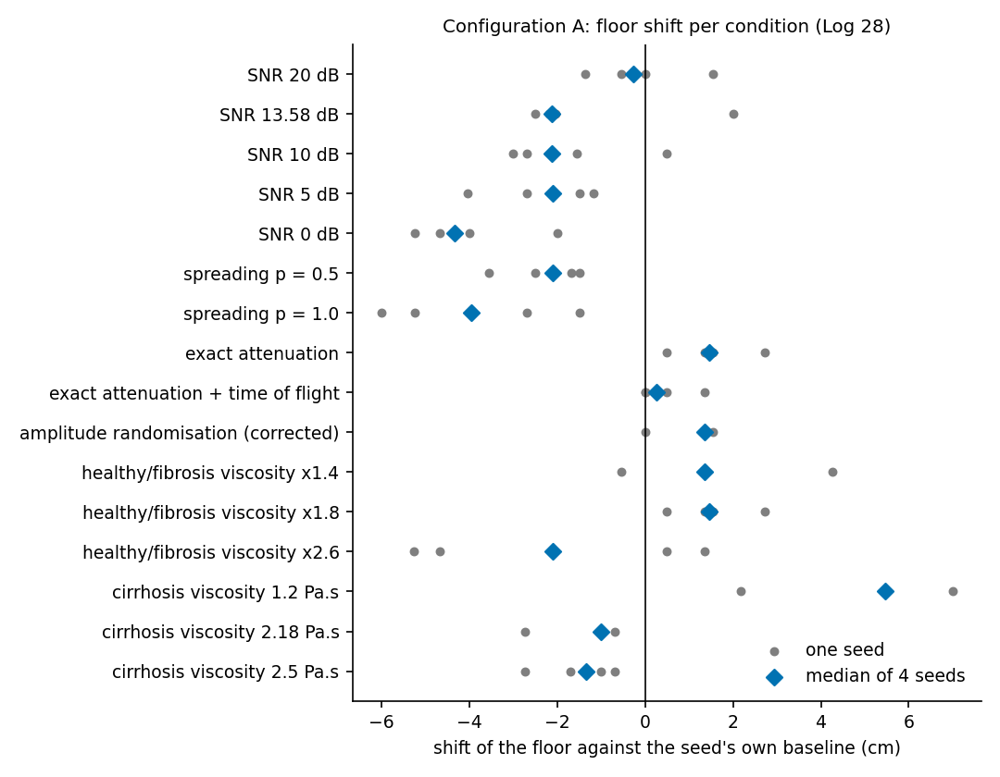

*Median shift of the floor against each seed's own baseline (configuration A): SNR 0 dB gives about −4.3 cm and a cirrhosis viscosity of 1.2 Pa·s gives +5.45 cm.*

**Result interpretation**

The report states directions: amplitude randomization deeper in all four seeds, spreading shallower, SNR shallower as the noise rises, exact attenuation deeper by roughly a centimetre, viscosity at × 2.6 negative for two of four seeds, flagged and not resolved. For stiffness variation it says a reliable quantitative floor shift cannot be reported. For the noise probe it says the model fails on pulse-absent input in a way worth disclosing. **These are directions from four seeds and carry no test.** The exact-attenuation result in particular rests on floor differences of 0 to 2.73 cm in a grid with steps of 1.36 cm. The report's headline calls the spreading and viscosity effects "as expected", but that is a reading after the run and not an expectation recorded before it. The first reading "all four seeds agree" for amplitude did not hold after Log 29.

**Consequences**

The amplitude gain was corrected and rerun (Log 29), the battery was replicated on four more seeds (Log 30), and the two read-only checks followed (Logs 30 and 31). The claim about pure noise was checked against the eight noise-probe rows and rewritten.

**Limitations**

- Four seeds and no significance tests, by design; the output is direction, not a test.
- The controls were trained once on the original distribution.
- Condition 6b changes timing but not the label.
- The amplitude condition used a gain with a mean of 1.08 (Log 29).
- The random seed for each condition is built from Python's `hash` of the condition name (line 121 of the harness), which differs between runs unless the hash seed is fixed, so the exact test sets cannot be regenerated.

**Evidence**

- `audit_fixes/cloud/battery/results/floors_101-104.csv`: per-seed floors
- `audit_fixes/cloud/battery/results/depth_detail_101.csv`: per-depth detail, seed 101
- `audit_fixes/cloud/battery/results/depth_detail_102.csv`: per-depth detail, seed 102
- `audit_fixes/cloud/battery/results/depth_detail_103.csv`: per-depth detail, seed 103
- `audit_fixes/cloud/battery/results/depth_detail_104.csv`: per-depth detail, seed 104
- `audit_fixes/cloud/battery/results/noise_probe_101-104.csv`: the pure-noise probe
- `audit_fixes/cloud/battery/seeds_101-104/`: protocol, report and code of the battery
- `audit_fixes/cloud/battery/seeds_101-104/harness.py`: line 94 builds the stiffness passed to the viscosity lookup; line 121 builds the per-condition seed from Python's `hash`
- `audit_fixes/cloud/battery/seeds_101-104/wrappers.py`: lines 91 to 96 and 100 to 102 perturb the stiffness in conditions 4a and 4b (identical in the `seeds_105-108` copy)
- `Source/attenuation_model.py`: the viscosity lookup; lines 34 to 38 and 48 return the class values, lines 39 and 44 to 47 the 0.5 Pa·s default
- `docs/methodology/12-cloud-robustness-battery.md`: methodology note 12 with the full list of findings

</details>

---
### Log 29: A biased amplitude gain, and the corrected rerun

<details>
<summary>Click to expand</summary>

**Approximate date of execution:** 21 August 2026

**Context**

In Log 28, amplitude randomization (condition 2) deepened the floor in all four seeds, the opposite of what removing an amplitude cue should do; the gain draw was then checked and its mean was 1.082, not 1.0, so the signal was scaled up by about 8% on average. The report's headline had said that all four seeds agree in sign.

Written up afterwards from the saved files.

**Why this check matters**

A randomization meant to remove an amplitude cue must leave the average signal level unchanged. If the draw has a mean above 1, the signal is on average larger, and a deeper floor can come from the extra amplitude alone. Checking the mean of the draw and rerunning with a mean of exactly 1 separates an effect of randomization from an effect of bias.

**Methodology**

Condition 2 multiplied each attenuated signal, before noise was added, by a gain g = exp(U), with U uniform between ln 0.5 and ln 2 (a log-uniform draw). The mean of such a gain is (2 − 0.5) / ln 4 = 1.5 / 1.386 = 1.082, and its standard deviation is 0.426. "Randomization with no overall gain change" needs a mean of 1.0, so the draw was biased high. A systematically larger signal could deepen the floor by itself. The question was whether the result was an artifact of that bias.

Condition 2b was added next to condition 2 and did not replace it. The gain is drawn uniformly between 0.5 and 1.5 in linear space and applied at the same point of the signal chain (after attenuation, before noise). This changes three things at once:

| Property | Condition 2 | Condition 2b |
|---|---|---|
| Gain distribution | exp(U), U uniform between ln 0.5 and ln 2 | Uniform between 0.5 and 1.5 in linear space |
| Mean | 1.082 | 1.0 (exactly) |
| Standard deviation | 0.426 | 1/√12 = 0.289 |
| Upper limit | 2.0 | 1.5 |

The first battery did not save the trained model weights, by design, so 2b retrains the real model and the 200 controls for each seed from scratch, with the same functions and the same seeding convention. The baseline regression test was run again first and passed bit for bit. Each seed took about 85 to 95 s. A consequence of retraining is that a difference between condition 2 and 2b mixes the effect of the gain distribution with the variation between two trained models. The floors can only take the values of the 23-depth grid, whose steps are 1.36 cm on the coarse grid and 0.5 cm on the fine grid between 3.5 and 8.0 cm, so a change smaller than a step can leave the floor unchanged.

**Execution order**

1. The first battery finished and the report was written (Log 28).
2. A read-only cross-check of the two random forest result sets was completed (Log 27), and the condition 2b work began right after.
3. The 2b condition and its rerun script were added, the rerun logged its progress, and the 2b results were appended to the report as an addendum.
4. The replication battery of Log 30 was pre-registered with the corrected draw.
5. Afterwards the viscosity check (Log 31) pulled per-depth data and noticed a 20th condition label, the linear-gain condition 2b, in the per-depth detail file of seed 101. It described it as leftover test data not carried into the summary table or the report table. That first reading was wrong: the saved floors table contains the 2b rows for seeds 101 to 104 and the report has the addendum. A timeline check corrected it, and the sentence in the viscosity check's findings file was not changed afterwards.

**Result**

Shift of the floor against each seed's baseline, from the saved floors table (conditions baseline, 2 and 2b):

| Seed | Baseline | Condition 2 (mean gain 1.08) | Shift | Condition 2b (mean gain 1.0) | Shift |
|---|---|---|---|---|---|
| 101 | 9.55 | 10.91 | +1.36 cm | 10.91 | +1.36 cm |
| 102 | 6.00 | 6.50 | +0.50 cm | 6.00 | **0.00 cm** |
| 103 | 8.18 | 9.55 | +1.36 cm | 9.55 | +1.36 cm |
| 104 | 8.00 | 9.55 | +1.55 cm | 9.55 | +1.55 cm |

The median shift is +1.36 cm for both conditions. Pooling the corrected rows over all eight seeds (2b for seeds 101 to 104, condition 2 of the seeds 105 to 108 floors table, which already uses the corrected draw) gives a deeper floor in seven seeds, no change in seed 102, and a median of +1.36 cm.

**Result interpretation**

The report's addendum says the deepening survives for three of the four seeds but not unanimously. Seeds 101, 103 and 104 land on exactly the same floor as before, and the report attributes this to the discrete grid: the reduced spread of the gain was not enough to move the significance boundary for them. Seed 102's deepening of +0.50 cm was the smallest and is one step of the fine grid; it did not survive the removal of the upward bias. **The statement "all four seeds agree in sign" therefore no longer holds as written**, and the report leaves the original headline unchanged because it describes condition 2 as run. What the data cannot say: whether the mean or the spread of the gain drives the shift, because both changed, and whether seed 102's change is anything more than retraining variation. Seed 102's change is the same size as the difference between its baseline floors on the two platforms (6.00 against 6.50 cm, Log 28).

**Consequences**

The replication on seeds 105 to 108 used the corrected draw only, and note 12 and Log 26 record that the "all four seeds agree" statement no longer holds. The original condition 2 rows are kept, so the first report's table still shows the biased draw.

**Limitations**

- Four seeds for the corrected rerun.
- The 2b models are new trainings.
- The mean and the spread of the gain were not tested separately.

**Evidence**

- `audit_fixes/cloud/battery/seeds_101-104/rerun_condition_2b.py`: the rerun script for condition 2b
- `audit_fixes/cloud/battery/results/floors_101-104.csv`: saved floors for seeds 101 to 104, including the 2b rows
- `audit_fixes/cloud/battery/results/floors_105-108.csv`: saved floors for seeds 105 to 108
- `audit_fixes/cloud/battery/results/depth_detail_101.csv`: per-depth detail of seed 101, where the 2b label was noticed
- `audit_fixes/cloud/vischeck/FINDINGS.md`: findings file of the viscosity check
- `docs/methodology/12-cloud-robustness-battery.md`: note 12, section "Bugs and corrections"

</details>

---
### Log 30: Replicating the battery on seeds 105–108, and seed 108's sign flip

<details>
<summary>Click to expand</summary>

**Approximate date of execution:** 26 August 2026

**Context**

The four-seed battery of Log 28 had no significance tests, by design. The protocol for the replication states its aim as running the same 19 conditions (its list includes the pure-noise probe; the conditions with a floor number 19 as well) on seeds 105 to 108 so that the results "concatenate cleanly" with seeds 101 to 104 into a combined set of eight. The files do not say why four more seeds were chosen. The seed-108 question comes from the replication report, which flagged one shift as the only disagreement between the two sets: seed 108's response to geometric spreading at p = 0.5.

My assumption that seeds 106 and 107 behaved alike near their floors came from an earlier look at summary outputs. I had not checked their per-depth control spread, and the check showed the assumption did not hold.

Written up afterwards from the saved files.

**Why this check matters**

One set of four seeds can agree by chance. Repeating the protocol on four new seeds shows whether a direction holds, and a single seed that disagrees shows where to look. A floor is a statement about significance against shuffled controls, so it matters whether it moved because accuracy fell or because the controls became tightly packed around chance.

**Methodology**

The pipeline is the one of Log 28, run for four new seeds. One thing differs: condition 2 uses the corrected linear gain of Log 29. The code was copied from the first battery and checked to be unchanged except for that condition and the seed list.

| Setting | Value |
|---|---|
| Seeds | 105 to 108 |
| Models per seed | the real model and 200 shuffled-label controls, trained once per seed on the original distribution |
| Conditions | 19 with a floor, on 23 depths, plus the pure-noise probe |
| Correction | BH within each (seed, condition) pair |
| Floor | the first non-significant depth |
| Regression test before launch | 27 of 27 cells reproduced bit for bit |

Terms that matter for reading the result:

| Term | Meaning |
|---|---|
| Replicating | Repeating a protocol on new units, here new training seeds, to see whether the direction of an effect holds. With four seeds against four and no test, it can support or contradict a direction and nothing more |
| Sign flip | A shift whose sign is opposite to the others for the same condition |
| Right-censored floor | A floor of 15.0 cm when no depth failed, because then the true floor is at least 15.0 cm |
| Observed first failure | A floor of 15.0 cm when the depths up to 13.64 cm were significant and 15.0 cm was not. The result file marks the difference in its censored column |
| Narrow null | A depth is significant when the real accuracy beats nearly all of the 200 controls. When the controls are packed tightly around chance (standard deviation 0.006 to 0.011 at the deep end), an accuracy only 0.02 to 0.03 above chance (0.333) still beats almost all of them and is called significant. That is a statement that the real model differs from the controls, and it does not show that the model discriminates usefully |

The seed-108 check read that seed's per-depth rows for condition 3a (real accuracy, the BH flag, and the minimum, median, maximum and standard deviation of the controls), its baseline and the other 17 condition shifts, and the 3a shifts of all eight seeds. It also compared the control spread of seeds 106 and 107 at their own floors.

**Execution order**

1. The protocol and code were fixed before any run, and the regression test passed.
2. Seeds 105, 106, 107 and 108 were run (timings in the table under Result).
3. The report for the 19 conditions was written. It lists two cells at 0.00 cm (seed 106 condition 4b and seed 107 condition 3b), per-seed timing slower than in the first battery and not investigated, and the 3a sign flip of seed 108, flagged as an open finding.
4. The seed-108 check followed. It found that every depth up to 13.64 cm is significant and that 15.0 cm is not; that the control spread is narrow at 15 cm for every seed at the deep end; that the premise about seeds 106 and 107 does not match the data (the control standard deviations are in the table under Expectation versus outcome); and that seed 108 has the deepest baseline floor of the eight (10.91 cm) and an anomalous recovery in its baseline, the second seed with one after seed 103.
5. The spreading floors per seed for seeds 101 to 108 and their mean were read from the files, with a check of whether any floor is exactly 0.00 or 15.0 cm. Seeds 102 and 107 have exactly 0.00 at p = 1.0 and seed 108 has exactly 15.0 at p = 0.5. The means are in the table under Result.

Correction: the first version of this entry, and the replication report, described seed 108's 15.0 cm floor as pinned at the grid maximum "by construction" and as right-censored. That is wrong. 15.0 cm is an observed first failure: in the per-depth file of seed 108 the 15.0 cm cell has raw p = 0.990, accuracy 0.313 (below chance) and a BH-significant flag of False, and the floors table has censored False and a last significant depth of 13.64 cm.

**Result**

Run times:

| Seed | Run time (s) |
|---|---|
| 105 | 208 |
| 106 | 176 |
| 107 | 172 |
| 108 | 190 |
| Total | 746 |

Seed 105 took 17 s to train, 98 s for the controls and about 93 s for the conditions.

Baseline floors for seeds 105 to 108 are 8.00, 9.55, 7.50 and 10.91 cm:

| Seeds | Mean baseline floor |
|---|---|
| 105 to 108 | 8.99 cm |
| 101 to 104 | 7.93 cm |
| All eight | 8.46 cm |

The direction matches seeds 101 to 104 for most conditions. Mean floor over all eight seeds (the floors are in the saved floors table of seeds 105 to 108):

| Condition | Mean floor over eight seeds |
|---|---|
| Baseline | 8.46 cm |
| Exact attenuation | 9.48 cm |
| Spreading p = 0.5 | 6.42 cm |
| Spreading p = 1.0 | 4.01 cm |
| SNR 0 dB | 3.85 cm |
| Healthy and fibrosis viscosity × 1.4, × 1.8 and × 2.6 | 9.85, 9.99 and 8.41 cm |
| Cirrhosis viscosity 1.2, 2.18 and 2.5 Pa·s | 13.47, 6.77 and 5.94 cm |

Five of the eight seeds sit at 15.0 cm at 1.2 Pa·s (four censored, one observed; see Log 37). The tables are in note 12.

Median shift for seeds 105 to 108 against seeds 101 to 104:

| Condition | Seeds 105 to 108 | Seeds 101 to 104 |
|---|---|---|
| SNR 0 dB | −5.02 cm | −4.34 cm |
| Spreading p = 0.5 | −2.52 cm | −2.09 cm |
| Spreading p = 1.0 | −4.62 cm | −3.96 cm |
| Exact attenuation | +0.34 cm | +1.45 cm |
| Cirrhosis at 1.2 Pa·s | +4.77 cm | +5.45 cm |

At spreading p = 0.5, seed 108 moves in the opposite direction from the other seven: +4.09 cm, against −1.50 to −6.14 cm for the others. Its per-depth values at the deep end:

| Depth (cm) | Real accuracy | Control SD | Raw p | BH-adjusted p | Significant |
|---|---|---|---|---|---|
| 8.00 | 0.367 | 0.017 | 0.040 | 0.042 | yes |
| 9.55 | 0.360 | 0.009 | 0.025 | 0.029 | yes |
| 10.91 | 0.350 | 0.011 | 0.020 | 0.029 | yes |
| 12.27 | 0.350 | 0.007 | 0.040 | 0.042 | yes |
| 13.64 | 0.357 | 0.007 | 0.025 | 0.029 | yes |
| 15.00 | 0.313 | 0.006 | 0.990 | 0.990 | **no** |

Reading the table:

| Quantity | Value |
|---|---|
| Accuracy from 9.55 cm on | 0.350 to 0.360, which is 1.7 to 2.7 points above chance |
| Accuracy at 8.00 cm | already only 3 points above chance |
| Depths where the narrow null decides the outcome | 10 to 14 cm |
| Shift of seed 108 | +4.09 cm, from a baseline floor of 10.91 cm to the one depth where accuracy finally falls below the controls |

These accuracies count as significant because the control spread is so narrow. The floor of 15.0 cm therefore reflects a narrow null at those depths more than usable discrimination there. Seed 108's baseline is the deepest of the eight, so it has more room to move in either direction. Conditions 4a and 4b of seed 108 are also at 15.0 cm, but those two conditions use the default viscosity of Log 28 and condition 3a does not.

**Expectation versus outcome**

| Item | Expectation | Outcome |
|---|---|---|
| Direction of each condition | No predicted direction in the protocol. The report's statement that the results are consistent with seeds 101 to 104 is a reading after the fact | The direction matches seeds 101 to 104 for most conditions |
| Control behaviour of seeds 106 and 107 near their floors | The first report stated a premise that both seeds had shown the same near-constant control behaviour. The earlier check behind that premise is not in the repository | **The premise does not match the data: control standard deviations of 0.038 and 0.183 at floors of 6.0 and 1.364 cm** |

**Result interpretation**

**The replication supports the direction of most conditions across eight seeds.** The report says that four or even eight seeds are too few to say whether the sign flip is noise or a property of seed 108's particular trained model and controls, and I agree with that. The seed-108 file says it is not a general outlier in direction and that its large shifts are at least partly mechanical, because its own baseline is already the deepest. I did not settle the cause. The baseline means of the two batteries differ by 1.06 cm, about the size of several condition shifts, so with four seeds each the two batteries cannot be compared as groups.

**Consequences**

The spreading numbers were recomputed from these files. Log 26 lists the sign flip as described and not resolved, and note 12 states the pooled direction counts. The same two floors files were read again for the SNR sweep and the other conditions during number checking.

**Limitations**

- Eight seeds, no significance tests, and the condition 2 comparability caveat of Log 29.
- The controls were trained once on the original distribution.
- Two more cells came back with the 0.00 cm floor from the test's resolution limit (as in Log 28).
- The per-seed time of 172 to 208 s in this battery against 136 to 137 s in the first was not investigated.
- The seed-108 file reports the numbers and does not diagnose them.

**Evidence**

- `audit_fixes/cloud/battery/seeds_105-108/PREREG.md`: protocol of the replication
- `audit_fixes/cloud/battery/seeds_105-108/REPORT.md`: report of the replication
- `audit_fixes/cloud/battery/seeds_105-108/`: protocol, report and code of the replication
- `audit_fixes/cloud/spreadcheck/FINDINGS.md`: the seed-108 check
- `audit_fixes/cloud/battery/results/floors_105-108.csv`: saved floors for seeds 105 to 108
- `audit_fixes/cloud/battery/results/depth_detail_108.csv`: per-depth detail of seed 108
- `docs/methodology/12-cloud-robustness-battery.md`: note 12

</details>

---
### Log 31: Is the shallowing of seeds 103 and 104 at 2.6× viscosity a collapse?

<details>
<summary>Click to expand</summary>

**Approximate date of execution:** 29 August 2026

**Context**

In the first battery (Log 28) the condition with healthy and fibrosis viscosity raised to 2.6× its base value (condition 7c) made the floor shallower for two of four seeds, and the report flagged this as not resolved. In the replication (Log 30) condition 7c was non-negative in all four new seeds. Across the eight seeds the floor was unchanged or deeper in six and shallower in two: seed 103 by 4.68 cm (to 3.50) and seed 104 by 5.27 cm (to 2.73). The question was whether this is a sharp loss of accuracy at some depth or a marginal significance miss.

I wanted to see whether accuracy for seeds 103 and 104 fell smoothly with depth, as attenuation would predict, or collapsed at one depth. It fell smoothly. The shallow floors came from p-values just above the threshold. No hypothesis was written down in advance, and the files do not say why these per-depth tables were chosen.

Written up afterwards from the saved files.

**Why this check matters**

A floor can become shallower because accuracy collapses at some depth, or because a few depths narrowly miss the significance threshold while accuracy remains well above chance. The two readings imply different physics. Reading the per-depth accuracy and p-values next to the controls shows which one applies, without retraining.

**Methodology**

The saved per-depth accuracy of both seeds was read against their baselines, together with the minimum, median and maximum accuracy of the 200 shuffled-label controls at each depth, and the same was done for three seeds that deepened (101, 105 and 107) as a contrast set. Seeds 101, 103 and 104 were read from the first battery's per-depth detail files, seeds 105 and 107 from the second's. Nothing was retrained or recomputed; all values were copied from those files.

Three terms help:

| Term | Meaning |
|---|---|
| BH-adjusted p-value | The Benjamini-Hochberg transform of the 23 raw p-values of a seed; a depth is significant when the adjusted value is at most 0.05. Because of this transform, a raw p-value of about 0.05 can be adjusted to about 0.055 or more when other depths also have large p-values, so a depth with accuracy well above chance can still fail |
| Collapse | A large drop in accuracy between neighbouring depths |
| Marginal miss | A change of the significance flag at a depth where accuracy is still clearly above chance |

**Execution order**

1. The baseline, condition 2 and condition 7c floors and the exact rows of seeds 105 to 108 were extracted.
2. Per-depth tables and an interpretation were written for the two shallowing seeds and the three contrast seeds.
3. A later timeline check corrected an unrelated aside in the same file about condition 2b (Log 29).

**Result**

Floors under 7c against baseline (cm):

| Seed | Baseline | Condition 7c | Shift |
|---|---|---|---|
| 103 | 8.18 | 3.50 | **−4.68** |
| 104 | 8.00 | 2.73 | **−5.27** |
| 101 | 9.55 | 10.91 | +1.36 |
| 105 | 8.00 | 10.91 | +2.91 |
| 107 | 7.50 | 9.55 | +2.05 |
| 102 | 6.00 | 6.50 | +0.50 |
| 106 | 9.55 | 9.55 | 0.00 |
| 108 | 10.91 | 13.64 | +2.73 |

Accuracy declines smoothly in all five examined seeds, with no sharp single-depth collapse in any of them; in seed 103 no depth-to-depth drop exceeds about 0.18. Per-depth accuracy under 7c for the two shallowing seeds (chance level 0.333):

| Seed | Depth (cm) | Accuracy | Note |
|---|---|---|---|
| 103 | 0 | 0.767 | |
| 103 | 2.73 | 0.723 | |
| 103 | 3.5 | 0.540 | Floor of 3.50 cm comes from one marginal miss: raw p = 0.0498, BH-adjusted p = 0.0545 |
| 103 | 4.0 to 4.5 | 0.533 to 0.583 | Significant again, and stays so until 12.27 cm |
| 104 | 1.36 | 0.803 | |
| 104 | 2.73 | 0.547 | The flag is False at five consecutive depths (2.73 to 4.5 cm), with raw p-values from 0.055 to 0.075 |
| 104 | 3.5 to 4.5 | 0.450 to 0.483 | |
| 104 | 5.0 | 0.480 | Significance resumes, with accuracy essentially unchanged |

The marginal misses behind the two shallow floors:

| Marginal miss | Value |
|---|---|
| Seed 103, BH-adjusted p-value | 0.0545 |
| Seed 104, raw p-values | 0.055 to 0.075 |
| Accuracy at these depths, both seeds | 0.45 to 0.55, against a chance level of 0.333 |

In seeds 101, 105 and 107, accuracy runs a few points below baseline at every depth, and significance is lost only in the same deep tail (10.9 to 15 cm) where the baseline also loses it.

**Result interpretation**

The file's own reading is that **what separates the two shallowing seeds from the three that deepened is whether a handful of mid-shallow depths land on the right or wrong side of the BH threshold for that seed's particular set of 200 controls.** The shape of the accuracy-against-depth curve is not what separates them. The numbers above support that: the shallow floors rest on a single marginal miss in seed 103 and on a band of marginal misses in seed 104 (values in the table of marginal misses). They do not support a "different kind of degradation" at 2.6× viscosity. The same sensitivity produced the 0.00 cm cells of Log 28. The file reports this as an interpretation and not a settled conclusion: no seed was rerun and no threshold was changed to test it.

**Consequences**

Nothing is recorded as done because of this result. Log 26 and note 12 list the shallowing at 2.6× in seeds 103 and 104 among the described-but-unresolved items. The two batteries differ in sign at the median for this condition: seeds 101 to 104 have a median of −2.09 cm and seeds 105 to 108 are non-negative (0.00 to +2.91 cm).

**Limitations**

- Five of the eight seeds were examined.
- The three contrast seeds were chosen by the sign of their shift (101, 105 and 107 are three of the six seeds that did not shallow; 102, 106 and 108 were not examined).
- The explanation is consistent with a control median of exactly 1/3 and 200 controls, but the same seeds were not rerun with more shuffles, so it is untested.
- Condition 7c changes the viscosity of healthy and fibrosis tissue only; cirrhosis stays on its exact class value (see Evidence for the code lines), so this condition is not affected by the default-viscosity path found in conditions 4a and 4b (Log 28).

**Evidence**

- `audit_fixes/cloud/vischeck/FINDINGS.md`: findings file of the viscosity check, with the copied values
- `audit_fixes/cloud/battery/results/depth_detail_101.csv`: per-depth detail, seed 101
- `audit_fixes/cloud/battery/results/depth_detail_103.csv`: per-depth detail, seed 103
- `audit_fixes/cloud/battery/results/depth_detail_104.csv`: per-depth detail, seed 104
- `audit_fixes/cloud/battery/results/depth_detail_105.csv`: per-depth detail, seed 105
- `audit_fixes/cloud/battery/results/depth_detail_107.csv`: per-depth detail, seed 107
- `audit_fixes/cloud/battery/seeds_101-104/wrappers.py`: lines 100 to 102 keep cirrhosis on its class value in condition 7c
- `Source/attenuation_model.py`: line 48 returns the cirrhosis class value
- `docs/methodology/12-cloud-robustness-battery.md`: note 12

</details>

---
### Log 32: Which class collapses into which?

<details>
<summary>Click to expand</summary>

**Approximate date of execution:** 4 September 2026

**Context**

A check of the stated findings found that two collapse patterns were stated without being reconciled:

| Statement | Where it applies | What it says |
|---|---|---|
| First | Near the certified floor (5.45 to 6.82 cm) | Every healthy sample is misclassified as cirrhosis |
| Second | Well past the floor, and on pure-noise input | The model defaults to predicting healthy for most windows (52 to 90%, up to 100% on pure noise) |

I decided to find out whether these are genuinely contradictory, or two depth regimes that were never connected, using real data, without speculation, and without retraining anything. The first statement is the one in Log 14: at the certified floor of 5.45 cm "every single healthy-tissue sample gets misclassified as cirrhosis", which I tied to healthy tissue attenuating fastest. Log 25 kept the same story in a figure caption.

Written up afterwards from the saved files.

**Why this check matters**

A confusion matrix from one network is one draw. Which class a failing network sends its errors to decides what kind of safety risk the failure is: errors toward cirrhosis would raise false alarms, errors toward healthy give false reassurance. Pooling the matrices of 24 networks shows the typical direction and how much it varies between networks.

**Methodology**

A confusion matrix counts windows by true class (rows) and predicted class (columns); the diagonal is correct classification. Two sets of saved 3 × 3 matrices exist for the 24 networks: the degradation-aware networks and the clean-trained networks.

| Setting | Value |
|---|---|
| Networks | 24 (seeds 101 to 124) |
| Windows | 100 per class per depth |
| Frequency | 100 Hz |
| Depths | 23, from 0 to 15 cm |
| Class order in both sets | alphabetical: cirrhosis, healthy, significant fibrosis |
| Pooled windows | 2,400 per class per depth (equal weight per seed) |
| Depths in the figure | 0, 2.73, 4.30 and 6.82 cm |

Pooling sums the matrices element by element over the 24 seeds. A row-normalised rate divides a row by its total, so "healthy called cirrhosis" is the healthy row's cirrhosis entry over 2,400 when pooled and over 100 for one network. A sink class is one that collects errors from the other classes, so its predicted share exceeds its true share of one third. I decided that nothing beyond summing existing saved counts should be done.

**Execution order**

1. The question above was put to the saved data. The first check found that the claim is not reproduced in any saved data and that the pattern is not a two-regime one (shares predicted healthy in the first table under Result).
2. I then decided to find out whether the statement traces to a real, specific source and not just an error, starting from the lead that the clean-trained network of seed 103 sends nearly all healthy windows to cirrhosis, with a bounded search for the confusion-matrix files and a check of where "30/30" (30 windows per class) could come from. What the search found is in the first table under Result.
3. The findings were then stated as established problems (second table under Result). The original figure is real data but from a different model, a single clean-trained CNN, whose weights and exact seed are no longer recoverable. The claim was to be corrected in every place it is made, leaving the "defaults to healthy" content untouched. Which rule the count of 8 networks used is not recorded.
4. I decided that the collapse figure should be replaced by pooled matrices of the 24 degradation-aware networks.

**Result**

What the source search found:

| Finding | Value |
|---|---|
| Healthy row of clean-trained seed 103 at 5.45 and 6.82 cm | [100, 0, 0]: all 100 healthy windows called cirrhosis |
| Origin of "30/30" | The Stage 4 multi-depth confusion figure of Log 14, which has 30 windows per class (the script sets 30 windows per class at line 30 and loads the Stage 4 model at line 57) |
| Robustness-battery files | 100 per class, never 30 of 30 |

The findings stated as established problems:

| Finding | Value |
|---|---|
| Degradation-aware networks, pooled healthy called cirrhosis | 1.8% at 5.45 cm and 4.8% at 6.82 cm (worst seed 17% and 42%) |
| Clean-trained networks, seed 103 | Sends all 100 healthy windows to cirrhosis at both depths |
| Count of networks with majority collapse given at that point | 8 of 24 |
| Recomputed with the rule "more than half of the healthy windows called cirrhosis" | 7 at 6.82 cm, where 8 had been given |

Share of windows predicted healthy, pooled over the 24 degradation-aware networks:

| Depth (cm) | Share predicted healthy |
|---|---|
| 0 | 28% |
| 4.5 | 35% |
| 5.45 | 41% |
| 6.5 | 52% |
| 8.18 | 68% |
| 15 | 87% |

Degradation-aware networks. Healthy correct and healthy called cirrhosis, pooled over 24 networks, with the worst single network (seed 104) for comparison:

| Depth (cm) | Healthy correct | Healthy called cirrhosis | Worst network, healthy called cirrhosis |
|---|---|---|---|
| 0.00 | 81.38% | 0.00% | – |
| 2.73 | 93.17% | 0.00% | – |
| 4.30 | 99.46% | 0.38% | – |
| 5.45 | 98.17% | **1.83%** | 17% |
| 6.82 | 95.21% | **4.79%** | 42% |
| 8.18 | 92.08% | 7.92% | 53% |

Seed 104 is the only degradation-aware network above half at any of these depths. The errors run the other way. At 6.82 cm:

| True class | Called healthy | Called cirrhosis |
|---|---|---|
| Cirrhosis | 1135 of 2400 | – |
| Fibrosis | 579 of 2400 | 884 |

Healthy acts as the sink class, which matches the noise-probe result in Log 28, where healthy takes 48 to 100% of pulse-free noise.

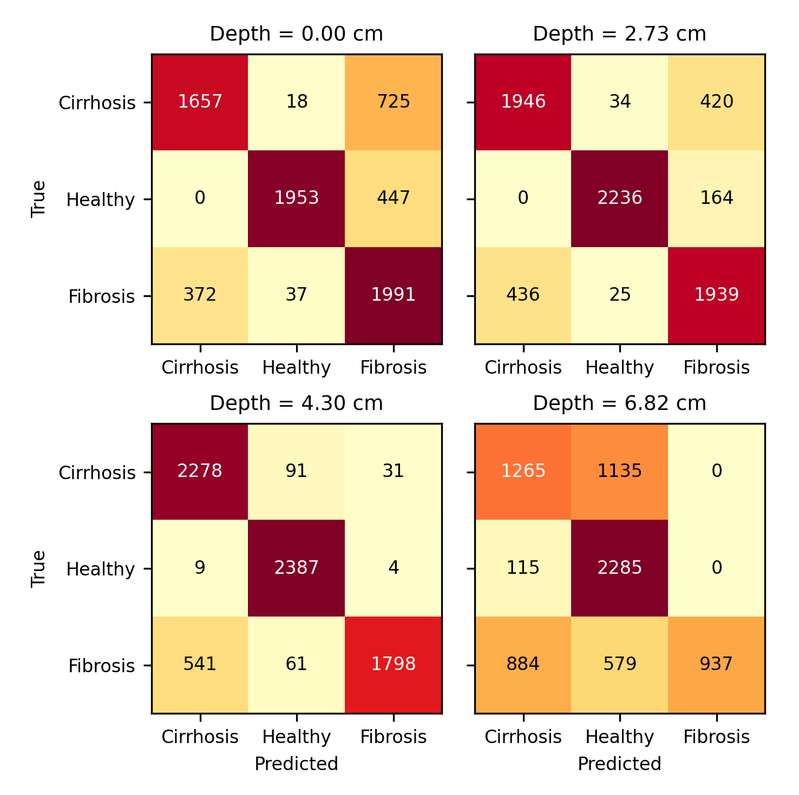

The figure above is the 2 × 2 layout. The single-row layout of the same four depths is a separate figure.

Clean-trained networks. The saved results hold the matrices of 24 networks trained on clean windows only, at every depth to 15 cm, and Log 14 describes a clean-trained model. They were pooled by a script that reads the 552 matrices without loading any pickle and writes a pooled summary table. Rows are true class and columns predicted class, in the alphabetical order above; the script checks the orientation by printing the pooled matrix at 0.00 cm, where the diagonal dominates for cirrhosis and healthy. Healthy windows, pooled over 24 networks:

| Depth (cm) | Healthy correct | Called cirrhosis | Called fibrosis | Networks with more than half called cirrhosis | Networks with all 100 called cirrhosis |
|---|---|---|---|---|---|
| 0.00 | 89.5% | 0.0% | 10.5% | 0 | – |
| 2.73 | 88.2% | 0.1% | 11.7% | 0 | – |
| 4.30 | 66.6% | 13.8% | 19.6% | 3 | – |
| 5.45 | 45.4% | 25.8% | 28.8% | 6 | 1 (seed 103 only) |
| 6.82 | 34.0% | 30.2% | 35.8% | 7 | 5 |
| 8.18 | 30.9% | **32.2%** | 37.0% | 7 | 4 |

At 8.18 cm the pooled healthy row, out of 2,400 windows:

| Called cirrhosis | Called healthy | Called fibrosis | Total |
|---|---|---|---|
| 772 | 741 | 887 | 2,400 |

Individual networks differ widely.

**Expectation versus outcome**

| Item | Expectation | Outcome |
|---|---|---|
| Pattern in the saved data | One of three outcomes listed in advance: a genuine two-regime pattern with the depth where it flips, a real inconsistency, or not determinable from what is saved | **The claim is not reproduced in any saved data, and the pattern is not a two-regime one** |

I stated no preference in advance. I wanted a plain verdict only, with no replacement wording yet.

**Result interpretation**

**Log 14's statement, that every healthy sample is called cirrhosis at the collapse depth, does not describe the pooled behaviour of either family of networks.** For the degradation-aware networks healthy stays healthy and is the sink. For the clean-trained networks healthy is called cirrhosis in 25.8% of cases at 5.45 cm and 32.2% at 8.18 cm, in more than half of the windows for 6 and 7 networks respectively, and is called fibrosis even more often at both depths; a few networks behave exactly as Log 14 says and most do not. The direction of the failure therefore depends on the network, and one network's confusion matrix is not a basis for a general statement. What this does not settle is the original single model of Log 14. That figure was made with a single saved model at the earlier noise level given in the table below, so its estimates carry a large standard error; the weights behind it are not recoverable, and whether the tracked Stage 4 model file is that model is not verified.

| Original single model of Log 14 | Value |
|---|---|
| Noise level | 67.03 dB |
| Windows per class | 30 |
| Standard error | about 9 percentage points at a rate near 50% |

Corrections to this entry: the first version said that the saved matrices stop at 6.82 cm and that Log 14's statement was "neither confirmed nor refuted" because the pooled matrices did not cover the clean-trained model. Both were wrong. The figure shows four depths, but the saved matrices cover 23 depths from 0 to 15 cm, and the clean-trained matrices are saved and give the numbers above.

**Consequences**

The collapse claim and its figure were changed. Log 14 and Log 19 are kept as the original record and each carries a pointer to this entry, saying that the direction varies by network. I take the corrected narrative as the actual finding: the model does not mistake healthy tissue for disease but increasingly reports healthy for everything as depth grows, a false-reassurance pattern, and I call that arguably a more important safety result than the original claim. The share of windows predicted healthy later became its own figure (Log 37).

**Limitations**

- Both sets of matrices come from retrained networks (the per-class balanced-accuracy evaluation and the clean sweep), not from the original certified weights.
- Each network has 100 windows per class per depth, and the pooled figures have one data draw per network.
- The clean-trained and degradation-aware sets differ in training distribution, so the contrast between them is a contrast between two training regimes.
- Whether the clean-trained networks and the model of Log 14 are alike enough for the pooled numbers to stand in for it was not tested: the 24 networks are evaluated at 27.05 dB with 100 windows per class on the 23-depth grid of the certified work, and the model of Log 14 was evaluated at 67.03 dB on a different depth set.

**Evidence**

- `audit_fixes/lane5/balanced_accuracy_retry/perclass_balacc/confusion_matrices/`: saved confusion matrices of the 24 degradation-aware networks
- `audit_fixes/lane5/clean_trained_sweep/clean_sweep/confusion_matrices/`: saved confusion matrices of the 24 clean-trained networks
- `audit_fixes/lane5/clean_trained_sweep/clean_sweep/pooled_confusion_summary.csv`: pooled summary of the clean-trained matrices
- `Source/pool_clean_confusion.py`: pools the clean-trained matrices
- `Source/make_fig10_pooled_confusion.py`: draws the pooled confusion figure
- `Source/make_fig08a_pooled_confusion_2x2.py`: draws the 2 × 2 layout
- `outputs/figures_final/fig08a_pooled_confusion_2x2.png`: the 2 × 2 figure
- `outputs/figures_final/fig08a_pooled_confusion.png`: the single-row layout of the same four depths
- `Source/stage4_depth_diagnostics.py`: the Stage 4 multi-depth confusion script (line 30 sets 30 windows per class, line 57 loads the Stage 4 model)
- `outputs/stage4/models/stage4_cnn_model.pt`: the tracked Stage 4 model file
- `docs/methodology/13-collapse-narrative-and-probe-corrections.md`: note 13, section 1

</details>

---
### Log 33: The frozen probe at the corrected noise level

<details>
<summary>Click to expand</summary>

**Approximate date of execution:** 7 September 2026

**Context**

I decided to test the depth at which the network's internal representation, and not its output, loses the classes: freeze the trained CNN's internal 32-dimensional representation at 8.18 cm, where the confusion matrix shows total collapse but the t-SNE plot still shows three visible clusters, train a simple linear classifier on those frozen embeddings using an independent held-out set at that depth, and report its accuracy. I wrote that if the probe is meaningfully above chance where the deployed decision boundary achieves none, that is quantitative evidence, and not just a visualization, that the representation floor sits deeper than the operational floor at that depth. The result entered Log 25 as 100% for the probe against 33.3% for the deployed classifier.

I later decided it had to be rerun, because that probe had been evaluated under the old 67.03 dB noise model and not under the 27.05 dB model the rest of the certified pipeline uses, so that the result would be certified and not just honestly labelled as outdated.

Written up afterwards from the saved files.

**Why this check matters**

A classifier's output layer can lose class information that the layer before it still holds. A linear probe on frozen internal features tests this, because it cannot add information the representation lacks. The test only counts if the data are generated at the noise level of the work being claimed, and if the test set is large enough for its error to be stated.

**Methodology**

An embedding is an intermediate layer's output vector for each input. A linear probe is a linear classifier trained on those frozen vectors; if it scores well, the class information is linearly readable from the representation even when the network's own output layer fails to use it. The probe models class probabilities by a softmax of linear scores, where C is the inverse of the L2 penalty, so a smaller C shrinks the weights more.

| Setting | Value |
|---|---|
| Model | The clean-trained CNN |
| Frozen representation | The 32-dimensional output of the first fully connected layer, taken before the ReLU and dropout, with the network weights fixed |
| Probe | scikit-learn `LogisticRegression`, `max_iter=2000`, `C=0.5` |
| Noise level | 27.05 dB |
| Windows | 200 per class, 600 in total, generated at the chosen depth with numpy seed 42 + 777 (a different draw from the original run) |
| Split | 60/40, stratified: 360 windows train the probe, 240 windows (80 per class) test it |
| Depths | 8.18 cm, for a direct before-and-after comparison with the original run, and 8.00 cm, which I named as the current certified median floor |
| Chance | 1/3 for three balanced classes |

The deployed classifier's accuracy is measured on the same generated windows. Only the noise level, the depth argument and the output path differ from the original script. The CNN does not depend on the test noise level, because it was trained on clean noiseless windows; changing the noise changes only the evaluation data. The comment in the original script that calls the network "trained under" 67.03 dB is therefore misleading: the network was only evaluated at that noise level. The standard error of an accuracy p on n test windows is √(p(1 − p) / n):

| Quantity | Value |
|---|---|
| p, n | 0.758, 240 |
| Standard error | √(0.758 × 0.242 / 240) = 0.028 |
| 95% interval | about ±5.4 points |

**Execution order**

1. The original probe was run. The documented noise level for the saved model was 67.03 dB. The result was 100% against 33.3% at 8.18 cm.
2. The rerun gave 75.8% at 8.18 cm and 77.1% at 8.00 cm.
3. I decided that the figure should be regenerated with the new numbers as the primary bars and the old numbers kept as a footnote in the caption.

Correction: the first version of this entry said "200 held-out windows per class at each depth". The probe is tested on 240 windows, 80 per class. The 200 per class is the size of the generated set (recorded as 200 samples per class in the result tables), of which 60% trains the probe.

**Result**

| Run | Depth (cm) | Deployed classifier | Frozen probe | Probe windows correct | Chance |
|---|---|---|---|---|---|
| 27.05 dB | 8.18 | 33.3% | **75.8%** | 182 of 240 | 33.3% |
| 27.05 dB | 8.00 | 33.3% | **77.1%** | 185 of 240 | 33.3% |
| 67.03 dB (earlier run) | 8.18 | 0.3333 | 1.0 | – | – |

The probe beats chance by 42.5 and 43.8 points where the deployed classifier is at chance. It is 75.8% against the earlier 100%.

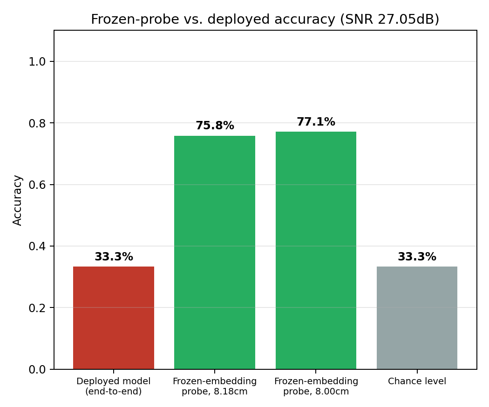

**Expectation versus outcome**

| Item | Expectation | Outcome |
|---|---|---|
| Probe accuracy | A lower value than 100% was possible, because the earlier value came from test data at the superseded 67.03 dB noise level | **75.8% at 8.18 cm and 77.1% at 8.00 cm: the finding holds, more weakly than the original 100%** |
| If the finding holds | A probe substantially beating the deployed model is confirmation | The probe beats chance by 42.5 and 43.8 points where the deployed model is at chance |
| If it does not hold, or holds much more weakly | Report that plainly, and do not adjust the method to preserve the original result | 75.8% and 77.1% against 100% originally |
| If the clean-trained model had been trained under old noise assumptions in a way that makes the comparison invalid | Stop and say so, and do not proceed with a misleading rerun | The CNN was trained on clean noiseless windows, so the test noise level does not enter its training |

No prediction was recorded.

**Result interpretation**

**At 27.05 dB the probe scores 75.8% at 8.18 cm and 77.1% at 8.00 cm, about 43 points above chance, where the deployed classifier is at chance.** Class information is therefore still present in the representation where the output has lost it. This is one clean-trained network, one seed and one held-out draw per depth, with no confidence interval, at two depths, so it does not show how that information declines with depth.

The finding holds under the corrected noise, but more weakly than the original 100%.

| Quantity | Value |
|---|---|
| Margin of the probe over chance | 42.5 and 43.8 points, more than fifteen times the standard error of 2.8 points |
| Difference between the two depths | 1.3 points, less than half a standard error |

The two depths use the same network weights, the same seed offset and overlapping generator draws, so they are not independent replications. The probe is trained and tested on windows from one generated set at one depth, so it measures separability at that depth only.

The depth of 8.18 cm itself was chosen from a collapse first observed at 67.03 dB; that the deployed accuracy is 33.3% at both depths in the new runs shows that the collapse is present at both under 27.05 dB.

**Consequences**

The probe claim was restated with the new values. The figure is copied unchanged into the final set (Log 37). The 67.03 dB result is kept unchanged as the earlier record.

**Limitations**

- One seed and one held-out draw per depth, with no interval in the original figure.
- The probe was not repeated on more seeds or draws.

**Evidence**

- `Source/frozen_embedding_linear_probe_27p05dB.py`: the rerun probe script (line 100 sets up the probe, lines 40 to 43 generate the windows, lines 94 to 96 split them)
- `Source/logs/frozen_embedding_linear_probe_8p18cm.csv`: the earlier 67.03 dB result (probe 1.0, deployed 0.3333)
- `Source/logs/frozen_embedding_linear_probe_27p05dB_8p18cm.csv`: result at 8.18 cm and 27.05 dB
- `Source/logs/frozen_embedding_linear_probe_27p05dB_8p0cm.csv`: result at 8.00 cm and 27.05 dB
- `outputs/stage4/models/stage4_cnn_model.pt`: tracked copy of the clean-trained CNN (the script reads it as models/stage4_cnn_model.pt)
- `outputs/figures_final/fig06_frozen_probe_vs_deployed.png`: the figure of the probe against the deployed classifier
- `outputs/figures_earlier/fig3_06_frozen_probe_vs_deployed_27p05dB.png`: the earlier copy of the same figure
- `Source/make_fig11_corrected_probe.py`: the plotting script
- `docs/methodology/13-collapse-narrative-and-probe-corrections.md`: note 13, section 2

</details>

---
### Log 34: The baselines under the Nadeau-Bengio correction

<details>
<summary>Click to expand</summary>

**Approximate date of execution:** 11 September 2026

**Context**

I decided to strengthen the architecture comparison with standard baselines under exactly the same protocol as the existing comparison: an SVM, a random forest and a small GRU, set beside the existing single-split accuracies of 72.70, 89.81 and 86.11% for the logistic baseline, the CNN and ResNet1D. The correction itself came from another piece of work: repeated-fold p-values of "p = 0.0002 for all three" had been reported without correction, and the Nadeau-Bengio test was to be applied to the 75 fold differences. I later noted that the SVM, random forest and GRU results of the second version had never been put through that test, and decided it had to be applied so that the gap was closed, with a flag wherever it changed a conclusion already stated.

The linear baseline was too weak a comparison, so the question was whether an SVM, a random forest or a GRU would also fail.

Written up afterwards from the saved files.

**Why this check matters**

Repeated cross-validation folds share training data, so a plain paired test makes differences look more certain than they are. The Nadeau-Bengio correction inflates the variance to account for the overlap. Applying it to every comparison, and counting how many comparisons were made, keeps a borderline p-value from being read as a finding.

**Methodology**

The task is the clean three-class task, with no depth and no noise.

| Setting | Value |
|---|---|
| Realizations | 90 |
| Split | Grouped 5-fold split, with the same fold indices as the Log 11 repeated grouped cross-validation |
| Folds | 15 repetitions × 5 folds = 75 |
| Models | An SVM with an RBF kernel, a random forest of 300 trees, and a GRU of one layer and 16 units (60 epochs) |
| Features, first version | The magnitude of the Fourier transform |
| Features, second version | The raw 100-sample window plus the real and imaginary parts of the transform (202 features) |
| Hyperparameters | An inner search of at most four configurations per model |

A grouped split keeps all windows from one realization on the same side, so test windows are never near-duplicates of training windows; the inner cross-validation inside the training part has to be grouped as well, otherwise hyperparameters are tuned on leaked data.

A paired t-test on cross-validation folds tests the per-fold difference between two models against zero. Folds share training data, so the differences are positively correlated and the plain test's variance is too small. The Nadeau-Bengio correction replaces the variance of the mean difference, s² / J, by (1/J + n_test / n_train) s², with J − 1 degrees of freedom:

| Quantity | Value |
|---|---|
| J | 75 |
| Groups per fold | 18 test to 72 train, so n_test / n_train = 0.25 |
| Variance factor | 1/75 + 0.25 = 0.263, against 1/75 = 0.0133 for the plain test |
| Effect | The variance is multiplied by 19.75 and the standard error by 4.44 |

The existing Nadeau-Bengio function from the lane 2 re-checks was applied unchanged to the 75 paired differences, with the ratio set to 0.25. The (repetition, fold) rows align one to one between the table of the earlier models and the table of these three.

Eight comparisons are made, so multiple comparisons matter: at a level of 0.05, the chance of at least one false positive among eight independent tests is 1 − 0.95⁸ = 0.34, and a Bonferroni threshold would be 0.05 / 8 = 0.00625. A below-chance accuracy, for three balanced classes anything under 33.3%, does not mean an inverted rule; it means the model collapsed to constant or near-constant predictions.

**Execution order**

1. The task was set up and the first version was run.
2. The first version, 15 repetitions, gave the results in the first table under Result. They were reported as run, with the GRU below the 33.3% no-information rate (note 07).
3. I decided that diagnostics had to come before any redesign: the GRU's training accuracy, the predicted-class histogram, the test-fold counts, the accuracy of a constant predictor, and confirmation of whether the inner cross-validation was grouped by realization. The diagnosis (note 07) was that the inner cross-validation was plain stratified, not grouped, while the outer split was grouped; that the GRU had collapsed to a single constant class in all five folds (72 of 72 test windows in one class each time); and that the SVM and random forest had not collapsed and were low because magnitude-only features lose phase. A pre-registration for the second version was to be written before it ran.
4. The second version ran (about 7,100 s). The inner cross-validation was made grouped for all three models; the amendment had named the GRU only, and the same defect was in the SVM and the random forest, so it was applied to all and flagged. The results are in the second table under Result.
5. The Nadeau-Bengio test was applied, and the result was summarised.

**Result**

First version, magnitude features (15 repetitions and the single split):

| Model | 15-repetition mean accuracy | Single-split accuracy |
|---|---|---|
| SVM | 47.98% | 48.61% |
| Random forest | 48.41% | 49.44% |
| GRU | 24.15% | 22.22% |

Second version, raw window plus transform parts:

| Model | Accuracy | Note |
|---|---|---|
| SVM | 90.50 ± 3.81% | |
| Random forest | 91.72 ± 3.32% | |
| GRU | 24.33 ± 5.41% | The restart loop hit its limit of 5 in most folds (355 restarts over 80 fold trainings) |

Mean accuracy over the 75 folds:

| Model | Mean accuracy |
|---|---|
| Logistic baseline | 70.94% |
| CNN | 85.28% |
| ResNet1D | 90.11% |
| SVM | 90.50% |
| Random forest | 91.72% |
| GRU | 24.33% |

Corrected comparisons:

| Comparison | Difference | p | 95% CI |
|---|---|---|---|
| SVM − baseline | +19.56 points | 7.7e-10 | 14.04 to 25.08 |
| Random forest − baseline | +20.78 | 1.2e-8 | 14.33 to 27.24 |
| Random forest − CNN | +6.44 | **0.048** | 0.06 to 12.83 |
| SVM − CNN | +5.22 | **0.156** | −2.04 to 12.49 |
| Random forest − ResNet1D | +1.61 | **0.579** | −4.15 to 7.37 |
| SVM − ResNet1D | +0.39 | 0.869 | −4.30 to 5.07 |
| Random forest − SVM | +1.22 | 0.478 | −2.19 to 4.64 |
| GRU − baseline | −46.61 | 4.7e-20 | −53.99 to −39.22 |

**Expectation versus outcome**

| Item | Expectation | Outcome |
|---|---|---|
| First version | No prediction was written. Two rules were set: report every model in the pre-registration whatever the result, and select hyperparameters by an inner cross-validation inside the training folds only | SVM 47.98%, random forest 48.41%, GRU 24.15% |
| Second version | The reason was stated before running: the magnitude of the Fourier transform is invariant to a shift in time, so it discards the arrival-time information that separates the classes, and the first version stays as a documented negative result | **SVM 90.50% and random forest 91.72%**, GRU 24.33% |
| Corrected test | None | Random forest against the CNN is nominally significant (p = 0.048) and the other comparisons with the CNN or ResNet1D are not distinguishable |

No expected outcome was written for the second version or for the corrected test.

**Result interpretation**

The comparison uses 75 paired fold differences from 90 realizations. Against the CNN, the SVM (+5.22, p = 0.156) and the random forest against ResNet1D (+1.61, p = 0.579) are not distinguishable. Random forest against the CNN (+6.44, p = 0.048) is nominally significant but would not survive the Bonferroni threshold for eight comparisons. The data support "not distinguishable" and leave "equal" open, since the intervals are wide, and they do not show that the classical models are better or that the CNN is distinct.

**In summary, the SVM and the random forest are not statistically distinguishable from the CNN or ResNet1D.** The one borderline exception, random forest against CNN, I consider not real, given eight uncorrected comparisons. The GRU failed as trained, and the reason is not established (see Limitations). Both the SVM and the random forest clearly beat the logistic baseline. The methodology note says the same: random forest against CNN "sits at the edge" and should not be read as a firm difference, with eight comparisons and no multiplicity adjustment. Two readings the numbers do not allow: that the CNN is better or worse than a random forest on this task (the fold standard deviation is 3.3 to 3.8 points, about the size of the SVM-CNN difference of 5.2), and that a result of 90 to 92% says anything about depth.

**Consequences**

Note 07 and the Log 26 sentence were updated. Nothing in the files says that any conclusion changed because of the result.

**Limitations**

- All of this is on the clean task: no depth and no noise. Accuracies of 90 to 92% here are not comparable with the depth floors of Logs 19 to 31.
- The random forest's 91.72% on raw windows is consistent with the finding in note 08 that window timing alone gives 90.6% on clean data, and the comparison itself does not explain it.
- The CNN and ResNet1D accuracies come from the Log 11 runs, and the SVM, random forest and GRU from a separate harness; they share fold indices but not training code, so differences also reflect different training procedures.
- The second version, its features and its grouped inner cross-validation, was chosen after the first version's results were seen, and applied to the SVM and the random forest as well as the GRU; its pre-registration documents this.
- The GRU result is unexplained: it collapsed to a constant single-class prediction in the first version and stayed at 24% after the fixes. The small size (1 layer, 16 units, 60 epochs) is the leading suspect and was not tested (note 07).
- The eight comparisons are not corrected for multiple testing, so random forest against CNN (p = 0.048) is borderline.

**Evidence**

- `Source/repeated_grouped_cv_log11.py`: the Log 11 repeated grouped cross-validation, source of the fold indices
- `audit_fixes/lane2/analysis.py`: the Nadeau-Bengio test function (lines 164 to 176)
- `audit_fixes/lane4/nb_v2.py`: applies the test to the second-version models
- `audit_fixes/lane4/nb_v2_output.txt`: output of the corrected comparisons
- `audit_fixes/lane4/diagnose_v1.py`: diagnosis of the first version
- `audit_fixes/lane4/run_lane4_v2_comparison.py`: harness of the second version
- `audit_fixes/lane4/README.md`: index of the lane 4 folder
- `docs/methodology/07-lane4-baseline-architectures.md`: note 07

</details>

---
### Log 35: The corrected progression figure, and an erratum in Log 22

<details>
<summary>Click to expand</summary>

**Approximate date of execution:** 14 September 2026

**Context**

This entry covers two linked corrections: the progression figure, and two numbers in Log 22.

I decided on a systematic pass over every claim, because nobody had checked whether other claims had been left unverified against the final state of the work: the 24-seed certified data and the 27.05 dB noise model. My rule for the pass was to hide nothing: where a gap can be closed by actually running something, such as regenerating a figure, do it and say so plainly. The pass found that the chart image of the progression figure was stale although its caption had already been fixed. I decided it should be regenerated with the corrected progression, 0.00, 4.30 and 8.48 cm, and not the old 0.52, 5.45 and 8.18 cm, and that the same stale numbers should be fixed in Log 22. The same pass found the Log 22 numbers: a table row gave a wrong margin and a wrong share of the range, and it was corrected (values in the erratum table under Result).

Written up afterwards from the saved files.

**Why this check matters**

A figure is evidence only if every curve in it comes from the run and noise level its label claims. A curve left over from before a correction can sit under a corrected title. Tracing each curve to its input file, with its date and noise level, shows which parts of a figure can be trusted. A margin or ratio quoted in text has to follow from the table it cites.

**Methodology**

The progression figure. The plotting script draws accuracy against depth at 100 Hz for three curves and a floor line for each. The first version read three Python result files. The redrawn version reads only CSV files, one per curve, each with a header giving its source, date and noise level; it writes the plotted points to a CSV file, and the floor lines come from CSV columns or from the degradation-aware sweep results. The floor is the first depth whose BH-corrected significance fails (Log 27).

The Log 22 numbers. The margin is the ratio of the attenuation coefficients of healthy tissue and cirrhosis. In the weak-damping formula α = ω²η / (2Gc), α is linear in η, so the margin changes in inverse proportion to the cirrhosis viscosity.

| Quantity | Value |
|---|---|
| Margin of the sweep at η = 1.8 Pa·s | 1.210 |
| Sweep grid | no point at 1.77 |
| Margin at the pipeline's value 1.77 | 1.210 × 1.8 / 1.77 = 1.23 |
| Breakpoint, where the margin falls to 1.0 | η = 1.8 × 1.210 = 2.18 |
| Swept range | 1.2 to 2.5, a span of 1.3 Pa·s |
| Breakpoint above the start of the range | 2.18 − 1.2 = 0.98 |
| Share of the range over which the finding holds | 0.98 / 1.3 = 0.754, about 75% |

The finding "healthy attenuates fastest" holds while the margin is above 1.0.

**Execution order**

1. The systematic pass was carried out. Its report listed a correction for the margin sentence (1.21× over about 85% became 1.23× over about 75%) and a second for a sentence that attributed the 5.45 to 4.30 cm change to the wrong model.
2. The first version of the figure was drawn from the three result files, the earlier figure file was kept next to it and not overwritten, and Log 22 was edited.
3. Later, when the figure set of Log 37 was planned, two copies of the baseline results file were compared. The copy in the repository holds the curve from before the noise correction (accuracy 0.778 at 0 cm). A second copy that is not in the repository had been written under the 27.05 dB setting (accuracy 0.384 at 0 cm). Two curves of the first version were found to come from runs before the noise correction.
4. The inputs of each curve were checked by listing the stored values of each file, and the figure was redrawn from CSV files exported once from the saved result files.

**Result**

What the first version plotted:

| Curve | Input of the first version | What it holds | Verdict |
|---|---|---|---|
| Baseline classifier | The baseline results file in the repository (the copy from before the noise correction) | Accuracy at 0 cm and 100 Hz is 0.778 (raw p = 0.00498), falling to 0.333 at 0.52 cm | Pre-correction |
| Clean-trained CNN | The clean-trained CNN results file | The sequence of Log 19: accuracies 0.90 at 0 cm, 0.717 at 4.09, 0.700 at 4.3, 0.633 at 4.5 and 0.533 at 4.7 cm | Valid |
| Degradation-aware CNN | The degradation-aware results file, written before the noise correction | Accuracies are multiples of 1/60 (60 windows per cell, the setting before it was raised to 300 in Log 20), and the first non-significant depth is 8.18 cm. Log 20 reports 9.55 cm for the first noise-corrected run | Pre-correction (inferred from content) |

Correction: the first version of the figure therefore plotted a pre-correction baseline curve (accuracy 0.778 at 0 cm, with a title that said 27.05 dB) and a degradation-aware curve, and a dotted line at 8.18 cm, from a run made before the noise correction. It also shaded 8 to 10 cm as a typical organ depth range, which is not in the redrawn figure. The first version is kept. In the saved file the 0.00 cm baseline floor could also be reached for a different reason: a single depth at the smallest possible p-value cannot pass BH when the family has 30 depths, whatever the accuracy at that depth.

| Quantity | Value |
|---|---|
| Smallest possible p-value | 1/201 = 0.00498 |
| Depths in the family | 30 |
| Rank-1 BH threshold | 0.05/30 = 0.0017 |

That reason is the resolution limit of Logs 28 and 30, not the collapse of Log 19.

What the redrawn figure plots:

| Curve | Source | Contents |
|---|---|---|
| Baseline classifier | A baseline CSV, exported from a result file that is not in the repository, written by the floor characterization script under the 27.05 dB setting | 30 depths at 100 Hz. Accuracy 0.384 at 0 cm (raw p = 0.045) and 0.333 from 0.52 cm on; floor **0.00 cm** from the stored significance flags. Adjusted p-values were not stored. Matches Log 19 |
| Clean-trained CNN | A CSV exported from the clean-trained CNN results file in the repository | 24 depths at 100 Hz; floor **4.30 cm** from the stored flags (accuracy 0.700, raw p = 0.0149 at 4.3 cm). The curve is the one of the first version |
| Degradation-aware CNN | A CSV with accuracy by depth taken from the corrected calibration data (the seed-42 run at 27.05 dB) | 23 depths, 60 windows each. Accuracy only: that run has no shuffled controls or p-values in the repository, so it has no floor of its own and the 9.55 cm floor of this run (Logs 20 and 37) is not drawn |

The floor lines are 0.00 cm (baseline), 4.30 cm (clean-trained) and the 24-network mean of the degradation-aware sweep, 8.48 cm. The figure labels the degradation-aware curve "one saved run, accuracy only (seed 42)", and its title takes the three floors from the CSV values.

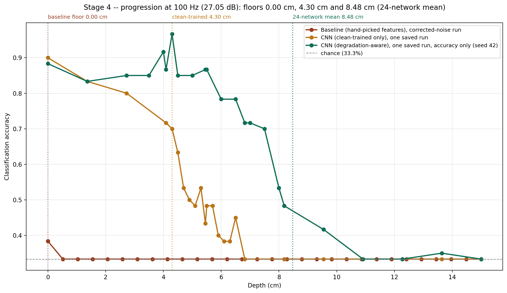

Erratum in Log 22: two numbers in Log 22's first draft were wrong.

| Quantity | First draft | Corrected |
|---|---|---|
| Margin between healthy and cirrhosis attenuation at the base viscosity of 1.77 Pa·s | 1.21× (the margin at the nearest sweep point, η = 1.8) | 1.23× |
| Share of the swept range over which the finding holds | about 85% | about 75%: the breakpoint at η ≈ 2.18 Pa·s is 0.98 of the 1.3 Pa·s span from 1.2 to 2.5 |

The breakpoint itself did not change. Log 22 was corrected in place, with a note saying so; its closing "Reportable finding" paragraph still quotes 1.21× and carries a pointer to this entry.

**Expectation versus outcome**

| Item | Expectation | Outcome |
|---|---|---|
| Progression figure | The corrected sequence was specified in advance: 0.00, then 4.30, then 8.48 cm | **Floor lines at 0.00, 4.30 and 8.48 cm in the redrawn figure** |
| Log 22 | The aim was to apply the corrected values | Margin 1.23× and about 75% of the range |

For Log 22 no expectation was recorded.

**Result interpretation**

**With a baseline floor of 0.00 cm, the ratio "roughly 16× deeper" in Log 15 can no longer be formed; the comparison is 0.00, 4.30 and 8.48 cm.** The numbers behind the reading:

| Quantity | Value |
|---|---|
| Ratio in Log 15 | 8.18 / 0.52 = 15.7 |
| Redrawn baseline accuracy at 0 cm | 0.384 (near chance, which agrees with the collapse that Log 19 describes) |
| Single saved degradation-aware run | above chance to about 9.5 cm, at chance by 10.9 cm |
| Clean-trained mean over 24 networks | 8.85 cm (SD 4.94, Log 37), against 4.30 cm for the single run used here |

The three curves are still not like-for-like: they are single saved runs of different procedures and sizes, and the 8.48 cm line is the mean of 24 networks and is not a feature of the plotted curve. The axis labelled "progression" therefore mixes procedures. The Log 22 numbers affected text only; the sweep table and the breakpoint 2.18 did not change.

**Consequences**

The corrections ledger gained rows, including the first version of this figure; Log 22 was edited; the pointer in Log 15 now says that the floors were replaced and that the first redraw used two curves from before the correction.

**Limitations**

- All three curves are single saved runs.
- The baseline export keeps only the file's stored significance flags, without adjusted p-values, and the clean-trained export has no control minimum or maximum.
- The degradation-aware curve has no controls, so the figure shows accuracy and not significance for it.
- The Log 22 margin at 1.77 is derived by scaling the 1.8 value, because the sweep has no point at 1.77.

**Evidence**

- `Source/make_fig12_corrected_progression.py`: the plotting script (the 12 in its name is historical and does not refer to the floor-versus-viscosity figure of Log 37)
- `outputs/stage4/data/stage4_results.pkl`: baseline results file read by the first version
- `outputs/stage4/data/stage4_cnn_results.pkl`: clean-trained CNN results file
- `outputs/stage4/data/stage4_degradation_aware_results.pkl`: degradation-aware results file read by the first version
- `outputs/stage4/data/stage4_progression_baseline_corrected.csv`: exported baseline curve
- `outputs/stage4/data/stage4_progression_clean_cnn.csv`: exported clean-trained curve
- `outputs/stage4/data/stage4_progression_degaware_seed42.csv`: exported degradation-aware curve (accuracy only)
- `outputs/stage4/data/stage4_calibration_data_corrected.csv`: corrected calibration data, the seed-42 run at 27.05 dB
- `outputs/stage4/data/stage4_progression_plotted_values.csv`: the plotted points of the redrawn figure
- `Source/floor_characterization.py`: the floor characterization script that wrote the baseline result file
- `Source/logs/degradation_aware_final_results.csv`: the degradation-aware sweep results (24-network mean 8.48 cm)
- `outputs/stage4/figures/stage4_full_progression_corrected_first_version.png`: the first version of the figure
- `outputs/stage4/figures/stage4_full_progression_corrected.png`: the redrawn figure

</details>

---
### Log 36: Control variants for the ETS Montreal phantom result

<details>
<summary>Click to expand</summary>

**Approximate date of execution:** 18 September 2026

**Context**

In Log 21 a CNN scored 97.25% on held-out acquisition data from the ETS Montreal / Borealis dataset (control mean 49.91%, p = 0.0050), which I had described as separating inclusion from background on real RF signal. The dataset holds the phantom fixed and varies the indentation of the probe (Log 21), so what it tests is separation on real RF signal, with no bearing on the depth floor. The labels, though, were "inclusion" and "background" windows cut from two depth bands, so the accuracy could come from the inclusion, from the depth band, or from lateral position. An external audit had raised that the high phantom accuracy might come from signal energy and where the target sits, and not from stiffness. That is why I decided that a control experiment was needed on this result. Alongside it, the wording of the 97.25% claim and of the "hard/soft" claim was looked up, together with the phantom's geometry sheet and the columns of the inclusion.

Written up afterwards from the saved files.

**Why this check matters**

When two things change together in a dataset, here the presence of an inclusion and the depth of the rows, a high accuracy does not say which one the classifier uses. Control variants that change one factor at a time show how much of the accuracy each factor explains. Without a shuffled-label null, an accuracy near 60% cannot be given a p-value.

**Methodology**

The data are the public ETS Montreal / Borealis ultrasound phantom RF recordings. A column of a frame is an A-line, one raw echo signal along one beam, and a row is a depth sample. Each window is standardised on its own: the window mean is subtracted and the result is divided by its standard deviation, which removes absolute amplitude differences. The classifier is the same CNN and training function as in the earlier Montreal retraining script. Classes are balanced by subsampling with a fixed seed. No shuffled-label controls were run.

| Setting | Value |
|---|---|
| Frame | 256 A-lines (columns) and 3,152 rows (depth samples) |
| Window length | 100 samples |
| Training | 60 epochs, Adam, learning rate 1e-3 |
| Split | Acqui1 to Acqui5 train, Acqui6 test, as in Log 21 |
| Chance level | 50% (balanced classes) |
| Model seeds | 1, 2 and 3 |

A control experiment changes one factor at a time to find what a result depends on. Here two differences go together in the original design, "inclusion present" and "deeper rows", so the label cannot say which one the classifier uses. That is a confound. The three variants separate them:

| Variant | Label 1 | Label 0 | Columns |
|---|---|---|---|
| V0, the original design | rows 1526 to 1626 | rows 300 to 400 | all 256 |
| V2, depth only | rows 1526 to 1626 | rows 300 to 400 | only those outside the inclusion, so no inclusion tissue is in either class |
| V1, lateral only | rows 1526 to 1626, columns over the inclusion | rows 1526 to 1626, columns beside the inclusion | both classes cut from the same rows |

The readings were specified before the runs. V2 "measures how much depth alone separates the classes", and if its accuracy is high, depth alone separates the classes with no inclusion tissue in either class. V0 should confirm about 97%. What V1 and V2 imply about what V0 measures was to be stated plainly. A guard was added: a high V1 would show that the model can separate inclusion from background at equal depth, but the two also differ in echo strength, so V1 alone would not prove sensing of stiffness.

The columns of the inclusion are the weak point of the design. The dataset's workbook gives no probe footprint, aperture, line pitch or image width. A mapping was therefore built from the B-mode pictures, using the pixel extent of the image and the pixel span of the inclusion in each sequence:

| Mapping item | Value |
|---|---|
| Image extent | x = 169 to 471 (303 pixels wide) |
| Pixel x to column | floor((x − 169) / 303 × 256) |
| Shrinking | 10 columns on each side for label 1, and the region outside widened by 10 for label 0, so that neither class touches the edge |

| Sequence | Inclusion span (pixels) | Inclusion columns after shrinking | Width (columns) |
|---|---|---|---|
| Acqui1 | 255 to 387 | 82 to 174 | 93 |
| Acqui2 | 246 to 393 | 75 to 179 | 105 |
| Acqui3 | 242 to 385 | 71 to 172 | 102 |
| Acqui4 | 250 to 389 | 78 to 175 | 98 |
| Acqui5 | 258 to 393 | 85 to 179 | 95 |
| Acqui6 | 258 to 393 | 85 to 179 | 95 |

The mapping assumes that the 256 A-lines span the displayed image width. This is an assumption that was not measured. A B-mode image is a scan-converted picture, so the pixel-to-column mapping cannot be checked against the RF data.

Two secondary hypotheses were also run and labelled hypothesis-dependent. The footprint behind H-b is an assumption that is not in the dataset files, and I adopted it as H-b.

| Hypothesis | Assumption about the 256 A-lines | Inclusion columns |
|---|---|---|
| H-a | they span the width of the phantom | 113 to 143 |
| H-b | they span a probe footprint narrower than the phantom | 71 to 185 |

Before training, the derived spans and the fraction of the original inclusion-class windows that fall laterally outside the inclusion under each method were to be printed.

An echo energy ratio compares the mean squared raw RF value per window between column sets or row bands. No permutation null was run on the variants, so the probability of seeing a given accuracy by chance is not estimated.

**Execution order**

1. The control experiment was set up, together with lookups of the phantom geometry and the wording of the claim. The geometry sheet gives the dimensions of the phantom and of the inclusion, and no probe footprint.
2. Work paused at the definition of V1. It depends on the inclusion's columns, and no geometry source for them could be found, so any range chosen would have been invented. Three options were weighed. The choice was to try the B-mode images first, to run V1 and V2 also under H-a and H-b labelled as hypothesis-dependent, and to start V0 and V2 at once.
3. The variants, the column mapping and the guard on how V1 would be read were fixed.
4. The logs of one run, in which the inclusion's columns were read from the images by eye, are saved as the first-run logs. The two runs were made independently.
5. The run whose results are reported below derived the column spans by thresholding the images. Its results are in the saved results file.

**Result**

Accuracy on Acqui6, mean ± SD over three seeds:

| Variant | Accuracy | Per seed |
|---|---|---|
| V0, original design (all columns) | 96.78 ± 0.68% | 97.32, 97.00, 96.01 |
| V2, depth only | **95.99 ± 0.82%** | 96.73, 96.13, 95.12 |
| V1, equal depth, inclusion vs background | **59.10 ± 0.61%** | 59.65, 58.44, 59.19 |

Under the two alternative column hypotheses V1 gives 59.69% (H-a) and 61.29% (H-b). V2 under H-a and H-b is the same computation (same columns and seeds), so the identical 95.55% is not two results. In the original all-column windows, 80% (H-a) or 47% (H-b) of the columns labelled "inclusion" lie outside the inclusion.

| Hypothesis | V1 accuracy | V2 accuracy | Columns labelled "inclusion" in V0 that lie outside the inclusion |
|---|---|---|---|
| H-a | 59.69% | 95.55% | 80% |
| H-b | 61.29% | 95.55% | 47% |

Window counts before balancing, per class (train and test):

| Variant | Train | Test |
|---|---|---|
| V0 | 45,056 | 8,192 |
| V1 | 17,342 and 20,674 | 3,040 and 3,872 |
| V2 | 20,674 | 3,872 |

Echo energy ratios (raw RF energy per window):

| Comparison | Ratio of raw RF energy per window | Range per sequence |
|---|---|---|
| Inclusion columns against columns beside them, same depth | 3.48 | 2.82 to 4.13 |
| Deep band against shallow band, outside the inclusion | 17.25 | 13.97 to 21.08 |

So even V1 differs in echo strength.

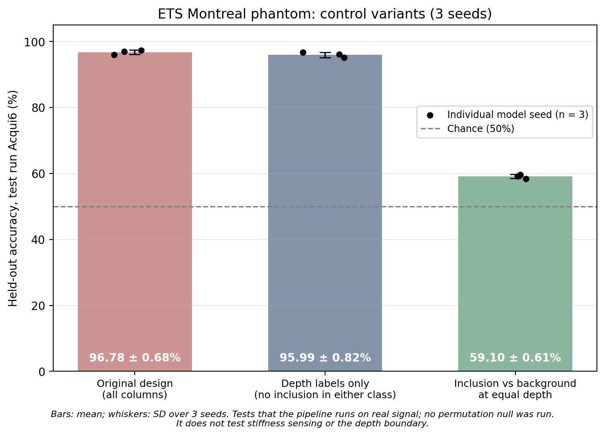

The run with the inclusion columns read by eye used the same variants and seeds. Its inclusion columns were:

| Sequence | Columns read by eye |
|---|---|
| Acqui1 | 73 to 173 |
| Acqui2 | 73 to 182 |
| Acqui6 | 75 to 184 |

Its window counts and accuracies for seeds 1 to 3 were:

| Variant | Training windows | Label 1 in training | Test windows | Label 1 in test | Accuracy per seed | Mean |
|---|---|---|---|---|---|---|
| V0 | 90,112 | 45,056 | 16,384 | 8,192 | 97.31, 97.01, 96.00% | 96.77% |
| V1 | 38,016 | 19,256 | 6,912 | 3,520 | 60.34, 60.36, 60.66% | 60.45% |
| V2 | 37,520 | – | 6,784 | – | 96.49, 95.83, 94.78% | 95.70% |

Both runs gave V1 near 60%: 59.10% with the thresholded spans and 60.45% with the spans read by eye. The two runs used different column spans, but both rest on the same assumed linear mapping from picture pixels to columns, so their agreement does not test that assumption.

**Expectation versus outcome**

| Variant | Expectation | Outcome |
|---|---|---|
| V0 | About 97%, confirming the original | 96.78% |
| V2 | High, since depth is easy to learn | **95.99%, within one point of V0** |
| V1 | Lower than V2 | **59.10%** |

Numeric expectations for V1 and V2 were not written down in advance.

**Result interpretation**

The saved report states the reading as follows. V0 reproduces about 97%, so the original headline is reproducible under this loader, which does not show that the model senses the inclusion. **V2 reaches almost the same accuracy with no inclusion in either class, so the depth band alone explains nearly all of the original result.** V2 is about 96% against about 97% for V0, within one point. At equal depth, V1 reaches about 59% against a chance level of 50%. The report adds that, with no permutation null, this does not show a statistically significant effect. Taken together, the high original accuracy is accounted for almost entirely by the axial depth band, and the inclusion does not account for it. The numbers do not show whether the CNN can detect the inclusion at all: 59% might reflect the inclusion, the 3.48-fold difference in echo strength, or lateral position, and V1 does not show sensing of stiffness in either direction. The result says nothing about the depth floor.

**Consequences**

The claim in Log 21 was reworded. Log 21 now says that the CNN separates two labelled regions and that this reflects mostly the axial depth band (59.10% at equal depth). The three-variant figure became part of the final figure set (Log 37).

**Limitations**

- The hold-out is fixed (Acqui6 only), with one architecture, three seeds, and no permutation null on the variants.
- The column mapping is an assumption.
- Windows from one acquisition are correlated (neighbouring columns and frames), so the effective sample size is smaller than the 6,912 test windows, and the ten points above chance cannot be turned into a p-value.
- V1 and V2 differ in training-set size: 38,016 against 41,348 windows (17,342 + 20,674 and 2 × 20,674).
- The probe indentation changes between frames within an acquisition, and none of the controls separates that from depth.
- The earlier 97.25% came from a different seed and a 200-shuffle design.
- The saved results are a copy of an earlier output. The generating script is among the saved scripts, but it writes to a path outside the saved record.

**Evidence**

- `Source/ets_montreal_path2_retrain.py`: the earlier Montreal retraining script that holds the CNN and training function
- `Source/ets_controls_run_variants.py`: the script that generates the control results
- `outputs/external_validation_controls/ets_montreal_controls_results.json`: saved accuracies for the three variants
- `outputs/external_validation_controls/REPORT_trackB_scratch_copy.md`: the saved report with window counts, energy ratios and the alternative column hypotheses
- `outputs/external_validation_controls/first_run/`: logs of the run with inclusion columns read by eye
- `outputs/external_validation_controls/first_run/spans_inner.json`: the inclusion columns read by eye
- `outputs/external_validation_controls/PROVENANCE.md`: note on where the saved results come from
- `outputs/figures_final/fig13_phantom_controls.png`: the three-variant accuracy figure

</details>

---
### Log 37: The final figure set, and a note on the logit-gap script

<details>
<summary>Click to expand</summary>

**Approximate date of execution:** 23 September 2026

**Context**

I needed one clean set of figures, each of which can be redrawn from files already saved. My rule was that a figure may be used only if it is an original output or is produced by a script reading saved files, never from numbers typed by hand. For each candidate figure the image file, the script, the saved inputs, the command that would regenerate it, and every number or label in the image that conflicts with the current verified set (table under Methodology) had to be listed. The decisions I had locked were:
- keep the first nine figures;
- restore the t-SNE figure, the reliability diagram (relabelled) and the viscosity-margin figure (corrected to 1.23× at η = 1.77, crossing 1.0 near 2.18);
- replace the phantom figure with the three-condition controls of Log 36;
- add an accuracy-versus-depth curve from the 24-network data only if a script that reads saved files can produce it;
- skip the Grad-CAM and occlusion figure, the four-frequency sweep, the training curves, the single-model noise stress test, the old floor progression, the baseline confusion matrix and the 10%-yardstick viscosity sweep.

The logit-gap question came later: I wanted the source of "halves every 1.3 to 1.5 cm" and of "0.033 to 0.040" in the logs, saved files and scripts, with file and line, and if they could not be traced that was to be said and nothing edited.

After the progression figure was found stale (Log 35), I set the rule that figures come only from saved files through a script, so that a transcription error could not enter a figure.

Written up afterwards from the saved files.

**Why this check matters**

A published figure that cannot be redrawn from saved files can carry a transcription error without anyone noticing. Building each figure by a script from stored data, and checking every number and label against the verified set, makes the figure reproducible. Reporting the spread, not only the mean, matters because two procedures with the same mean floor can differ greatly in how often they fail early.

**Methodology**

Each script either reads saved CSV, matrix or result files or recomputes from the physics model, and its header says which. After each figure the image was opened and every number, label, unit and legend checked against the verified list. The verified values:

| Quantity | Value |
|---|---|
| Floors over 24 networks | mean 8.48 (8.4754), SD 1.81 (1.812), median 8.00 |
| Gate | 6.50 cm |
| Attenuation at 100 Hz | 55.3, 25.7 and 45.0 per metre |
| Margin | 1.23× at η = 1.77, with the flip at 2.18 |
| Probe accuracy at 27.05 dB | 75.8 and 77.1% |
| Calibration gap | 0.356 and 0.326, named "binned calibration gap" and not UCE or ECE |
| Viscosity-sweep floors | 13.47 (five of eight at 15 cm), 6.77 and 5.94 cm |
| Phantom controls | 96.78 ± 0.68, 95.99 ± 0.82 and 59.10 ± 0.61 |
| Pooled matrices | 24 networks |

Inputs, by figure:

| Figure | Content | Input |
|---|---|---|
| fig03 | Amplitude against depth | Recomputed from the physics model |
| fig04 | Viscosity margin | The cirrhosis viscosity sensitivity script with an explicit frequency argument (default 100 Hz) |
| fig07 floor distribution | Floors under two training regimes | The naive floor column of the degradation-aware sweep results and the aggregate floor column of the clean-trained per-class results |
| fig07 pooled confusion and share healthy, fig08a, fig08b | Pooled confusion matrices and the share of windows predicted healthy | The 24 × 23 saved confusion matrices |
| fig09 | Per-class recall | The recall column of the per-depth balanced-accuracy detail files |
| fig10 | Reliability diagram | The corrected calibration data: one run, seed 42, 27.05 dB, 1,380 windows = 23 depths × 60 |
| fig12 | Floor against cirrhosis viscosity | The two battery floor files (an 8-network proxy; a floor at or above 15.0 counts as censored) |
| fig13 | Phantom controls | Log 36 |
| fig02 | Measurement chain | Stiffness classes, density, tracking distance, carrier, sample rate, window length and SNR read from the code of the physics model, the CNN classifier and the constants file; the script prints them and writes a values file |
| fig08a 2 × 2 | Pooled confusion matrices in a 2 × 2 layout | The same 96 saved matrices as fig08a; the counts are saved |
| fig11 | Logit gap against depth | The corrected calibration data; the values are saved |
| fig01, fig05, fig06 | Windowing, t-SNE, frozen probe | Unchanged copies of earlier outputs |

Terms used:

| Term | Meaning |
|---|---|
| Binned calibration gap | The average, over confidence bins, of the absolute difference between the mean confidence and the accuracy in the bin, with every bin weighted equally. With 10 equal-width bins it is the fixed-width gap, and with 10 bins holding the same number of windows each it is the equal-mass gap. The size-weighted variant, which weights bins by their window count, is not used |
| Reliability diagram | Accuracy plotted against mean confidence in each bin; the diagonal is perfect calibration |
| Top-minus-second logit gap | For each window, the largest class score minus the second largest, averaged by depth; it is zero when two classes tie and measures how decisively the network separates the top class |
| Floor of 15.0 cm | A lower bound when every depth was significant (Log 27) |
| BH artifact | The artifact of Logs 28 and 30 applies: with 200 shuffles, one or two depths at the minimum p-value cannot pass BH over 23 depths |

**Execution order**

1. The candidate figures were tallied against the verified set. A mismatch in the attenuation values was resolved by reading: the larger values were 500 Hz values (the attenuation ratio is (500/100)² = 25), and the saved margin image's left panel plotted 500 Hz values under a 100 Hz label. Two copies of the baseline result file were compared (Log 35).
2. The figure set and captions were finalised as a decision task and not a compute task, and the final set was built. The margin figure was regenerated at 100 Hz, three figures were relabelled and three new scripts written, and the share-healthy figure was computed last. Three further figures were then made by the scripts listed above (the measurement chain, the 2 × 2 pooled confusion matrices and the logit-gap figure).
3. The logit-gap numbers were looked up. The sources of "0.033 to 0.040" and of "halves every 1.3 to 1.5 cm" could not be traced to a script: no script for either number is in the repository, and Log 23 states them without code.
4. The logit-gap recompute script was written and run, and "0.033 to 0.040" was replaced by "0.038 to 0.041 (recomputed from the saved calibration logits)", since the values reproduced.

**Result**

Floors under two training regimes, over 24 networks (seeds 101 to 124):

| Training | Mean floor | SD | Below 6.50 cm | At 15.0 cm |
|---|---|---|---|---|
| Clean-trained only (aggregate floor column) | 8.85 cm | **4.94 cm** | **11 of 24** | 6 |
| Mixed-depth (degradation-aware, naive floor column) | 8.48 cm | **1.81 cm** | 2 of 24 | 0 |

The means are close; the spread is not. The medians are 9.55 and 8.00 cm; the clean-only median equals the single-run calibration floor of 9.55 cm only because both are points on the same depth grid, a coincidence of the grid with no relationship behind it. Both columns use the same rule, the first depth that is not significant after BH correction, with 15.0 cm the fallback cap when every depth is significant, so a value of 15.0 is a lower bound; the saved clean-trained column does not say which of its six values at 15.0 are censored and which are observed.

The clean-trained count of 11 is indicative, not exact:

| Quantity | Value |
|---|---|
| Clean-trained networks below 6.50 cm | 11 of 24 |
| Of those 11, adjusted p-value at the floor depth | between 0.053 and 0.076 for eight of them, just above 0.05 |
| Smallest attainable p-value with 200 shuffles | 0.00498 |

Seed 111 is the only network with a floor of 0.00 cm:

| Quantity | Value |
|---|---|
| Real accuracy at 0 cm | 0.893 |
| Three smallest raw p-values | 0.00498, 0.00498 and 0.00995 |
| BH thresholds for k = 1, 2, 3 (m = 23, 0.05 × k / 23) | 0.00217, 0.00435 and 0.00652 |
| Adjusted p-value at 0 cm | 0.0572 |

0.00498 is above the first two thresholds and 0.00995 is above the third, so none passes. Three depths at 0.00498 would have passed at k = 3. The floor of 0.00 cm is therefore an artifact of the BH resolution, and the network did not collapse.

Median per-class recall over 24 retrained networks:

| Class | 0.00 cm | 4.30 cm | 6.82 cm | 8.18 cm | 15.00 cm |
|---|---|---|---|---|---|
| Healthy | 0.835 | 1.000 | 0.980 | 0.960 | 0.915 |
| Cirrhosis | 0.640 | 0.965 | 0.600 | 0.310 | 0.095 |
| Fibrosis | 0.835 | 0.775 | 0.435 | 0.115 | 0.000 |

In the floor-versus-viscosity figure the mean floors (eight networks) are:

| Cirrhosis viscosity (Pa·s) | Mean floor (cm) |
|---|---|
| 1.2 | 13.47 |
| 1.77 | 8.46 |
| 2.18 | 6.77 |
| 2.5 | 5.94 |

At 1.2 Pa·s four seeds are censored at 15.0 cm and one (seed 101) has an observed floor of 15.0; the script treats all 15.0 values as lower bounds.

The share of windows predicted healthy, pooled over 24 networks, reproduces the expected values (52% at 6.5 cm and 87% at 15 cm, see Expectation versus outcome).

The calibration figure is one saved run (seed 42, 27.05 dB). Computed from the saved file:

| Quantity | Value |
|---|---|
| Binned calibration gap, fixed-width bins | 0.356 |
| Binned calibration gap, equal-mass bins | 0.326 |
| Accuracy over the 1,380 windows | 0.699 |
| Windows in the lowest confidence bin (0.30 to 0.40) | 1,176 |

The line that was labelled "certified accuracy floor" now says that 9.55 cm is the floor of that single run, and the metric box now reads "binned calibration gap".

The logit-gap script computes the mean gap between the top two class logits by depth from the saved seed-42 calibration data (60 windows per depth, 27.05 dB):

| Quantity | Value |
|---|---|
| Mean gap at 0, 1.36 and 2.73 cm | 0.806, 0.428 and 0.207 |
| Mean gap at depths of 8 cm and beyond | 0.038 to 0.041 (printed, not saved) |
| Range reported in Log 23 | about 0.033 to 0.040 from about 8 cm |
| Per-window median at the depths from 8 cm | 0.032 to 0.044 |

Log 23 reports the same quantity, the mean gap between the top two class scores, flattening from about 8 cm (range in the table); the code behind that range was not saved, so which windows and aggregation it used cannot be checked. The mean gap at each depth from 8 cm to 15 cm is between 0.038 and 0.041, and none reaches 0.033. The two ranges are cited side by side and are not shown to agree. A median-based statistic would come nearer 0.033. That the 0.033 of Log 23 was a median is a possibility that the files do not show.


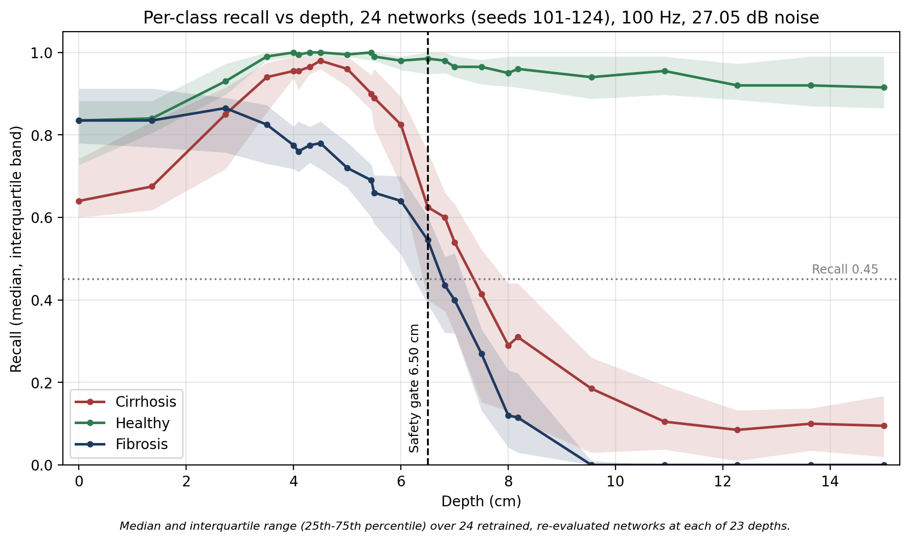
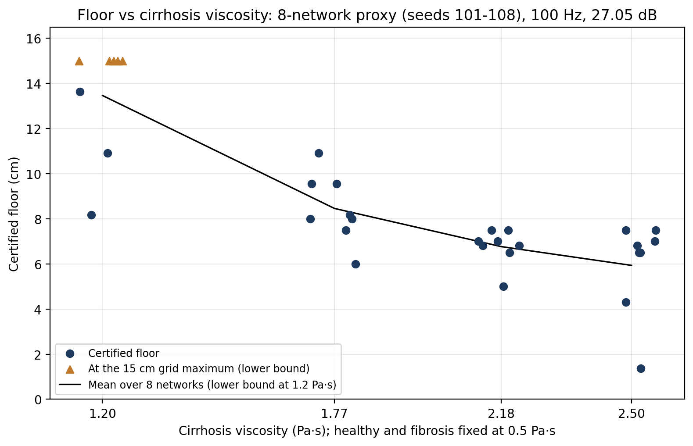
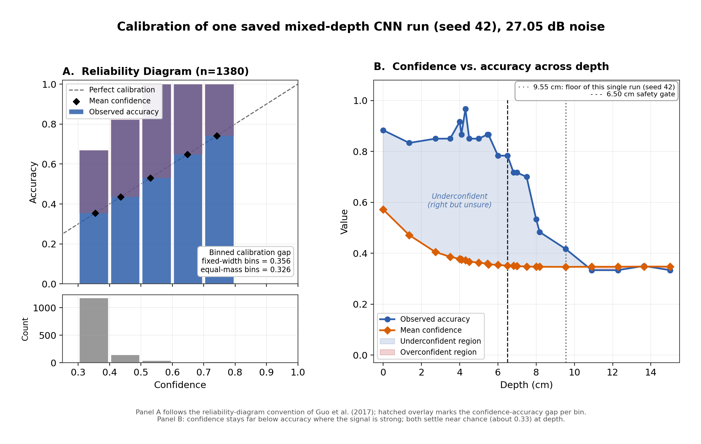

The final figure set has sixteen figures, with three small CSV files holding the values behind the later figures. Redrawn from saved files: attenuation by depth, the viscosity margin, the floor distributions, the pooled confusion matrices and the share of windows predicted healthy, per-class recall, the reliability diagram, the floor-versus-viscosity figure and the phantom controls (Log 36). Made later by scripts: the measurement chain, the 2 × 2 layout of the pooled confusion matrices and the logit-gap figure. Copies of earlier outputs, not redrawn: the windowing figure, the t-SNE figure and the frozen-probe figure. The measurement chain and the logit-gap figure had been cut from the first figure set and were built afterwards (above).

**Expectation versus outcome**

| Item | Expectation | Outcome |
|---|---|---|
| Floor-distribution figure | The six values at 15 cm should be marked as censored, and seed 111 noted as an artifact | Seed 111's floor of 0.00 cm is an artifact of the BH resolution. The saved clean-trained column does not say which of its six values at 15.0 are censored and which are observed |
| Share of windows predicted healthy | About 52% at 6.50 cm rising to about 87 to 90% at 15 cm; if the values did not reproduce, the figure would be dropped and the failure reported | **52% at 6.5 cm and 87% at 15 cm, as expected** |
| Logit-gap recompute | About 0.806, 0.428 and 0.207 at the shallowest depths and a range of 0.038 to 0.041; if the values did not reproduce, stop, report and make no edit | **Reproduced: 0.806, 0.428 and 0.207 at 0, 1.36 and 2.73 cm, and 0.038 to 0.041 from 8 cm** |

**Result interpretation**

**The two training regimes have nearly the same mean floor and very different spreads: the clean-trained networks range from 0.00 to 15.00 cm and 11 of 24 fall below the gate, which the mean hides, while the mixed-depth networks range from 5.45 to 12.27 cm.** This supports the statement that training on degraded windows narrows the spread of the floor; it does not support a statement that it moves the mean. The two sweeps differ in training distribution and in code, so the comparison is between two procedures. The share of windows predicted healthy at 15 cm pools networks that are close to chance, so it reflects a default class and no detection is involved. For the logit gap, the mean top-minus-second gap of about 0.04 on raw scores that are themselves near 0 means that at depth the network barely separates its top two classes.

**Consequences**

The claim for the logit-gap range was changed to "0.038 to 0.041 (recomputed from the saved calibration logits)". The logit-gap decay figure of Log 23 remains in Log 23. The final logit-gap figure plots the same points again, without the 5.45 cm line, whose value no file defines.

**Limitations**

- The per-class recall figure shows retrained networks, not the original certified weights.
- The reliability diagram is one run.
- The floor-versus-viscosity figure uses 8 of 24 networks.
- The logit-gap values were printed once and not saved, and the origin of 0.033 in Log 23 is unknown.

**Evidence**

- `Source/plot_attenuation.py`: fig03, amplitude against depth, recomputed from the physics model
- `Source/cirrhosis_viscosity_sensitivity.py`: fig04, viscosity margin (explicit frequency argument, default 100 Hz)
- `Source/make_final_fig07_floors.py`: fig07 floor distribution
- `Source/logs/degradation_aware_final_results.csv`: degradation-aware floors (naive floor column)
- `audit_fixes/lane5/clean_trained_sweep/clean_sweep/logs/lane5_clean_per_class_results.csv`: clean-trained floors (aggregate floor column)
- `audit_fixes/lane5/clean_trained_sweep/lane5_harness_clean.py`: harness of the clean-trained sweep
- `Source/degradation_aware_final_sweep.py`: the degradation-aware sweep
- `Source/make_final_fig07_combined.py`: fig07 pooled confusion and share healthy
- `Source/make_fig10_pooled_confusion.py`: fig08a, pooled confusion matrices
- `Source/make_final_fig08b_share_healthy.py`: fig08b, share predicted healthy
- `Source/make_final_fig09_perclass_recall.py`: fig09, per-class recall
- `audit_fixes/lane5/balanced_accuracy_retry/perclass_balacc/logs/`: per-depth balanced-accuracy detail files, one per seed (recall column)
- `calibration_analysis.py`: fig10, reliability diagram and metric box
- `outputs/stage4/data/stage4_calibration_data_corrected.csv`: corrected calibration data (seed 42, 27.05 dB)
- `Source/make_final_fig12_floor_vs_viscosity.py`: fig12, floor against cirrhosis viscosity (the 12 in its name is historical and does not refer to the progression figure of Log 35)
- `audit_fixes/cloud/battery/results/floors_101-104.csv`: battery floors, seeds 101 to 104
- `audit_fixes/cloud/battery/results/floors_105-108.csv`: battery floors, seeds 105 to 108
- `Source/make_final_fig13_phantom_controls.py`: fig13, phantom controls
- `Source/make_fig02_measurement_chain.py`: fig02, measurement chain
- `Source/physics_model.py`: constants read by the measurement-chain script
- `Source/cnn_classifier.py`: constants read by the measurement-chain script
- `Source/constants.py`: constants read by the measurement-chain script
- `Source/make_fig08a_pooled_confusion_2x2.py`: fig08a, 2 × 2 layout
- `Source/make_fig11_logit_gap_vs_depth.py`: fig11, logit gap against depth
- `Source/make_fig1_windowing.py`: fig01, windowing
- `Source/stage4_depth_diagnostics.py`: fig05, t-SNE at depth
- `Source/make_fig11_corrected_probe.py`: fig06, frozen probe against the deployed classifier
- `Source/logit_gap_recompute.py`: the logit-gap recompute script
- `outputs/stage4/figures/stage4_logit_separation_decay.png`: the logit-gap decay figure of Log 23
- `outputs/figures_final/`: folder of the final figure set
- `outputs/figures_final/fig01_beat_anchored_windows.png`: fig01
- `outputs/figures_final/fig02_measurement_chain.png`: fig02
- `outputs/figures_final/fig02_measurement_chain_values.csv`: values behind fig02
- `outputs/figures_final/fig03_amplitude_vs_depth.png`: fig03
- `outputs/figures_final/fig04_viscosity_margin.png`: fig04
- `outputs/figures_final/fig05_tsne_at_depth.png`: fig05
- `outputs/figures_final/fig06_frozen_probe_vs_deployed.png`: fig06
- `outputs/figures_final/fig07_floor_distribution.png`: fig07 floor distribution
- `outputs/figures_final/fig07_pooled_confusion_and_share_healthy.png`: fig07 pooled confusion and share healthy
- `outputs/figures_final/fig08a_pooled_confusion.png`: fig08a
- `outputs/figures_final/fig08a_pooled_confusion_2x2.png`: fig08a, 2 × 2 layout
- `outputs/figures_final/fig08a_pooled_confusion_2x2_counts.csv`: counts behind the 2 × 2 layout
- `outputs/figures_final/fig08b_share_predicted_healthy.png`: fig08b
- `outputs/figures_final/fig09_per_class_recall.png`: fig09
- `outputs/figures_final/fig10_reliability_diagram.png`: fig10
- `outputs/figures_final/fig11_logit_gap_vs_depth.png`: fig11
- `outputs/figures_final/fig11_logit_gap_vs_depth_values.csv`: values behind fig11
- `outputs/figures_final/fig12_floor_vs_cirrhosis_viscosity.png`: fig12
- `outputs/figures_final/fig13_phantom_controls.png`: fig13

</details>

---

### Log 38: Sensitivity sweeps on eight networks

<details>
<summary>Click to expand</summary>

**Approximate date of execution:** 26 September 2026

**Context**

Earlier values existed for the floor under changes of training budget, beat-time jitter, pulse carrier, tracking distance, window length and an alternative stiffness set, and for clean-only against mixed-depth training on eight networks. No script, log or CSV in the repository, or in the other copies and scratch folders I searched, held the runs behind those values. I reran the values rather than dropping them, because a number without an archived run cannot be checked.

Written up afterwards from the saved files.

**Why this check matters**

A certified floor depends on constants and choices made when the simulator was built. Changing one choice at a time and retraining shows how far the number moves and which choices it is sensitive to. A value that comes from a run with no saved script or output cannot be reproduced or audited, so the sweep is rerun from archived code, with the protocol fixed before any result and the per-seed floors kept.

**Methodology**

The protocol states no predicted direction or size for any condition. The earlier values were not used to set any part of it.

| Setting | Value |
|---|---|
| Conditions | Thirteen |
| Seeds | 101 to 108 |
| Retrained per condition and seed | The real CNN and its 200 shuffled-label controls (shuffled labels of the same data, the same number of epochs as the real model), on that condition's training data |
| Evaluation | That condition's evaluation windows: the 23 depths of the certified sweep, 300 windows per depth, 27.05 dB |
| Correction | BH at 0.05 over the 23 depths |
| Floor | The first depth that is not significant; 15.0 cm is the fallback cap (a floor of 15.0 cm with every depth significant is censored, a lower bound) |

The conditions:

| Condition | Setting |
|---|---|
| Baseline | Mixed-depth training, 60 epochs, 100-sample windows, 10 mm, 100 Hz |
| 600 epochs | 600 training epochs |
| Beat-time jitter | A Gaussian shift of each beat's pulse arrival time with SD 0.5 and 1.0 sample (1 and 2 ms), independent per beat |
| Carrier | 50 and 150 Hz, with the attenuation coefficient evaluated at the carrier frequency |
| Tracking distance | 5, 15 and 20 mm (10 mm is the baseline data) |
| Window length | 50 and 150 samples, with the network's first dense layer resized |
| Stiffness | 5.4 / 7.3 / 11.4 kPa instead of 4.5 / 7.5 / 12.0, with the viscosity of each class unchanged |
| Clean-only training | The clean-trained network of the lane 5 clean-trained sweep, evaluated under the baseline degradation |

Each changed parameter is applied in training and in evaluation. The baseline training set is identical to the certified sweep's for the same seed. Eight single-thread processes, one per seed, were run; this changes execution only. The test of clean-only against mixed-depth floors was declared before any result: the Wilcoxon rank-sum (Mann-Whitney U) test, two-sided, unpaired, as the primary test and the paired signed-rank test over seeds as the secondary one. Three consistency checks against earlier runs were declared too and are reported without adjusting anything.

**Execution order**

1. The protocol and then the harness were fixed.
2. The eight processes were started. Each seed took about 5.2 hours (18,653 to 18,692 s, from the run logs); the 600-epoch condition took about 2 hours of that.
3. The last seed ended. No process failed and none was restarted.
4. After the last seed ended, the summary script printed the floors and the two tests, then stopped at the consistency checks because the reference files of the earlier runs are not in the folder where it was run. An option naming the location of the reference files was added and the checks were rerun; this is recorded in the deviations file (no threshold, seed, condition, test or floor changed).
5. The floors of 0.00 cm were examined with a rule fixed before the table was read.

**Result**

Proxy floors in cm, eight networks per condition, not certified; "≥" marks a mean that is a lower bound because at least one seed is censored:

| Condition | Mean | SD | Median | Min to max | Censored | Seeds at 0.00 |
|---|---|---|---|---|---|---|
| Baseline (mixed depth, 60 epochs, 100 samples, 10 mm, 100 Hz) | 8.44 | 1.73 | 8.52 | 5.50 to 10.91 | 0 | 0 |
| 600 epochs | ≥ 14.83 | 0.48 | 15.00 | 13.64 to 15.00 | 3 | 0 |
| Beat-time jitter, SD 0.5 sample (1 ms) | 5.78 | 2.94 | 6.50 | 1.36 to 9.55 | 0 | 0 |
| Beat-time jitter, SD 1.0 sample (2 ms) | **0.17** | 0.48 | 0.00 | 0.00 to 1.36 | 0 | 7 |
| Carrier 50 Hz | **≥ 15.00** | 0.00 | 15.00 | 15.00 to 15.00 | 8 | 0 |
| Carrier 150 Hz | 3.22 | 2.24 | 3.50 | 0.00 to 6.00 | 0 | 2 |
| Tracking distance 5 mm | 3.44 | 1.80 | 2.73 | 1.36 to 6.50 | 0 | 0 |
| Tracking distance 15 mm | 10.06 | 1.92 | 10.23 | 8.18 to 13.64 | 0 | 0 |
| Tracking distance 20 mm | **10.91** | 1.03 | 10.91 | 9.55 to 12.27 | 0 | 0 |
| Window 50 samples | 9.16 | 1.80 | 9.55 | 6.50 to 10.91 | 0 | 0 |
| Window 150 samples | 8.18 | 2.94 | 8.00 | 2.73 to 12.27 | 0 | 0 |
| Stiffness 5.4 / 7.3 / 11.4 kPa | 8.11 | 3.13 | 9.55 | 2.73 to 10.91 | 0 | 0 |
| Clean-only training | ≥ 8.52 | 5.64 | 7.52 | 0.00 to 15.00 | 2 | 1 |

Floors by seed ("c" = censored):

| Condition | 101 | 102 | 103 | 104 | 105 | 106 | 107 | 108 |
|---|---|---|---|---|---|---|---|---|
| Baseline (mixed depth, 60 epochs, 100 samples, 10 mm, 100 Hz) | 9.55 | 5.50 | 10.91 | 7.50 | 7.50 | 9.55 | 7.50 | 9.55 |
| 600 epochs | 15.00c | 15.00 | 15.00c | 15.00 | 15.00 | 15.00c | 13.64 | 15.00 |
| Beat-time jitter, SD 0.5 sample (1 ms) | 8.00 | 7.00 | 1.36 | 9.55 | 6.00 | 1.36 | 6.50 | 6.50 |
| Beat-time jitter, SD 1.0 sample (2 ms) | 1.36 | 0.00 | 0.00 | 0.00 | 0.00 | 0.00 | 0.00 | 0.00 |
| Carrier 50 Hz | 15.00c | 15.00c | 15.00c | 15.00c | 15.00c | 15.00c | 15.00c | 15.00c |
| Carrier 150 Hz | 6.00 | 5.00 | 0.00 | 2.73 | 3.50 | 5.00 | 0.00 | 3.50 |
| Tracking distance 5 mm | 2.73 | 6.00 | 2.73 | 6.50 | 2.73 | 1.36 | 2.73 | 2.73 |
| Tracking distance 15 mm | 10.91 | 8.18 | 10.91 | 13.64 | 8.18 | 9.55 | 10.91 | 8.18 |
| Tracking distance 20 mm | 12.27 | 9.55 | 10.91 | 10.91 | 9.55 | 10.91 | 10.91 | 12.27 |
| Window 50 samples | 9.55 | 10.91 | 7.00 | 6.50 | 10.91 | 8.00 | 10.91 | 9.55 |
| Window 150 samples | 10.91 | 6.00 | 8.00 | 2.73 | 8.00 | 8.00 | 9.55 | 12.27 |
| Stiffness 5.4 / 7.3 / 11.4 kPa | 9.55 | 9.55 | 9.55 | 2.73 | 3.50 | 10.91 | 9.55 | 9.55 |
| Clean-only training | 0.00 | 15.00c | 4.00 | 13.64 | 5.45 | 5.50 | 15.00c | 9.55 |

Against the earlier values. Those values had no archived source and are superseded by the table above.

| Condition | Earlier value | This run: mean (median) |
|---|---|---|
| Baseline | 8.46 and 8.69 | 8.44 (8.52) |
| 600 epochs | 12.78 | ≥ 14.83 (15.00) |
| Jitter 0.5 sample | 7.86 | 5.78 (6.50) |
| Jitter 1 sample | fails at every depth | 0.17 (0.00); 7 of 8 seeds at 0.00 and one at 1.36 |
| Carrier 50 Hz | no failure within 15 cm | ≥ 15.00; all 8 seeds censored |
| Carrier 150 Hz | 4.44 | 3.22 (3.50) |
| Tracking 5 mm | 7.25 | 3.44 (2.73) |
| Tracking 10 mm | 8.69 | 8.44 (the baseline) |
| Tracking 15 mm | 10.06 | 10.06 (10.23) |
| Tracking 20 mm | 10.06 | 10.91 (10.91) |
| Window length; alternative stiffness set | no effect beyond seed noise | window 50: 9.16; window 150: 8.18; stiffness set: 8.11 |
| Clean-only against mixed-depth (eight networks each) | 7.98 (SD 2.15) against 8.69 (SD 0.98), Wilcoxon p = 0.47 | ≥ 8.52 (SD 5.64, median 7.52) against 8.44 (SD 1.73, median 8.52) |

Clean-only against mixed-depth: the eight clean-only floors against the eight baseline floors.

| Test | Statistic | p |
|---|---|---|
| Rank-sum, two-sided, unpaired | U = 30.0 | 0.873 |
| Paired signed-rank over the eight seeds | W = 14.0 | 1.000 |

The clean-only mean is a lower bound (two seeds censored at 15.0 cm and one floor at 0.00 cm). The 24-network comparison of Log 37 has the same direction in the spread: SD 4.94 cm for clean-only against 1.81 cm for mixed depth.

The three consistency checks (this run minus the reference, per seed 101 to 108; control draws and platform differ, so identical floors are not expected):

| Check | Reference | Differences, seeds 101 to 108 | Mean | SD | Correlation |
|---|---|---|---|---|---|
| (a) | Baseline against condition 1 (baseline) of the robustness battery | 0.00, −0.50, +2.73, −0.50, −0.50, 0.00, 0.00, −1.36 | −0.02 | 1.20 | 0.74 |
| (b) | Baseline against the naive floor column of the certified sweep | 0.00, 0.00, +1.36, −0.50, −0.50, +1.55, 0.00, 0.00 | +0.24 | 0.78 | 0.90 |
| (c) | Clean-only against the aggregate floor column of the clean-trained sweep | −2.73, 0.00, 0.00, +2.73, +0.45, −0.50, 0.00, −1.36 | −0.18 | 1.56 | 0.97 |

Ten cells have a floor of 0.00 cm: seven of the eight seeds at 1 sample of jitter, two at carrier 150 Hz (seeds 103 and 107) and one clean-only (seed 101). The diagnostic, with its rule fixed in advance, classifies them as follows:

| Class | Count | Cells |
|---|---|---|
| Real failure, with accuracy at 0 cm at or below 0.40 | 5 | seeds 102, 103, 104, 107 and 108 at jitter 1.0 |
| Resolution artifact, with accuracy at 0 cm of 0.45 to 0.84 and the smallest possible p, so that BH could not certify the depth | 4 | seed 101 clean-only, seed 103 carrier 150, seed 105 jitter 1.0, seed 107 carrier 150 |
| Other | 1 | seed 106 jitter 1.0 (accuracy 0.407, raw p 0.0796) |

The floors are reported as computed.

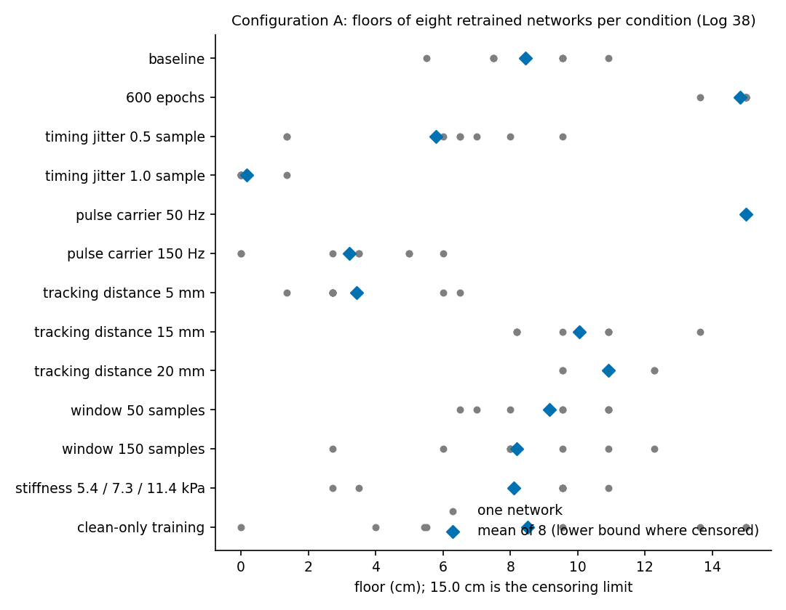

*Floors of the eight retrained networks in each sensitivity condition (configuration A): the floor falls as timing jitter rises and rises with tracking distance (3.44, 8.44, 10.06 and 10.91 cm at 5, 10, 15 and 20 mm).*

**Result interpretation**

**The floor falls as timing jitter rises, with 7 of 8 seeds at 0.00 cm at 1 sample; it rises with tracking distance (3.44, 8.44, 10.06 and 10.91 cm at 5, 10, 15 and 20 mm).** It falls at 150 Hz and is censored at 15.0 cm for all eight seeds at 50 Hz, and it is at or near the 15 cm maximum with 600 epochs (seven of eight floors at 15.00 cm, three of them censored). The directions agree with those stated earlier; the magnitudes differ in several rows, for example 5 mm (3.44 against 7.25) and 600 epochs.

For window length and the stiffness set the means differ from the baseline mean as follows (baseline SD 1.73):

| Condition | Mean minus baseline mean |
|---|---|
| Window 50 samples | 0.72 cm |
| Window 150 samples | -0.26 cm |
| Stiffness 5.4 / 7.3 / 11.4 kPa | -0.33 cm |

No equivalence test was run, so this shows no large shift and leaves open that there is a small one. Clean-only and mixed-depth floors do not differ in location in this test, and the clean-only floors are far more spread. The baseline agrees with the earlier eight-network baseline of the battery on average (check a, mean difference −0.02 cm) but not seed by seed (one seed differs by 2.73 cm).

**Consequences**

The earlier values for the sensitivity conditions and for the eight-network rerun are replaced by these, with the disclosure that the earlier values had no archived source.

**Limitations**

- The simulator is the one of the earlier logs (class-anchored stiffness, no hardware effects).
- Eight networks per condition, so the standard deviations are themselves uncertain.
- Proxy floors are not certified, and floors from different procedures are not comparable.
- A mean that includes censored seeds is a lower bound.
- The run was on a different platform from the robustness battery. The battery's per-condition seeds used Python's `hash()` and are not reproducible; this harness uses a crc32 of the condition name instead.
- Each condition retrains its own models, so differences between conditions include training randomness as well as the changed parameter.
- No equivalence tests were run.
- Floors take only the 23 grid values, so ties and the 1.36 cm grid spacing limit the resolution.

**Evidence**

- `audit_fixes/proxy_sweeps/PREREG.md`: the protocol, fixed before any result
- `audit_fixes/proxy_sweeps/harness_proxy.py`: the harness
- `audit_fixes/proxy_sweeps/wrappers_proxy.py`: the wrappers that apply each condition
- `audit_fixes/lane5/clean_trained_sweep/lane5_harness_clean.py`: harness of the clean-trained network used for the clean-only condition
- `audit_fixes/proxy_sweeps/diagnose_zero_floors.py`: the diagnostic for floors of 0.00 cm
- `audit_fixes/proxy_sweeps/summarize_proxy.py`: the summary script
- `audit_fixes/proxy_sweeps/`: folder of the sweep code
- `audit_fixes/cloud/proxy_sweeps/results/`: per-seed floors, per-depth details and run logs (one of each per seed)
- `audit_fixes/cloud/proxy_sweeps/results/summary_by_condition.csv`: the summary table
- `audit_fixes/cloud/proxy_sweeps/results/summary_output.txt`: output of the summary script with the two tests
- `audit_fixes/cloud/proxy_sweeps/results/diagnostic_zero_floors.csv`: the classification of the floors at 0.00 cm
- `audit_fixes/cloud/proxy_sweeps/results/DEVIATIONS.md`: record of the one deviation

</details>

---

### Log 39: The viscosity lookup defect, and a sweep of the cirrhosis viscosity

<details>
<summary>Click to expand</summary>

**Approximate date of execution:** 30 September 2026

**Context**

Two conditions of the robustness battery (Log 28, conditions 4a and 4b, where the stiffness of every record is drawn from a continuous distribution) gave floors that were either pinned at the 15.0 cm maximum or at 0.00 cm, with nothing in between for several seeds. Log 28 lists that every class received a viscosity of 0.5 Pa·s in these conditions and that they do not test stiffness variation alone. The cause of the two ends had not been traced to code, and the cirrhosis viscosity (1.77 Pa·s) had been varied only upwards (Log 22), never below the value used for the other two classes.

All floors in this log are **configuration A**: the earlier idealised simulator of Logs 1 to 38 (class-anchored stiffness unless stated, no hardware effects, 23 depths to 15 cm, 200 shuffled-label controls, 60 training epochs, BH at 0.05). They are proxy floors for eight or twelve retrained networks, not certified floors, and they are not comparable with the configuration B floors of Logs 40 to 43.

Written up afterwards from the saved files.

**Why this check matters**

A floor of 15.0 cm can mean either "the model still works at 15 cm" or "the grid ended", and a floor of 0.00 cm can mean either "the model never worked" or "the statistical test could not certify the first depth". A reported floor is only informative if the cause of each extreme is known. A viscosity that the code silently replaces by a default value changes the physics of one class and therefore the depth at which that class stops being recognisable.

**Methodology**

Three checks were run on the certified pipeline, one after the other, each with the settings below:

| Check | Setting |
|---|---|
| Reproduction and repair of the bimodal floors | Seeds 101 to 108, the certified training distribution or a continuous-stiffness distribution (3 to 6, 6 to 9 and 9 to 15 kPa for the three classes), evaluation at the class-exact or the continuous stiffness, viscosity chosen either by the original lookup (an exact match of the stiffness against 4.5, 7.5 and 12.0 kPa, otherwise 0.5 Pa·s) or by the stage label (0.5, 0.5 and 1.77 Pa·s); 200 controls per network, 23 depths to 15 cm |
| Sweep of the cirrhosis viscosity | Seeds 101 to 112; the network trained at 1.77 Pa·s and evaluated with the cirrhosis viscosity set to 0.2, 0.3, …, 1.0 Pa·s (healthy and fibrosis fixed at 0.5), no retraining; 200 controls; reference column at 1.77 |
| Generator check of the timing and noise model | Uniform timing error per beat with half-width 0.5, 1.0 and 2.0 ms, 200 records per setting, significant-fibrosis class, depths 0 and 4 cm |

The viscosity fix is a flag that takes the viscosity from the stage label instead of the lookup. It is off by default, and a test script compares the generator output with the flag off against the original path (the output of that test is not saved).

**Execution order**

1. The generator for continuous stiffness and the hardware effects (timing, noise colour, gain) was written with every effect off by default, and a regression test compared its output with the original path.
2. The battery conditions with continuous stiffness were rerun with the original lookup and the pattern of 15.0 cm and 0.00 cm floors was reproduced.
3. The floors at 0.00 cm were examined with the saved p-values and the null distribution of the controls; the floors at 15.0 cm were examined with the viscosity that each record received.
4. The viscosity flag was added and the same conditions were rerun with it on.
5. The cirrhosis viscosity sweep was run on twelve seeds.
6. The hardware generator was checked against its own settings.

**Result**

Reproduction (eight networks per row; "C" = floor at the 15.0 cm maximum, "Z" = floor at 0.00 cm; the first three rows are the conditions of the battery):

| Condition | Viscosity | Median floor (cm) | Seeds censored at 15.0 cm | Seeds at 0.00 cm | Mean real accuracy at 15 cm |
|---|---|---|---|---|---|
| Baseline, class-exact | stage label (identical to lookup) | 8.09 | 0 | 0 | 0.331 |
| Stiffness CV per class (4a) | lookup | **15.00** | 5 | 1 | 0.549 |
| Stiffness CV uniform (4b) | lookup | 10.23 | 4 | 1 | 0.580 |
| Stiffness CV per class (4a) | stage label | 10.91 | 2 | 0 | 0.347 |
| Stiffness CV uniform (4b) | stage label | 10.23 | 0 | 0 | 0.337 |
| Continuous evaluation, trained class-exact | lookup | 6.75 | 3 | 2 | 0.583 |
| Continuous evaluation, trained class-exact | stage label | 9.45 | 0 | 0 | 0.337 |
| Continuous evaluation, trained continuous | lookup | 15.00 | 5 | 0 | 0.610 |
| Continuous evaluation, trained continuous | stage label | 8.86 | 0 | 0 | 0.336 |

With the lookup, every off-class stiffness receives 0.5 Pa·s. For cirrhosis that is 3.54 times less attenuation than at 1.77 Pa·s (same stiffness, same frequency), so cirrhosis pulses survive to depth and the real accuracy at 15 cm stays between 0.55 and 0.61 instead of falling to chance (0.333).

The floors at 0.00 cm are a property of the test, not of the signal:

| Quantity | Value |
|---|---|
| Smallest possible p-value with 200 controls | 1/201 = 0.004975 |
| BH threshold at rank 1, 2, 3 over 23 depths | 0.00217, 0.00435, 0.00652 |
| Depths that must tie at the smallest p to pass | 3 |
| Cells with depth 0 not significant (seed by condition, 72 cells) | 4 |
| Real accuracy at 0 cm in those 4 cells | 0.68 to 0.74 |
| Controls at depth 0 (baseline) predicting one class for every window | 19.0 to 28.5% per seed |
| Controls at depth 0 (baseline) reaching 0.60 or more | 3 to 6% per seed |

Cirrhosis viscosity sweep (configuration A, twelve networks trained at 1.77 Pa·s, evaluated at the stated viscosity of the cirrhosis class):

| Cirrhosis viscosity (Pa·s) | Seeds censored at 15.0 cm | Seeds at 0.00 cm | Median floor (cm) | Mean real accuracy at 15 cm | Healthy to cirrhosis attenuation ratio |
|---|---|---|---|---|---|
| 0.2 | 0 | 8 | 0.00 | 0.542 | 10.89 |
| 0.3 | 0 | 7 | 0.00 | 0.564 | 7.26 |
| 0.4 | 1 | 5 | 3.41 | 0.591 | 5.44 |
| 0.5 | 4 | 1 | 7.75 | 0.611 | 4.35 |
| 0.6 | 8 | 0 | 15.00 | 0.592 | 3.63 |
| 0.7 | 11 | 0 | 15.00 | 0.540 | 3.11 |
| 0.8 | 11 | 0 | 15.00 | 0.471 | 2.72 |
| 0.9 | 11 | 0 | 15.00 | 0.412 | 2.42 |
| 1.0 | 9 | 0 | 15.00 | 0.378 | 2.18 |
| 1.77 (reference) | 0 | 0 | 8.09 | 0.332 | 1.23 |

The ratio is of the attenuation coefficients at 100 Hz for 4.5 kPa with 0.5 Pa·s against 12.0 kPa with the stated viscosity; the real accuracy at 0 cm is 0.76 to 0.79 in every row.

Cirrhosis recall by depth (mean over twelve networks, no retraining):

| Cirrhosis viscosity (Pa·s) | 0 cm | 6.5 cm | 8 cm | 9.55 cm | 10.91 cm |
|---|---|---|---|---|---|
| 0.2 | 0.71 | 0.73 | 0.75 | 0.72 | 0.74 |
| 0.5 | 0.71 | 0.76 | 0.78 | 0.84 | 0.87 |
| 0.8 | 0.71 | 0.86 | 0.92 | 0.95 | 0.93 |
| 1.0 | 0.71 | 0.94 | 0.94 | 0.86 | 0.68 |
| 1.77 (reference) | 0.70 | 0.61 | 0.34 | 0.20 | 0.18 |

At 6.5 cm the recall of healthy stays between 0.93 and 0.95 and that of fibrosis between 0.45 and 0.50 across all ten rows.

Generator check (timing error applied to the pulse arrival, significant-fibrosis class, 200 records per setting, depth 0 cm):

| Half-width of the uniform timing error | SD applied (ms) | SD from the theory half-width/√3 (ms) | SD measured by cross-correlation (ms) |
|---|---|---|---|
| 0.5 ms | 0.289 | 0.289 | 0.253 |
| 1.0 ms | 0.573 | 0.577 | 0.537 |
| 2.0 ms | 1.143 | 1.155 | 1.156 |

In the baseline and the three timing settings the noise SD is 0.0443 to 0.0445 (target 0.0444), the peak signal-to-noise ratio is 26.6 to 26.7 dB at 0 cm and 17.7 to 17.8 dB at 4 cm; the settings with random gain were also generated and are in the evidence file.

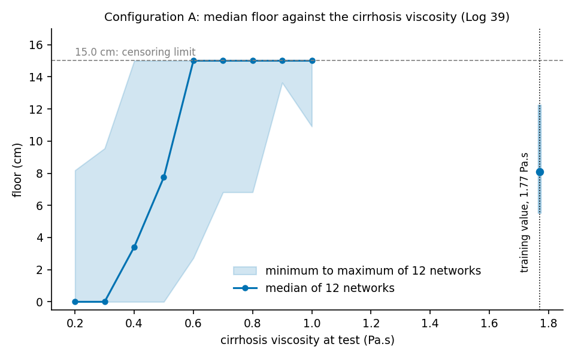

*Median floor against the cirrhosis viscosity (configuration A, 12 networks, 60 epochs): 0.00 cm at 0.2 and 0.3 Pa·s, 15.00 cm at 0.6 to 1.0 Pa·s and 8.09 cm at 1.77 Pa·s.*

**Result interpretation**

**A floor of 15.0 cm in the battery conditions 4a and 4b is mostly the viscosity default, not a robustness of the classifier.** With the viscosity taken from the stage label, the real accuracy at 15 cm is at chance (0.34 against 0.333), the number of seeds censored at 15.0 cm falls from 5 to 2 in condition 4a and from 4 to 0 in condition 4b, and the median floors are 10.91 and 10.23 cm against 8.09 cm for the baseline of the same eight seeds. The earlier sentence that these conditions show "no usable floor shift" was reached with the wrong cirrhosis viscosity.

A floor of 0.00 cm is not by itself a failure at the first depth. With 200 controls the smallest p-value cannot pass the BH threshold unless three depths tie at it, and the null of the controls has a heavy upper tail, so a network with real accuracy 0.68 to 0.74 at 0 cm can still return 0.00 cm.

In the viscosity sweep the floors saturate at both ends: at 0.3 Pa·s or less most seeds return 0.00 cm although the real accuracy at 0 cm is 0.76 to 0.79, and at 0.6 Pa·s or more between 8 and 11 of the 12 seeds are censored at the 15.0 cm cap. The floor therefore carries information only between about 0.4 and 0.6 Pa·s and at the reference value, and this sweep cannot rank how strongly the result depends on the viscosity. The per-class table shows what moves: with a lower viscosity the network keeps assigning surviving pulses to cirrhosis, while at the reference value cirrhosis recall falls from 0.70 at 0 cm to 0.18 at 10.91 cm. Healthy still attenuates faster than cirrhosis over the whole swept range (ratio of at least 2.18 in the nine rows from 0.2 to 1.0 Pa·s).

**Consequences**

No floor of Logs 1 to 38 changes: the lookup defect enters only conditions 4a and 4b of Log 28, and the certified sweeps use class-exact stiffness, for which the lookup returns the right viscosity. The two rows of Log 28 should be read with the corrected medians above. The viscosity flag and the hardware effects are off by default. The viscosity of 1.77 Pa·s stays a single-value assumption.

**Limitations**

- Eight networks per condition (twelve in the viscosity sweep), proxy floors, configuration A only.
- The viscosity sweep evaluates a network trained at 1.77 Pa·s; it does not retrain at each viscosity.
- The 0.00 cm artefact was diagnosed and left in place; no rerun with more controls was made in configuration A.
- The attenuation module that carries the viscosity flag is shipped as `Source/attenuation_model.py`, together with the saved results, the test of the flag and the harness that calls it.
- The timing-error distribution (uniform), the noise slope and the gain range of the hardware generator have no source in the repository; they are settings, not measured values.
- The grid above 8.18 cm has a spacing of 1.36 cm, so a floor in that range is resolved to 1.36 cm.

**Evidence**

- `outputs/post_audit/simulator_audit/floor13_summary.txt`: floors, accuracy at 0 and 15 cm, the BH-tie cases and the null distribution of the controls
- `outputs/post_audit/simulator_audit/cv4a_tail_check.txt`: amplitude-to-noise at 15 cm for the continuous-stiffness cirrhosis records
- `outputs/post_audit/simulator_audit/eta_bug_demo.csv`: attenuation coefficient with the lookup against the stage label
- `outputs/post_audit/simulator_audit/eta3_summary.csv`, `eta3_floors_by_seed.csv`, `eta3_perclass_fixed_depths.csv`: the viscosity sweep
- `outputs/post_audit/simulator_audit/hardware_summary_stats.csv`, `hardware_pipeline_check.csv`: the generator check
- `outputs/post_audit/simulator_audit/p1_run.py`, `p1_common.py`, `p1_agg_eta3.py`, `p1_agg_eta3_perclass.py`, `p1_agg_floor13.py`, `test_eta_by_stage.py`, `hardware_effects.py`, `p1_hardware_examples.py`: harness, aggregation scripts, the test of the flag, the hardware module and the script that generated the check

</details>

---

### Log 40: A rebuilt dataset, and what lowered the accuracy

<details>
<summary>Click to expand</summary>

**Approximate date of execution:** 4 October 2026

**Context**

The simulator of Logs 1 to 38 gives every stiffness class one exact stiffness value, applies no timing error, uses white noise only, and assigns the class viscosity only when the stiffness equals a class value (Log 39). A floor measured on such data answers the question for an idealised sensor. Log 39 added the pieces needed to relax these choices (a stage-label viscosity, a timing error per beat, coloured noise, a random gain). Before any floor was measured again, the question was how the accuracy of the networks changes on data that includes them, and whether the other model families behave as the CNN does.

From this log on, a **configuration B** appears: the rebuilt simulator. In configuration B the stiffness of each record is drawn uniformly inside a stage range (3 to 6, 6 to 9 and 9 to 15 kPa for healthy, fibrosis and cirrhosis), the viscosity comes from the stage label (0.5, 0.5 and 1.77 Pa·s), each beat has a uniform timing error of half-width 1.0 ms, the noise has a 1/f slope (β = 1) at 27.05 dB, and the gain is uniform between 0.5 and 1.5. Configuration A is the idealised simulator of Logs 1 to 38. This log reports accuracies only, no floors, and says for every table which configuration and training budget it is.

Written up afterwards from the saved files.

**Why this check matters**

An accuracy that falls when the simulator becomes more realistic could mean a fault in the pipeline or a real cost of the new effects. A floor measured afterwards is only interpretable if the two are separated. Three model families trained for different numbers of steps would also give floors that differ for reasons other than the family, so the budgets have to be stated before the floors are compared.

**Methodology**

The dataset configuration is written down and hashed (the hash is stored in every record). Twenty-four networks per family were trained on the same cached splits (seeds 101 to 124):

| Family | Training budget | Training data |
|---|---|---|
| CNN | 60 full-batch epochs, Adam, learning rate 0.001 | 375 windows (5 depths × 3 classes × 25), depths 0, 3, 6, 9 and 12 cm |
| ResNet1D | 150 full-batch epochs, restart on collapse | the same windows |
| Random forest | 300 trees | the same windows |
| Logistic regression | 1000 iterations, default solver, six timing-independent features, robust scaler | the same windows |

Accuracy was measured on a noise-free cell and on four depths (0, 6.5, 8 and 10 cm; 300 windows per cell, hardware effects on). No permutation control and no floor was computed in this step. The budgets are not matched across families and were left unmatched.

The cause of the lower CNN accuracy was examined with five variants of the CNN data on eight seeds, each with its own random draws:

| Variant | Stiffness | Hardware effects |
|---|---|---|
| (a) | class-anchored | off |
| (b) | continuous inside the stage ranges | off |
| (c) | class-anchored | on |
| (d) | continuous inside the stage ranges (the primary configuration B) | on |
| (e), diagnostic only | centre ± 1 kPa | on |

Two further checks were run: the CNN with timing error of half-width 0.5 and 2.0 ms against the 1.0 ms of the primary configuration (the same eight seeds), and an alternative stiffness set (5.4, 7.3 and 11.4 kPa instead of 4.5, 7.5 and 12.0 kPa) with class-exact stiffness, no hardware effects and the certified noise, with the viscosity taken from the stage label or from the old lookup.

**Execution order**

1. The dataset configuration and its hash were fixed and the four families were trained and reloaded; all 24 checkpoints per family reloaded with exact predictions.
2. The sanity accuracies were read for each family.
3. The five variants of the CNN data were trained to separate the effects of continuous stiffness and of hardware effects.
4. The timing-error and alternative-stiffness checks were run on the CNN.
5. Logistic regression, which sat at chance at 0 cm, was checked against the choice of feature scaler.

**Result**

Accuracy, configuration B, 24 networks per family, mean (SD) over seeds; chance is 0.333:

| Family (budget) | Train | Validation | Noise-free cell | 0 cm | 6.5 cm | 8 cm | 10 cm |
|---|---|---|---|---|---|---|---|
| CNN (60 epochs) | 0.560 (0.039) | 0.553 (0.046) | 0.704 (0.065) | 0.650 (0.057) | 0.554 (0.087) | 0.458 (0.075) | 0.387 (0.050) |
| ResNet1D (150 epochs) | 0.768 (0.099) | 0.471 (0.035) | 0.635 (0.084) | 0.568 (0.052) | 0.471 (0.059) | 0.475 (0.053) | 0.418 (0.040) |
| Random forest (300 trees) | 1.000 (0.000) | 0.634 (0.034) | 0.717 (0.050) | 0.664 (0.035) | 0.714 (0.028) | 0.661 (0.031) | 0.536 (0.037) |
| Logistic regression | 0.464 (0.026) | 0.438 (0.024) | 0.353 (0.026) | 0.344 (0.039) | 0.559 (0.050) | 0.542 (0.042) | 0.484 (0.039) |

Two ResNet1D networks needed one restart; none needed more.

Variants of the CNN data, configuration B at 60 epochs, mean over seeds 101 to 108 (SD across seeds for 0 and 8 cm):

| Variant | Train | Validation | Noise-free cell | 0 cm | 8 cm |
|---|---|---|---|---|---|
| (a) class-anchored, hardware off | 0.643 | 0.627 | 0.762 | **0.783** (0.034) | 0.468 (0.035) |
| (b) continuous, hardware off | 0.615 | 0.601 | 0.735 | 0.713 (0.069) | 0.479 (0.047) |
| (c) class-anchored, hardware on | 0.575 | 0.574 | 0.754 | 0.712 (0.035) | 0.450 (0.057) |
| (d) continuous, hardware on (primary) | 0.557 | 0.552 | 0.687 | **0.648** (0.078) | 0.458 (0.089) |
| (e) centre ± 1 kPa, hardware on (diagnostic) | 0.607 | 0.573 | 0.743 | 0.691 (0.024) | 0.485 (0.037) |

A random forest trained and tested on noise-free windows without timing jitter reaches 0.777 at 0 cm (range 0.750 to 0.810 over eight seeds). A classifier that sees only the stiffness, with the stage distributions quoted in the physics module, would reach 0.929 on equal priors; 16.3% of the healthy mass, 0.1% of the fibrosis mass and 29.4% of the cirrhosis mass of those quoted distributions lie outside the assumed stage ranges.

Timing error of the CNN, configuration B at 60 epochs, mean accuracy over seeds 101 to 108:

| Half-width of the timing error | Train | Validation | Noise-free cell | 0 cm | 6.5 cm | 8 cm | 10 cm |
|---|---|---|---|---|---|---|---|
| 0.5 ms | 0.606 | 0.574 | 0.700 | 0.685 | 0.591 | 0.501 | 0.388 |
| 1.0 ms (primary, same eight seeds) | 0.557 | 0.552 | 0.687 | 0.648 | 0.565 | 0.458 | 0.397 |
| 2.0 ms | 0.499 | 0.490 | 0.642 | 0.517 | 0.516 | 0.412 | 0.363 |

Alternative stiffness set, class-exact stiffness, hardware off, CNN at 60 epochs, mean over eight seeds:

| Arm | Train | 0 cm | 6.5 cm | 8 cm | 10 cm |
|---|---|---|---|---|---|
| Default set (4.5, 7.5, 12.0 kPa) | 0.651 | 0.775 | 0.701 | 0.477 | 0.364 |
| Alternative set, viscosity from the stage label | 0.564 | 0.652 | 0.595 | 0.433 | 0.355 |
| Alternative set, old lookup | 0.655 | 0.692 | 0.788 | 0.688 | 0.552 |

Paired difference to the default set, with the number of seeds out of eight in which it is negative:

| Arm | 0 cm | 6.5 cm | 8 cm | 10 cm |
|---|---|---|---|---|
| Alternative set, stage label | −0.122 (8 of 8) | −0.106 (6 of 8) | −0.044 (6 of 8) | −0.009 (4 of 8) |
| Alternative set, old lookup | −0.083 (8 of 8) | +0.087 (2 of 8) | **+0.210** (0 of 8) | **+0.188** (0 of 8) |

Logistic regression, configuration B: the validation accuracy is 0.438 with the robust scaler and 0.438 with the standard scaler (paired difference +0.0007, SD 0.0044 over 24 seeds). On the earlier oracle-timed data, scaling matters (0.690 standard, 0.662 robust, 0.406 none over 24 dataset seeds). A random forest on the same six features reaches 0.585 at 0 cm against 0.344 for logistic regression.

**Result interpretation**

**The drop in CNN accuracy at 0 cm is not a fault in the pipeline.** With class-anchored stiffness and no hardware effects (variant a) the same code gives 0.783 at 0 cm. Continuous stiffness alone (b) and hardware effects alone (c) each cost about 7 points (0.713 and 0.712), and together (d) cost about 13 points (0.648), which is close to additive; the additive reading describes the means and is not a fitted model. Part of the cost of continuous stiffness is a ceiling set by the design: even without noise or jitter a random forest reaches 0.777, because the stage ranges abut and a window near a boundary is ambiguous. At 8 cm all variants lie between 0.450 and 0.485, so the shallow-depth loss does not reach the depth where the floors lie.

The random forest fits its training data perfectly (1.000) and validates at 0.634, ResNet1D fits at 0.768 and validates at 0.471, and the CNN is under-fitted at 60 epochs (train 0.560). The families are not compared at matched budgets here. Logistic regression is at chance at 0 cm and better at 6.5 to 10 cm; the scaler is not the cause, and why the linear model sits at chance at 0 cm was not isolated.

A larger timing error lowers the accuracy at 0 cm (0.685, 0.648, 0.517 at 0.5, 1.0, 2.0 ms) and leaves all three settings close to chance at 10 cm (0.388, 0.397, 0.363).

The alternative stiffness set does not give "no effect" at shallow depth: with the viscosity from the stage label the accuracy at 0 cm falls by 0.122 (negative in all eight seeds), because the healthy and fibrosis values move closer (1.9 kPa apart against 3.0 kPa). With the old lookup, all three alternative values receive 0.5 Pa·s, cirrhosis attenuates too little and the accuracy at 8 and 10 cm rises by about 0.2. The gain at depth therefore comes from the lookup, not from the stiffness values. The earlier statement that the alternative set has no effect had no saved run; the design used here is new and may not be what the earlier statement measured.

**Consequences**

The configuration B data and the 24 networks per family are the basis of Logs 41 to 43. Accuracy values of this log are not comparable with the accuracies of configuration A without the variant (a) run above. No floor of Logs 1 to 38 changes.

**Limitations**

- Accuracies only: no permutation control, no floor and no significance test in this log.
- Variants use independent random draws, so differences between variants contain sampling noise (the SD of the 0 cm accuracy is 0.024 to 0.078).
- Eight seeds for the variants, the timing-error check and the alternative stiffness set.
- The stage ranges of the continuous stiffness, the timing-error distribution, the noise slope and the gain range have no source in the repository; they are assumptions.
- Budgets differ across families (60 epochs, 150 epochs, 300 trees).

**Evidence**

- `outputs/post_audit/rebuilt_dataset/configs/`: the dataset configurations (primary, two timing-error settings, alternative stiffness)
- `outputs/post_audit/rebuilt_dataset/seed_records_cnn_p2_primary_v1.csv`, `seed_records_resnet_p2_primary_v1.csv`, `seed_records_rf_p2_primary_v1.csv`, `seed_records_logreg_p2_primary_v1.csv`: per-seed accuracies of the four families
- `outputs/post_audit/rebuilt_dataset/seed_records_cnn_p2_sens_j0p5_v1.csv`, `seed_records_cnn_p2_sens_j2p0_v1.csv`: timing-error settings
- `outputs/post_audit/rebuilt_dataset/a0_cnn_variants.csv`, `a0_summary.txt`: the five variants, the random-forest ceiling and the stiffness-only classifier
- `outputs/post_audit/rebuilt_dataset/altstiff_p2_altstiff_v1.csv`, `altstiff_summary.txt`: the alternative stiffness set
- `outputs/post_audit/rebuilt_dataset/logreg_study_summary.txt`: the scaler check
- `outputs/post_audit/rebuilt_dataset/configs/dataset_config_p3_a0_a_v1.json`, `dataset_config_p3_a0_b_v1.json`, `dataset_config_p3_a0_c_v1.json`, `dataset_config_p3_a0_e_v1.json`: the data settings of variants (a), (b), (c) and (e)
- `outputs/post_audit/rebuilt_dataset/p2_run.py`, `p2_common.py`, `p2_features.py`, `p2_altstiff.py`, `p3_a0.py`: the training, feature and data code

</details>

---

### Log 41: Permutation floors for three model families on the rebuilt dataset

<details>
<summary>Click to expand</summary>

**Approximate date of execution:** 6 October 2026

**Context**

Log 40 rebuilt the dataset (configuration B) and measured accuracies only. The certified floor of Logs 1 to 38 (configuration A) and the family floors of Logs 26 and 27 were measured on the idealised simulator. The question here was what the permutation-certified floor of a CNN, a random forest and ResNet1D is on configuration B, with the same 24 seeds as before, and how the floors are spread over seeds and over repeated permutation draws.

Every floor in this log is **configuration B at the training budget of Log 40** (CNN 60 epochs, ResNet1D 150 epochs, random forest 300 trees). The 200-epoch headline of configuration B is in Log 43. None of the floors here is comparable with the configuration A floors of Logs 20 to 27 without the differences listed in the methodology.

Written up afterwards from the saved files.

**Why this check matters**

A floor from a single permutation test depends on which shuffled-label controls were drawn. If most of the variation of a floor came from the draw, one network and one test would be enough; if it came from the network, the distribution over networks is what has to be reported. The floor rule also needs to be stated for the grid it is applied to, because the earlier rule (the first depth that is not significant) returns a shallower floor on a grid with many near-ties.

**Methodology**

The protocol is recorded as prespecified before any permutation run, with no value changing afterwards. Its settings:

| Setting | Value |
|---|---|
| Depth grid | 36 depths from 0 to 20 cm, 0.25 cm steps between 6 and 10 cm |
| Controls per test | B = 719 shuffled-label networks, each trained from scratch for the same budget as the real network |
| Reason for 719 | B + 1 = 720 = 20 × 36, so the smallest possible p-value (1/720) equals the BH threshold at rank 1 over 36 depths at q = 0.05 |
| Correction | Benjamini-Hochberg at q = 0.05 over the 36 depths |
| Floor, new rule | The last depth before the first run of two consecutive non-significant depths; 20.0 cm if there is no such run (censored) |
| Floor, old rule | The first non-significant depth |
| Draws per seed | K = 10; the per-seed floor is the median over the draws |
| Networks | CNN: 24 seeds (101 to 124); random forest: 24 seeds; ResNet1D: 10 seeds (101 to 110, a reduction from 24) |
| Classwise floor | The first depth at which the lowest class recall is below 0.45 at that depth and at the next |
| Intervals | 95% bootstrap over seeds |

With B = 199 the smallest p-value (0.005) cannot pass BH over 36 depths unless four depths tie at it; the protocol file records 199 controls for ResNet1D as a deviation, and the archived ResNet1D evaluations use 719.

**Execution order**

1. The grid, the controls and the floor rules were fixed.
2. The CNN and random forest evaluations (240 each) and the ResNet1D evaluations (100) were run and archived, including all control accuracies at all depths; the archives were checked file by file (240, 240 and 100 files, no bad file) and the BH decision was recomputed independently (no mismatching depth).
3. The per-seed floors, the variance split and the classwise floors were computed for each family.
4. The CNN seeds with floor 0.00 cm were examined against the training accuracy of those networks.

**Result**

Floors by family, configuration B, per-seed median over ten draws, new rule (CNN and random forest 24 seeds; ResNet1D 10 seeds); "CI" = 95% bootstrap over seeds:

| Family | Mean | SD | Median | Range | P10 [CI] | Seeds at 0.00 | Seeds censored |
|---|---|---|---|---|---|---|---|
| CNN, 60 epochs | 9.35 | 3.65 | 8.88 | 0.00 to 16.36 | 6.08 [1.65, 7.33] | 1 | 0 |
| Random forest, 300 trees | **13.24** | 1.29 | 12.95 | 10.91 to 16.36 | 12.27 [11.32, 12.27] | 0 | 0 |
| ResNet1D, 150 epochs (10 seeds) | 6.79 | 4.71 | 7.38 | 0.00 to 12.27 | 1.23 [0.00, 5.54] | 1 | 0 |

The three families on the same ten seeds (101 to 110; the bootstrap intervals come from separate resampling runs, so the ResNet1D P10 interval differs in its upper bound, 5.90 here and 5.54 in the table above, for the same ten floors):

| Family | Mean | SD | Median | Range | P10 [CI] |
|---|---|---|---|---|---|
| CNN, 60 epochs | 9.33 | 4.94 | 7.62 | 0.00 to 16.36 | 5.62 [0.00, 7.50] |
| Random forest, 300 trees | 13.77 | 1.36 | 13.64 | 12.27 to 16.36 | 12.27 [12.27, 13.64] |
| ResNet1D, 150 epochs | 6.79 | 4.71 | 7.38 | 0.00 to 12.27 | 1.23 [0.00, 5.90] |

Old rule against new rule, all seeds:

| Family | Rule | Mean | SD | Median | Range | P10 [CI] |
|---|---|---|---|---|---|---|
| CNN | old | 8.97 | 3.32 | 7.88 | 0.00 to 15.00 | 6.33 [1.80, 7.33] |
| CNN | new | 9.35 | 3.65 | 8.88 | 0.00 to 16.36 | 6.08 [1.65, 7.33] |
| Random forest | old | 14.15 | 1.18 | 13.64 | 10.91 to 16.36 | 13.64 [11.32, 13.64] |
| Random forest | new | 13.24 | 1.29 | 12.95 | 10.91 to 16.36 | 12.27 [11.32, 12.27] |
| ResNet1D | old | 6.98 | 4.75 | 6.62 | 1.36 to 13.64 | 2.59 [1.36, 5.90] |
| ResNet1D | new | 6.79 | 4.71 | 7.38 | 0.00 to 12.27 | 1.23 [0.00, 5.54] |

Variance components of the floor (new rule, all seeds, cm²; share of the total in brackets):

| Family | Between seeds | Between draws within a seed | Grid discretisation | Seed share, 95% CI |
|---|---|---|---|---|
| CNN | 12.59 (91.5%) | 1.12 (8.1%) | 0.046 (0.3%) | 76.6 to 99.1% |
| Random forest | 1.55 (87.0%) | 0.18 (10.4%) | 0.046 (2.6%) | 69.1 to 94.9% |
| ResNet1D | 22.37 (93.1%) | 1.61 (6.7%) | 0.046 (0.2%) | 72.6 to 99.7% |

Classwise floor (lowest class recall below 0.45), per seed:

| Family | Mean | Median | Range | P10 [CI] | Seeds at 0.00 |
|---|---|---|---|---|---|
| CNN | 4.63 | 5.23 | 0.00 to 7.25 | 0.82 [0.00, 4.21] | 3 |
| Random forest | 9.34 | 9.25 | 8.00 to 10.91 | 8.40 [8.07, 9.00] | 0 |
| ResNet1D | 0.55 | 0.00 | 0.00 to 2.73 | 0.00 [0.00, 0.00] | 8 |

Seed 104 of the CNN has a floor of 0.00 cm in all ten draws and is the only seed with a floor of 0.00 cm in any CNN draw (10 of 240 evaluations). Its training accuracy (0.461) is the lowest of the 24 CNN networks (next: 0.499 and 0.517), and its p-value at depth 0 is 0.061 to 0.083 over the ten draws (not significant).

Against the configuration A values of the same quantities:

| Quantity | Configuration A (Logs 20 to 27) | Configuration B at 60 epochs (this log) |
|---|---|---|
| CNN mean floor over 24 seeds | 8.48 cm | 9.35 cm (new rule), 8.97 cm (old rule) |
| CNN SD over 24 seeds | 1.81 cm | 3.65 cm (new), 3.32 cm (old) |
| CNN P10 of the 24 floors (the gate) | 6.50 cm | 6.08 cm [1.65, 7.33] (new), 6.33 cm [1.80, 7.33] (old) |
| Random forest median floor, 24 seeds | 12.27 cm | 12.95 cm (new), 13.64 cm (old) |
| ResNet1D median floor | 10.91 cm | 7.38 cm (new), 6.62 cm (old); 10 seeds |

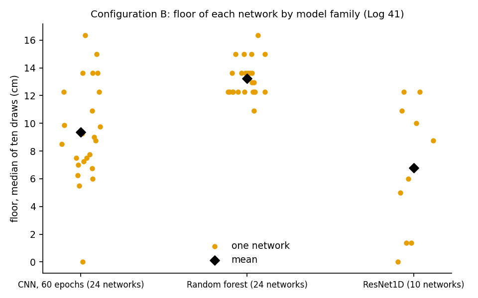

*Floors of each network by model family (configuration B): mean 9.35 cm for the CNN at 60 epochs, 13.24 cm for the random forest and 6.79 cm for the ResNet1D (10 networks).*

**Result interpretation**

**The floor varies mainly between networks and little between repeated permutation draws.** The between-seed share is 91.5% for the CNN, 87.0% for the random forest and 93.1% for ResNet1D. One network and one draw therefore give a noisy estimate, and the distribution over networks, not a single test, is the quantity to report. The grid contributes 0.3% or less for the CNN and ResNet1D and 2.6% for the random forest.

At these settings the random forest has the deepest and tightest floors (mean 13.24 cm, SD 1.29 cm), and the CNN at 60 epochs has a wide spread (SD 3.65 cm) with its P10 interval reaching down to 1.65 cm. The floor rule matters for the forest: on the new rule its median is 12.95 cm against 13.64 cm on the old rule. The ordering of the families differs from configuration A (there ResNet1D was deeper than the CNN); here the ResNet1D median (7.38 cm) is the shallowest of the three, and the CNN and ResNet1D medians on the same ten seeds are close (7.62 and 7.38 cm) with large spreads.

The classwise floor is shallower than the aggregate floor in every family: the weakest class falls below 0.45 recall before the accuracy becomes indistinguishable from chance, by about 4.7 cm for the CNN (9.35 against 4.63 cm) and 3.9 cm for the random forest. For ResNet1D it is 0.00 cm in 8 of 10 seeds, because one class is already below 0.45 at 0 cm.

The configuration B CNN floor at 60 epochs is not the configuration A floor. The mean is about 0.9 cm deeper in configuration B than in configuration A and the spread about twice as wide, and the gate is 6.08 cm in configuration B against 6.50 cm in configuration A, with a configuration B interval that contains 6.50 cm. The two sets of floors differ in the simulator, the grid, the number of controls, the floor rule and the networks retrained, so no difference is attributed to one of them.

**Consequences**

The configuration A numbers of Logs 20 to 27 are unchanged and remain the answer for the idealised simulator. For configuration B the floor distribution at 60 epochs is a baseline for Log 43, where the training budget is raised. The CNN at 60 epochs is under-fitted (eval-mode training loss 0.983 against 1.099 for chance; training-quality table in the evidence, and Log 43), which is the reason the budget is examined next.

**Limitations**

- ResNet1D has ten networks and the others twenty-four; intervals for ResNet1D are wide.
- The budgets are not matched across families, so the ordering of families is not a ranking of architectures.
- The classwise floor and the aggregate floor answer different questions and use different thresholds.
- The 0.00 cm floor of seed 104 stays in every number above.
- The controls are retrained for the same budget as the real network; floors are specific to that budget (Log 43).
- The raw archive of the permutation counts (about 13.5 MB for the CNN) and the checkpoints are not in the repository; the per-seed floors, the per-evaluation floors and the analysis script are.

**Evidence**

- `outputs/post_audit/family_floors/protocol_p3_v1.json`: the protocol (grid, number of controls, floor rules, networks and draws; the original ResNet1D setting of 199 controls)
- `outputs/post_audit/family_floors/cnn_floor_by_seed.csv`, `rf_floor_by_seed.csv`, `resnet_floor_by_seed.csv`: per-seed floors, new and old rule
- `outputs/post_audit/family_floors/cnn_evaluations.csv`, `rf_evaluations.csv`, `resnet_evaluations.csv`: floor, number of significant depths and p-value at depth 0 for every evaluation
- `outputs/post_audit/family_floors/cnn_variance_components_all.csv`, `rf_variance_components_all.csv`, `resnet_variance_components_all.csv`: variance components
- `outputs/post_audit/family_floors/cnn_classwise_by_seed.csv`, `rf_classwise_by_seed.csv`, `resnet_classwise_by_seed.csv`: classwise floors
- `outputs/post_audit/family_floors/cnn_analysis_summary.txt`, `rf_analysis_summary.txt`, `resnet_analysis_summary.txt`: the summary lines with the intervals
- `outputs/post_audit/family_floors/validate_archive_v2_cnn.txt`, `recompute_bh_exact_cnn.txt`, `validate_archive_v2_rf.txt`, `recompute_bh_exact_rf.txt`, `resnet_validate_archive.txt`, `resnet_recompute_bh_exact.txt`: archive checks and the independent BH recomputation
- `outputs/post_audit/family_floors/cnn_train_quality_vs_floors.csv`: training accuracy and loss of the CNN networks against their floors
- `outputs/post_audit/family_floors/p3_perm.py`, `p3_analyze.py`, `p3_grid.py`, `p3_common.py`: the permutation runner, the analysis and the grid

</details>

---

### Log 42: Calibration, the logit gap and attribution on the 24 networks of configuration B

<details>
<summary>Click to expand</summary>

**Approximate date of execution:** 8 October 2026

**Context**

Log 16 and Log 23 studied the calibration of the degradation-aware CNN on the idealised simulator, and Log 9 compared its Grad-CAM map with the physics. Log 40 trained 24 CNN networks of configuration B (60 epochs, seeds 101 to 124) and Log 41 gave each a floor. Two questions remained open for them: whether the confidence of the network signals when it fails, and whether the attribution maps of different networks agree on what they use, or only reflect the input.

Everything in this log is **configuration B at 60 epochs**, on the 24 saved networks of Log 41, with seed 104 included. The calibration and attribution values of Logs 9, 16 and 23 (configuration A) are not repeated here and are not mixed with these.

Written up afterwards from the saved files.

**Why this check matters**

A classifier that is wrong at depth is only safe to deploy if it can say so. If the confidence falls as the signal falls, but falls at depths where the accuracy is still high, confidence follows the signal amplitude and not the correctness. An attribution method is only informative about what a network learned if its maps differ from the maps of an untrained network of the same architecture; otherwise the agreement between networks can come from the input alone.

**Methodology**

The analyses used these settings:

| Setting | Value |
|---|---|
| Networks | The 24 saved CNN networks of Log 41, frozen, 60 full-batch training updates each |
| Cells | The cells of the permutation archive of Log 41: 300 windows per depth and seed |
| Calibration | Mean maximum softmax against accuracy, expected calibration error (ECE) with 15 bins, a binned gap without mass weighting; temperature fitted per seed on the 75 validation windows at 0 cm only |
| Failure signal | AUROC of the maximum softmax and of the logit gap (top-1 minus top-2 logit) for correct against incorrect windows |
| Attribution | Grad-CAM at the second convolution after the ReLU, upsampled to 100 samples; Integrated Gradients with an all-zero baseline, 32 steps, absolute value; each window normalised to unit sum, then averaged; Spearman correlation over the 100 time samples |
| Controls | The same networks untrained (the epoch-0 weights of the trainer), a second independent random initialisation, and the mean absolute input |
| Intervals | 95% percentile bootstrap over seeds, 10,000 resamples |
| Rule for attribution | A method counts as informative about learned features at a depth only if the lower bound of the trained-against-trained median Spearman correlation exceeds the upper bounds of the trained-against-untrained similarities and of both untrained pairwise medians |

The logit gap of each seed was also summarised with a half depth (first grid depth at or below half of the gap at 0 cm), a halving distance over 0 to 5.45 cm (from the slope of the logarithm of the gap) and a collapse depth (first grid depth at or below 1.25 times the plateau, the mean over 17.7 to 20 cm).

**Execution order**

1. The calibration and attribution analyses were run on the saved networks and cells.
2. The weights of the untrained control were checked against the trainer: identical to its epoch-0 weights in 24 of 24 seeds.
3. The logit-gap dynamics and a second random initialisation were added after the first results.
4. The attribution rule was applied to the results.

**Result**

Calibration, configuration B at 60 epochs, mean over 24 seeds [95% bootstrap interval over seeds]:

| Depth | Accuracy | Mean max softmax | ECE | ECE after temperature | Binned gap | Binned gap after temperature |
|---|---|---|---|---|---|---|
| 0 cm | 0.652 | 0.569 | 0.121 [0.103, 0.138] | 0.103 [0.089, 0.119] | 0.146 [0.128, 0.164] | 0.142 [0.121, 0.162] |
| 4 cm | 0.715 | 0.391 | 0.332 [0.313, 0.352] | 0.303 [0.283, 0.323] | 0.352 [0.321, 0.382] | 0.328 [0.299, 0.356] |
| 6.5 cm | 0.561 | 0.369 | 0.198 [0.162, 0.236] | 0.186 [0.151, 0.222] | 0.263 [0.228, 0.298] | 0.246 [0.204, 0.285] |
| 8 cm | 0.464 | 0.365 | 0.109 [0.080, 0.139] | 0.120 [0.094, 0.146] | 0.163 [0.120, 0.210] | 0.201 [0.158, 0.245] |
| 10 cm | 0.384 | 0.364 | 0.048 [0.033, 0.063] | 0.065 [0.049, 0.080] | 0.113 [0.078, 0.149] | 0.138 [0.104, 0.174] |
| Each seed's floor depth | 0.435 | 0.370 | 0.072 [0.052, 0.096] | 0.065 [0.046, 0.087] | 0.119 [0.082, 0.157] | 0.138 [0.104, 0.175] |

The fitted temperature has mean 0.66 (SD 0.27, range 0.31 to 1.43); it is below 1 in 22 of 24 seeds and above 1 in seeds 104 (1.43) and 124 (1.19).

Does the confidence signal failure? Mean over 24 seeds [interval]:

| Depth | AUROC, maximum softmax | AUROC, logit gap | Mean logit gap |
|---|---|---|---|
| 0 cm | 0.589 [0.558, 0.617] | 0.617 [0.589, 0.642] | 0.735 |
| 4 cm | 0.564 [0.525, 0.602] | 0.618 [0.587, 0.650] | 0.164 |
| 6.5 cm | 0.594 [0.557, 0.630] | 0.586 [0.555, 0.615] | 0.092 |
| 8 cm | 0.602 [0.572, 0.631] | 0.554 [0.526, 0.582] | 0.076 |
| 10 cm | 0.607 [0.579, 0.633] | 0.534 [0.501, 0.566] | 0.068 |
| Each seed's floor depth | 0.575 [0.545, 0.605] | 0.528 [0.491, 0.563] | not tabulated |

At each seed's floor depth the mean maximum softmax is 0.199 lower than at 0 cm (interval 0.171 to 0.225), the logit gap 0.641 lower (0.545 to 0.734) and the accuracy 0.218 lower (0.179 to 0.254); n = 23 non-zero differences (seed 104, floor 0.00 cm, contributes 0 by construction), Wilcoxon p below 0.0001 for the first two (rounded to zero in the file) and 3 × 10⁻⁵ for the accuracy.

Logit-gap dynamics of the 24 seeds (median gap, grid depths):

| Quantity | Mean | 95% interval |
|---|---|---|
| Gap at 0 cm | 0.638 | 0.568 to 0.713 |
| Plateau (17.7 to 20 cm) | 0.064 | 0.050 to 0.079 |
| Half depth (cm) | 1.803 | 1.621 to 1.997 |
| Halving distance over 0 to 5.45 cm (cm) | 1.876 | 1.723 to 2.040 |
| R² of the log-linear fit | 0.974 | 0.965 to 0.981 |
| Collapse depth (cm) | 6.56 | 5.589 to 7.598 |

Spearman correlation with the per-seed floor of Log 41 (n = 24; interval): half depth 0.215 (−0.240 to 0.661), halving distance −0.230 (−0.607 to 0.224), collapse depth **0.610** (0.241 to 0.846); without seed 104 (n = 23) the collapse depth gives 0.563 (0.170 to 0.821).

Attribution agreement between networks, group "all" classes, median pairwise Spearman correlation of trained networks [interval]; seeds with a correlation above 0.5 against the leave-one-out median, out of 24:

| Depth | Integrated Gradients | Seeds above 0.5 | Grad-CAM | Seeds above 0.5 |
|---|---|---|---|---|
| 0 cm | 0.924 [0.916, 0.936] | 24 | 0.806 [0.600, 0.878] | 23 |
| 4 cm | 0.823 [0.791, 0.848] | 24 | 0.190 [−0.037, 0.434] | 12 |
| 6.5 cm | 0.714 [0.648, 0.769] | 24 | 0.097 [−0.065, 0.209] | 6 |
| 8 cm | 0.648 [0.579, 0.721] | 24 | −0.015 [−0.088, 0.074] | 4 |
| 10 cm | 0.582 [0.485, 0.665] | 23 | −0.001 [−0.058, 0.080] | 0 |

Controls (median Spearman correlation, group "all"):

| Depth | IG: trained with the input envelope | IG: trained with its untrained twin | IG: untrained with untrained | Grad-CAM: trained with its untrained twin | Grad-CAM: untrained with untrained |
|---|---|---|---|---|---|
| 0 cm | 0.956 | 0.886 | 0.847 | 0.570 | 0.370 |
| 4 cm | 0.891 | 0.649 | 0.531 | 0.278 | 0.126 |
| 6.5 cm | 0.755 | 0.391 | 0.260 | 0.142 | 0.055 |
| 8 cm | 0.678 | 0.283 | 0.144 | 0.084 | 0.025 |
| 10 cm | 0.503 | 0.147 | 0.077 | 0.068 | −0.019 |

The attribution rule above is met by Integrated Gradients at all five depths and by Grad-CAM at none; the Grad-CAM map of the untrained twin is undefined in 5 to 7 of the 24 seeds per depth (the comparison with it has 17 to 19 seeds).

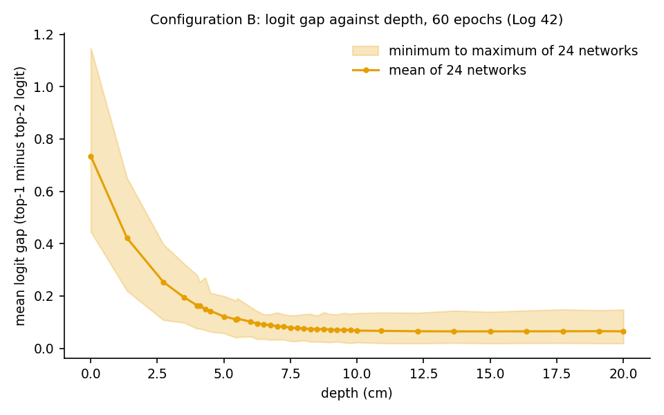

*Mean logit gap of the 24 networks against depth (configuration B, 60 epochs): 0.735 at 0 cm and 0.068 at 10 cm.*

**Result interpretation**

**Confidence falls with depth but is a weak signal of failure at every depth.** The AUROC for correct against incorrect windows is between 0.53 and 0.62 at all depths, including 0 cm. At 4 cm the accuracy (0.715) is higher than at 0 cm (0.652) while the mean maximum softmax is lower (0.391 against 0.569), so confidence follows the amplitude of the signal and not the correctness. Temperature scaling lowers ECE at 0, 4 and 6.5 cm by small amounts, raises it at 8 and 10 cm, and at the floor depth lowers ECE while raising the binned gap; the intervals overlap at most depths; no calibration gain is claimed, because the temperature was fitted on 75 windows at 0 cm and both measures are inflated by sparse bins.

The logit gap decays close to exponentially (R² 0.974) with a halving distance of 1.88 cm and reaches a plateau of 0.064. The collapse depth, 6.56 cm on average, tracks the floor of the same network moderately (Spearman 0.61, interval 0.24 to 0.85); the half depth and the halving distance do not (intervals contain zero).

The agreement of Integrated Gradients is largely an input property at shallow depth. An untrained twin gives a profile nearly as similar to the trained one (0.886 at 0 cm) as another trained network does (0.924), and the trained map correlates 0.956 with the input envelope at 0 cm. Beyond 6.5 cm the agreement between trained networks (0.582 to 0.714) exceeds the agreement between untrained ones (0.077 to 0.260) and is close to the correlation with the envelope (0.503 to 0.755), so only a modest part of it is clearly beyond the input. Grad-CAM agrees across trained networks at 0 cm only, and by the rule it is not distinguishable from an untrained network at any depth. Nothing here shows what the networks learned.

**Consequences**

The calibration and attribution statements of configuration A (Logs 9, 16, 23) are unchanged. For configuration B the confidence of the 60-epoch networks is a weak failure signal and is not shown to be usable as a depth gate; the floors of Log 41 and Log 43 remain the quantity to report.

**Limitations**

- These are 60-epoch networks, which are under-fitted (Log 41); the 200-epoch networks of Log 43 were not analysed for calibration or attribution.
- The temperature is fitted at 0 cm only, on 75 windows.
- ECE and the binned gap are inflated by sparse bins; AUROC and ECE measure different things.
- The untrained twin assumes the epoch-0 weights of the trainer, which the check supports (24 of 24); the second initialisation is independent (0 of 24 identical).
- Spearman correlations over 100 time samples, one normalisation per window, a zero baseline for Integrated Gradients; other baselines were not tried.
- Seed 104 (floor 0.00 cm) is included in every number.

**Evidence**

- `outputs/post_audit/calibration_attribution/calib_summary_by_depth.csv`, `calib_temperature.csv`, `calib_floor_vs_zero.csv`, `calib_by_seed_depth.csv`: calibration, temperature, the floor against 0 cm and the per-seed logit gap
- `outputs/post_audit/calibration_attribution/gap_dynamics_summary.csv`, `gap_dynamics_by_seed.csv`: logit-gap dynamics
- `outputs/post_audit/calibration_attribution/attr_agreement.csv`, `attr_controls.csv`, `attr_randinit_summary.csv`, `init_check_output.txt`: attribution agreement, controls and the initialisation check
- `outputs/post_audit/calibration_attribution/p4v2_calib.py`, `p4v2_attr.py`, `p4v2_agree.py`, `p4v3_gap_dynamics.py`, `p4v3_randinit.py`: the analysis code
- `outputs/post_audit/family_floors/cnn_floor_by_seed.csv`: the floors of Log 41 used in the rank correlations

</details>

---

### Log 43: The training budget moves the floor: 200 epochs on 24 networks of configuration B

<details>
<summary>Click to expand</summary>

**Approximate date of execution:** 10 October 2026

**Context**

Log 41 measured the permutation floors of configuration B with the CNN trained for 60 full-batch epochs, and found the network under-fitted (eval-mode training loss 0.983 against 1.099 for chance). A floor is the depth at which a trained network stops being distinguishable from a shuffled-label control trained for the same budget, so a floor measured on an under-fitted network says as much about the training as about the signal. This log asks how the floor of configuration B changes with the training budget, and whether the sensitivity to timing error seen at 60 epochs holds at the larger budget.

Unless a row says otherwise, every number is **configuration B** (rebuilt simulator: continuous stiffness inside the stage ranges, uniform timing error of half-width 1.0 ms, 1/f noise, random gain, viscosity from the stage label; 36 depths to 20 cm; 719 controls; BH at 0.05; floor = last depth before two consecutive non-significant depths). The budgets are stated in each table. The headline of configuration B is the 200-epoch CNN on 24 seeds. The configuration A floors (Logs 20 to 25) are shown only where marked.

Written up afterwards from the saved files.

**Why this check matters**

If the floor moves by several centimetres when only the number of training epochs changes, the floor is a property of the training recipe as well as of the sensor, and the budget at which it is quoted must be stated and justified. A single permutation draw per network adds noise to the lower tail of the floor distribution, which is the part used as a depth gate, so the number of draws matters as well.

**Methodology**

Five analyses were run in this order:

| Analysis | Networks | Budgets | Draws per network |
|---|---|---|---|
| Accuracy pilot, no permutation test | 24 | 60, 200 and 600 epochs | none |
| Floors on eight seeds (101 to 108) | 8 | 200 and 600 epochs against the 60-epoch floors of Log 41 | 1 |
| Floors on 24 seeds | 24 | 200 epochs | 1 |
| Floors on 24 seeds | 24 | 200 epochs | 3 (the per-seed floor is the median of three) |
| Timing error of half-width 2.0 ms against 1.0 ms | 8 | 200 epochs | 1 |

All floors use 719 controls per test, each trained for the budget of the network under test. The 60-epoch floor of a seed is the median over ten draws (Log 41). The test of the budget effect on each set of seeds is the exact two-sided binomial sign test on the per-seed differences, with zero differences dropped. The 95% interval of the P10 is a percentile bootstrap over seeds (10,000 resamples). Accuracy against the shuffled-label null is shown with the null band taken per seed (2.5th and 97.5th percentile of the control accuracies of each seed, then the median across seeds) and then the median across seeds; this band is marginal and is not the BH-corrected rule that sets the floor.

The headline budget of 200 epochs is the one with the highest mean validation accuracy of the three tried (0.643 at 200, 0.615 at 600 and 0.553 at 60 epochs); only three budgets were tried, so it is the best of three and not a located optimum, and the floors at 200 and 600 epochs on eight seeds had already been seen when it was chosen. Three draws per seed were used so that the lower tail of the 24 floors rests on a median of three draws instead of a single draw.

**Execution order**

1. Accuracy of the same 24 seeds was measured at 60, 200 and 600 epochs.
2. Permutation floors were computed for seeds 101 to 108 at 200 and 600 epochs.
3. The 200-epoch floors were extended to 24 seeds with one draw, then to three draws per seed.
4. The timing-error check was run at 200 epochs for eight seeds.
5. The saved permutation counts of the 200-epoch runs were collected into a bundle that recomputes the headline from files and checks each file against a hash list.

**Result**

Accuracy pilot, configuration B, 24 seeds, mean over seeds (no permutation test):

| Budget | Eval-mode training loss | Train | Validation | 0 cm | 4 cm | 6.5 cm | 8 cm | 10 cm | Mean minimum-class recall at 8 cm |
|---|---|---|---|---|---|---|---|---|---|
| 60 epochs | 0.983 | 0.560 | 0.553 | 0.652 | 0.715 | 0.561 | 0.464 | 0.384 | 0.130 |
| 200 epochs | 0.714 | 0.695 | 0.643 | 0.668 | 0.695 | 0.747 | **0.700** | 0.574 | 0.630 |
| 600 epochs | 0.306 | 0.893 | 0.615 | 0.645 | 0.654 | 0.678 | 0.644 | 0.566 | 0.567 |

The accuracy at 8 cm is higher at 200 than at 60 epochs by 0.236 on average, in all 24 seeds.

Floors of eight seeds, configuration B, new rule (60 epochs: median of ten draws; 200 and 600 epochs: one draw; "c" = censored at 20 cm):

| Seed | 60 epochs | 200 epochs | 600 epochs |
|---|---|---|---|
| 101 | 13.64 | 13.64 | 13.64 |
| 102 | 7.75 | 12.27 | 13.64 |
| 103 | 16.36 | 16.36 | 16.36 |
| 104 | 0.00 | 13.64 | 15.00 |
| 105 | 6.25 | 13.64 | 15.00 |
| 106 | 7.50 | 15.00 | 20.00c |
| 107 | 7.00 | 13.64 | 17.73 |
| 108 | 15.00 | 15.00 | 13.64 |
| Mean (SD) | 9.19 (5.45) | **14.15** (1.25) | ≥ 15.63 (2.29) |
| Median | 7.63 | 13.64 | 15.00 |

Sign test of the difference to the 60-epoch floor: 200 epochs, 5 of 5 non-zero differences positive, p = 0.0625; 600 epochs, 5 positive and 1 negative of 6 non-zero, p = 0.219 (the smallest attainable p for eight seeds is 0.0078).

Floors of 24 seeds, configuration B, new rule:

| Budget and draws | Mean | SD | Median | Min | Max | P10 [95% interval] |
|---|---|---|---|---|---|---|
| 60 epochs, median of 10 draws | 9.35 | 3.65 | 8.88 | 0.00 | 16.36 | 6.08 [1.65, 7.33] |
| 200 epochs, 1 draw | 14.09 | 1.37 | 13.64 | 12.27 | 17.73 | 12.27 |
| **200 epochs, median of 3 draws** | **13.86** | 1.11 | 13.64 | 12.27 | 16.36 | **12.27** [12.27, 13.64] |

For the 200-epoch median of three draws: 20 seeds are deeper than at 60 epochs, 4 are equal and none is shallower (sign test, n = 20, p = 1.9 × 10⁻⁶). The per-seed floors fall on four grid values: 12.27 cm (5 seeds), 13.64 cm (11), 15.00 cm (7) and 16.36 cm (1). In 21 of the 24 seeds the three draws give the same floor; the floors of seeds 106 and 111 change between the first draw and the median of three (15.00 to 13.64 and 17.73 to 13.64). The variance split on single draws puts 81.7% of the total variance between seeds (between-seed SD 1.13 cm, between-draw SD 0.53 cm). The P10 of 12.27 cm equals the minimum floor and is a grid coincidence.

Classwise floor at 200 epochs (one draw, lowest class recall below 0.45 at that depth and the next), 24 seeds: mean 9.33, SD 2.48, median 9.75, range 0.00 to 10.91, P10 9.08; one seed at 0.00 cm, none censored. The overall floor of the same draw has mean 14.09.

Accuracy against the shuffled-label null, configuration B, median across 24 seeds; the second figure is the upper end of the null band (median across seeds of the per-seed 97.5th percentile):

| Depth | Accuracy, 60 epochs | Upper null, 60 epochs | Accuracy, 200 epochs | Upper null, 200 epochs |
|---|---|---|---|---|
| 0 cm | 0.668 | 0.537 | 0.670 | 0.510 |
| 4 cm | 0.720 | 0.543 | 0.692 | 0.482 |
| 6.5 cm | 0.542 | 0.473 | 0.757 | 0.460 |
| 8 cm | 0.445 | 0.441 | 0.708 | 0.439 |
| 10 cm | 0.367 | 0.393 | 0.580 | 0.403 |
| 12.27 cm | 0.342 | 0.370 | 0.428 | 0.387 |
| 13.64 cm | 0.335 | 0.367 | 0.390 | 0.387 |
| 15.0 cm | 0.337 | 0.363 | 0.357 | 0.383 |

Timing error at 200 epochs, configuration B, eight seeds (uniform error of half-width J, SD J/√3: 0.577 ms at 1.0 ms and 1.155 ms at 2.0 ms), floors in cm:

| Seed | J = 1.0 ms | J = 2.0 ms | Difference |
|---|---|---|---|
| 101 | 13.64 | 10.91 | −2.73 |
| 102 | 12.27 | 10.91 | −1.36 |
| 103 | 16.36 | 12.27 | −4.09 |
| 104 | 13.64 | 10.91 | −2.73 |
| 105 | 13.64 | 13.64 | 0.00 |
| 106 | 15.00 | 12.27 | −2.73 |
| 107 | 13.64 | 13.64 | 0.00 |
| 108 | 15.00 | 13.64 | −1.36 |
| Mean (SD) | 14.15 (1.25) | **12.27** (1.26) | −1.88 |

Six seeds are shallower, two are equal and none is deeper (sign test, n = 6, p = 0.031); no seed has a floor of 0.00 cm at J = 2.0 ms.

The headline quantities of the two configurations, side by side (not comparable without the differences of Log 41):

| Quantity | Configuration A, 60 epochs (Logs 20 and 25) | Configuration B, 200 epochs, 3 draws (this log) |
|---|---|---|
| Mean floor over 24 seeds | 8.48 cm (SD 1.81) | 13.86 cm (SD 1.11) |
| Depth gate, P10 of the 24 floors | 6.50 cm | 12.27 cm (equals the minimum floor) |

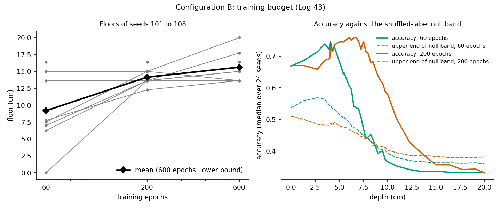

*Left: floors of eight seeds at 60, 200 and 600 epochs (mean 9.19, 14.15 and at least 15.63 cm). Right: median accuracy against the upper end of the shuffled-label null band at 60 and 200 epochs (configuration B).*

**Result interpretation**

**The floor of configuration B moves by about 4.5 cm when the training budget goes from 60 to 200 epochs** (mean 9.35 to 13.86 cm over 24 seeds, no seed shallower), and the accuracy at 8 cm rises from 0.464 to 0.700 at the same time. The shuffled-label controls are trained for the same number of epochs, so the null moves as well; the null band shows it moving little (upper end 0.441 and 0.439 at 8 cm), and the median accuracy stays above the band up to 13.64 cm at 200 epochs, whereas at 60 epochs it is inside the band from 8.75 cm on (and only 0.004 above it at 8 cm). The floor at 60 epochs therefore describes an under-trained network.

The depth gate of configuration B moves from 6.08 cm at 60 epochs to 12.27 cm at 200 epochs, which is a change of the number, not a refinement. Both values are configuration B, and the gate at 200 epochs sits on a single grid value shared by the five shallowest seeds. At 600 epochs the eight-seed floors are not deeper than at 200 in a way the test can resolve (600 against 200 epochs: 5 deeper and 1 shallower of 6 non-zero differences, p = 0.219), while the validation accuracy falls from 0.643 to 0.615 as the training accuracy rises from 0.695 to 0.893, which is consistent with the choice of 200 epochs but does not establish a best budget.

The classwise floor (9.33 cm) is about 4.8 cm shallower than the overall floor of the same draw (14.09 cm): the weakest class falls below 0.45 recall well before the pooled accuracy reaches the null.

A timing error of 2.0 ms does not make the floor fail at 200 epochs in configuration B; it makes it shallower by 1.9 cm on average. The configuration A sweep of Log 38 (Gaussian error with SD 1 sample, 2 ms; 60 epochs; proxy floors) gave a mean floor of 0.17 cm with 7 of 8 seeds at 0.00 cm. The two settings differ in the error distribution (Gaussian against uniform, SD 2 ms against 1.155 ms), in the simulator and in the budget, and the present data cannot say which of these accounts for the difference.

**Consequences**

For configuration B the floor is quoted with its training budget: 9.35 cm (SD 3.65) at 60 epochs and 13.86 cm (SD 1.11) at 200 epochs, with a lower-tail gate of 6.08 cm and 12.27 cm. The configuration A values of Logs 20 to 38 are unchanged and stay labelled configuration A. No saved run varies the carrier frequency or the cirrhosis viscosity in configuration B; the configuration A runs are those of Logs 22 and 38 and the viscosity sweep of Log 39 (configuration A, 60 epochs).

**Limitations**

- Eight seeds for the 600-epoch floors and the timing-error check, with a smallest attainable sign-test p of 0.0078; the 200-epoch sign test over eight seeds (p = 0.0625) does not reach 0.05.
- The 600-epoch mean is a lower bound (one seed censored at 20 cm).
- Only three budgets were tried, 200 epochs was chosen after the eight-seed floors had been seen, and the choice is not a located optimum.
- The 200-epoch 24-seed value rests on three draws per seed and the P10 equals the minimum floor, so its interval ends at a single grid value; the grid has 0.25 cm steps between 6 and 10 cm and 1.36 cm steps above 10.91 cm.
- The null band is marginal and is not the BH-corrected rule.
- Configuration B parameters (stage ranges, timing-error distribution, noise slope, gain range) are assumptions without a source in the repository.
- The 200-epoch networks were not analysed for calibration or attribution (Log 42 uses the 60-epoch networks).
- The raw permutation-count files of the 60-epoch runs and the 600-epoch runs are not in the repository; the bundle holds the 200-epoch counts only.

**Evidence**

- `outputs/post_audit/training_budget/derived/budget_pilot_summary.txt`: accuracy, loss and recall at 60, 200 and 600 epochs on 24 seeds
- `outputs/post_audit/training_budget/derived/floor_by_budget_8_seeds.csv`: floors of eight seeds at 60, 200 and 600 epochs
- `outputs/post_audit/training_budget/derived/floor_200_three_draws_vs_60.csv`, `k3_200_epoch_results.md`: the three draws, the per-seed floors and the 24-seed summary at 200 epochs
- `outputs/post_audit/training_budget/derived/classwise_vs_overall_floor_200.csv`: classwise and overall floors at 200 epochs
- `outputs/post_audit/training_budget/derived/accuracy_null_band.csv`: accuracy and null band by depth
- `outputs/post_audit/training_budget/derived/jitter_pairs_200_epochs.csv`, `jitter_2ms_results.md`: timing error at 200 epochs
- `outputs/post_audit/training_budget/README.md`, `verify.py`, `expected_results.txt`, `SHA256SUMS`, `SCRUB_MAP.tsv`: the bundle that recomputes the 200-epoch headline and the timing-error result from the saved permutation counts and checks them
- `outputs/post_audit/training_budget/outputs/phase3/raw_stage2/e200/`, `outputs/post_audit/training_budget/outputs/phase3/raw_stage2c/e200/`, `outputs/post_audit/training_budget/outputs/phase3/raw_stage2d/j2p0_e200/`: the saved permutation counts
- `outputs/post_audit/training_budget/outputs/phase3/code/stage2_floors_common.py`, `stage2c_analyze.py`, `stage2d_analyze.py`, `p3_grid.py`: the floor rule and the analysis
- `outputs/post_audit/family_floors/cnn_floor_by_seed.csv`: the 60-epoch floors used as the comparison

</details>

</details>

<a id="conclusion"></a>
<a id="conclusion-and-status"></a>

## Conclusion and status

This record establishes two depth-reliability results, kept apart because they come from different simulators. In configuration A, the earlier idealised simulator, the floor is 8.48 cm ± 1.81 cm over 24 seeds, with a depth gate of 6.50 cm (see Logs 20 and 25). In configuration B, the rebuilt simulator, the 200-epoch CNN on 24 networks gives a mean floor of 13.86 cm (SD 1.11 cm) and a gate of 12.27 cm; at 60 epochs the same simulator gives 9.35 cm (SD 3.65 cm) and 6.08 cm (see Logs 41 and 43). In configuration B the floor moves by about 4.5 cm with the training budget (Log 43). Shuffled-label controls, grouped splits, a 19-condition battery and sweeps of viscosity and sensor noise were applied, and the bugs and retired claims they exposed remain documented in the repository logs.

It does not establish that a device works. All evidence is simulated except the ETS Montreal phantom check, whose controls show that its accuracy mostly reflects the axial depth band (Log 36). The parameters of configuration B are assumptions without a source in the repository (Log 43), and the noise spectrum, timing error, gain variation and tissue viscosity are assumed or borrowed values (Log 40). The remaining gaps are listed under Open items and limitations.

This is where simulation reaches its limit. Further sweeps, more seeds or more training budgets could refine these floors, but each would rest on the same assumed physics, so the result would be a more precise number for the same simulated model, not a test of it. Closing that loop requires measurement: characterising the noise, timing and gain of a real sensor, measuring attenuation in tissue-mimicking phantoms of known stiffness and depth, and controlling for depth when comparing classes.

Hardware validation is therefore the natural next step. It would replace simulation parameters with real-world data ( currently unapplicable due to lack of case specific dataset ) and show whether the floors and gates reported here hold in a real signal chain; until then they remain properties of the simulated configurations A and B.
